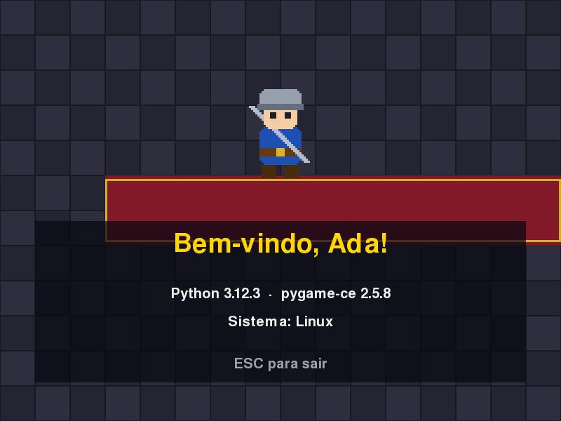

# MÓDULO 00A: Primeira janela — o herói ganha vida na sua tela

Engenheiro, hoje você monta a bancada de trabalho de um desenvolvedor Python e termina a sessão com o herói do seu jogo numa janela, com o seu nome. O conceito do dia é o primeiro que todo profissional configura num projeto novo: **ambiente virtual e dependências**.

## 🎯 O que você vai ver na tela ao final

Uma janela de 800×600 com o herói "respirando" no salão do castelo e a mensagem "Bem-vindo, <seu nome>!".



## 🏢 Onde isso aparece no mercado

Todo projeto Python profissional (APIs, ciência de dados, automação, jogos) começa com um ambiente isolado e um `requirements.txt`. É o que permite que outra pessoa, ou um servidor, instale exatamente as mesmas versões e rode o mesmo código sem o famoso "na minha máquina funciona".

## 🚦 Ponto de partida

- Computador com Windows 10/11 ou Linux, e acesso de administrador para instalar programas.
- Uma pasta `curso-arquivos/` na sua pasta pessoal (`C:\Users\<você>\curso-arquivos` no Windows, `~/curso-arquivos` no Linux), **fora** do projeto: é onde você guarda, módulo a módulo, os arquivos prontos de cada módulo (a pasta `arquivos/MNN/` do repositório do curso). Ficando fora do projeto, eles nunca vão parar no Git por engano.
- Arquivos prontos deste módulo: `curso-arquivos/M00A/` (`requirements.txt`, `ferramentas/gerar_assets.py` e `.vscode/settings.json`).
- Comando para conferir: este é o primeiro módulo, então ainda não há projeto; o ponto de partida é o computador com acesso de administrador.
- Nada de conta online hoje: chave de IA e GitHub ficam para o M00B.
- Duas sessões: **Sessão A**, Passos 1 a 5a (a bancada montada e a primeira janela); **Sessão B**, Passos 5b a 6, o Quebre de propósito e o desafio (o salão, o herói e o seu nome).

## ❓ Pergunta do dia

Por que o mesmo `main.py` abre num terminal e dá erro em outro, no mesmo computador? No fim do módulo você vai provocar esse erro de propósito e saber explicar.

Ao longo dos passos aparecem caixas **🔍 Pare e pesquise**: pesquise as duas perguntas na hora, anote as respostas e, no fim, explique ao Engenheiro Sênior em até 5 minutos. **Sem mentor?** Grave um áudio de até 5 minutos explicando os termos e ouça de volta: onde você hesitar, o termo ainda não está claro.

## 🛠️ Passo a passo

### Passo 1: instalar Python 3.12 e o VS Code

Você vai usar o terminal o tempo todo. Para abrir: no Windows, aperte a tecla Windows, digite `PowerShell` e Enter; no Linux, `Ctrl+Alt+T`. Ele abre na sua pasta de usuário, e é lá que o projeto será criado.

**Windows:** baixe o instalador "Windows installer (64-bit)" do Python 3.12 em https://www.python.org/downloads/release/python-31210/. Na primeira tela do instalador, marque a opção "Add python.exe to PATH" (importante) antes de clicar em "Install Now". Se você já tem o Python 3.13 instalado, pode usá-lo: nos comandos abaixo, troque `3.12` por `3.13`.

**Linux (Ubuntu 24.04):** o Python 3.12 já vem instalado; falta só o módulo de ambientes virtuais:

```bash
sudo apt install python3.12-venv
```

Instale o VS Code (https://code.visualstudio.com) e, dentro dele, a extensão "Python" (da Microsoft).

Confira no terminal:

```powershell
# PowerShell (Windows)
py -3.12 --version
```

```bash
# bash (Linux)
python3.12 --version
```

Você deve ver `Python 3.12.x`.

> 🔍 **Pare e pesquise: PATH** — Quando você digita `python` no terminal, como o sistema descobre qual programa executar? Por que o mesmo comando pode chamar Pythons diferentes antes e depois de ativar a venv (o próximo passo)?

### Passo 2: criar a pasta do projeto e o ambiente virtual

```powershell
# PowerShell (Windows)
mkdir rpg-engine
cd rpg-engine
py -3.12 -m venv .venv
.venv\Scripts\activate
```

```bash
# bash (Linux)
mkdir rpg-engine
cd rpg-engine
python3.12 -m venv .venv
source .venv/bin/activate
```

No Windows, se o PowerShell recusar o `activate` com a mensagem "a execução de scripts foi desabilitada neste sistema", rode uma vez `Set-ExecutionPolicy -Scope CurrentUser RemoteSigned`, confirme com `S` (ou `Y`) e repita o `.venv\Scripts\activate`.

O começo da linha do terminal passa a mostrar `(.venv)`: a partir de agora, `python` e `pip` são os da pasta `.venv`, e não os do sistema. Abra a pasta no VS Code (`code .`, ou pelo menu File > Open Folder) e, se ele perguntar, escolha o interpretador da `.venv`. Daqui em diante, use o terminal do próprio VS Code (menu Terminal > New Terminal): ele já abre na pasta do projeto. Confira o `(.venv)` no começo da linha; se não aparecer, ative a venv como acima.

> 🔍 **Pare e pesquise: ambiente virtual (venv) e dependências** — O que acontece se dois projetos no mesmo computador precisarem de versões diferentes da mesma biblioteca? Para que serve o arquivo `requirements.txt` quando outra pessoa baixa o seu projeto?

### Passo 3: instalar as dependências

Copie para dentro de `rpg-engine` o conteúdo da pasta `curso-arquivos/M00A/` (pelo explorador de arquivos, que no Linux só mostra a pasta `.vscode` com `Ctrl+H`, ou com `Copy-Item -Recurse $HOME\curso-arquivos\M00A\* .` no PowerShell e `cp -r ~/curso-arquivos/M00A/. .` no bash). A estrutura fica assim:

```
rpg-engine/
  .venv/
  .vscode/
    settings.json
  ferramentas/
    gerar_assets.py
  requirements.txt
```

O `.vscode/settings.json` vale só para esta pasta: ele desliga as sugestões automáticas de IA do VS Code (o texto cinza que completa o código sozinho). Neste curso você treina a mão e a cabeça; a IA entra mais tarde, como ferramenta que você revisa. O chat continua disponível para pedir explicação.

O `requirements.txt` diz o que o projeto precisa, com a faixa de versões aceitas:

```text
# Dependências do jogo (Python 3.12).
# pygame-ce: fork mantido do pygame; o import continua "import pygame".
pygame-ce>=2.5.8,<2.6
```

Com a venv ativa (o `(.venv)` aparecendo), instale as dependências (o comando é o mesmo no PowerShell e no bash):

```bash
pip install -r requirements.txt
```

### Passo 4: gerar a arte e ver o herói

O gerador desenha os sprites e os cenários por código e grava arquivos `.png` de verdade:

```bash
python ferramentas/gerar_assets.py
```

Deve aparecer `[SUCESSO]` e a lista dos arquivos criados. Abra a pasta `assets/` no VS Code ou no explorador de arquivos e dê dois cliques em `player.png` e `bg_castelo.png`: é o seu herói e o salão onde ele começa. Este é o primeiro resultado visual do curso; a janela do jogo vem no próximo passo. Quer trocar a arte mais tarde? Basta substituir o arquivo, mantendo o mesmo nome.

### Passo 5a (Leia): a janela abre

Crie o arquivo `main.py` na raiz de `rpg-engine` e digite o código abaixo. Digite, não cole: é assim que a sintaxe entra na mão. São umas 50 linhas, um terço delas comentários e linhas em branco que explicam e organizam cada parte.

```python
"""
RPG Engine — Módulo 00: Primeira janela.

Abre a primeira janela do jogo: o herói no salão do castelo e o nome do
engenheiro que montou a bancada.
"""
import math
import platform
import sys
from pathlib import Path

import pygame

# Caminhos sempre a partir deste arquivo: o jogo roda de qualquer pasta.
PASTA_PROJETO = Path(__file__).resolve().parent
PASTA_ASSETS = PASTA_PROJETO / "assets"

NOME = "Ada"  # troque pelo seu nome (curto: nomes longos não cabem)

LARGURA, ALTURA = 800, 600
FPS = 60
COR_TEXTO = (240, 240, 240)
COR_DESTAQUE = (255, 215, 0)


def main():
    pygame.init()
    tela = pygame.display.set_mode((LARGURA, ALTURA))
    pygame.display.set_caption("RPG Engine — Módulo 00")
    relogio = pygame.time.Clock()

    tempo = 0.0
    rodando = True
    # Game loop: a cada volta, ler eventos, atualizar e desenhar (60 vezes por segundo).
    while rodando:
        # tick() segura o ritmo em 60 FPS e devolve os milissegundos desde o último quadro.
        tempo += relogio.tick(FPS) / 1000

        for evento in pygame.event.get():
            if evento.type == pygame.QUIT:
                rodando = False
            elif evento.type == pygame.KEYDOWN and evento.key == pygame.K_ESCAPE:
                rodando = False

        tela.fill((24, 20, 32))  # cor de fundo provisória
        pygame.display.flip()

    pygame.quit()


if __name__ == "__main__":
    main()
```

Salve (`Ctrl+S`) e rode:

```bash
python main.py
```

Você deve ver uma janela de 800×600, toda num tom escuro de roxo. ESC fecha. Se aparecer um erro, ele aponta a linha: compare com o código acima (aspas, dois-pontos, parênteses e recuo de 4 espaços) antes de seguir. O VS Code mostra alguns nomes apagados (como os `import` de `math`, `platform` e `sys`): eles só passam a ser usados nos próximos passos, e não é erro.

Repare no `while rodando:`: esse é o **game loop**, e ele dá 60 voltas por segundo. Em cada volta, o jogo lê os eventos (teclas, fechar a janela) e desenha tudo de novo. Por enquanto ele desenha sempre a mesma coisa; no 5c, algo passa a mudar a cada volta.

Perguntas de leitura (responda olhando o código):

- Que linha faz o jogo terminar quando você fecha a janela pelo X, e qual faz terminar com o ESC?
- O `(24, 20, 32)` é uma cor em vermelho, verde e azul, de 0 a 255. Ela é clara ou escura?

> 🔍 **Pare e pesquise: game loop** — Quais são as três coisas que um jogo faz em cada quadro? O que significa um jogo rodar a "60 FPS"?

> ⏸️ **Fim da Sessão A.** Bancada montada e a primeira janela rodando. Se a sessão já passou de uma hora, pare aqui e continue no Passo 5b. (O commit começa no M00B, quando o Git chega; até lá, o seu `main.py` fica salvo na pasta do projeto.)

### Passo 5b (Leia): o salão

Três acréscimos trazem a arte gerada no Passo 4 para a janela.

Logo depois da linha `COR_DESTAQUE = ...`, acrescente a função que carrega uma imagem da pasta `assets/` (deixe duas linhas em branco antes do `def`, como antes do `def main()`):

```python
def carregar_imagem(nome_arquivo):
    """Carrega um .png da pasta assets/ ou explica como gerá-lo."""
    caminho = PASTA_ASSETS / nome_arquivo
    if not caminho.exists():
        print(f"[ERRO] Arquivo não encontrado: {caminho}")
        print("Gere os assets com: python ferramentas/gerar_assets.py")
        sys.exit(1)
    return pygame.image.load(caminho).convert_alpha()
```

No `main()`, logo depois da linha `relogio = pygame.time.Clock()`, carregue o fundo:

```python
    fundo = carregar_imagem("bg_castelo.png")
```

E, dentro do `while`, troque a linha `tela.fill((24, 20, 32))` por:

```python
        tela.blit(fundo, (0, 0))
```

Rode `python main.py`: a janela mostra o salão do castelo, com o piso quadriculado e o tapete vermelho.

Perguntas de leitura:

- O que o `carregar_imagem` faz se o arquivo não existir, e por que isso é melhor do que deixar o pygame quebrar sozinho?
- Por que o `tela.blit(fundo, (0, 0))` precisa vir antes de qualquer outro desenho?

### Passo 5c (Preveja): o herói e o seu nome

Quatro acréscimos no `main.py`, digitados também.

Logo depois da função `carregar_imagem`, acrescente a função que escreve um texto centralizado:

```python
def escrever(tela, fonte, texto, cor, centro_y):
    """Desenha um texto centralizado na horizontal."""
    imagem = fonte.render(texto, True, cor)
    tela.blit(imagem, imagem.get_rect(center=(LARGURA // 2, centro_y)))
```

No `main()`, logo depois da linha `relogio = pygame.time.Clock()`, crie as fontes:

```python
    # Font(None, tamanho) usa a fonte embutida no pygame-ce: funciona em
    # Windows, Linux e no navegador sem depender de fontes instaladas.
    fonte_titulo = pygame.font.Font(None, 56)
    fonte = pygame.font.Font(None, 30)
```

Logo depois da linha `fundo = carregar_imagem(...)`, carregue o herói (ampliado 3×) e crie o painel translúcido onde os textos ficam:

```python
    heroi = pygame.transform.scale_by(carregar_imagem("player.png"), 3)
    painel = pygame.Surface((700, 230), pygame.SRCALPHA)
    painel.fill((10, 10, 20, 190))  # preto translúcido (o 4º número é o alpha)
```

Por fim, dentro do `while`, troque a linha `tela.blit(fundo, (0, 0))` por este bloco, que desenha tudo, do fundo para a frente:

```python
        # O herói "respira": sobe e desce seguindo uma onda (seno).
        respiracao = math.sin(tempo * 3) * 6

        tela.blit(fundo, (0, 0))
        tela.blit(heroi, heroi.get_rect(center=(LARGURA // 2, 190 + respiracao)))
        tela.blit(painel, painel.get_rect(center=(LARGURA // 2, 430)))
        escrever(tela, fonte_titulo, f"Bem-vindo, {NOME}!", COR_DESTAQUE, 350)
        escrever(tela, fonte, f"Python {platform.python_version()}  ·  "
                              f"pygame-ce {pygame.version.ver}", COR_TEXTO, 420)
        escrever(tela, fonte, f"Sistema: {platform.system()}", COR_TEXTO, 460)
        escrever(tela, fonte, "ESC para sair", (160, 160, 170), 520)
```

Rode `python main.py`. Você deve ver o herói subindo e descendo devagar e "Bem-vindo, Ada!". O `math.sin` devolve uma onda entre -1 e 1; multiplicada por 6, vira um sobe-e-desce de 6 pixels.

**Preveja:** e se o `* 6` virar `* 60`? E se o `3` de `tempo * 3` virar `10`? Pense nas duas, depois **modifique** uma de cada vez, rode e confira. Volte para `3` e `6`.

### Passo 6 (Modifique): o jogo com o seu nome

Troque o valor da constante `NOME` pelo seu nome ou apelido (curto) e salve:

```python
NOME = "SeuNome"  # troque pelo seu nome (curto: nomes longos não cabem)
```

Rode `python main.py` de novo: a janela deve mostrar "Bem-vindo, SeuNome!".

## 💥 Quebre de propósito

Hora de responder à pergunta do dia. Você vai desativar a venv e rodar o jogo com o Python do sistema. **Preveja antes de rodar:** com o que você pesquisou sobre PATH e venv, o que vai acontecer? Depois rode:

```powershell
# PowerShell (Windows)
deactivate
py main.py
```

```bash
# bash (Linux): fora da venv, o comando é python3
deactivate
python3 main.py
```

O erro é este:

```
ModuleNotFoundError: No module named 'pygame'
```

O pygame-ce foi instalado só dentro da `.venv`; o Python do sistema não sabe que ele existe. Ative a venv de novo (`.venv\Scripts\activate` ou `source .venv/bin/activate`) e o jogo volta a abrir. Toda vez que abrir um terminal novo, confira o `(.venv)` antes de trabalhar.

## 🧯 Problemas comuns

| Sintoma | Causa provável | Como resolver |
| --- | --- | --- |
| PowerShell recusa rodar `.venv\Scripts\activate` ("execução de scripts foi desabilitada") | Política de execução padrão do Windows | Rode uma vez: `Set-ExecutionPolicy -Scope CurrentUser RemoteSigned` e confirme |
| `python` ou `py` não encontrado no Windows | Python instalado sem "Add to PATH" | Reinstale marcando a opção, ou use `py -3.12` |
| `pip install` falha | Venv criada com outra versão do Python | Confira `python --version` com a venv ativa: deve ser 3.12 (ou 3.13) |
| `SyntaxError`, `IndentationError` ou `NameError` apontando uma linha | Erro de digitação ou de recuo | Vá à linha indicada no fim da mensagem e compare com o material: aspas, dois-pontos, parênteses e recuo de 4 espaços |
| `[ERRO] Arquivo não encontrado: ...player.png` | O gerador não rodou | `python ferramentas/gerar_assets.py` |
| Mensagens `ALSA lib ...` no terminal (Linux) | Avisos do sistema de áudio | São inofensivas; o jogo funciona normalmente |
| `code: command not found` (Linux) | VS Code sem o comando no PATH | Abra o VS Code e use File > Open Folder |
| O VS Code sublinha o `import pygame` ("não foi possível resolver") | O VS Code está usando outro Python, não o da `.venv` | `Ctrl+Shift+P`, "Python: Select Interpreter" e escolha o da `.venv` |
| `deactivate` não é reconhecido no Quebre de propósito | O VS Code ativou a venv sozinho, sem o script | Faça o Quebre num terminal aberto fora do VS Code (PowerShell ou terminal do Linux), dentro da pasta `rpg-engine` |
| O VS Code completa o código sozinho, com texto cinza | O `.vscode/settings.json` não foi copiado, ou o VS Code abriu outra pasta | Confira que existe `rpg-engine/.vscode/settings.json` e abra a pasta `rpg-engine` (File > Open Folder) |
| Está usando o WSL no Windows | Este módulo é para Windows ou Linux nativo | Faça no Windows; o Linux entra no M05A |

## 🧩 Desafio de Engenharia

Dê um nome ao seu jogo e faça a janela mostrá-lo: no topo da tela e na barra de título da janela.

**Critérios de aceite:**

- [ ] A janela mostra o seu nome e o nome do jogo que você escolheu.
- [ ] A barra de título da janela mostra o nome do jogo.
- [ ] O nome do jogo fica numa constante chamada `NOME_JOGO`, no topo do arquivo, como fizemos com `NOME`, e é escrito com uma fonte própria, chamada `fonte_jogo` (os próximos módulos usam esses dois nomes).
- [ ] Você explica ao Engenheiro Sênior, sem ler e em até 5 minutos, os três termos das caixas 🔍 (PATH, venv e game loop) e por que o erro do "Quebre de propósito" acontece. **Sem mentor?** Grave a explicação em áudio e ouça de volta.

Dica: procure na documentação do pygame-ce o que faz `pygame.display.set_caption`, e reaproveite a função `escrever`.

**Entrega:** mostre a janela rodando ao Engenheiro Sênior (sem mentor, guarde um print em `curso-arquivos/entregas/`). O Git entra no próximo módulo; a partir dele, toda entrega vai para o seu repositório.

## 💼 Resumo profissional

- **Conceito:** configuração de ambiente Python isolado (venv), gestão de dependências com `pip` e `requirements.txt`, e a estrutura de um game loop com pygame-ce.
- **Linha para o currículo:** "Configurei ambiente de desenvolvimento Python com ambientes virtuais e dependências versionadas, e implementei o loop principal de um jogo 2D em pygame-ce."
