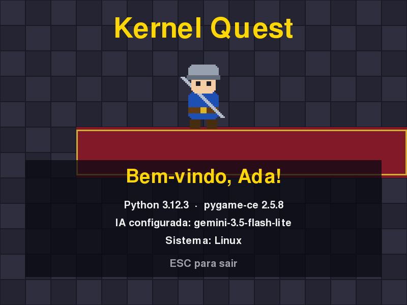

# MÓDULO 00B: Chave e Git — a bancada conectada ao mundo

Engenheiro, hoje a sua bancada se conecta a dois serviços de mercado: a IA do Gemini, que vai dar voz aos personagens, e o GitHub, onde o seu código passa a morar com histórico e backup. O conceito do dia é o que todo time de software usa desde o primeiro minuto: **versionamento com Git**.

## 🎯 O que você vai ver na tela ao final

A janela do jogo mostra o modelo de IA configurado, e o seu nome passa a vir de um arquivo de configuração: trocar o nome nesse arquivo muda a tela sem mexer no código.



## 🏢 Onde isso aparece no mercado

Nenhuma empresa guarda senha ou chave de API dentro do código: elas ficam em variáveis de ambiente, fora do repositório. E nenhum time trabalha sem Git: cada mudança fica registrada, com autor e motivo, e qualquer versão antiga pode ser recuperada.

## 🚦 Ponto de partida

- Seu projeto deve estar como no fim do M00A, com o desafio concluído (nome do jogo na janela).
- Arquivos prontos deste módulo: `curso-arquivos/M00B/` (`requirements.txt`, `.env.example` e `teste_conexao_gemini.py`).
- Uma conta Google (para a chave do Gemini) e uma conta no GitHub (crie em https://github.com/signup, se ainda não tiver).
- Duas sessões: **Sessão A**, Passos 1 a 5 (a chave, o teste e o projeto no GitHub); **Sessão B**, Passos 6 e 7, o Quebre de propósito e o desafio.
- Comando para conferir: com a venv ativa, `python main.py` abre a janela com o nome do jogo e "Bem-vindo, <seu nome>!".

## ❓ Pergunta do dia

O jogo vai precisar de uma chave secreta para falar com a IA, e o código vai morar no GitHub. Como guardar a chave de um jeito que ela nunca vá parar na internet junto com o código?

Ao longo dos passos aparecem caixas **🔍 Pare e pesquise**: pesquise as duas perguntas na hora, anote as respostas e, no fim, explique ao Engenheiro Sênior em até 5 minutos. **Sem mentor?** Grave um áudio de até 5 minutos explicando os termos e ouça de volta: onde você hesitar, o termo ainda não está claro.

## 🛠️ Passo a passo

### Passo 1 (Modifique): o nome sai do código e vai para o `.env`

Copie os três arquivos de `curso-arquivos/M00B/` para a raiz do projeto (o `requirements.txt` novo substitui o antigo):

```powershell
# PowerShell (Windows), na raiz do projeto
Copy-Item -Force $HOME\curso-arquivos\M00B\* .
```

```bash
# bash (Linux), na raiz do projeto
cp -r ~/curso-arquivos/M00B/. .
```

Atenção: `.env.example` começa com ponto e fica oculto em alguns gerenciadores de arquivos; confira que ele chegou. O `requirements.txt` ganhou duas dependências: o SDK oficial do Gemini e a biblioteca que lê o `.env`:

```text
# Dependências do jogo (Python 3.12).
# pygame-ce: fork mantido do pygame; o import continua "import pygame".
pygame-ce>=2.5.8,<2.6
# SDK oficial do Gemini. A Interactions API exige 2.3.0+; o curso foi verificado na 2.33.
google-genai>=2.33,<3
python-dotenv>=1.0,<2
```

Com a venv ativa, instale o que é novo (o `pip` mantém o que já estava instalado):

```bash
pip install -r requirements.txt
```

Crie o seu `.env` a partir do modelo:

```powershell
# PowerShell (Windows)
Copy-Item .env.example .env
```

```bash
# bash (Linux)
cp .env.example .env
```

Abra o `.env` no VS Code e troque `NOME_ENGENHEIRO=Seu Nome` pelo seu nome. A chave fica para o Passo 2.

Agora o `main.py`. No topo, junto dos outros `import`, acrescente `os` e o `load_dotenv`:

```python
import math
import os
import platform
import sys
from pathlib import Path

import pygame
from dotenv import load_dotenv
```

Logo depois de `PASTA_ASSETS = ...`, substitua a linha da constante `NOME` por:

```python
# Lê o arquivo .env (que nunca vai para o Git) e carrega as variáveis.
load_dotenv(PASTA_PROJETO / ".env")
NOME = os.getenv("NOME_ENGENHEIRO", "Engenheiro")
MODELO_IA = os.getenv("GEMINI_MODEL", "gemini-3.5-flash-lite")
```

O segundo valor de `os.getenv` é o padrão, usado quando a variável não existe. Por fim, dentro do `while`, troque as duas chamadas `escrever(...)` da versão do Python e do Sistema (três linhas no editor) por estas, que incluem a IA:

```python
        escrever(tela, fonte, f"Python {platform.python_version()}  ·  "
                              f"pygame-ce {pygame.version.ver}", COR_TEXTO, 405)
        escrever(tela, fonte, f"IA configurada: {MODELO_IA}", COR_TEXTO, 440)
        escrever(tela, fonte, f"Sistema: {platform.system()}", COR_TEXTO, 475)
```

Atualize também a docstring do topo do `main.py`, que ainda fala do M00A:

```python
"""
RPG Engine — Módulo 00: Chave e Git.

Abre a janela do jogo: o herói no salão do castelo, o nome do engenheiro
e a IA configurada, lidos do arquivo .env.
"""
```

Salve e rode `python main.py`. Você deve ver o seu nome e a linha "IA configurada: gemini-3.5-flash-lite". Agora troque o `NOME_ENGENHEIRO` no `.env`, salve e rode de novo: a tela muda, e o código continua igual.

**Preveja antes de rodar:** e se você apagar a linha `NOME_ENGENHEIRO` inteira do `.env`? O jogo quebra, fica sem nome ou mostra outra coisa? Apague, salve, rode e confira. Depois ponha a linha de volta.

> 🔍 **Pare e pesquise: variáveis de ambiente (.env)** — Por que a configuração (nomes, chaves, endereços) fica fora do código? O que acontece se o `.env` for parar num repositório público?

### Passo 2: a chave do Gemini

1. Entre em https://aistudio.google.com/apikey com a sua conta Google e clique em "Create API key".
2. Copie a chave e cole no `.env`, no lugar de `cole_sua_chave_aqui`:

   ```text
   GEMINI_API_KEY=AIza...sua_chave...
   ```

3. Leia com o Engenheiro Sênior (ou sozinho, com calma) os termos da API (https://ai.google.dev/gemini-api/terms). Dois pontos valem para o curso todo:
   - quem usa a API precisa ter 18 anos ou mais;
   - no plano gratuito, o que você envia pode ser lido por revisores humanos e usado para melhorar os produtos do Google. Nunca coloque dados pessoais (seus ou de outras pessoas) nos textos enviados à IA.

A chave é como uma senha: não mande por mensagem, não cole em print e não coloque no código.

> 🔍 **Pare e pesquise: chave de API** — Para que um serviço pede uma chave a cada requisição? O que alguém pode fazer com a sua chave se ela vazar?

### Passo 3 (Leia): o teste de conexão

O `teste_conexao_gemini.py` veio pronto. Rode:

```bash
python teste_conexao_gemini.py
```

A resposta é parecida com esta (o texto muda a cada execução, porque a IA gera uma frase nova):

```
[REDE] Testando o modelo gemini-3.5-flash-lite...
[OK] Resposta em 5.9 s:
Que a engenhosidade guie suas mãos, jovem aprendiz, pois sua jornada nas artes mecânicas começa agora nesta humilde bancada.
```

Leia o arquivo (com o Engenheiro Sênior, se tiver um) e responda, olhando o código:

- O `system_instruction` e o `input` vão separados na chamada. Qual dos dois diz **quem** a IA deve ser, e qual diz **o que** pedimos a ela?
- O que aconteceria, numa rede travada, se não existisse o `TIMEOUT_MS`?
- Quando a `explicar_erro` devolve `None`, e por que, nesse caso, o programa mostra o erro completo (o traceback) em vez de uma mensagem amigável?

Duas linhas que vale reconhecer: `store=False` diz para a API não guardar esta interação para continuar a conversa depois (no M06A você vai usar o contrário; isso não muda as regras do plano gratuito do Passo 2); e `time.perf_counter()` mede quanto tempo a resposta levou.

### Passo 4: Git e GitHub CLI

Instale:

```powershell
# PowerShell (Windows)
winget install --id Git.Git -e
winget install --id GitHub.cli -e
```

```bash
# bash (Linux)
sudo apt install git gh
```

Feche o VS Code inteiro e abra de novo (o terminal dele herda o PATH antigo até o VS Code reiniciar). Os comandos `git` e `gh` a seguir são iguais no PowerShell e no bash. Configure quem você é: isso aparece em cada commit. Use o mesmo e-mail da sua conta do GitHub.

```bash
git config --global user.name "Seu Nome"
git config --global user.email "seu-email@exemplo.com"
git config --global init.defaultBranch main
```

Conecte o terminal à sua conta do GitHub:

```bash
gh auth login
```

Escolha "GitHub.com", "HTTPS", responda **Yes** quando perguntar "Authenticate Git with your GitHub credentials?" (sem isso o `git push` pede senha e falha), escolha "Login with a web browser" e siga o código que aparece no terminal.

### Passo 5: o primeiro commit (com o `.gitignore` antes)

Antes de qualquer `git add`, crie na raiz do projeto o arquivo `.gitignore`, que diz ao Git o que nunca entra no repositório. Crie pelo VS Code (File > New File, digite o nome `.gitignore` e salve na raiz): o Bloco de Notas salvaria como `.gitignore.txt`, e o Git ignoraria o arquivo. A última linha só passa a ter uso no M04B, mas já deixamos pronta:

```text
# Segredos: a chave do Gemini nunca vai para o Git.
.env

# Ambiente virtual: cada máquina cria o seu (pip install -r requirements.txt).
.venv/

# Arquivos gerados pelo Python.
__pycache__/
*.pyc

# Prints da verificação automática.
ferramentas/saida/
```

Agora inicie o repositório e confira o que vai entrar:

```bash
git init
git add .
git status
```

Na lista do `git status`, devem aparecer `.env.example`, `.gitignore`, `.vscode/settings.json`, `main.py`, `requirements.txt`, `teste_conexao_gemini.py` e os arquivos dentro de `assets/` e `ferramentas/` (um por linha). O `.vscode/settings.json` vai junto de propósito: a configuração do editor viaja com o projeto. **Não** podem aparecer `.env` nem `.venv/`. Se aparecerem, pare e chame o Engenheiro Sênior antes do commit. Se a lista estiver certa, faça o commit. O `feat:` no começo da mensagem diz o tipo da mudança (funcionalidade nova); é um padrão de mercado chamado Conventional Commits, que você vai usar em todo o curso:

```bash
git commit -m "feat: primeira janela e bancada com .env"
gh repo create rpg-engine --private --source . --push
```

Abra o repositório no navegador (`gh repo view --web`) e confira: o código está lá, e o `.env` não.

> ⏸️ **Fim da Sessão A.** Projeto no GitHub, jogo funcionando. Se a sessão já passou de uma hora, pare aqui; os Passos 6 e 7, o Quebre de propósito e o desafio ficam para a Sessão B.

> 🔍 **Pare e pesquise: versionamento com Git** — Qual a diferença entre `git add` e `git commit`? O que o GitHub acrescenta ao Git que você já tem no computador?

### Passo 6: o Engenheiro Sênior entra no time (se você tiver um)

Peça ao Engenheiro Sênior o usuário dele no GitHub. No site, abra o repositório, vá em Settings > Collaborators > Add people e convide esse usuário (o GitHub pode pedir sua senha de novo antes de enviar). Ele aceita o convite pelo e-mail. A partir de agora, ele acompanha cada mudança que você enviar.

> **Sem mentor?** Pule este passo: o repositório continua seu e o curso segue igual. Se você estuda com colegas, convide um deles: a partir do M03C, um revisa o Pull Request do outro.

### Passo 7: as regras de uso de IA no curso

Combine com o Engenheiro Sênior (ou consigo mesmo, se estuda sozinho), e lembre a cada desafio:

- **Pode:** pedir a uma IA explicação de conceito e de erro, revisão do seu próprio código e exemplos diferentes do desafio.
- **Não pode:** pedir a solução pronta do desafio.
- **Deve:** explicar ao Engenheiro Sênior cada trecho que veio de uma IA. Se não souber explicar, o trecho não entra. Sem mentor, a explicação vai na mensagem do commit (a partir do M03C, na descrição do Pull Request).
- **No editor:** as sugestões automáticas de IA ficam desligadas no projeto (o `.vscode/settings.json` do M00A). Mais adiante no curso, você vai religá-las de propósito para revisar o que a IA sugere.

## 💥 Quebre de propósito

Apague uma letra da sua chave no `.env` e salve. **Preveja antes de rodar:** o teste vai dar `[OK]`, travar ou mostrar um erro? Se for erro, qual código: o da chave, o do modelo ou o da cota? Agora rode:

```bash
python teste_conexao_gemini.py
```

```
[REDE] Testando o modelo gemini-3.5-flash-lite...
[ERRO] Requisição recusada (400). Quase sempre é a chave: confira GEMINI_API_KEY no arquivo .env.
```

O código de erro diz onde procurar: 400, 401 ou 403 apontam a chave; 404, o nome do modelo; 429, a cota. Desfaça a mudança e rode de novo para ver o `[OK]`.

## 🧯 Problemas comuns

| Sintoma | Causa provável | Como resolver |
| --- | --- | --- |
| A tela continua com o nome antigo | `.env` não foi salvo, ou se chama `.env.txt` (Bloco de Notas no Windows) | Salve no VS Code; confira o nome exato do arquivo com `ls -a` (bash) ou `Get-ChildItem -Force` (PowerShell) |
| `ModuleNotFoundError: No module named 'dotenv'` | O `pip install -r requirements.txt` não rodou na venv ativa | Ative a venv e rode o `pip install` de novo |
| `[ERRO] GEMINI_API_KEY não configurada.` | A chave ainda é `cole_sua_chave_aqui` | Cole a chave do AI Studio no `.env` |
| Erro 429 no teste | Cota por minuto do plano gratuito | Espere um minuto e tente de novo |
| `git` ou `gh` não encontrado | O VS Code foi aberto antes da instalação | Feche o VS Code inteiro e abra de novo |
| `gh auth login` pede navegador | É o fluxo normal | Siga o código exibido no terminal |
| `.env` aparece no `git status` mesmo com `.gitignore` | O arquivo se chama `.gitignore.txt` | Renomeie no VS Code para `.gitignore` e rode `git status` de novo |
| `.env.example` não encontrado | O gerenciador de arquivos esconde arquivos que começam com ponto, e ele ficou para trás | Copie pelo nome: `cp ~/curso-arquivos/M00B/.env.example .` (bash) ou `Copy-Item $HOME\curso-arquivos\M00B\.env.example .` (PowerShell) |
| `warning: LF will be replaced by CRLF` (Windows) | O Git ajustando o fim de linha para o Windows | É normal; pode seguir |
| O `.env` apareceu no GitHub | Foi commitado antes do `.gitignore` | Chame o Engenheiro Sênior: troque a chave no AI Studio (a antiga vazou) e removam juntos do histórico. **Sem mentor?** Troque a chave na hora (é o que importa: a antiga deixa de valer); depois, o jeito mais simples de limpar o histórico neste começo é apagar o repositório no GitHub e criá-lo de novo, já com o `.gitignore` |

## 🧩 Desafio de Engenharia

Deixe a bancada pronta para o trabalho em time.

**Critérios de aceite:**

- [ ] `python teste_conexao_gemini.py` responde com `[OK]`.
- [ ] Repositório privado no GitHub, com `.gitignore`; o `.env` **não** aparece no GitHub.
- [ ] Se você tem um mentor, o Engenheiro Sênior é colaborador do repositório.
- [ ] Primeira Issue criada, com o título "Módulo 01" (procure como criar uma Issue pelo site ou com `gh issue create`).
- [ ] `README.md` na raiz do repositório, com o nome do jogo e a seção "Como rodar" (criar a venv, instalar as dependências, criar o `.env` a partir do `.env.example`), em PowerShell e bash, num segundo commit no padrão Conventional Commits (`docs: ...`).
- [ ] Você explica ao Engenheiro Sênior, sem ler e em até 5 minutos, os três termos das caixas 🔍 (`.env`, chave de API e Git). **Sem mentor?** Grave a explicação em áudio e ouça de volta.

**Entrega:** push na `main` e o link do repositório enviado ao Engenheiro Sênior (sem mentor, anote o link: é o começo do seu portfólio).

## 💼 Resumo profissional

- **Conceito:** versionamento com Git e GitHub, configuração por variáveis de ambiente e uso seguro de chave de API de um serviço de IA.
- **Linha para o currículo:** "Configurei projeto Python com Git e GitHub, segredos em variáveis de ambiente e integração validada com a API do Google Gemini."
