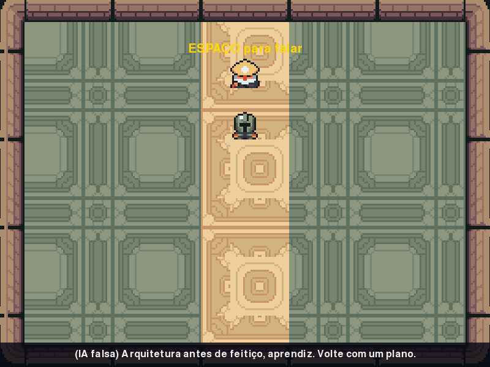

# MÓDULO 01: O Mago responde — o herói anda e a IA fala

Engenheiro, hoje o jogo ganha vida: o herói passa a andar pelo salão do castelo e o Arquimago Solaris responde com a voz do Gemini. O conceito do dia é o coração de todo jogo e de muito software em tempo real, que você conheceu no M00A e hoje completa com a etapa de atualizar: o game loop, e o ritmo em que ele roda.

## 🎯 O que você vai ver na tela ao final

Uma tela de título e, depois dela, o salão do castelo com arte de verdade. O herói anda com WASD ou as setas e, perto do Mago, o ESPAÇO faz o Gemini responder numa linha no rodapé da tela.



## 🏢 Onde isso aparece no mercado

Todo jogo, simulador ou interface gráfica roda um laço que lê a entrada, atualiza o estado e desenha a tela, dezenas de vezes por segundo. E todo sistema que chama um serviço pela rede precisa lidar com a espera: quem trava a tela enquanto espera a resposta perde o usuário.

## 🚦 Ponto de partida

- Seu projeto deve estar como no fim do M00B, com o desafio concluído (repositório no GitHub, teste de conexão com `[OK]`).
- **Arquivos do curso:** traga a pasta deste módulo do seu clone do curso (feito no M00B). PowerShell: `git -C $HOME\kernel-quest-curso pull` e `Copy-Item -Recurse -Force $HOME\kernel-quest-curso\arquivos\M01 $HOME\curso-arquivos\`. bash: `git -C ~/kernel-quest-curso pull` e `cp -r ~/kernel-quest-curso/arquivos/M01 ~/curso-arquivos/`.
- Arquivos prontos deste módulo: pasta `M01/` dentro de `curso-arquivos/` (a pasta fora do projeto onde você guarda os arquivos prontos de cada módulo), com a pasta `assets/` (arte nova) e o `teste_conexao_gemini.py` atualizado.
- Comando para conferir: com a venv ativa, `python main.py` abre a janela de boas-vindas com "IA configurada".
- Duas sessões: **Sessão A**, Passos 1 a 4 (o herói anda, o Mago aparece e o `ia.py` fica pronto); **Sessão B**, Passos 5a e 5b, o Quebre de propósito e o desafio (o Mago fala).

## ❓ Pergunta do dia

Como um jogo consegue, ao mesmo tempo, mover o herói, ouvir o teclado e redesenhar a tela 60 vezes por segundo? E o que acontece quando ele precisa esperar alguém, como a IA, responder?

Ao longo dos passos aparecem caixas **🔍 Pare e pesquise**: pesquise as duas perguntas na hora, anote as respostas e, no fim, explique ao Engenheiro Sênior em até 5 minutos. **Sem mentor?** Grave um áudio de até 5 minutos explicando os termos e ouça de volta: onde você hesitar, o termo ainda não está claro.

## 🛠️ Passo a passo

### Passo 1 (Leia): a arte nova

A partir de hoje, a arte do jogo vem de um pacote profissional e gratuito, o **Ninja Adventure** (licença CC0: uso livre, até comercial). Copie o **conteúdo** de `curso-arquivos/M01/assets/` para dentro da pasta `assets/` do projeto, mantendo as subpastas. Os `.png` antigos e o `ferramentas/gerar_assets.py` deixam de ser usados a partir de hoje; podem ficar onde estão (ou sair num commit `chore:` mais tarde).

```powershell
# PowerShell (Windows), na raiz do projeto
Copy-Item -Recurse -Force $HOME\curso-arquivos\M01\assets\* assets\
```

```bash
# bash (Linux), na raiz do projeto
cp -r ~/curso-arquivos/M01/assets/. assets/
```

Dentro de `assets/` devem aparecer `personagens/` (`heroi.png`, `mago.png`, `sentinela.png`), `cenarios/salao.png`, `CREDITOS.md` e `LICENCA-ninja-adventure.txt`. Abra o `CREDITOS.md`: é assim que um projeto profissional registra de onde vem cada arte e com qual licença.

Os personagens têm só 16×16 pixels. Por isso o código amplia cada imagem com o `scale_by`, que você já conhece do M00A. No `main.py`, troque as linhas do `fundo` e do `heroi` (antes do `painel`) por:

```python
    # Arte do pacote Ninja Adventure: 16×16 pixels, ampliada para ficar visível.
    fundo = carregar_imagem("cenarios/salao.png")
    heroi = pygame.transform.scale_by(carregar_imagem("personagens/heroi.png"), 8)
```

Na função `carregar_imagem`, a dica de erro também muda, porque a arte agora vem pronta. Troque o texto da docstring e o segundo `print` por:

```python
    """Carrega um .png da pasta assets/ ou explica de onde ele vem."""
```

```python
        print("Copie para assets/ a pasta assets/ que veio com os arquivos do módulo.")
```

Rode `python main.py`: você deve ver o cavaleiro novo, grande, sobre o piso do salão do castelo.

Perguntas de leitura:

- No `CREDITOS.md`, qual é a licença do pacote, e o que ela deixa você fazer com a arte?
- O herói do título é ampliado 8 vezes (`scale_by(..., 8)`). Quantos pixels ele passa a ter de lado na tela?

### Passo 2a (Leia): o título vira um estado

O jogo vai ter dois momentos: a tela de título (a de boas-vindas que você já tem) e o salão, onde o herói anda. Uma variável `na_titulo` diz em qual dos dois estamos. Neste passo, uma tecla leva do título ao salão; no 2b, o herói anda.

Logo depois do `painel.fill(...)`, crie o herói do salão. Cada personagem é uma imagem **e** um retângulo (`Rect`) que guarda a posição dela:

```python
    # No salão, cada personagem é uma imagem e um retângulo (Rect) com a posição dela.
    sprite_heroi = pygame.transform.scale_by(carregar_imagem("personagens/heroi.png"), 3)
    heroi_rect = sprite_heroi.get_rect(center=(LARGURA // 2, 480))
    area_livre = pygame.Rect(40, 40, LARGURA - 80, ALTURA - 80)  # o salão sem as paredes

    na_titulo = True  # o jogo começa na tela de título
```

Dentro do `for evento in pygame.event.get():`, depois do `elif` do ESC, acrescente: qualquer outra tecla sai do título.

```python
            elif evento.type == pygame.KEYDOWN and na_titulo:
                na_titulo = False  # qualquer outra tecla começa o jogo
```

Agora o coração do módulo. Tudo o que vem depois do `for` de eventos, do comentário `# O herói "respira"` até o `pygame.display.flip()`, passa a ficar dentro de um `if na_titulo:`, e depois dele vem o desenho do salão. Troque esse trecho inteiro pelo bloco abaixo. O que muda em relação ao seu código:

1. a linha `if na_titulo:` entra antes do comentário `# O herói "respira"`, e todas as linhas até o `flip()` ganham 4 espaços de recuo (selecione e aperte Tab no VS Code);
2. o `tela.blit(fundo, (0, 0))` vira `tela.fill((24, 20, 32))`: o título fica legível sobre um fundo escuro;
3. o último `escrever` passa a dizer "Aperte uma tecla para começar  ·  ESC para sair";
4. depois do `flip()`, ainda dentro do `if`, entra o `continue`, que volta ao início do laço sem desenhar o salão;
5. fora do `if`, o salão: fundo, herói e `flip()`.

**Mantenha a sua linha do desafio do M00A.** Antes de colar, copie a sua linha `escrever(tela, fonte_jogo, NOME_JOGO, ...)`; depois de colar, devolva-a no lugar da do exemplo. No bloco abaixo, a linha `escrever(tela, fonte_jogo, NOME_JOGO, ...)` é a do exemplo; no seu código, mantenha a sua (a posição e a cor podem ser outras, os nomes `fonte_jogo` e `NOME_JOGO` são os mesmos).

```python
        if na_titulo:
            # O herói "respira": sobe e desce seguindo uma onda (seno).
            respiracao = math.sin(tempo * 3) * 6
            tela.fill((24, 20, 32))  # fundo escuro: o título fica legível
            escrever(tela, fonte_jogo, NOME_JOGO, COR_DESTAQUE, 60)
            tela.blit(heroi, heroi.get_rect(center=(LARGURA // 2, 190 + respiracao)))
            tela.blit(painel, painel.get_rect(center=(LARGURA // 2, 430)))
            escrever(tela, fonte_titulo, f"Bem-vindo, {NOME}!", COR_DESTAQUE, 350)
            escrever(tela, fonte, f"Python {platform.python_version()}  ·  "
                                  f"pygame-ce {pygame.version.ver}", COR_TEXTO, 405)
            escrever(tela, fonte, f"IA configurada: {MODELO_IA}", COR_TEXTO, 440)
            escrever(tela, fonte, f"Sistema: {platform.system()}", COR_TEXTO, 475)
            escrever(tela, fonte, "Aperte uma tecla para começar  ·  ESC para sair",
                     (160, 160, 170), 520)
            pygame.display.flip()
            continue  # volta ao início do loop sem desenhar o salão

        # 3. Desenhar: do fundo para a frente, e só então mostrar (flip).
        tela.blit(fundo, (0, 0))
        tela.blit(sprite_heroi, heroi_rect)
        pygame.display.flip()
```

Para ficar claro onde começa cada etapa, acrescente este comentário logo antes do `for` de eventos:

```python
        # 1. Eventos: o que o jogador fez desde o último quadro.
```

Rode `python main.py`: o título aparece sobre o fundo escuro; aperte uma tecla, e você está no salão, com o herói parado perto do tapete.

Perguntas de leitura (responda olhando o código):

- Em que linha o jogo deixa de estar no título, e o que faz essa linha rodar?
- Se você apagasse a linha do `continue`, o que o jogo faria logo depois de desenhar o título, ainda na mesma volta do laço?

### Passo 2b (Preveja): o herói anda

No topo, junto das constantes de cor, acrescente a velocidade do herói:

```python
VELOCIDADE = 4  # pixels por quadro
```

E, logo antes do comentário `# 3. Desenhar`, acrescente a etapa que faltava no laço, a de **atualizar**:

```python
        # 2. Atualizar: get_pressed() diz quais teclas estão seguradas agora.
        teclas = pygame.key.get_pressed()
        if teclas[pygame.K_LEFT] or teclas[pygame.K_a]:
            heroi_rect.x -= VELOCIDADE
        if teclas[pygame.K_RIGHT] or teclas[pygame.K_d]:
            heroi_rect.x += VELOCIDADE
        if teclas[pygame.K_UP] or teclas[pygame.K_w]:
            heroi_rect.y -= VELOCIDADE
        if teclas[pygame.K_DOWN] or teclas[pygame.K_s]:
            heroi_rect.y += VELOCIDADE
        heroi_rect.clamp_ip(area_livre)  # mantém o herói dentro do salão
```

Repare na diferença entre as duas formas de ler o teclado. O **evento** `KEYDOWN` acontece uma vez, no instante em que a tecla desce (bom para "começar" ou "falar"). O `get_pressed()` diz se a tecla **está** segurada agora (bom para andar). O `clamp_ip` empurra o retângulo de volta para dentro da área livre, sem deixar o herói atravessar as paredes.

**Preveja antes de rodar:** a `VELOCIDADE` é 4 pixels por quadro, e o loop dá 60 voltas por segundo. Segurando a seta para a direita, quantos pixels o herói anda em um segundo? Quanto tempo ele leva para atravessar os 720 pixels do salão?

Rode `python main.py`: aperte uma tecla no título, e o herói anda pelo salão nas 4 direções, parando nas paredes. Confira a sua previsão atravessando o salão. Depois, **modifique**: `VELOCIDADE = 8`, rode e sinta a diferença; volte para 4.

> 🔍 **Pare e pesquise: quadro e ritmo (`tick`)** — No M00A você viu as etapas do game loop; hoje ele ganhou a de atualizar. O que o `relogio.tick(FPS)` (com `FPS = 60`) faz quando uma volta do laço termina mais rápido que 16,7 ms, e o que acontece quando ela demora mais? Por que a tela é desenhada do fundo para a frente, e só no fim aparece com o `flip()`?

### Passo 3 (Preveja): o Mago e a área de conversa

Logo depois do `heroi_rect = ...`, coloque o Mago no alto do tapete, com uma área de conversa ao redor dele. O `inflate(100, 100)` devolve uma cópia do retângulo 50 pixels maior em cada lado:

```python
    sprite_mago = pygame.transform.scale_by(carregar_imagem("personagens/mago.png"), 3)
    mago_rect = sprite_mago.get_rect(center=(LARGURA // 2, 120))
    # Área de conversa: o retângulo do Mago "inflado" 50 pixels em cada direção.
    area_mago = mago_rect.inflate(100, 100)
```

No começo de cada volta do laço, logo depois da linha do `relogio.tick`, descubra se o herói está perto. O `colliderect` responde `True` quando dois retângulos se sobrepõem:

```python
        perto_do_mago = heroi_rect.colliderect(area_mago)
```

Na etapa de desenhar, troque a linha `tela.blit(sprite_heroi, heroi_rect)` por estas, que desenham o Mago antes do herói e a dica quando ele está perto:

```python
        tela.blit(sprite_mago, mago_rect)
        tela.blit(sprite_heroi, heroi_rect)
        if perto_do_mago:
            escrever(tela, fonte, "ESPAÇO para falar", COR_DESTAQUE, mago_rect.top - 15)
```

Rode `python main.py`: ande até o Mago, e "ESPAÇO para falar" aparece em cima dele. Afaste-se, e a dica some. O herói passa por cima do Mago: a colisão sólida entre personagens fica para o M02A.

**Preveja:** se você trocar `inflate(100, 100)` por `inflate(300, 300)`, de onde a dica passa a aparecer? Troque, rode, confira e volte para 100.

> 🔍 **Pare e pesquise: retângulo de colisão (hitbox)** — Por que jogos testam colisão com retângulos em vez de comparar os pixels das imagens? O que fazem os métodos `inflate()` e `colliderect()` do `pygame.Rect`?


### Passo 4 (Leia): o módulo da IA (`ia.py`)

Todo o código que fala com o Gemini vai morar num arquivo só, e o `main.py` só pede "responda isto". Assim, se a IA mudar um dia, você mexe num lugar só.

Crie o arquivo `ia.py` na raiz do projeto. Você já conhece a constante `ERROS_DE_CONEXAO` e a função `explicar_erro` do `teste_conexao_gemini.py`: a partir de agora elas moram aqui (o 404 ganhou um texto que não depende de variável do teste). O resto é novo:

```python
"""
RPG Engine — a IA do jogo (Gemini).

Tudo o que fala com o Gemini mora aqui; o main.py só chama responder().
Com IA_FALSA=1 no ambiente, responder() devolve uma fala fixa, sem rede
e sem gastar cota (útil para testar e para a verificação automática).
"""
import os

from google import genai

TIMEOUT_MS = 30_000  # sem isso, uma rede travada deixaria o jogo esperando para sempre

# Erros de rede da Interactions API (o SDK não exporta essas classes publicamente).
ERROS_DE_CONEXAO = ("APIConnectionError", "APITimeoutError")

_cliente = None  # criado só na primeira chamada de verdade


def explicar_erro(erro):
    """Traduz o erro da API numa orientação prática. Devolve None se não for erro da API."""
    codigo = getattr(erro, "status_code", None) or getattr(erro, "code", None)
    if codigo == 429:
        return "Cota esgotada (429). Espere um minuto e tente de novo."
    if codigo in (400, 401, 403):
        return (f"Requisição recusada ({codigo}). Quase sempre é a chave: "
                "confira GEMINI_API_KEY no arquivo .env.")
    if codigo == 404:
        return "Modelo não encontrado (404). Confira GEMINI_MODEL no arquivo .env."
    if codigo:
        return f"A API respondeu com erro {codigo}: {erro}"
    if type(erro).__name__ in ERROS_DE_CONEXAO:
        return f"Sem conexão com a API (rede, proxy ou firewall): {erro}"
    return None  # não é erro da API: provavelmente um erro no nosso código


def obter_cliente():
    """Cria o cliente do Gemini uma única vez e reaproveita nas próximas chamadas."""
    global _cliente
    if _cliente is None:
        # genai.Client() lê a chave da variável GEMINI_API_KEY (carregada do .env).
        _cliente = genai.Client(http_options={"timeout": TIMEOUT_MS})
    return _cliente


def responder(instrucao, fala):
    """Pede ao Gemini a resposta do personagem descrito em `instrucao` para a `fala`."""
    if os.getenv("IA_FALSA") == "1":
        return "(IA falsa) Arquitetura antes de feitiço, aprendiz. Volte com um plano."
    if not os.getenv("GEMINI_API_KEY"):
        return "[ERRO] GEMINI_API_KEY não configurada no arquivo .env."
    try:
        interacao = obter_cliente().interactions.create(
            model=os.getenv("GEMINI_MODEL", "gemini-3.5-flash-lite"),
            system_instruction=instrucao,
            input=fala,
            store=False,  # cada fala é independente: não guardamos a conversa
        )
    except Exception as erro:
        mensagem = explicar_erro(erro)
        if mensagem is None:
            raise  # erro de programação: mostra o traceback completo para corrigir
        return f"[ERRO] {mensagem}"
    return interacao.output_text
```

Três ideias de mercado moram nesse arquivo:

- **Cliente criado só quando precisa** (`obter_cliente`): o jogo abre rápido e funciona mesmo sem rede até alguém falar com o Mago. O `global _cliente` avisa ao Python que a função vai trocar a variável `_cliente` do módulo (a de fora da função), em vez de criar uma variável nova só dentro dela.
- **Erros viram mensagens**, não travamentos: um 429 aparece como orientação na tela. Já um erro de programação (`mensagem is None`) sobe com o traceback completo, para você corrigir: um `raise` sozinho, dentro do `except`, relança o mesmo erro que acabou de ser capturado.
- **IA falsa:** com a variável `IA_FALSA=1`, o `responder` devolve uma fala fixa sem usar a rede. Serve para testar sem gastar cota, e no M04B é o que o CI vai usar.

Agora o `teste_conexao_gemini.py` ficou com uma cópia da `explicar_erro` que ninguém usa. Substitua-o pelo arquivo de `curso-arquivos/M01/`, que importa a função do `ia.py`:

```powershell
# PowerShell (Windows), na raiz do projeto
Copy-Item -Force $HOME\curso-arquivos\M01\teste_conexao_gemini.py .
```

```bash
# bash (Linux), na raiz do projeto
cp ~/curso-arquivos/M01/teste_conexao_gemini.py .
```

Confira que ele continua funcionando:

```bash
python teste_conexao_gemini.py
```

Perguntas de leitura (responda olhando o `ia.py`):

- Se você falar 10 vezes com o Mago, quantas vezes o `genai.Client(...)` é criado? Que linha garante isso?
- Com `IA_FALSA=1` e sem internet, o que o `responder` devolve, e por que ele nem tenta a rede?
- Um erro que a `explicar_erro` não reconhece devolve `None`. O que o `responder` faz nesse caso, e por quê?

Fim da Sessão A. Registre e envie:

```bash
git add .
git commit -m "feat: herói anda pelo salão, o Mago aparece e o ia.py está pronto"
git push
```

> ⏸️ **Fim da Sessão A.** Commit enviado, jogo funcionando e `teste_conexao_gemini.py` com `[OK]`. Pare aqui e continue na próxima sessão, no Passo 5a.

### Passo 5a (Preveja): a faixa do rodapé

A fala do Mago vai aparecer numa faixa escura no rodapé da tela. Primeiro a faixa, com uma dica para o jogador; no 5b, a fala.

Depois da linha `fonte = pygame.font.Font(None, 30)`, crie a fonte da fala:

```python
    fonte_fala = pygame.font.Font(None, 24)
```

Depois do `painel.fill(...)`, crie a faixa escura:

```python
    faixa = pygame.Surface((LARGURA, 40), pygame.SRCALPHA)
    faixa.fill((10, 10, 20, 210))
```

Logo depois do `na_titulo = True`, acrescente o texto inicial da faixa:

```python
    fala = "Ande com WASD ou as setas. Chegue perto do Mago."
```

Por fim, na etapa de desenhar, logo antes do `pygame.display.flip()` do salão, desenhe a faixa e o texto:

```python
        tela.blit(faixa, (0, ALTURA - 40))
        escrever(tela, fonte_fala, fala, COR_TEXTO, ALTURA - 20)
```

Rode `python main.py`: a faixa aparece no rodapé com a dica.

**Preveja:** e se as duas linhas da faixa viessem **antes** do `tela.blit(fundo, (0, 0))`, e não depois? Mude as duas linhas de lugar, rode, confira a sua previsão e desfaça.

### Passo 5b (Leia): ESPAÇO e o Mago responde

No `main.py`, acrescente dois `import`: o `time` (junto dos outros da biblioteca padrão) e o seu módulo `ia` (num bloco separado, depois dos de terceiros, que é a convenção do Python):

```python
import math
import os
import platform
import sys
import time
from pathlib import Path

import pygame
from dotenv import load_dotenv

import ia
```

Junto da `VELOCIDADE`, acrescente o intervalo mínimo entre chamadas e a instrução de sistema do Mago: quem ele é e como fala, separado do que o jogador diz. O tom é de mentor exigente, não de personagem de desenho animado; o limite de 15 palavras faz a resposta caber numa linha:

```python
INTERVALO_MINIMO = 2.0  # segundos entre duas chamadas à IA (reduz o risco do erro 429)

# Instrução de sistema: quem o Mago é. Vai separada da fala do jogador.
INSTRUCAO_MAGO = (
    "Você é o Arquimago Solaris, mentor exigente e seco num castelo medieval sombrio. "
    "Trata magia como arquitetura e cobra método do aprendiz, com ironia rara e sem insultar. "
    "Responda em português, em texto simples (sem Markdown), "
    "em até 2 frases curtas, com no máximo 15 palavras no total."
)
```

Logo depois da linha `fala = ...` do 5a, guarde a hora da última chamada:

```python
    ultima_chamada = -INTERVALO_MINIMO  # permite a primeira chamada logo de cara
```

No `for` de eventos, depois do `elif` do título, acrescente o ESPAÇO. Repare na linha marcada como **bloqueante**: enquanto o Gemini não responde, o laço inteiro fica parado nela.

```python
            elif evento.type == pygame.KEYDOWN and evento.key == pygame.K_SPACE and perto_do_mago:
                if time.perf_counter() - ultima_chamada < INTERVALO_MINIMO:
                    continue  # ESPAÇO apertado rápido demais: ignora
                print("[REDE] O Mago está pensando... (o jogo congela até a resposta)")
                inicio = time.perf_counter()
                # Chamada BLOQUEANTE: o loop para aqui até a resposta chegar.
                fala = ia.responder(INSTRUCAO_MAGO, f"O aprendiz {NOME} se aproxima e cumprimenta você.")
                ultima_chamada = time.perf_counter()
                print(f"[MAGO] ({ultima_chamada - inicio:.1f} s) {fala}")
```

Atualize também a docstring do topo do `main.py`, que ainda fala do Módulo 00:

```python
"""
RPG Engine — Módulo 01: O Mago responde.

Tela de título e, depois dela, o salão do castelo: o herói anda com
WASD ou as setas e, perto do Mago, ESPAÇO pede a fala dele ao Gemini.
"""
```

Primeiro, teste **sem gastar cota**, com a IA falsa:

```powershell
# PowerShell (Windows)
$env:IA_FALSA = "1"; python main.py; Remove-Item Env:IA_FALSA
```

```bash
# bash (Linux)
IA_FALSA=1 python main.py
```

Perto do Mago, o ESPAÇO mostra na hora "(IA falsa) Arquitetura antes de feitiço, aprendiz. Volte com um plano.". Agora rode `python main.py` normalmente. O ESPAÇO congela o jogo por alguns segundos (tente andar: o herói não se mexe) e então a fala do Mago aparece no rodapé. No terminal, você vê quanto tempo a resposta levou (nos testes do curso, entre 1 e 6 segundos):

```
[REDE] O Mago está pensando... (o jogo congela até a resposta)
[MAGO] (x.x s) <a fala do Mago>
```

O texto muda a cada vez, porque a IA gera uma frase nova. Se a fala vier com `*asteriscos*`, é Markdown: foi por isso que a instrução pede "texto simples (sem Markdown)". Esse congelamento não é defeito do seu código: é o comportamento de uma **operação bloqueante**, e no M07A você vai eliminá-lo.

> 🔍 **Pare e pesquise: operação bloqueante** — O que é uma chamada bloqueante, e por que uma requisição de rede costuma ser uma? O que o usuário vê quando a interface fica bloqueada esperando a rede?

Perguntas de leitura (responda olhando o `main.py`):

- Por que o ESPAÇO é lido pelo evento `KEYDOWN`, e o movimento pelo `get_pressed()`?
- Qual linha impede duas chamadas à IA em menos de 2 segundos, e por que isso protege a sua cota?

Tudo funcionando? Hora de registrar. Confira o que vai entrar (o `.env` **não** pode aparecer na lista) e faça o commit:

```bash
git status
git add .
git commit -m "feat: o Mago responde pela IA"
git push
```

## 💥 Quebre de propósito

A segunda metade da pergunta do dia: o que acontece quando o loop espera? No laço, logo depois da linha do `relogio.tick`, acrescente:

```python
        time.sleep(1.5)  # QUEBRA
```

**Preveja:** o que vai acontecer com o herói e com o ESC? Rode com a IA falsa e tente andar.

O herói dá um passo a cada 1,5 segundo, e até o ESC demora a responder. É exatamente o que acontece durante a chamada ao Gemini, mas agora sem gastar cota. Qualquer coisa lenta dentro do laço (rede, disco, `sleep`) segura o quadro inteiro: nada se mexe, nada é desenhado, nenhuma tecla é lida. Apague a linha e confira que o jogo voltou ao normal.

## 🧯 Problemas comuns

| Sintoma | Causa provável | Como resolver |
| --- | --- | --- |
| `[ERRO] Arquivo não encontrado: .../assets/cenarios/salao.png` | A pasta `assets/` do módulo não foi copiada, ou foi copiada como `assets/assets/` | Copie o **conteúdo** de `curso-arquivos/M01/assets/` para `assets/` |
| O herói some da tela | Faltou o `clamp_ip` depois do movimento | Confira a linha `heroi_rect.clamp_ip(area_livre)` |
| O título aparece e nada acontece ao andar | O `continue` ficou fora do `if na_titulo:` | O `continue` precisa estar indentado dentro do `if` |
| Nada acontece no ESPAÇO | O herói está longe do Mago, ou a tecla foi apertada antes de 2 s da última fala | Chegue até aparecer "ESPAÇO para falar"; espere 2 s entre falas |
| A resposta sai da tela | A IA ignorou o limite de palavras | Reforce o limite na instrução de sistema; no M02B a fala ganha uma caixa com quebra de linha |
| Janela "Não respondendo" por alguns segundos | É o congelamento esperado da chamada bloqueante | Espere a resposta; o M07A resolve |
| `[ERRO] Cota esgotada (429)` no rodapé | Muitas chamadas seguidas no plano gratuito | Espere um minuto; teste com a IA falsa |
| `ModuleNotFoundError: No module named 'ia'` | O `ia.py` não está na raiz do projeto, ao lado do `main.py` | Mova o arquivo para a raiz |
| `NameError: name 'fonte_jogo' is not defined` (ou `NOME_JOGO`) | No seu desafio do M00A, a fonte ou a constante ganhou outro nome | Renomeie para `fonte_jogo` e `NOME_JOGO`, os nomes do critério do M00A |
| O jogo trava ~30 s e depois aparece `[ERRO] Sem conexão...` | A rede caiu; o timeout de 30 s encerrou a espera | Confira a internet; teste com a IA falsa |
| A linha de `[ERRO]` sai cortada no rodapé | Mensagens de erro longas não cabem numa linha | O texto completo aparece no terminal |
| `cannot change to ...kernel-quest-curso` ao rodar o `git -C ... pull` | O clone do curso não existe | Faça o Passo 8 do M00B (o `git clone` do curso) |
| O `pull` do curso recusa com `Your local changes would be overwritten` | Um arquivo do clone do curso foi editado por engano | `git -C $HOME\kernel-quest-curso reset --hard origin/main` (PowerShell) ou `git -C ~/kernel-quest-curso reset --hard origin/main` (bash), e o `pull` de novo |
| A pasta do módulo não aparece dentro de `curso-arquivos/`, mas os arquivos dela sim | A `curso-arquivos` não existia, e a cópia criou a pasta já com o conteúdo do módulo | Apague a `curso-arquivos`, crie de novo (`mkdir`) e repita a cópia da linha "Arquivos do curso" |

## 🧩 Desafio de Engenharia

O salão ganha uma guarda, e o Mago passa a falar da missão que vem pela frente.

**Critérios de aceite:**

- [ ] O Mago menciona o Cristal de Kernel, guardado no fundo da masmorra, em pelo menos 2 de 3 falas seguidas, mudando **só** a instrução de sistema. A missão em si chega no M06B.
- [ ] Um segundo NPC no salão, a Sentinela do Salão (sprite `personagens/sentinela.png`, que já veio na pasta `assets/`), com personalidade criada por você, no mesmo tom adulto do Mago, numa constante chamada `INSTRUCAO_SENTINELA` (o M02A usa esse nome). ESPAÇO perto dela faz **ela** responder.
- [ ] Commit com mensagem no padrão Conventional Commits (por exemplo, `feat: sentinela do salão`) e push na `main`.

Lembre as regras de uso de IA do M00B: pode pedir explicação de conceito e de erro, não pode pedir a solução pronta, e deve saber explicar ao Engenheiro Sênior cada trecho que veio de uma IA. **Sem mentor?** Escreva essa explicação na mensagem do commit.

- [ ] Você explica ao Engenheiro Sênior, sem ler e em até 5 minutos, os três termos das caixas 🔍 (quadro e ritmo, hitbox e operação bloqueante). **Sem mentor?** Grave a explicação em áudio e ouça de volta.

**Entrega:** push na `main` e um print da Sentinela respondendo, enviado ao Engenheiro Sênior. Tire o print com o Gemini de verdade: com a IA falsa, todos os NPCs dizem a mesma frase fixa. **Sem mentor?** Guarde os prints na pasta `entregas/` do projeto e inclua-os no commit: viram o seu portfólio, dentro do seu repositório.

## 💼 Resumo profissional

- **Conceito:** game loop (eventos, atualização e desenho a 60 FPS), detecção de proximidade com retângulos de colisão e integração com um serviço de IA isolada num módulo próprio, com timeout, tratamento de erros e modo simulado para testes.
- **Linha para o currículo:** "Desenvolvi um jogo 2D em Python (pygame-ce) com game loop a 60 FPS e NPCs que respondem via API do Google Gemini, com tratamento de erros, limite de requisições e modo simulado para testes sem custo."
