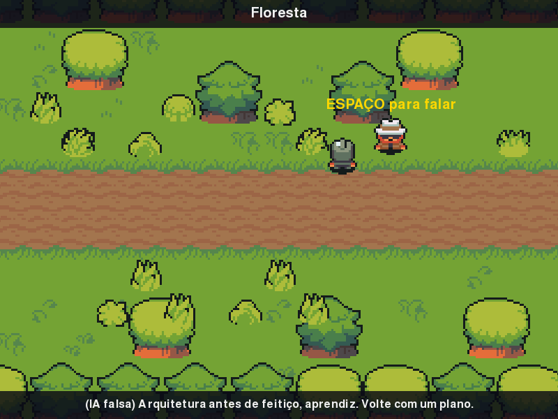

# MÓDULO 02A: Mundo vivo — caminhada animada e três cenas

Engenheiro, até agora o herói desliza parado pelo salão. Hoje ele anda de verdade, virando para cada lado, e o mundo cresce para três lugares: o salão, a floresta do mercador Brok e a entrada da masmorra. O conceito do dia organiza todo esse crescimento: **classes e objetos**.

## 🎯 O que você vai ver na tela ao final

O herói anda animado nas 4 direções, com sombra. A porta no meio da parede leste do salão leva à floresta, onde o Brok responde pelo Gemini; a estrada da floresta segue até o portão gradeado da masmorra. Uma barra no alto mostra o nome da cena.



## 🏢 Onde isso aparece no mercado

Todo sistema com muitas "coisas parecidas" (clientes, pedidos, sensores, inimigos) usa classes para descrever o molde uma vez e criar quantos objetos precisar. E todo jogo ou animação calcula o movimento pelo tempo que passou, não pelo número de quadros, para rodar igual num PC rápido e num lento. Configurar comportamento com dados, em vez de `if` espalhado, é como se mantêm cardápios, regras de preço e fases de jogo sem mexer no código.

## 🚦 Ponto de partida

- Seu projeto deve estar como no fim do M01, com o desafio concluído (o Mago lembra o Cristal de Kernel e a Sentinela do Salão responde).
- **Arquivos do curso:** traga a pasta deste módulo do seu clone do curso (feito no M00B). PowerShell: `git -C $HOME\kernel-quest-curso pull` e `Copy-Item -Recurse -Force $HOME\kernel-quest-curso\arquivos\M02A $HOME\curso-arquivos\`. bash: `git -C ~/kernel-quest-curso pull` e `cp -r ~/kernel-quest-curso/arquivos/M02A ~/curso-arquivos/`.
- Arquivos prontos deste módulo: pasta `M02A/` dentro de `curso-arquivos/`, com a pasta `assets/` (arte nova).
- Comando para conferir: com a venv ativa, `python main.py` abre o título e, depois, o salão com o Mago e a Sentinela.
- Duas sessões: **Sessão A**, Passos 1a a 2 (o herói animado e a classe `NPC`); **Sessão B**, Passos 3a a 3c, o Quebre de propósito e o desafio (o mundo com três cenas).

## ❓ Pergunta do dia

O jogo vai ganhar o Brok e, mais adiante, dezenas de personagens e lugares. Como fazer isso sem copiar o mesmo código para cada um, e sem o herói andar mais devagar num computador mais fraco?

Ao longo dos passos aparecem caixas **🔍 Pare e pesquise**: pesquise as duas perguntas na hora, anote as respostas e, no fim, explique ao Engenheiro Sênior em até 5 minutos. **Sem mentor?** Grave um áudio de até 5 minutos explicando os termos e ouça de volta: onde você hesitar, o termo ainda não está claro.

## 🛠️ Passo a passo

### Passo 1a (Preveja): velocidade por segundo

Copie o **conteúdo** de `curso-arquivos/M02A/assets/` para dentro da pasta `assets/` do projeto, mantendo as subpastas. O `cenarios/salao.png` será substituído por uma versão com uma porta na parede leste: é esperado.

```powershell
# PowerShell (Windows), na raiz do projeto
Copy-Item -Recurse -Force $HOME\curso-arquivos\M02A\assets\* assets\
```

```bash
# bash (Linux), na raiz do projeto
cp -r ~/curso-arquivos/M02A/assets/. assets/
```

Abra `assets/personagens/heroi/andar.png` num visualizador de imagens e amplie. É uma folha de sprites (*sprite sheet*): 4 colunas, uma por direção (baixo, cima, esquerda, direita), e 4 linhas, os quadros da caminhada. O `parado.png` tem uma linha só, com um quadro por direção. Animar é mostrar um quadro de cada vez, rápido o bastante para o olho enxergar movimento.

No topo do `main.py`, troque a linha da `VELOCIDADE` por estas. A velocidade passa a ser medida em pixels **por segundo** (já explico por quê):

```python
VELOCIDADE = 200  # pixels por SEGUNDO (multiplicada por dt, vale em qualquer FPS)
TEMPO_QUADRO = 0.15  # segundos que cada quadro da caminhada fica na tela
# Ordem das colunas nas folhas do pacote (andar.png e parado.png).
COLUNA = {"baixo": 0, "cima": 1, "esquerda": 2, "direita": 3}
```

A função `escrever` ganha um parâmetro a mais, `centro_x`, para centralizar um texto em qualquer ponto da tela, e não só no meio: no Passo 2, a dica "ESPAÇO para falar" vai aparecer sobre o NPC que estiver perto. Troque a função inteira por esta (se a sua solução do desafio do M01 já fez algo parecido, use esta versão do mesmo jeito: o Passo 2 chama o parâmetro pela posição, como sexto argumento):

```python
def escrever(tela, fonte, texto, cor, centro_y, centro_x=LARGURA // 2):
    """Desenha um texto centralizado em (centro_x, centro_y); sem centro_x, no meio da tela."""
    imagem = fonte.render(texto, True, cor)
    tela.blit(imagem, imagem.get_rect(center=(centro_x, centro_y)))
```

O `centro_x=LARGURA // 2` é um **valor padrão**: quem chama a função sem o sexto argumento (todas as chamadas que você já tem) continua escrevendo no meio da tela.

Logo depois da função `escrever`, acrescente a função que fatia uma folha em quadros. O `subsurface` devolve um pedaço retangular de uma imagem, sem copiar os pixels:

```python
def recortar_quadros(folha, colunas, linhas):
    """Fatia uma folha de sprites em quadros de 16×16, já ampliados 3×.

    Devolve uma lista por coluna: quadros[coluna][linha].
    """
    quadros = []
    for coluna in range(colunas):
        lista = []
        for linha in range(linhas):
            # subsurface() é uma "janela" sobre um pedaço da folha, sem copiar pixels.
            recorte = folha.subsurface((coluna * 16, linha * 16, 16, 16))
            lista.append(pygame.transform.scale_by(recorte, 3))
        quadros.append(lista)
    return quadros
```

Com ela, `quadros_andar[2][1]` vai ser o segundo quadro (linha 1) da caminhada para a esquerda (coluna 2). Ela entra em uso no Passo 1b.

No laço, troque a linha `tempo += relogio.tick(FPS) / 1000` por estas três. O `dt` (**delta time**) é quanto tempo passou desde o quadro anterior, em segundos:

```python
        dt = relogio.tick(FPS) / 1000  # delta time: segundos desde o último quadro
        dt = min(dt, 0.1)  # teto: depois de um congelamento (a IA pensando), nada de teletransporte
        tempo += dt
```

Por que o teto? Enquanto o Gemini pensa, o laço fica parado; quando a resposta chega, o primeiro quadro teria um `dt` de vários segundos, e o herói daria um salto enorme se você estivesse segurando uma seta. O `min` limita o quadro a 0,1 s.

**Preveja antes de rodar:** a `VELOCIDADE` agora vale 200, mas o movimento ainda é o do M01, que soma a velocidade **a cada quadro**. O que acontece quando você aperta uma seta?

Rode `python main.py` e dê um toque rápido numa seta.

Confira: o herói vai parar na parede. São 200 pixels a cada quadro, e até um toque rápido dura vários quadros. É isso que o `dt` vai consertar no Passo 1b.

### Passo 1b (Leia): o herói anda animado

Dentro do `main()`, troque o comentário `# No salão, cada personagem é uma imagem...` e as duas linhas do herói do salão (`sprite_heroi = ...` e `heroi_rect = ...`) por:

```python
    # Herói: 4 direções × 4 quadros andando e 1 quadro por direção parado.
    quadros_andar = recortar_quadros(carregar_imagem("personagens/heroi/andar.png"), 4, 4)
    quadros_parado = recortar_quadros(carregar_imagem("personagens/heroi/parado.png"), 4, 1)
    sombra = pygame.transform.scale_by(carregar_imagem("personagens/sombra.png"), 3)
    # FRect guarda a posição com casas decimais: com dt, cada passo é fracionário.
    heroi_rect = quadros_parado[0][0].get_frect(center=(LARGURA // 2, 480))
    direcao = "baixo"
    quadro = 0
    tempo_quadro = 0.0
```

O `FRect` é o `Rect` do pygame-ce com posição em números decimais. Ele será necessário porque, a 60 FPS, o herói vai andar 3,33 pixels por quadro, e um `Rect` comum jogaria fora o 0,33.

Agora o movimento. Na etapa de atualizar, troque os quatro `if` das teclas e a linha do `clamp_ip` por este bloco. Em vez de mover direto, cada tecla anota a direção (`dx`, `dy`) e para onde o herói está virado:

```python
        dx, dy = 0, 0  # direção do movimento neste quadro: -1, 0 ou 1 em cada eixo
        if teclas[pygame.K_LEFT] or teclas[pygame.K_a]:
            dx, direcao = -1, "esquerda"
        if teclas[pygame.K_RIGHT] or teclas[pygame.K_d]:
            dx, direcao = 1, "direita"
        if teclas[pygame.K_UP] or teclas[pygame.K_w]:
            dy, direcao = -1, "cima"
        if teclas[pygame.K_DOWN] or teclas[pygame.K_s]:
            dy, direcao = 1, "baixo"
        # Pixels por segundo × segundos do quadro = pixels deste quadro.
        heroi_rect.x += dx * VELOCIDADE * dt
        heroi_rect.y += dy * VELOCIDADE * dt
        heroi_rect.clamp_ip(area_livre)  # mantém o herói dentro do salão

        # Animação por tempo: troca de quadro a cada TEMPO_QUADRO segundos andando.
        if dx or dy:
            tempo_quadro += dt
            if tempo_quadro >= TEMPO_QUADRO:
                tempo_quadro -= TEMPO_QUADRO
                quadro = (quadro + 1) % 4  # depois do quadro 3 volta ao 0
            imagem_heroi = quadros_andar[COLUNA[direcao]][quadro]
        else:
            imagem_heroi = quadros_parado[COLUNA[direcao]][0]
```

Repare em duas coisas. A velocidade: 200 pixels por segundo × 1/60 de segundo = 3,33 pixels neste quadro; se o PC só conseguir 30 FPS, o `dt` dobra e o passo também, e o herói atravessa a sala no mesmo tempo. E a animação: o quadro também troca pelo tempo (`tempo_quadro` acumula o `dt`), não a cada volta do laço. O `% 4` (resto da divisão por 4) faz o quadro voltar a 0 depois do 3.

Por fim, na etapa de desenhar, troque a linha `tela.blit(sprite_heroi, heroi_rect)` pela sombra e pelo quadro atual:

```python
        tela.blit(sombra, sombra.get_rect(center=(heroi_rect.centerx, heroi_rect.bottom - 3)))
        tela.blit(imagem_heroi, heroi_rect)
```

Rode `python main.py`: o herói mexe as pernas ao andar, numa velocidade normal, e vira para o lado do movimento; ao parar, fica olhando para o último lado em que andou.

Perguntas de leitura:

- Por que o `quadro` volta a 0, e o que aconteceria sem o `% 4`?
- Depois de andar para a esquerda e soltar a tecla, que imagem aparece, e qual linha a escolhe?

**Modifique:** `TEMPO_QUADRO = 0.05`, rode e veja a caminhada acelerar (as pernas, não o herói). Volte para 0.15.

> 🔍 **Pare e pesquise: delta time** — Por que um jogo que soma "4 pixels por quadro" anda mais devagar num computador lento? Como multiplicar a velocidade pelo tempo do quadro resolve isso?

### Passo 2 (Leia): a classe `NPC`

O Mago e a Sentinela repetem o mesmo padrão: carregar a imagem, criar o retângulo, criar a área de conversa, desenhar, testar se o herói está perto. No M01 foram duas cópias desse código; com o Brok seriam três, com os próximos NPCs, dez. Uma **classe** descreve o padrão uma vez, e cada personagem vira um **objeto** criado a partir dela.

Logo depois da função `recortar_quadros`, acrescente a classe:

```python
class NPC:
    """Um personagem da cena: nome, sprite, posição e instrução de sistema (a persona)."""

    def __init__(self, nome, pasta, centro, instrucao):
        self.nome = nome
        self.instrucao = instrucao
        self.quadros = recortar_quadros(carregar_imagem(f"personagens/{pasta}/parado.png"), 4, 1)
        self.direcao = "baixo"
        self.rect = self.quadros[0][0].get_rect(center=centro)
        self.area_conversa = self.rect.inflate(100, 100)  # perto o bastante para falar

    def desenhar(self, tela, sombra):
        tela.blit(sombra, sombra.get_rect(center=(self.rect.centerx, self.rect.bottom - 3)))
        tela.blit(self.quadros[COLUNA[self.direcao]][0], self.rect)
```

O `__init__` roda quando você escreve `NPC(...)`: ele guarda os dados no próprio objeto (`self.nome`, `self.rect`, ...). Os atributos são esses dados; os métodos, como o `desenhar`, são funções que cada objeto sabe executar sobre os próprios dados.

No `main()`, troque as linhas que criam o Mago e a Sentinela (as de `sprite_mago`, `mago_rect`, `area_mago` e as da sua Sentinela, com os nomes que você usou no desafio do M01), até a linha `fala = ...`, por este bloco. As linhas `area_livre` e `na_titulo` voltam iguais; a lista de NPCs entra no lugar dos dois personagens, e o texto da faixa deixa de citar os dois pelo nome. **Use a instrução de sistema da sua Sentinela** (a `INSTRUCAO_SENTINELA`); a posição dela muda para perto da porta leste, que passa a funcionar no Passo 3c:

```python
    # Cada NPC é um objeto: os dados e o jeito de desenhar ficam juntos.
    npcs = [
        NPC("Arquimago Solaris", "mago", (LARGURA // 2, 120), INSTRUCAO_MAGO),
        NPC("Sentinela do Salão", "sentinela", (660, 170), INSTRUCAO_SENTINELA),
    ]
    area_livre = pygame.Rect(40, 40, LARGURA - 80, ALTURA - 80)  # o salão sem as paredes

    na_titulo = True  # o jogo começa na tela de título
    fala = "Ande com WASD ou as setas. Chegue perto de alguém para falar."
```

No laço, logo depois do `tempo += dt`, troque as linhas que testam se o herói está perto do Mago e da Sentinela por um único laço sobre a lista:

```python
        perto = None  # o NPC ao alcance da conversa, se houver
        for npc in npcs:
            if heroi_rect.colliderect(npc.area_conversa):
                perto = npc
                break  # basta o primeiro
```

O ESPAÇO fica genérico: quem responde é o objeto `perto`, com o nome e a instrução dele. Troque o seu `elif` do ESPAÇO inteiro (incluindo o trecho que decide quem responde) por:

```python
            elif evento.type == pygame.KEYDOWN and evento.key == pygame.K_SPACE and perto:
                if time.perf_counter() - ultima_chamada < INTERVALO_MINIMO:
                    continue  # ESPAÇO apertado rápido demais: ignora
                print(f"[REDE] {perto.nome} está pensando... (o jogo congela até a resposta)")
                inicio = time.perf_counter()
                # Chamada BLOQUEANTE: o loop para aqui até a resposta chegar.
                fala = ia.responder(perto.instrucao,
                                    f"O aprendiz {NOME} se aproxima e cumprimenta você.")
                ultima_chamada = time.perf_counter()
                print(f"[{perto.nome}] ({ultima_chamada - inicio:.1f} s) {fala}")
```

O `and perto` funciona porque `None` conta como falso e um objeto conta como verdadeiro.

Na etapa de desenhar, troque as linhas do Mago e da Sentinela, do `blit` do Mago até o fim dos `if` que escrevem "ESPAÇO para falar", por este trecho: cada NPC se desenha, o herói vem depois, e a dica aparece sobre quem estiver perto:

```python
        for npc in npcs:
            npc.desenhar(tela, sombra)
        tela.blit(sombra, sombra.get_rect(center=(heroi_rect.centerx, heroi_rect.bottom - 3)))
        tela.blit(imagem_heroi, heroi_rect)
        if perto:
            escrever(tela, fonte, "ESPAÇO para falar", COR_DESTAQUE, perto.rect.top - 15,
                     perto.rect.centerx)
```

Rode `python main.py`: o salão parece quase igual, agora com sombra sob o Mago e a Sentinela, que está mais perto da parede direita. Os dois continuam respondendo com ESPAÇO, e no terminal aparece o nome completo de quem falou. Um NPC novo agora custa **uma linha**.

Perguntas de leitura:

- Onde fica guardada a instrução de sistema de cada NPC, e como o ESPAÇO a encontra?
- O que o `break` evita no laço do `perto`?

> 🔍 **Pare e pesquise: classes e objetos** — Qual a diferença entre uma classe e um objeto (instância) dela? O que é o `self` e o que o método `__init__` faz quando você escreve `NPC(...)`?

O Passo 3 mexe em muitos lugares. Antes, faça um commit: se algo der errado, você tem um ponto seguro para voltar.

```bash
git add .
git commit -m "refactor: NPCs viram objetos da classe NPC"
```

> ⏸️ **Fim da Sessão A.** Commit feito, jogo funcionando. Pare aqui e continue na próxima sessão, no Passo 3a.

### Passo 3a (Leia): o molde e os dados do mundo

O mundo vai ter três lugares. Cada um tem um fundo, NPCs, portas e uma área onde o herói pode andar: outro padrão que se repete, outra classe. E as portas viram **dados**: a cena diz para onde leva cada lado, num dicionário como `{"leste": "FLORESTA"}`. Neste passo você só escreve o molde e os dados; o jogo passa a usá-los no 3b.

No topo, logo depois da linha do `COLUNA`, acrescente a área livre de uma cena e o tamanho das portas:

```python
AREA_LIVRE = pygame.Rect(40, 40, LARGURA - 80, ALTURA - 80)  # a cena sem as bordas
MEIA_PORTA = 72  # as portas têm 3 tiles (144 px) e ficam no meio dos lados leste e oeste
```

Depois da instrução da Sentinela, acrescente a do Brok, o mercador da floresta:

```python
INSTRUCAO_BROK = (
    "Você é Brok, mercador da floresta: frio, calculista e educado na medida do lucro. "
    "Não dá desconto, não vende fiado e lembra cada dívida, mas esconde uma dívida sua com o castelo. "
    "Responda em português, em texto simples (sem Markdown), "
    "em até 2 frases curtas, com no máximo 15 palavras no total."
)
```

Depois da classe `NPC`, acrescente a classe `Cena`, a função que monta o mundo e a função que descobre se o herói encostou numa porta:

```python
class Cena:
    """Um lugar do mundo: fundo, NPCs, portais e a área onde o herói pode andar."""

    def __init__(self, nome, fundo, npcs, portais, area=AREA_LIVRE):
        self.nome = nome
        self.fundo = carregar_imagem(f"cenarios/{fundo}")
        self.npcs = npcs
        self.portais = portais  # ex.: {"leste": "FLORESTA"} = a porta leste leva à floresta
        self.area = area


def criar_cenas():
    """O mundo como dados: quem está em cada cena e para onde leva cada porta."""
    return {
        "CASTELO": Cena("Salão do Castelo", "salao.png", [
            NPC("Arquimago Solaris", "mago", (LARGURA // 2, 120), INSTRUCAO_MAGO),
            NPC("Sentinela do Salão", "sentinela", (660, 170), INSTRUCAO_SENTINELA),
        ], {"leste": "FLORESTA"}),
        "FLORESTA": Cena("Floresta", "floresta.png", [
            NPC("Mercador Brok", "brok", (560, 190), INSTRUCAO_BROK),
        ], {"oeste": "CASTELO", "leste": "MASMORRA"}),
        # A masmorra termina no paredão de rocha: a área livre é mais estreita.
        "MASMORRA": Cena("Entrada da Masmorra", "masmorra.png", [], {"oeste": "FLORESTA"},
                         area=pygame.Rect(40, 40, 528, ALTURA - 80)),
    }


def porta_tocada(rect, area):
    """Diz se o herói encostou na porta "leste" ou "oeste" da área; senão, None."""
    if abs(rect.centery - area.centery) > MEIA_PORTA:
        return None  # longe do meio da altura, onde ficam as portas
    if rect.right >= area.right:
        return "leste"
    if rect.left <= area.left:
        return "oeste"
    return None
```

O `area=AREA_LIVRE` é outro parâmetro com valor padrão, como o `centro_x` da `escrever`: só a masmorra, que acaba no paredão, passa uma área diferente. E repare que a masmorra não tem porta leste nos dados: o portão continua fechado até alguém ter a chave.

Rode `python main.py`: o jogo deve estar **igual**. Nada usa a `Cena` ainda, mas rodar agora já pega erros de sintaxe neste trecho grande (parêntese, recuo, aspas), antes de eles se misturarem com as próximas mudanças. Um nome digitado errado dentro de uma função só aparece quando ela for chamada, no 3b.

Pergunta de leitura: por que só a masmorra passa `area=` ao criar a `Cena`?

### Passo 3b (Leia): o salão vira uma cena

Cinco trocas no `main()`. Nenhuma muda a tela: o salão passa a vir da cena `CASTELO`.

1. Apague a linha `fundo = carregar_imagem("cenarios/salao.png")`: cada cena tem o seu fundo.
2. Troque a lista `npcs = [...]` do Passo 2 (com o comentário dela) e a linha `area_livre = pygame.Rect(...)` logo abaixo, que virou a constante `AREA_LIVRE`, pelas duas linhas abaixo. Os NPCs do salão agora moram dentro da cena `CASTELO`, no `criar_cenas()`:

```python
    cenas = criar_cenas()
    cena = cenas["CASTELO"]
```

3. No laço do `perto`, troque `for npc in npcs:` por `for npc in cena.npcs:`.
4. Troque a linha do `clamp_ip`, para o herói respeitar a área da cena atual:

```python
        heroi_rect.clamp_ip(cena.area)  # mantém o herói dentro da área da cena
```

5. Na etapa de desenhar, troque o `tela.blit(fundo, (0, 0))` e a linha do `for` que desenha os NPCs, logo abaixo dele, pelo fundo e pelos NPCs da cena atual. Só a linha do `for` muda: o `npc.desenhar(tela, sombra)` de baixo fica como está.

```python
        tela.blit(cena.fundo, (0, 0))
        for npc in cena.npcs:
```

**Preveja antes de rodar:** o que muda na tela?

Rode `python main.py`. Nada muda: o salão, o Mago e a Sentinela são os mesmos, agora vindos dos dados da cena. Mudar a estrutura sem mudar o comportamento é um bom sinal de que a troca foi feita direito.

Pergunta de leitura: quais três nomes deixaram de existir no `main()` neste passo, e onde cada informação passou a morar?

### Passo 3c (Preveja): as portas

Logo depois do bloco da animação (antes do comentário `# 3. Desenhar`), acrescente os portais. A porta tocada só leva a algum lugar se a cena tiver aquele lado nos dados:

```python
        # Portais: a porta tocada só leva a algum lugar se a cena tiver esse lado nos dados.
        lado = porta_tocada(heroi_rect, cena.area)
        if lado in cena.portais:
            cena = cenas[cena.portais[lado]]
            # Na cena nova, o herói aparece logo depois da porta do lado oposto.
            if lado == "leste":
                heroi_rect.midleft = (cena.area.left + 20, cena.area.centery)
            else:
                heroi_rect.midright = (cena.area.right - 20, cena.area.centery)
```

E, logo antes da linha `tela.blit(faixa, (0, ALTURA - 40))`, acrescente uma barra no alto com o nome da cena (a mesma `faixa` do rodapé, desenhada também no topo):

```python
        tela.blit(faixa, (0, 0))
        escrever(tela, fonte, cena.nome, COR_TEXTO, 20)
```

Atualize a docstring do topo do `main.py`:

```python
"""
RPG Engine — Módulo 02A: Mundo vivo.

Tela de título e, depois dela, o mundo: três cenas ligadas por portas
(salão, floresta e entrada da masmorra). O herói anda animado com WASD
ou as setas e, perto de um NPC, ESPAÇO pede a fala dele ao Gemini.
"""
```

**Preveja antes de rodar:** a cena `MASMORRA` não tem `"leste"` nos portais. O que acontece quando o herói encosta no meio da parede direita da masmorra?

Teste primeiro com a IA falsa, sem gastar cota:

```powershell
# PowerShell (Windows)
$env:IA_FALSA = "1"; python main.py; Remove-Item Env:IA_FALSA
```

```bash
# bash (Linux)
IA_FALSA=1 python main.py
```

Ande até a abertura no meio da parede direita do salão: você chega à floresta, entrando pela esquerda. Fale com o Brok (a IA falsa dá a mesma fala para todos os NPCs), siga a estrada para a direita até a entrada da masmorra, confira a sua previsão no paredão e volte pela esquerda. Depois rode `python main.py` normalmente e ouça o Brok pelo Gemini. O herói ainda passa por cima dos NPCs: isso é o desafio.

Para acrescentar uma cena, agora basta uma entrada no dicionário e uma porta numa cena vizinha. Nenhum `if` novo.

> 🔍 **Pare e pesquise: dados que dirigem o código** — Que vantagem tem descrever as cenas e as portas num dicionário em vez de escrever um `if` para cada porta? O que precisaria mudar no código para acrescentar uma cena nova?

Tudo funcionando? Registre:

```bash
git status
git add .
git commit -m "feat: classe Cena, três cenas e portais"
git push
```

## 💥 Quebre de propósito

Antes de quebrar, meça: rode com a IA falsa e cronometre o herói atravessando o salão, de parede a parede, com `FPS = 60`.

Agora troque `FPS = 60` por `FPS = 15`. **Preveja:** com um quarto dos quadros, o herói atravessa o salão mais devagar ou no mesmo tempo? Rode e cronometre de novo.

A animação fica menos fluida, mas o herói atravessa no **mesmo tempo**: o `dt` ficou 4 vezes maior e compensou.

Ainda com 15 FPS, troque só a linha do `x` (`heroi_rect.x += dx * VELOCIDADE * dt`) por `heroi_rect.x += dx * 4`, como o M01 andava, e atravesse o salão na horizontal. O herói se arrasta a 60 pixels por segundo (4 × 15), menos de um terço dos 200 com `dt`. Num PC fraco, que não consegue 60 FPS, todo jogo sem delta time fica assim. Desfaça as duas mudanças.

## 🧯 Problemas comuns

| Sintoma | Causa provável | Como resolver |
| --- | --- | --- |
| `TypeError: escrever() takes 5 positional arguments but 6 were given` perto de um NPC | A função `escrever` ainda é a antiga, sem o `centro_x` | Troque a função pela versão do Passo 1a |
| `[ERRO] Arquivo não encontrado: .../personagens/heroi/andar.png` | A pasta `assets/` do módulo não foi copiada, ou virou `assets/assets/` | Copie o **conteúdo** de `curso-arquivos/M02A/assets/` para `assets/` |
| O herói quase não se mexe | A `VELOCIDADE` ainda vale 4: com `dt`, são 4 pixels por **segundo** | Use `VELOCIDADE = 200` |
| Depois de uma fala da IA, o herói dá um salto | Faltou o teto do `dt`: o quadro após o congelamento vale segundos | Confira `dt = min(dt, 0.1)` logo depois do `relogio.tick` |
| `IndexError: list index out of range` na animação | O índice do quadro passou do tamanho da lista (faltou o `% 4`) | Confira `quadro = (quadro + 1) % 4` |
| A animação "pisca" ou anda rápido demais | O quadro troca a cada volta do laço, sem o `tempo_quadro` | Some o `dt` em `tempo_quadro` e troque só quando passar de `TEMPO_QUADRO` |
| `AttributeError: ... has no attribute 'get_frect'` | O pygame instalado é o original, não o `pygame-ce` | `pip uninstall pygame` e `pip install -r requirements.txt` |
| `TypeError: NPC.__init__() missing 1 required positional argument` | Faltou um dos quatro dados do NPC | `NPC(nome, pasta, (x, y), instrucao)`, nessa ordem |
| `KeyError: 'FLORESTA'` | O nome no portal não bate com a chave do dicionário de cenas | Maiúsculas e grafia iguais nos dois lugares |
| Encostar na parede direita não troca de cena | O herói não está no meio da altura, onde fica a porta | Ande até a abertura (o meio da parede) |
| O herói vai e volta entre duas cenas sem parar | O ponto de chegada ficou encostado na porta | Mantenha o `+ 20` / `- 20` do ponto de chegada |
| `NameError: name 'npcs' is not defined` | Sobrou um `npcs` depois do Passo 3b | Troque por `cena.npcs` |
| `NameError: name 'fundo' is not defined` (ou `'area_livre'`) | No Passo 3b, um nome saiu do `main()` mas ainda é usado | Faça os cinco itens do 3b: o desenho usa `cena.fundo` e o `clamp_ip` usa `cena.area` |
| `TypeError: escrever() got an unexpected keyword argument ...` | Alguma chamada sua (do desafio do M01) usa o parâmetro com outro nome, como `x=` | Troque o nome na chamada por `centro_x=`, ou passe o valor como sexto argumento, sem nome |

## 🧩 Desafio de Engenharia

O herói atravessa os NPCs como um fantasma, e a floresta merece mais um morador.

**Critérios de aceite:**

- [ ] Colisão sólida: o herói não atravessa nenhum NPC. Quando bater, desfaça o movimento **só no eixo que colidiu** (assim ele desliza ao longo do NPC em vez de grudar), e pare de procurar na primeira colisão encontrada.
- [ ] Um NPC novo na floresta, com personalidade própria criada por você, no tom adulto do jogo (motivação, algo que ele esconde, um conflito com alguém do mundo). Use uma destas pastas de `assets/personagens/`, que têm sprite e retrato (o retrato entra no M02B): `cacador`, `herbalista` ou `batedor`. ESPAÇO perto dele faz **ele** responder.
- [ ] Velocidade igual em 30 e 60 FPS, inclusive com a colisão. Prove: cronometre a travessia da floresta, de porta a porta, com `FPS = 30` e com `FPS = 60`; a diferença deve ficar abaixo de meio segundo. Depois volte a `FPS = 60`.
- [ ] Commit no padrão Conventional Commits (por exemplo, `feat: colisão com NPCs e caçador na floresta`) e push na `main`.
- [ ] Você explica ao Engenheiro Sênior, sem ler e em até 5 minutos, os três termos das caixas 🔍 (delta time, classes e objetos, dados que dirigem o código). **Sem mentor?** Grave a explicação em áudio e ouça de volta.

Dica: hoje o herói anda nos dois eixos de uma vez. Para saber qual eixo colidiu, separe o movimento em dois, um eixo de cada vez:

```text
mova o herói só no eixo x
se ele colidiu com algum NPC: desfaça só o movimento em x
mova o herói só no eixo y
se ele colidiu com algum NPC: desfaça só o movimento em y
```

"Colidiu com algum NPC" é um laço sobre `cena.npcs` que para no primeiro que bater: vale a pena virar uma função.

Lembre as regras de uso de IA do M00B: pode pedir explicação de conceito e de erro, não pode pedir a solução pronta, e deve saber explicar ao Engenheiro Sênior cada trecho que veio de uma IA. **Sem mentor?** Escreva essa explicação na mensagem do commit.

**Entrega:** push na `main` e um print do NPC novo respondendo, enviado ao Engenheiro Sênior, com os dois tempos da travessia. **Sem mentor?** Guarde os prints na pasta `entregas/` do projeto e inclua-os no commit: viram o seu portfólio, dentro do seu repositório.

## ⭐ Bônus (opcional)

- **Uma quarta cena só com dados:** por exemplo, uma clareira entre a floresta e a masmorra, reaproveitando o `floresta.png`. Só valem mudanças no `criar_cenas()`: nenhum `if` novo.
- **NPCs viram para o herói** quando ele chega perto. O `parado.png` de cada NPC já tem os 4 lados, e o `desenhar` já usa `self.direcao`.

## 💼 Resumo profissional

- **Conceito:** orientação a objetos (classes `NPC` e `Cena`, atributos, métodos e parâmetros com valor padrão), animação por folha de sprites, movimento independente da taxa de quadros (delta time) e mundo configurado por dados.
- **Linha para o currículo:** "Estruturei um jogo 2D em Python com orientação a objetos, animação por sprite sheet, movimento independente de FPS (delta time) e cenas configuradas por dados, com NPCs que respondem via Gemini."
