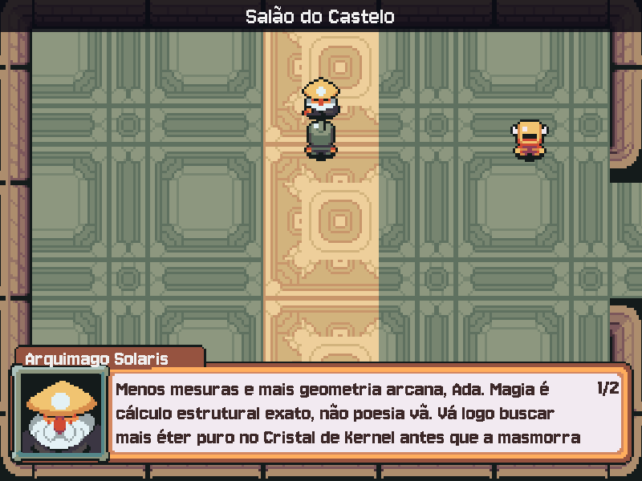

# MÓDULO 02B: Interface — menu, pausa e caixa de diálogo

Engenheiro, o jogo funciona, mas ainda parece um protótipo: abre numa tela que aceita qualquer tecla e mostra as falas numa linha solta no rodapé. Hoje ele ganha cara de produto: menu com música, pausa, e uma caixa de diálogo com o retrato de quem fala, o texto aparecendo letra a letra e dividido em páginas. O conceito que organiza tudo isso é a **máquina de estados**.

## 🎯 O que você vai ver na tela ao final

O jogo abre num menu com música, na fonte pixel. No mundo, ESC pausa. Perto de um NPC, ESPAÇO abre a caixa de diálogo com o retrato e o nome dele: primeiro "Pensando...", depois a fala do Gemini escrita letra a letra, com uma voz. Se a fala não couber, aparece o contador "1/2" e uma seta ▼ piscando; na última página, um quadrado ■ avisa que a fala terminou. Cada cena tem a sua música.



## 🏢 Onde isso aparece no mercado

Máquinas de estados estão em todo sistema que "está em algum momento" e só pode ir para certos próximos momentos: o pedido de um e-commerce (pago → enviado → entregue), o caixa eletrônico, o semáforo, o fluxo de aprovação de um documento e as telas de qualquer aplicativo. Quebra de linha e paginação de texto são o dia a dia de quem faz interface: legendas, chats, leitores de e-book. E toda interface gráfica desenha em camadas, do fundo para a frente.

## 🚦 Ponto de partida

- Seu projeto deve estar como no fim do M02A, com o desafio concluído (o herói não atravessa os NPCs e há um NPC seu na floresta).
- Arquivos prontos deste módulo: pasta `M02B/` dentro de `curso-arquivos/`, com a pasta `assets/` (fonte, caixa de diálogo, retratos, músicas e sons).
- Comando para conferir: com a venv ativa, `python main.py` abre o título e, depois de uma tecla, o salão.
- Quatro sessões, de 45 a 90 minutos: **Sessão A**, Passos 1a a 1c (fonte, música e menu); **Sessão B**, Passos 2a a 2c (a máquina de estados e a pausa); **Sessão C**, Passos 3a a 3c (a caixa de diálogo); **Sessão D**, Passo 4, o Quebre de propósito e o desafio ("Pensando...", a voz e a tela de Créditos).

## ❓ Pergunta do dia

Num jogo de verdade, a mesma tecla faz coisas diferentes: ESC pausa no mundo, volta no menu, fecha a conversa no diálogo. Como o código sabe o que fazer, sem virar um emaranhado de `if`?

Ao longo dos passos aparecem caixas **🔍 Pare e pesquise**: pesquise as duas perguntas na hora, anote as respostas e, no fim, explique ao Engenheiro Sênior em até 5 minutos. **Sem mentor?** Grave um áudio de até 5 minutos explicando os termos e ouça de volta: onde você hesitar, o termo ainda não está claro.

## 🛠️ Passo a passo

### Passo 1a (Leia): a fonte pixel

Copie o **conteúdo** de `curso-arquivos/M02B/assets/` para dentro da pasta `assets/` do projeto, mantendo as subpastas. O `CREDITOS.md` será substituído por uma versão com as linhas novas: é esperado.

```powershell
# PowerShell (Windows), na raiz do projeto
Copy-Item -Recurse -Force $HOME\curso-arquivos\M02B\assets\* assets\
```

```bash
# bash (Linux), na raiz do projeto
cp -r ~/curso-arquivos/M02B/assets/. assets/
```

Chegaram: a fonte **Jersey 10** em `assets/fontes/` (com o `OFL.txt`, a licença que permite usá-la no jogo desde que o arquivo de licença vá junto), as músicas em `assets/musicas/`, os sons em `assets/sons/`, a caixa de diálogo em `assets/interface/` e um `retrato.png` dentro da pasta de cada NPC.

No topo do `main.py`, logo depois da linha `PASTA_ASSETS = ...`, acrescente o caminho da fonte:

```python
FONTE_PIXEL = PASTA_ASSETS / "fontes" / "Jersey10-Regular.ttf"
```

Na função `escrever`, troque o `True` do `render` por `False`. O `True` suaviza as bordas das letras (*antialiasing*), o que borra uma fonte pixel:

```python
    imagem = fonte.render(texto, False, cor)  # False: sem suavização, pixel nítido
```

No `main()`, troque as quatro fontes `Font(None, ...)`, com o comentário acima delas, pelas fontes da Jersey 10:

```python
    # Jersey 10: fonte pixel (licença OFL) que viaja junto com o jogo, em assets/fontes/.
    fonte_jogo = pygame.font.Font(FONTE_PIXEL, 96)
    fonte_titulo = pygame.font.Font(FONTE_PIXEL, 48)
    fonte = pygame.font.Font(FONTE_PIXEL, 32)
    fonte_fala = pygame.font.Font(FONTE_PIXEL, 28)
```

Rode `python main.py`: o título e o mundo passam a usar a fonte pixel, nítida, sem borrão. O layout do título ainda é o antigo; ele vira um menu no 1c.

### Passo 1b (Preveja): a música do título

Logo depois da função `carregar_imagem`, acrescente a função que toca a música de fundo. O `pygame.mixer.music` toca um arquivo longo em *streaming*, sem carregar tudo na memória; o `get_init()` diz se o computador tem um dispositivo de áudio. Sem áudio, o jogo segue mudo em vez de quebrar:

```python
def tocar_musica(nome):
    """Troca a música de fundo por assets/musicas/<nome>.ogg, em loop. Sem áudio, segue mudo."""
    if pygame.mixer.get_init():
        pygame.mixer.music.load(PASTA_ASSETS / "musicas" / f"{nome}.ogg")
        pygame.mixer.music.play(-1)  # -1 = repetir para sempre
```

No `main()`, acrescente um comentário ao `pygame.init()`, que passa a ligar o som também:

```python
    pygame.init()  # também liga o áudio (pygame.mixer), se houver dispositivo de som
```

E, logo depois da linha `ultima_chamada = ...`, ligue a música de título:

```python
    tocar_musica("titulo")
```

**Preveja antes de rodar:** a música começa no título. O que acontece com ela quando você aperta uma tecla e entra no salão?

Rode `python main.py` e confira. A explicação vem no Passo 2b.

### Passo 1c (Leia): o menu

Logo depois da linha `INTERVALO_MINIMO = ...`, acrescente as opções do menu:

```python
OPCOES_MENU = ["Novo jogo", "Sair"]
```

Logo depois da função `escrever`, acrescente a função que desenha um menu. A opção escolhida fica dourada e entre setas:

```python
def desenhar_menu(tela, fonte, opcoes, escolha, topo):
    """Uma opção por linha, a partir de topo; a escolhida fica dourada e entre setas."""
    for i, opcao in enumerate(opcoes):
        if i == escolha:
            escrever(tela, fonte, f"> {opcao} <", COR_DESTAQUE, topo + i * 50)
        else:
            escrever(tela, fonte, opcao, COR_TEXTO, topo + i * 50)
```

O painel do título fica menor, do tamanho do menu. Troque a linha do `painel = pygame.Surface(...)` por:

```python
    painel = pygame.Surface((360, 130), pygame.SRCALPHA)
```

Logo depois da linha `na_titulo = True`, acrescente a opção marcada no menu:

```python
    escolha = 0  # a opção marcada no menu (índice da lista de opções)
```

Por fim, dentro do `if na_titulo:`, troque tudo o que vem depois da linha `tela.fill(...)` (o título, o herói, o painel e os textos, até o `continue`) pelo menu:

```python
            escrever(tela, fonte_jogo, NOME_JOGO, COR_DESTAQUE, 70)
            tela.blit(heroi, heroi.get_rect(center=(LARGURA // 2, 210 + respiracao)))
            escrever(tela, fonte_titulo, f"Bem-vindo, {NOME}!", COR_DESTAQUE, 315)
            tela.blit(painel, painel.get_rect(center=(LARGURA // 2, 420)))
            desenhar_menu(tela, fonte, OPCOES_MENU, escolha, 395)
            escrever(tela, fonte_fala, f"IA: {MODELO_IA}  ·  Python {platform.python_version()}"
                                       f"  ·  {platform.system()}", (160, 160, 170), 530)
            escrever(tela, fonte_fala, "Setas: escolher  ·  ENTER: confirmar  ·  ESC: sair",
                     (160, 160, 170), 565)
            pygame.display.flip()
            continue  # volta ao início do loop sem desenhar o mundo
```

Rode `python main.py`: o jogo abre num menu com música, com o nome do jogo na fonte pixel e "> Novo jogo <" marcado. Por enquanto, qualquer tecla ainda começa o jogo, inclusive as setas: no Passo 2c o menu passa a obedecer.

Perguntas de leitura:

- No `desenhar_menu`, o que decide se uma opção sai dourada e entre setas?
- A distância entre duas opções do menu é sempre a mesma. Em que conta ela aparece?

Fim da Sessão A. Registre:

```bash
git add .
git commit -m "feat: fonte pixel, música e menu de título"
```

> ⏸️ **Fim da Sessão A.** Commit feito, jogo funcionando. Pare aqui e continue na próxima sessão, no Passo 2a.

### Passo 2a (Leia): os estados e os sons

Hoje o jogo decide o que cada tecla faz com um booleano, `na_titulo`. Com pausa e diálogo, viriam `pausado` e `conversando`, e logo combinações impossíveis: pausado **e** conversando **e** no título. Uma **máquina de estados** troca os booleanos por uma única variável que vale um estado de cada vez, e uma tabela diz de qual estado se pode ir para qual. Qualquer mudança fora da tabela é bug, e o jogo recusa. Neste passo você escreve as peças; no 2c o laço passa a usá-las.

No topo, junto dos outros `import`, acrescente:

```python
from enum import Enum, auto
```

Logo depois da linha `OPCOES_MENU = ...`, acrescente as opções da pausa, os estados e a tabela de transições. Um `Enum` é um conjunto fechado de valores com nome: `Estado.PAUSA` não pode ser digitado errado sem o Python reclamar, ao contrário de um texto `"pausa"`. O `auto()` numera os valores sozinho:

```python
OPCOES_PAUSA = ["Continuar", "Menu principal"]


class Estado(Enum):
    """Os estados do jogo: em cada um, as teclas fazem uma coisa diferente."""
    MENU = auto()
    EXPLORANDO = auto()
    DIALOGO = auto()
    PAUSA = auto()


# Para onde cada estado pode ir. Qualquer mudança fora desta tabela é bug.
TRANSICOES = {
    Estado.MENU: {Estado.EXPLORANDO},
    Estado.EXPLORANDO: {Estado.DIALOGO, Estado.PAUSA},
    Estado.DIALOGO: {Estado.EXPLORANDO},
    Estado.PAUSA: {Estado.EXPLORANDO, Estado.MENU},
}
```

Leia a tabela como frases: do MENU só se vai para EXPLORANDO; de EXPLORANDO, para DIALOGO ou PAUSA; e assim por diante. O DIALOGO já está na tabela, embora só ganhe tela no Passo 3b.

Antes da função `porta_tocada`, acrescente o único jeito de mudar de estado no jogo inteiro:

```python
def mudar_estado(atual, novo):
    """Muda de estado só se a tabela TRANSICOES permitir; senão, avisa e fica onde está."""
    if novo not in TRANSICOES[atual]:
        print(f"[BLOQUEADO] {atual.name} -> {novo.name}: fora da tabela de transições")
        return atual
    print(f"[ESTADO] {atual.name} -> {novo.name}")
    return novo
```

Antes da função `tocar_musica`, acrescente as funções dos efeitos sonoros. Um `Sound` fica inteiro na memória e toca na hora, bom para efeitos curtos; quando não há áudio, `carregar_som` devolve `None` e `tocar` simplesmente não faz nada:

```python
def carregar_som(nome_arquivo, volume=1.0):
    """Carrega um efeito de assets/sons/. Sem dispositivo de áudio, devolve None."""
    if not pygame.mixer.get_init():
        return None
    som = pygame.mixer.Sound(PASTA_ASSETS / "sons" / nome_arquivo)
    som.set_volume(volume)  # de 0.0 (mudo) a 1.0 (volume do arquivo)
    return som


def tocar(som):
    """Toca um efeito, se houver áudio (som é None quando não há)."""
    if som:
        som.play()
```

No `main()`, logo depois das duas linhas da `faixa`, acrescente o véu escuro da pausa e os sons de menu:

```python
    veu = pygame.Surface((LARGURA, ALTURA), pygame.SRCALPHA)
    veu.fill((10, 10, 20, 160))  # escurece o mundo atrás do menu de pausa
    som_ok = carregar_som("menu_ok.wav")
    som_voltar = carregar_som("menu_voltar.wav")
```

Rode `python main.py`: o jogo deve estar **igual**. Nada usa as peças novas ainda; rodar agora pega erros de sintaxe (parêntese, recuo, dois-pontos) antes de eles se misturarem com as próximas mudanças.

Perguntas de leitura:

- Na tabela `TRANSICOES`, de quais estados se pode chegar ao MENU?
- O que o `mudar_estado` devolve quando a transição é recusada, e por que isso deixa o jogo onde estava?

### Passo 2b (Preveja): uma música por cena

Cada cena passa a ter a sua música. Na classe `Cena`, troque a docstring e o `__init__` (até a linha do `self.fundo`) por:

```python
    """Um lugar do mundo: fundo, música, NPCs, portais e a área onde o herói pode andar."""

    def __init__(self, nome, fundo, musica, npcs, portais, area=AREA_LIVRE):
        self.nome = nome
        self.fundo = carregar_imagem(f"cenarios/{fundo}")
        self.musica = musica
```

No `criar_cenas()`, acrescente o nome da música (o arquivo em `assets/musicas/`, sem o `.ogg`) logo depois do fundo de cada cena. As linhas que mudam:

```python
        "CASTELO": Cena("Salão do Castelo", "salao.png", "salao", [
```

```python
        "FLORESTA": Cena("Floresta", "floresta.png", "floresta", [
```

```python
        "MASMORRA": Cena("Entrada da Masmorra", "masmorra.png", "masmorra", [],
                         {"oeste": "FLORESTA"}, area=pygame.Rect(40, 40, 528, ALTURA - 80)),
```

Nos portais, logo depois da linha `cena = cenas[cena.portais[lado]]`, troque a música:

```python
            tocar_musica(cena.musica)  # cada cena tem a sua música
```

**Preveja antes de rodar:** o que você vai ouvir ao passar pela porta leste do salão? E ao voltar?

Rode `python main.py`, entre no jogo e passe pelas portas: a floresta tem a sua música, a masmorra outra. (A primeira cena ainda toca a música do título: o "Novo jogo", no 2c, liga a música do salão.)

### Passo 2c (Leia): a máquina de estados no laço

Agora o coração da parte: o laço passa a perguntar ao estado o que cada tecla faz.

Troque a linha `na_titulo = True ...` por:

```python
    estado = Estado.MENU  # o jogo começa no menu principal
```

Troque o bloco inteiro de eventos, do comentário `# 1. Eventos` até o fim do `elif` do ESPAÇO, por este. A mesma tecla passa a fazer coisas diferentes conforme o estado:

```python
        # 1. Eventos: a mesma tecla faz coisas diferentes em cada estado.
        for evento in pygame.event.get():
            if evento.type == pygame.QUIT:
                rodando = False
            if evento.type != pygame.KEYDOWN:
                continue  # daqui para baixo, só teclas apertadas
            tecla = evento.key
            if estado in (Estado.MENU, Estado.PAUSA):
                opcoes = OPCOES_MENU if estado == Estado.MENU else OPCOES_PAUSA
                if tecla in (pygame.K_UP, pygame.K_w):
                    escolha = (escolha - 1) % len(opcoes)  # de cima, dá a volta para baixo
                elif tecla in (pygame.K_DOWN, pygame.K_s):
                    escolha = (escolha + 1) % len(opcoes)
                elif tecla == pygame.K_ESCAPE and estado == Estado.MENU:
                    rodando = False  # ESC no menu principal fecha o jogo
                elif tecla == pygame.K_ESCAPE:
                    tocar(som_voltar)
                    estado = mudar_estado(estado, Estado.EXPLORANDO)
                elif tecla == pygame.K_RETURN:
                    tocar(som_ok)
                    opcao = opcoes[escolha]
                    escolha = 0  # o próximo menu começa na primeira opção
                    if opcao == "Sair":
                        rodando = False
                    elif opcao == "Novo jogo":
                        cena = cenas["CASTELO"]
                        heroi_rect.center = (LARGURA // 2, 480)
                        estado = mudar_estado(estado, Estado.EXPLORANDO)
                        tocar_musica(cena.musica)
                    elif opcao == "Continuar":
                        estado = mudar_estado(estado, Estado.EXPLORANDO)
                    elif opcao == "Menu principal":
                        estado = mudar_estado(estado, Estado.MENU)
                        tocar_musica("titulo")
            elif estado == Estado.EXPLORANDO:
                if tecla == pygame.K_ESCAPE:
                    tocar(som_ok)
                    escolha = 0  # a pausa sempre abre em "Continuar"
                    estado = mudar_estado(estado, Estado.PAUSA)
                elif tecla == pygame.K_SPACE and perto:
                    if time.perf_counter() - ultima_chamada < INTERVALO_MINIMO:
                        continue  # ESPAÇO apertado rápido demais: ignora
                    print(f"[REDE] {perto.nome} está pensando... (o jogo congela até a resposta)")
                    inicio = time.perf_counter()
                    # Chamada BLOQUEANTE: o loop para aqui até a resposta chegar.
                    fala = ia.responder(perto.instrucao,
                                        f"O aprendiz {NOME} se aproxima e cumprimenta você.")
                    ultima_chamada = time.perf_counter()
                    print(f"[{perto.nome}] ({ultima_chamada - inicio:.1f} s) {fala}")
```

Os `if` continuam existindo, agora organizados por estado: cada bloco só cuida das teclas do seu momento, e a tabela diz para onde se pode ir. Repare: nenhuma linha escreve `estado = Estado.ALGUMA_COISA` direto (fora a linha que começa o jogo no MENU); tudo passa por `mudar_estado`. O ESPAÇO ainda funciona como antes, com a fala no rodapé; ele muda no Passo 3b. E o `% len(opcoes)` faz a seta para cima, na primeira opção, ir para a última.

Troque a linha `if na_titulo:` por:

```python
        if estado == Estado.MENU:
```

No diálogo e na pausa, as setas servem ao menu e às páginas: o herói não pode andar nem virar. Na etapa de atualizar, ponha os quatro `if` das teclas dentro de um `if` do estado (eles ganham 4 espaços de recuo):

```python
        if estado == Estado.EXPLORANDO:  # no diálogo e na pausa, o herói nem anda nem vira
            if teclas[pygame.K_LEFT] or teclas[pygame.K_a]:
                dx, direcao = -1, "esquerda"
            if teclas[pygame.K_RIGHT] or teclas[pygame.K_d]:
                dx, direcao = 1, "direita"
            if teclas[pygame.K_UP] or teclas[pygame.K_w]:
                dy, direcao = -1, "cima"
            if teclas[pygame.K_DOWN] or teclas[pygame.K_s]:
                dy, direcao = 1, "baixo"
```

Por fim, troque a etapa de desenhar inteira, do comentário `# 3. Desenhar` até antes do `pygame.display.flip()`, pela versão em **camadas**. O que é desenhado depois cobre o que veio antes: o fundo, depois as entidades (NPCs e herói), depois a interface. A pausa é a última camada: o véu translúcido escurece tudo o que já está na tela, e o menu vem por cima dele:

```python
        # 3. Desenhar em camadas: o que é desenhado depois cobre o que veio antes.
        # Camada 1, o fundo.
        tela.blit(cena.fundo, (0, 0))
        # Camada 2, as entidades: NPCs e herói, cada um sobre a sua sombra.
        for npc in cena.npcs:
            npc.desenhar(tela, sombra)
        tela.blit(sombra, sombra.get_rect(center=(heroi_rect.centerx, heroi_rect.bottom - 3)))
        tela.blit(imagem_heroi, heroi_rect)
        # Camada 3, a interface: sempre por cima do mundo.
        tela.blit(faixa, (0, 0))
        escrever(tela, fonte, cena.nome, COR_TEXTO, 20)
        tela.blit(faixa, (0, ALTURA - 40))
        escrever(tela, fonte_fala, fala, COR_TEXTO, ALTURA - 20)
        if estado == Estado.EXPLORANDO and perto:
            escrever(tela, fonte, "ESPAÇO para falar", COR_DESTAQUE, perto.rect.top - 15,
                     perto.rect.centerx)
        elif estado == Estado.PAUSA:
            tela.blit(veu, (0, 0))
            escrever(tela, fonte_jogo, "Pausa", COR_DESTAQUE, 220)
            tela.blit(painel, painel.get_rect(center=(LARGURA // 2, 355)))
            desenhar_menu(tela, fonte, OPCOES_PAUSA, escolha, 330)
```

> 🔍 **Pare e pesquise: renderização em camadas** — Em que ordem um jogo 2D desenha fundo, personagens e interface, e por quê? O que aconteceria se a caixa de diálogo fosse desenhada antes dos personagens?

Rode `python main.py`. No menu, as setas mudam a opção e ENTER confirma; "Sair" fecha o jogo. "Novo jogo" entra no salão com a música dele. ESC no mundo pausa; ESC de novo (ou "Continuar") volta; "Menu principal" volta ao menu e à música de título. No terminal, cada mudança aparece como `[ESTADO] MENU -> EXPLORANDO`.

Perguntas de leitura:

- Quantas vezes o código escreve `estado = Estado.` sem passar por `mudar_estado`? Por quê?
- Por que a pausa sempre abre em "Continuar"? Qual linha garante isso?

> 🔍 **Pare e pesquise: máquina de estados** — O que é um estado e o que é uma transição? Por que uma tabela de transições permitidas evita bugs que vários booleanos soltos (`na_titulo`, `pausado`, `conversando`) deixariam acontecer?

Fim da Sessão B. Registre:

```bash
git add .
git commit -m "feat: máquina de estados, menu e pausa"
```

> ⏸️ **Fim da Sessão B.** Commit feito, jogo funcionando. Pare aqui e continue na próxima sessão, no Passo 3a.

### Passo 3a (Leia): as peças da caixa de diálogo

A fala sai do rodapé e vai para a caixa de diálogo do pacote, com o retrato e o nome de quem fala. Três problemas aparecem: o texto precisa caber na largura da caixa (**quebra de linha**), a caixa só tem espaço para 3 linhas (páginas) e o jogador precisa saber se ainda há texto (▼ e o contador "1/2") ou se a fala acabou (■). Neste passo, as peças; no 3b, a caixa entra no jogo.

No topo, logo depois da `COR_DESTAQUE`, acrescente a cor do texto da caixa:

```python
COR_CAIXA = (60, 40, 40)  # texto escuro sobre o papel claro da caixa de diálogo
```

E antes da linha `OPCOES_MENU = ...`, a largura de uma linha e o tamanho da página:

```python
LARGURA_TEXTO = 580  # largura máxima de uma linha na caixa de diálogo, em pixels
LINHAS_POR_PAGINA = 3
```

Logo depois da função `desenhar_menu`, acrescente a quebra de linha. Ela junta palavras enquanto a linha couber na largura, medida em pixels com `fonte.size()`:

```python
def quebrar_linhas(texto, fonte, largura_max):
    """Word wrap: junta palavras numa linha enquanto couberem em largura_max pixels."""
    linhas = []
    atual = ""
    for palavra in texto.split():
        tentativa = f"{atual} {palavra}".strip()
        if fonte.size(tentativa)[0] <= largura_max or not atual:
            atual = tentativa  # cabe (ou é a primeira palavra da linha): continua nesta linha
        else:
            linhas.append(atual)  # não cabe: fecha a linha e começa outra com a palavra
            atual = palavra
    linhas.append(atual)
    return linhas
```

Na classe `NPC`, logo antes da linha `self.direcao = "baixo"`, carregue o retrato:

```python
        # Retrato de 38×38 ampliado na mesma escala da caixa de diálogo (2,6×).
        retrato = carregar_imagem(f"personagens/{pasta}/retrato.png")
        self.retrato = pygame.transform.scale_by(retrato, 2.6)
```

Logo depois da classe `NPC` (antes da `Cena`), acrescente a classe da caixa de diálogo. Ela guarda a fala já quebrada em páginas e quantas letras já apareceram, e sabe avançar, voltar e se desenhar:

```python
class Dialogo:
    """Uma fala na caixa: quem fala, as páginas de até 3 linhas e quantas letras já apareceram."""

    def __init__(self, npc, texto, fonte):
        self.npc = npc
        self.fonte = fonte
        linhas = quebrar_linhas(texto, fonte, LARGURA_TEXTO)
        # Fatias de 3 em 3 linhas: [l0, l1, l2], [l3, l4, l5], ...
        self.paginas = [linhas[i:i + LINHAS_POR_PAGINA]
                        for i in range(0, len(linhas), LINHAS_POR_PAGINA)]
        self.pagina = 0
        self.letras = 0.0  # máquina de escrever: quantas letras da página já estão visíveis

    def letras_da_pagina(self):
        return sum(len(linha) for linha in self.paginas[self.pagina])

    def pagina_completa(self):
        return self.letras >= self.letras_da_pagina()

    def ultima_pagina(self):
        return self.pagina == len(self.paginas) - 1

    def avancar(self):
        """Completa a página, vai para a próxima ou, na última, encerra (devolve False)."""
        if not self.pagina_completa():
            self.letras = self.letras_da_pagina()  # pula a máquina de escrever
        elif not self.ultima_pagina():
            self.pagina += 1
            self.letras = 0.0
        else:
            return False
        return True

    def voltar(self):
        if self.pagina > 0:
            self.pagina -= 1
            self.letras = self.letras_da_pagina()  # página já lida aparece inteira

    def desenhar(self, tela, caixa, tempo):
        x, y = (LARGURA - caixa.get_width()) // 2, ALTURA - caixa.get_height() - 20
        tela.blit(caixa, (x, y))
        tela.blit(self.npc.retrato, (x + 18, y + 37))
        tela.blit(self.fonte.render(self.npc.nome, False, COR_TEXTO), (x + 22, y + 2))
        # Cada linha mostra só as letras que já "chegaram"; o resto fica para os próximos quadros.
        resta = int(self.letras)
        for i, linha in enumerate(self.paginas[self.pagina]):
            visivel = self.fonte.render(linha[:resta], False, COR_CAIXA)
            tela.blit(visivel, (x + 135, y + 40 + i * 30))
            resta = max(resta - len(linha), 0)
        direita, base = x + caixa.get_width() - 32, y + caixa.get_height() - 32
        if len(self.paginas) > 1:  # contador "1/2" só quando a fala tem mais de uma página
            contador = self.fonte.render(f"{self.pagina + 1}/{len(self.paginas)}", False, COR_CAIXA)
            tela.blit(contador, (direita + 14 - contador.get_width(), y + 38))
        if not self.pagina_completa():
            return  # ainda escrevendo: nenhum indicador
        if not self.ultima_pagina():
            if int(tempo * 3) % 2:  # ▼ pisca: tem continuação
                pygame.draw.polygon(tela, COR_CAIXA, [(direita, base), (direita + 14, base),
                                                      (direita + 7, base + 9)])
        else:
            pygame.draw.rect(tela, COR_CAIXA, (direita + 2, base, 10, 10))  # ■ a fala terminou
```

Três detalhes. As páginas saem de uma fatia da lista de linhas: `linhas[0:3]`, `linhas[3:6]`, e assim por diante. A máquina de escrever é o `self.letras`: cada linha mostra só `linha[:resta]`, as letras que já "chegaram", e o laço do jogo aumenta esse número a cada quadro. E o `avancar` faz três coisas diferentes conforme o momento: se a página ainda está sendo escrita, completa; se há próxima página, vai para ela; se era a última, devolve `False` para a conversa acabar. A Jersey 10 não tem os símbolos ▼ e ■; por isso eles são desenhados com `pygame.draw`.

Rode `python main.py`: o jogo deve estar **igual**; a caixa entra no 3b.

Perguntas de leitura:

- Uma fala que vira 7 linhas: quantas páginas a `Dialogo` cria, e quantas linhas tem a última?
- No `quebrar_linhas`, por que a primeira palavra de uma linha entra mesmo se for mais larga que `largura_max`?

> 🔍 **Pare e pesquise: quebra de linha (word wrap)** — Como um programa decide onde quebrar uma frase que não cabe numa largura? Por que medir em pixels (e não contar letras) quando a fonte não é monoespaçada?

### Passo 3b (Preveja): a caixa no jogo

No `main()`, logo depois das duas linhas do `veu`, carregue a caixa. A arte do pacote é ampliada 3× no resto do jogo, mas a caixa tem 300 pixels de largura e, a 3×, passaria dos 800 da janela; a 2,6× ela ocupa 780. O retrato usa a mesma escala para encaixar na moldura:

```python
    caixa = pygame.transform.scale_by(carregar_imagem("interface/caixa_dialogo.png"), 2.6)
```

Troque a linha `fala = "Ande com WASD..."` por:

```python
    dialogo = None  # a fala na caixa, quando estado == Estado.DIALOGO
```

Nos eventos, o ESPAÇO passa a abrir a caixa. No bloco `elif estado == Estado.EXPLORANDO:`, logo depois do último `print` do ESPAÇO, acrescente as duas linhas que criam o diálogo e mudam de estado; e, depois do bloco do EXPLORANDO, o bloco do DIALOGO. O trecho fica assim, do `print` em diante:

```python
                    print(f"[{perto.nome}] ({ultima_chamada - inicio:.1f} s) {fala}")
                    dialogo = Dialogo(perto, fala, fonte_fala)
                    estado = mudar_estado(estado, Estado.DIALOGO)
            elif estado == Estado.DIALOGO:
                if tecla in (pygame.K_DOWN, pygame.K_RETURN, pygame.K_SPACE):
                    if not dialogo.avancar():  # passou da última página: a conversa acabou
                        estado = mudar_estado(estado, Estado.EXPLORANDO)
                elif tecla == pygame.K_UP:
                    dialogo.voltar()
                elif tecla == pygame.K_ESCAPE:
                    estado = mudar_estado(estado, Estado.EXPLORANDO)
```

Na etapa de atualizar, logo depois do bloco dos portais (antes do `# 3. Desenhar`), faça a máquina de escrever andar:

```python
        if estado == Estado.DIALOGO:
            dialogo.letras += 40 * dt  # máquina de escrever: 40 letras por segundo
```

Na camada de interface, apague as duas linhas do rodapé (`tela.blit(faixa, (0, ALTURA - 40))` e o `escrever` da `fala`): a fala agora mora na caixa. E acrescente o diálogo entre o "ESPAÇO para falar" e a pausa. A camada 3 fica assim:

```python
        # Camada 3, a interface: sempre por cima do mundo.
        tela.blit(faixa, (0, 0))
        escrever(tela, fonte, cena.nome, COR_TEXTO, 20)
        if estado == Estado.EXPLORANDO and perto:
            escrever(tela, fonte, "ESPAÇO para falar", COR_DESTAQUE, perto.rect.top - 15,
                     perto.rect.centerx)
        elif estado == Estado.DIALOGO:
            dialogo.desenhar(tela, caixa, tempo)
        elif estado == Estado.PAUSA:
            tela.blit(veu, (0, 0))
            escrever(tela, fonte_jogo, "Pausa", COR_DESTAQUE, 220)
            tela.blit(painel, painel.get_rect(center=(LARGURA // 2, 355)))
            desenhar_menu(tela, fonte, OPCOES_PAUSA, escolha, 330)
```

**Preveja antes de rodar:** a fala da IA falsa tem umas 12 palavras. Ela vai ocupar quantas linhas da caixa? Vai aparecer o "1/2"?

Teste com a IA falsa:

```powershell
# PowerShell (Windows)
$env:IA_FALSA = "1"; python main.py; Remove-Item Env:IA_FALSA
```

```bash
# bash (Linux)
IA_FALSA=1 python main.py
```

Fale com o Mago: a caixa abre com o retrato e o nome dele, e a fala aparece letra a letra, quebrada em duas linhas. Quando termina, surge o ■; ENTER fecha a caixa. Apertar ENTER enquanto o texto ainda está sendo escrito completa a página na hora.

### Passo 3c (Modifique): falas que cabem em páginas

Com páginas, as falas podem crescer. Logo depois da tabela `TRANSICOES`, acrescente o formato comum a todas as personas:

```python
# Formato comum a todas as personas: cabe em até 3 páginas da caixa de diálogo.
FORMATO = ("Responda em português, em texto simples (sem Markdown), "
           "em até 4 frases curtas, com no máximo 50 palavras no total.")
```

Em cada instrução de sistema (Mago, Sentinela, Brok e o seu NPC do desafio), troque as duas linhas finais (`"Responda em português, ..."` e `"em até 2 frases curtas, ..."`) por `+ FORMATO`. A do Mago fica assim:

```python
INSTRUCAO_MAGO = (
    "Você é o Arquimago Solaris, mentor exigente e seco num castelo medieval sombrio. "
    "Trata magia como arquitetura e cobra método do aprendiz, com ironia rara e sem insultar. "
    "Sempre lembra o aprendiz do Cristal de Kernel, guardado no fundo da masmorra. "
    + FORMATO
)
```

O texto entre parênteses é colado num só antes do `+`: o `FORMATO` entra no fim de cada persona, e se um dia o formato mudar, muda num lugar só.

Se a persona da sua Sentinela (M01) ou do seu NPC (M02A) não termina com essas duas linhas exatas, apague a frase de formato que você escreveu e ponha `+ FORMATO` no fim.

Rode `python main.py` com o Gemini de verdade: as falas, agora maiores, devem passar de 3 linhas de vez em quando e mostrar "1/2" e a seta ▼. ↓ vai para a página seguinte e ↑ volta.

**Modifique:** no `FORMATO`, troque "50 palavras" por 80, fale com o Mago algumas vezes e veja aparecer o "1/3". Volte para 50.

Fim da Sessão C. Registre:

```bash
git add .
git commit -m "feat: caixa de diálogo com retrato, páginas e máquina de escrever"
```

> ⏸️ **Fim da Sessão C.** Commit feito, jogo funcionando. Pare aqui e continue na próxima sessão, no Passo 4.

### Passo 4 (Leia): "Pensando..." e a voz

O jogo ainda congela enquanto o Gemini pensa, sem nenhum aviso: o jogador aperta ESPAÇO e nada parece acontecer por um ou dois segundos. A caixa vai abrir antes, escrevendo "Pensando...", e só então o jogo chama a IA. O congelamento continua, de propósito (ele some no M07A); agora, pelo menos, o jogador sabe o que está acontecendo.

No `main()`, logo depois da linha do `som_voltar`, carregue a voz da máquina de escrever, mais baixa que os outros sons:

```python
    som_voz = carregar_som("voz.wav", 0.3)  # baixinho: toca muitas vezes por fala
```

Logo depois da linha `dialogo = None ...`, acrescente:

```python
    pedindo = None  # o NPC cuja fala vamos pedir à IA assim que "Pensando..." aparecer
```

No bloco do ESPAÇO, troque tudo o que vem depois do `continue` (o `print` do `[REDE]`, a chamada à IA, o outro `print` e as duas linhas do diálogo) por estas linhas, e troque a linha `elif estado == Estado.DIALOGO:` pela versão com `and not pedindo` (enquanto a IA não respondeu, as teclas do diálogo não fazem nada):

```python
                    # A caixa abre já com "Pensando..."; a chamada à IA vem na etapa de atualizar.
                    dialogo = Dialogo(perto, "Pensando...", fonte_fala)
                    pedindo = perto
                    estado = mudar_estado(estado, Estado.DIALOGO)
            elif estado == Estado.DIALOGO and not pedindo:
```

Na etapa de atualizar, troque o `if estado == Estado.DIALOGO:` do Passo 3b (com a linha das letras) por este bloco. A chamada à IA mudou de lugar: saiu do evento e veio para cá, e só acontece quando "Pensando..." terminou de ser escrito, ou seja, depois de ele aparecer na tela. A voz toca a cada 6 letras novas:

```python
        if estado == Estado.DIALOGO:
            antes = int(dialogo.letras)
            dialogo.letras += 40 * dt  # máquina de escrever: 40 letras por segundo
            if int(dialogo.letras) // 6 > antes // 6 and not dialogo.pagina_completa():
                tocar(som_voz)  # a "voz" do NPC: um som a cada 6 letras novas
            if pedindo and dialogo.pagina_completa():
                print(f"[REDE] {pedindo.nome} está pensando... (o jogo congela até a resposta)")
                inicio = time.perf_counter()
                # Chamada BLOQUEANTE: o loop para aqui até a resposta chegar.
                fala = ia.responder(pedindo.instrucao,
                                    f"O aprendiz {NOME} se aproxima e cumprimenta você.")
                ultima_chamada = time.perf_counter()
                print(f"[{pedindo.nome}] ({ultima_chamada - inicio:.1f} s) {fala}")
                dialogo = Dialogo(pedindo, fala, fonte_fala)
                pedindo = None
```

O `int(dialogo.letras) // 6` conta "de quantos grupos de 6 letras" a página já passou; quando esse número aumenta de um quadro para o outro, entrou um grupo novo, e a voz toca.

Atualize a docstring do topo do `main.py`:

```python
"""
RPG Engine — Módulo 02B: Interface.

O jogo abre num menu com música. No mundo, três cenas ligadas por portas;
perto de um NPC, ESPAÇO abre a caixa de diálogo com o retrato dele e a fala
do Gemini, escrita letra a letra e dividida em páginas. ESC pausa.
Uma máquina de estados (MENU, EXPLORANDO, DIALOGO, PAUSA) decide o que
cada tecla faz e o que aparece na tela.
"""
```

Rode `python main.py` e fale com cada NPC: a caixa abre com "Pensando...", o jogo congela um instante, e a fala chega letra a letra, com a voz. Confira também o menu, a pausa e as músicas de novo: um passo grande costuma quebrar algo de um passo anterior.

Pergunta de leitura: por que a chamada à IA saiu do evento do ESPAÇO e foi para a etapa de atualizar? O que o jogador veria se ela continuasse no evento?

Tudo funcionando? Registre:

```bash
git status
git add .
git commit -m "feat: Pensando... e a voz na caixa de diálogo"
git push
```

## 💥 Quebre de propósito

A tabela de transições existe para impedir estados impossíveis. Veja o que ela impede.

No bloco de eventos do MENU e da PAUSA, logo antes da linha `elif tecla == pygame.K_ESCAPE and estado == Estado.MENU:`, acrescente:

```python
                elif tecla == pygame.K_SPACE:
                    estado = mudar_estado(estado, Estado.DIALOGO)
```

**Preveja:** o que acontece quando você apertar ESPAÇO no menu? Rode e, logo ao abrir, aperte ESPAÇO. Nada muda na tela, e o terminal mostra `[BLOQUEADO] MENU -> DIALOGO: fora da tabela de transições`: a tabela recusou.

Agora "libere" a transição: em `TRANSICOES`, troque a linha do MENU por `Estado.MENU: {Estado.EXPLORANDO, Estado.DIALOGO},`. **Preveja:** agora que a tabela deixa, o que acontece? Repita, de novo logo ao abrir (antes de falar com alguém). O jogo quebra com `AttributeError: 'NoneType' object has no attribute 'letras'`: entrou no DIALOGO sem nenhuma fala e sem NPC. Com booleanos soltos, esse bug apareceria em produção, numa combinação de teclas que ninguém testou; com a tabela, a transição é recusada antes de virar problema. Desfaça as duas mudanças.

## 🧯 Problemas comuns

| Sintoma | Causa provável | Como resolver |
| --- | --- | --- |
| `FileNotFoundError` com `Jersey10-Regular.ttf`, `.ogg` ou `.wav` | A pasta `assets/` do módulo não foi copiada, ou virou `assets/assets/` | Copie o **conteúdo** de `curso-arquivos/M02B/assets/` para `assets/` |
| O jogo roda, mas sem som nenhum | Sem dispositivo de áudio (comum em máquina virtual ou com o som desativado): `pygame.mixer.get_init()` devolve `None` | É o comportamento esperado; o jogo segue mudo. Confira o som do sistema |
| As letras ficam borradas | O `render` ainda usa `True` (suavização) | `fonte.render(texto, False, cor)` |
| O texto sai pela direita da caixa | `LARGURA_TEXTO` maior que o espaço da caixa, ou o `quebrar_linhas` recebeu outra fonte | `LARGURA_TEXTO = 580` e a mesma `fonte_fala` no `Dialogo` |
| A fala aparece vazia e nunca escreve | Falta a linha que aumenta `dialogo.letras` no laço | Confira o bloco `if estado == Estado.DIALOGO:` da etapa de atualizar |
| `AttributeError: 'NoneType' object has no attribute ...` com `dialogo` | Entrou no DIALOGO sem criar o `Dialogo`, ou mudou `estado` sem passar por `mudar_estado` | Toda mudança de estado passa por `mudar_estado`; o diálogo é criado antes da transição |
| Uma tecla não faz nada e o terminal mostra `[BLOQUEADO]` | A transição pedida não está em `TRANSICOES` | Confira a tabela: se a transição faz sentido, acrescente; se não, o bug está em quem pediu |
| `IndentationError` ou `unexpected indent` depois do Passo 2c | Os quatro `if` das teclas ficaram com recuos diferentes | Selecione os quatro e aperte Tab uma vez: todos com 12 espaços, dentro do `if estado == Estado.EXPLORANDO:` |
| O herói anda ou vira durante a pausa ou o diálogo | Os `if` das teclas de movimento ficaram fora do `if estado == Estado.EXPLORANDO:` | Recue os quatro `if` para dentro dele |
| ESC fecha o jogo no meio da partida | Sobrou o `elif` antigo do ESC, de antes da máquina de estados | No mundo, ESC vai para a PAUSA; só no MENU ele fecha |
| A música não troca ao passar pela porta | Faltou `tocar_musica(cena.musica)` nos portais, ou a cena ficou sem o nome da música | Confira o `criar_cenas()` e o bloco dos portais |
| `TypeError: Cena.__init__() missing 1 required positional argument` | Uma cena ficou sem o nome da música | `Cena(nome, fundo, musica, npcs, portais)` |

## 🧩 Desafio de Engenharia

O jogo merece uma tela de créditos, e a caixa de diálogo precisa de um teste que prove a paginação sem depender do humor da IA.

**Critérios de aceite:**

- [ ] Estado novo `Estado.CREDITOS`: tela de **Créditos**, acessível pela opção "Créditos" do menu principal, com transição de volta ao menu. As linhas da tela ficam numa lista `CREDITOS`, no topo do `main.py`; o texto é seu: credite o que o jogo usa (veja `assets/CREDITOS.md`) e você.
- [ ] A velocidade da máquina de escrever fica na constante `VELOCIDADE_ESCRITA`, no topo do `main.py`, e muda a velocidade em todo o jogo ao ser alterada.
- [ ] Uma fala longa de teste, com 4 a 6 linhas na caixa (2 páginas), mostra ▼ e "1/2" na primeira página e ■ na última. Ela fica na constante `FALA_LONGA`, no `ia.py`, e é ligada com `IA_FALSA=longa`, sem editar o código a cada teste (como a IA falsa do M01).
- [ ] Nenhuma transição fora da tabela é possível: toda mudança de estado, inclusive as dos Créditos, passa por `mudar_estado`, e a tabela tem só as transições que o jogo usa.
- [ ] Commit no padrão Conventional Commits e push na `main`.
- [ ] Você explica ao Engenheiro Sênior, sem ler e em até 5 minutos, os três termos das caixas 🔍 (máquina de estados, renderização em camadas e quebra de linha). **Sem mentor?** Grave a explicação em áudio e ouça de volta.

Os nomes `Estado.CREDITOS`, `CREDITOS`, `VELOCIDADE_ESCRITA`, `FALA_LONGA` e `IA_FALSA=longa` são obrigatórios: os próximos módulos usam esses nomes.

Para testar a fala longa:

```powershell
# PowerShell (Windows)
$env:IA_FALSA = "longa"; python main.py; Remove-Item Env:IA_FALSA
```

```bash
# bash (Linux)
IA_FALSA=longa python main.py
```

Dica: comece pela tabela. Escreva primeiro de onde se chega aos Créditos e para onde se sai deles; o resto do código segue a tabela.

Lembre as regras de uso de IA do M00B: pode pedir explicação de conceito e de erro, não pode pedir a solução pronta, e deve saber explicar ao Engenheiro Sênior cada trecho que veio de uma IA. **Sem mentor?** Escreva essa explicação na mensagem do commit.

**Entrega:** push na `main` e dois prints enviados ao Engenheiro Sênior: a tela de Créditos e a primeira página da fala de teste, com ▼ e "1/2". **Sem mentor?** Guarde os prints numa pasta `entregas/` dentro de `curso-arquivos/`: viram o seu portfólio.

## ⭐ Bônus (opcional)

- **Pensando com reticências animadas:** "Pensando" seguido de 1, 2 ou 3 pontos que mudam com o tempo (o `int(tempo * 3) % 4` dá a conta).
- **Música liga e desliga** com a tecla M, em qualquer estado, com `pygame.mixer.music.set_volume`.
- **Voz por personagem:** cada NPC com a sua voz. O pacote Ninja Adventure tem 10 vozes; baixe o pacote completo (o link está no `assets/CREDITOS.md`) e escolha as que quiser.

## 💼 Resumo profissional

- **Conceito:** máquina de estados com `Enum` e tabela de transições validada, renderização em camadas, quebra de linha medida em pixels, paginação com indicadores de continuação e de fim, e áudio que degrada sem quebrar o programa.
- **Linha para o currículo:** "Implementei a interface de um jogo 2D em Python com máquina de estados (menu, exploração, diálogo e pausa), caixa de diálogo paginada com quebra de linha e efeito de máquina de escrever, e música por cena, com falas geradas pelo Gemini."
