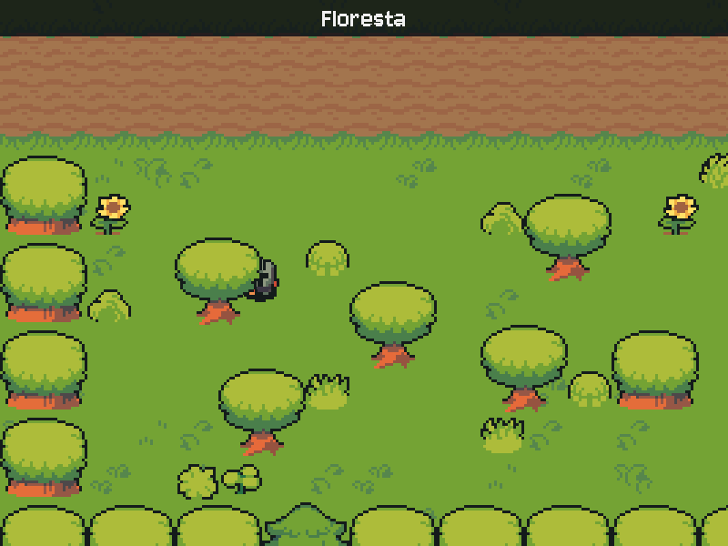

# MÓDULO 02C: Mapas de verdade — mundo maior que a tela, desenhado no Tiled

Engenheiro, até aqui cada cena é uma foto do tamanho da janela, e mudar uma árvore de lugar exigiria redesenhar a imagem. Hoje o mundo vira **dados**: mapas montados num editor de verdade, o Tiled, lidos pelo jogo. A floresta fica maior que a tela, a câmera acompanha o herói, as árvores bloqueiam o caminho e o herói passa por trás delas. O conceito do dia é o **mapa como dados (tilemap)**.

## 🎯 O que você vai ver na tela ao final

"Novo jogo" abre a floresta, um mapa de 40×24 tiles que não cabe na janela: ao andar, a câmera segue o herói e para nas bordas. As árvores bloqueiam pela base e, vindo de cima, o herói some atrás da copa. O fim da estrada leva à entrada da masmorra, que também é um mapa.



## 🏢 Onde isso aparece no mercado

Quase todo jogo 2D comercial é montado num editor de mapas: o designer desenha o nível, o programador escreve o motor que lê o arquivo. É o mesmo princípio de separar conteúdo e código que você encontra em CMSs de sites, em planilhas que alimentam sistemas e em arquivos de configuração: quem muda o conteúdo não precisa mexer no programa. Câmeras e ordenação por profundidade estão em todo jogo com visão de cima, de Stardew Valley a Pokémon.

## 🚦 Ponto de partida

- Seu projeto deve estar como no fim do M02B, com o desafio concluído (tela de Créditos, velocidade da escrita numa constante e a fala de teste).
- Arquivos prontos deste módulo: pasta `M02C/` dentro de `curso-arquivos/`, com a pasta `assets/mapas/` (mapas, tilesets e imagens) e o `requirements.txt` novo.
- Comando para conferir: com a venv ativa, `python main.py` abre o menu e, em "Novo jogo", o salão.
- Quatro sessões: **Sessão A**, Passos 1a a 2 (o mapa e a câmera); **Sessão B**, Passos 3 a 4c (árvores, profundidade e portais vindos do mapa); **Sessão C**, o Quebre de propósito e a primeira metade do desafio (o salão desenhado por você, ligado à floresta); **Sessão D**, a segunda metade (a transição e a clareira).

> **Aviso:** neste módulo o salão sai do jogo por um tempo. A floresta e a masmorra viram mapas nos passos; o salão volta como mapa no desafio, desenhado por você. Até lá, o Mago e a Sentinela ficam fora do mundo.

## ❓ Pergunta do dia

Num jogo de verdade, quem desenha as fases não é o programador. Como o código pode montar um mundo que ele não conhece, a partir de um arquivo feito numa ferramenta de design?

Ao longo dos passos aparecem caixas **🔍 Pare e pesquise**: pesquise as duas perguntas na hora, anote as respostas e, no fim, explique ao Engenheiro Sênior em até 5 minutos. **Sem mentor?** Grave um áudio de até 5 minutos explicando os termos e ouça de volta: onde você hesitar, o termo ainda não está claro.

## 🛠️ Passo a passo

### Passo 1a (Leia): o leitor de mapas

Copie o **conteúdo** de `curso-arquivos/M02C/assets/` para dentro da pasta `assets/` do projeto (chega a pasta `mapas/`) e o `requirements.txt` novo por cima do seu. O `CREDITOS.md` será substituído por uma versão com as linhas novas: é esperado.

```powershell
# PowerShell (Windows), na raiz do projeto
Copy-Item -Recurse -Force $HOME\curso-arquivos\M02C\assets\* assets\
Copy-Item -Force $HOME\curso-arquivos\M02C\requirements.txt .
```

```bash
# bash (Linux), na raiz do projeto
cp -r ~/curso-arquivos/M02C/assets/. assets/
cp ~/curso-arquivos/M02C/requirements.txt .
```

O `requirements.txt` ganhou o `pytmx`, a biblioteca que lê os mapas do editor **Tiled** (você instala o editor logo depois deste passo). Com a venv ativa, instale:

```bash
pip install -r requirements.txt
```

Abra `assets/mapas/floresta.tmx` num editor de texto, só para espiar: é XML, com uma grade de números (cada número é um pedaço de imagem, um *tile*) e uma lista de objetos com posição e tamanho. O jogo vai ler esse arquivo.

No `main.py`, acrescente as duas linhas do `pytmx`, cada uma no grupo certo: `import pytmx` logo depois do `import pygame`, e o `from` logo depois do `from dotenv ...`:

```python
import pytmx
```

```python
from pytmx.util_pygame import load_pygame
```

No topo, logo depois da linha `COLUNA = ...`, acrescente a escala dos mapas:

```python
ESCALA = 3  # tiles e sprites de 16×16 aparecem 3× maiores (48 px)
```

Rode `python main.py`: o jogo está **igual**. Se ele abriu, o `pytmx` foi instalado na venv certa; se aparecer `ModuleNotFoundError: No module named 'pytmx'`, o `pip install` rodou fora da venv.

Perguntas de leitura, olhando o `floresta.tmx` que você espiou:

- Quantos números tem cada linha da grade de uma camada, e por quê?
- O que um `0` na grade quer dizer?

### Passo 1b (Preveja): o mapa na tela

Agora o centro do passo: a `Cena` passa a ler um mapa. Troque a classe `Cena` e a função `criar_cenas()` inteiras por estas:

```python
class Cena:
    """Um lugar do mundo, lido de assets/mapas/<mapa>.tmx (desenhado no Tiled)."""

    def __init__(self, nome, mapa, npcs, portais):
        self.nome = nome
        self.mapa = mapa  # nome do arquivo, sem o .tmx; a música tem o mesmo nome
        self.npcs = npcs
        self.portais = portais  # ex.: {"leste": "masmorra"}; no Passo 3 os portais vêm do mapa
        dados = load_pygame(str(PASTA_ASSETS / "mapas" / f"{mapa}.tmx"))
        # Camadas de tiles: desenhadas uma única vez numa imagem do tamanho do mapa.
        chao = pygame.Surface((dados.width * 16, dados.height * 16))
        for camada in dados.visible_layers:
            if isinstance(camada, pytmx.TiledTileLayer):
                for x, y, imagem in camada.tiles():
                    chao.blit(imagem, (x * 16, y * 16))
        self.fundo = pygame.transform.scale_by(chao, ESCALA)  # scale_by não borra o pixel
        self.area = self.fundo.get_rect()  # o herói anda pelo mapa inteiro


def criar_cenas():
    """O mundo: cada cena é um mapa; os NPCs ficam em pixels do mapa já ampliado."""
    return {
        "floresta": Cena("Floresta", "floresta", [
            NPC("Mercador Brok", "brok", (696, 456), INSTRUCAO_BROK),
            NPC("Caçador Rurik", "cacador", (1080, 744), INSTRUCAO_CACADOR),
        ], {"leste": "masmorra"}),
        "masmorra": Cena("Entrada da Masmorra", "masmorra", [], {"oeste": "floresta"}),
    }
```

**A linha do Caçador é a do NPC do seu desafio do M02A.** Mantenha o nome, a pasta e a instrução do seu NPC; só a posição muda para `(1080, 744)`, que no mapa novo fica na clareira de baixo da estrada. O Mago e a Sentinela saem do jogo por enquanto e voltam no desafio, no salão.

O `load_pygame` lê o `.tmx` e já carrega as imagens dos tilesets. As camadas de tiles viram uma única imagem, montada **uma vez**, quando a cena é criada: são 960 tiles por camada (40×24), e redesenhá-los a cada quadro seria trabalho jogado fora. A área livre agora é o mapa inteiro: apague a linha `AREA_LIVRE = ...` do topo, que ninguém usa mais.

No `main()`, troque `cena = cenas["CASTELO"]` por:

```python
    cena = cenas["floresta"]
```

No "Novo jogo", troque as linhas da cena, do herói e da música por:

```python
                        cena = cenas["floresta"]
                        heroi_rect.center = (264, 600)  # na estrada; no Passo 3, o ponto "inicio"
                        estado = mudar_estado(estado, Estado.EXPLORANDO)
                        tocar_musica(cena.mapa)
```

E, nos portais, troque `tocar_musica(cena.musica)` por `tocar_musica(cena.mapa)`.

**Preveja antes de rodar:** o mapa da floresta tem 40×24 tiles de 48 pixels na tela, ou seja, 1920×1152. A janela tem 800×600. O que você vai ver, e onde vai estar o herói, que nasce em y = 600?

Rode `python main.py` e escolha "Novo jogo". A floresta aparece, lida do mapa, mas só o canto de cima à esquerda, e o herói nasce na borda de baixo da janela: a estrada fica em y = 600 e a tela vai até 600. O mundo agora é maior que a janela, e falta quem mostre a parte certa dele. É o trabalho da câmera, no Passo 2.

> 🔍 **Pare e pesquise: mapa como dados (tilemap)** — O que são um tileset, uma camada de tiles e uma camada de objetos? Que vantagem tem guardar o mundo num arquivo editado por uma ferramenta, em vez de escrever as posições no código?

#### Conheça o mapa no Tiled

Instale o Tiled (gratuito, código aberto):

```powershell
# PowerShell (Windows)
winget install --id Tiled.Tiled -e
```

```bash
# bash (Linux), pelo Flatpak; a primeira linha só é necessária uma vez
flatpak remote-add --user --if-not-exists flathub https://dl.flathub.org/repo/flathub.flatpakrepo
flatpak install --user flathub org.mapeditor.Tiled
flatpak run org.mapeditor.Tiled    # abre o Tiled
```

Abra `assets/mapas/floresta.tmx` no Tiled (Arquivo → Abrir) e explore:

- O painel **Camadas** (Layers) mostra seis camadas. `chao` e `detalhes` são **camadas de tiles**: uma grade de 40×24 quadradinhos de 16×16 pixels, cada um apontando para um pedaço de imagem. `arvores`, `colisao`, `portais` e `chegadas` são **camadas de objetos**: coisas com posição livre, como as árvores, os retângulos vermelhos de colisão e os pontos dourados.
- O painel **Tilesets** mostra as folhas de onde saem os tiles (`chao.tsx`, `natureza.tsx`, `arvores.tsx`). Elas apontam para as imagens em `mapas/tiles/`.
- Clique no retângulo azul na ponta leste da estrada: no painel **Propriedades**, ele tem `destino = masmorra`. Clique num ponto dourado: o nome dele (`inicio`, `masmorra`) diz onde o herói aparece.
- Feche o Tiled **sem salvar**.

Faça um commit:

```bash
git add .
git commit -m "feat: floresta e masmorra lidas do Tiled"
```

### Passo 2 (Leia): a câmera

A **câmera** é só um deslocamento: o ponto do mapa que aparece no canto superior esquerdo da tela. Tudo o que é do mundo passa a ser desenhado **menos** a câmera: se a câmera está em x = 500, o que está em x = 500 no mapa aparece em x = 0 na tela.

O NPC vai ser desenhado junto com o herói, com o mesmo deslocamento, então ele passa a só **entregar** a imagem. Na classe `NPC`, troque o método `desenhar` inteiro por:

```python
    def imagem(self):
        """O quadro parado virado para self.direcao."""
        return self.quadros[COLUNA[self.direcao]][0]
```

Logo depois do bloco dos portais (antes do `if estado == Estado.DIALOGO:`), calcule a câmera. Ela centraliza o herói; o `max` impede que passe da borda esquerda (ou de cima) e o `min`, da direita (ou de baixo):

```python
        # Câmera: o herói no meio da tela, sem mostrar nada além das bordas do mapa.
        # int(): pixel inteiro; com casas decimais, chão e sprites arredondam diferente e tremem.
        camera_x = int(min(max(heroi_rect.centerx - LARGURA // 2, 0), cena.area.width - LARGURA))
        camera_y = int(min(max(heroi_rect.centery - ALTURA // 2, 0), cena.area.height - ALTURA))
```

O `int()` arredonda a câmera para um pixel inteiro. Sem ele, o chão e os personagens arredondariam a parte decimal para lados diferentes e as árvores tremeriam 1 pixel contra o chão enquanto o mapa rola.

Na etapa de desenhar, troque as camadas 1 e 2 (do comentário `# Camada 1, o fundo.` até o `blit` do herói) por:

```python
        # Tudo o que é do mundo é desenhado deslocado pela câmera (- camera_x, - camera_y).
        # Camada 1, o chão do mapa.
        tela.blit(cena.fundo, (-camera_x, -camera_y))
        # Camada 2, as entidades. Primeiro as sombras, que ficam no chão.
        for rect in [npc.rect for npc in cena.npcs] + [heroi_rect]:
            tela.blit(sombra, sombra.get_rect(center=(rect.centerx - camera_x,
                                                      rect.bottom - 3 - camera_y)))
        # Depois NPCs e herói, no mesmo deslocamento.
        sprites = [(npc.rect, npc.imagem()) for npc in cena.npcs]
        sprites.append((heroi_rect, imagem_heroi))
        for rect, imagem in sprites:
            tela.blit(imagem, (rect.x - camera_x, rect.y - camera_y))
```

E o "ESPAÇO para falar" também acompanha a câmera:

```python
            escrever(tela, fonte, "ESPAÇO para falar", COR_DESTAQUE,
                     perto.rect.top - 15 - camera_y, perto.rect.centerx - camera_x)
```

Rode `python main.py`: o herói aparece na estrada, no meio da altura da tela (na horizontal ele fica à esquerda, porque a câmera não passa do começo do mapa). Ande para a direita e veja a câmera acompanhar; perto de uma borda do mapa, ela para e o herói sai do centro. A estrada termina na masmorra. Ainda falta a colisão: o herói atravessa o paredão da masmorra. Isso é o Passo 3.

Perguntas de leitura:

- Na floresta (1920 de largura), qual é o maior valor que o `camera_x` pode ter, e por quê?
- Por que a sombra e o herói são desenhados com `- camera_x`, mas o nome da cena, no alto, não?

> 🔍 **Pare e pesquise: câmera** — Num jogo 2D, a câmera move o mundo ou o herói? Por que limitar a câmera às bordas do mapa, e o que o jogador veria sem esse limite?

```bash
git add .
git commit -m "feat: câmera que segue o herói"
```

> ⏸️ **Fim da Sessão A.** Commit feito, jogo funcionando. Pare aqui e continue na próxima sessão, no Passo 3.

### Passo 3 (Preveja): árvores sólidas e profundidade

As árvores e a colisão estão no mapa, em camadas de objetos. No Tiled, cada objeto tem posição e tamanho em pixels do mapa (16×16 por tile); na tela, tudo é 3× maior.

Logo antes da classe `Cena`, acrescente duas funções de apoio:

```python
def ampliar(obj):
    """Retângulo de um objeto do Tiled (em pixels de 16×16) convertido para a tela (3×)."""
    return pygame.Rect(obj.x * ESCALA, obj.y * ESCALA, obj.width * ESCALA, obj.height * ESCALA)


def objetos(dados, camada):
    """Os objetos de uma camada do mapa; lista vazia se o mapa não tiver essa camada."""
    try:
        return list(dados.get_layer_by_name(camada))
    except ValueError:
        return []
```

A segunda existe porque nem todo mapa tem todas as camadas: um salão sem árvores não precisa de uma camada `arvores` vazia.

Na `Cena`, logo depois da linha do `self.area`, leia as árvores e a colisão:

```python
        # Camadas de objetos: as árvores (com imagem) e os retângulos de colisão.
        self.arvores = [(ampliar(obj), pygame.transform.scale_by(obj.image, ESCALA))
                        for obj in objetos(dados, "arvores")]
        self.colisoes = [ampliar(obj) for obj in objetos(dados, "colisao")]
```

Cada árvore vira um par `(retângulo, imagem)`. A colisão é outra camada: no Tiled, o retângulo vermelho cobre só a **base** de cada árvore, para o herói poder passar por trás da copa.

Agora a colisão no laço. Até aqui, o herói só batia em NPCs (a sua solução do desafio do M02A). Os obstáculos passam a ser a colisão do mapa **mais** os NPCs, numa lista só. Troque o seu movimento com colisão (as linhas que movem e desfazem cada eixo, até o `clamp_ip`) por este bloco; se você criou uma função para a colisão no M02A, apague-a, porque deixou de ser usada:

```python
        # Um eixo de cada vez: se bater num obstáculo, desfaz só o eixo que colidiu
        # (assim o herói ainda desliza ao longo dele no outro eixo).
        obstaculos = cena.colisoes + [npc.rect for npc in cena.npcs]
        heroi_rect.x += dx * VELOCIDADE * dt
        if heroi_rect.collidelist(obstaculos) != -1:  # -1 = não encostou em nenhum
            heroi_rect.x -= dx * VELOCIDADE * dt
        heroi_rect.y += dy * VELOCIDADE * dt
        if heroi_rect.collidelist(obstaculos) != -1:
            heroi_rect.y -= dy * VELOCIDADE * dt
        heroi_rect.clamp_ip(cena.area)  # mantém o herói dentro do mapa
```

O `collidelist` testa o retângulo contra a lista inteira e devolve a posição do primeiro que encostou, ou `-1` se nenhum. É a mesma lógica do M02A, um eixo de cada vez, agora com qualquer obstáculo.

Por fim, a **profundidade**. Na camada 2 do desenho, troque as linhas que desenham NPCs e herói (do comentário `# Depois NPCs e herói` até o fim do `for`) por:

```python
        # Depois árvores, NPCs e herói, em ordem de profundidade: quem tem a base
        # mais acima na tela é desenhado antes; quem está mais abaixo fica na frente.
        sprites = cena.arvores + [(npc.rect, npc.imagem()) for npc in cena.npcs]
        sprites.append((heroi_rect, imagem_heroi))
        for rect, imagem in sorted(sprites, key=lambda sprite: sprite[0].bottom):
            tela.blit(imagem, (rect.x - camera_x, rect.y - camera_y))
```

O `sorted` ordena a lista pela base de cada retângulo (`sprite[0].bottom`). O `key=lambda sprite: sprite[0].bottom` é uma função de uma linha que diz "para ordenar, olhe a base do retângulo". Quem está mais acima na tela é desenhado primeiro, e quem está mais abaixo cobre os outros. Quando o herói está acima da base de uma árvore, a árvore é desenhada depois e a copa o cobre.

**Preveja antes de rodar:** o herói vem de cima, pela grama, até uma árvore. Quem é desenhado primeiro, ele ou a árvore? Ele aparece na frente ou atrás da copa?

Rode `python main.py`. As árvores apareceram e bloqueiam pela base. Ande para cima, encostando na base de uma árvore por baixo: o herói fica na frente. Dê a volta e venha de cima: ele passa por trás da copa. Na masmorra, o paredão e a grade bloqueiam.

> 🔍 **Pare e pesquise: ordenação por profundidade** — Por que desenhar de cima para baixo da tela faz o herói passar "atrás" de uma árvore? Qual ponto de cada objeto decide a ordem: o topo, o centro ou a base?

```bash
git add .
git commit -m "feat: colisão com o cenário e ordenação por profundidade"
```

### Passo 4a (Modifique): o ponto de partida vem do mapa

Os portais ainda moram no código (`{"leste": "masmorra"}`) e o herói aparece numa posição calculada. O mapa já tem tudo isso: os retângulos azuis com a propriedade `destino` e os pontos dourados de chegada. Primeiro, os pontos.

Na `Cena`, logo depois da linha do `self.colisoes`, leia os pontos de chegada:

```python
        # Ponto de chegada com o nome do mapa de onde o herói vem (ou "inicio").
        self.chegadas = {obj.name: (obj.x * ESCALA, obj.y * ESCALA)
                         for obj in objetos(dados, "chegadas")}
```

As chegadas viram um dicionário `nome → posição`: `{"inicio": (264, 600), "masmorra": (1800, 600)}`.

No "Novo jogo", o herói começa no ponto `inicio` do mapa. Troque a linha do `heroi_rect.center` por:

```python
                        heroi_rect.center = cena.chegadas["inicio"]
```

Rode `python main.py`: o jogo começa na ponta oeste da estrada, como antes, agora pelo mapa. **Modifique:** abra o `floresta.tmx` no Tiled, arraste o ponto `inicio` para outro lugar, salve (Ctrl+S) e rode de novo: o herói começa onde você pôs. Você mudou o jogo sem tocar no código. Desfaça (arraste de volta e salve).

### Passo 4b (Leia): os portais vêm do mapa

Na `Cena`, logo depois da linha do `self.colisoes`, leia os portais, e troque o comentário das camadas de objetos (acima das árvores), que agora fala dos portais e das chegadas:

```python
        self.portais = [(ampliar(obj), obj.properties["destino"])
                        for obj in objetos(dados, "portais")]
```

```python
        # Camadas de objetos: árvores (com imagem), colisão, portais e pontos de chegada.
```

O `obj.properties` é um dicionário com as propriedades que o objeto tem no Tiled. Por enquanto a `Cena` ainda recebe o dicionário antigo de portais; a linha nova o substitui pela lista vinda do mapa. A faxina vem no 4c.

E troque o bloco dos portais inteiro (do comentário `# Portais:` até antes da câmera) por:

```python
        # Portais: objetos do mapa; a propriedade "destino" diz para qual mapa levam.
        for portal, destino in cena.portais:
            if heroi_rect.colliderect(portal):
                origem = cena.mapa
                cena = cenas[destino]
                tocar_musica(cena.mapa)  # cada mapa tem a música de mesmo nome
                heroi_rect.center = cena.chegadas[origem]  # o ponto com o nome de onde ele veio
                break
```

O herói chega no ponto com o nome do mapa de onde veio: saindo da floresta para a masmorra, aparece no ponto `floresta` da masmorra. Nenhum `if` por porta: um portal novo é só um retângulo azul e um ponto dourado no Tiled.

Rode `python main.py`: ida e volta da masmorra funcionam como antes, agora pelos dados do mapa.

Perguntas de leitura:

- Saindo da masmorra para a floresta, em que ponto da floresta o herói aparece, e qual linha decide isso?
- Depois da troca de mapa, sem o `break`, o `for` continuaria percorrendo os portais de qual mapa?

### Passo 4c (Leia): a faxina

O código antigo das portas ficou sem uso. Apague a linha `MEIA_PORTA = ...` do topo e a função `porta_tocada` inteira: o mapa diz onde ficam as portas.

Na `Cena`, tire o parâmetro `portais` do `__init__` e a linha `self.portais = portais ...`. O começo fica assim:

```python
    def __init__(self, nome, mapa, npcs):
        self.nome = nome
        self.mapa = mapa  # nome do arquivo, sem o .tmx; a música tem o mesmo nome
        self.npcs = npcs
```

No `criar_cenas()`, tire os dicionários de portais das duas cenas (o seu NPC do M02A continua na linha do Caçador):

```python
def criar_cenas():
    """O mundo: cada cena é um mapa; os NPCs ficam em pixels do mapa já ampliado."""
    return {
        "floresta": Cena("Floresta", "floresta", [
            NPC("Mercador Brok", "brok", (696, 456), INSTRUCAO_BROK),
            NPC("Caçador Rurik", "cacador", (1080, 744), INSTRUCAO_CACADOR),
        ]),
        "masmorra": Cena("Entrada da Masmorra", "masmorra", []),
    }
```

Atualize a docstring do topo do `main.py`:

```python
"""
RPG Engine — Módulo 02C: Mapas de verdade.

O jogo abre num menu com música. O mundo é feito de mapas do Tiled
(assets/mapas/*.tmx), maiores que a janela: a câmera segue o herói, as
árvores bloqueiam o caminho e o herói passa por trás delas. Perto de um
NPC, ESPAÇO abre a caixa de diálogo com a fala do Gemini. ESC pausa.
Uma máquina de estados (MENU, EXPLORANDO, DIALOGO, PAUSA e CREDITOS) decide
o que cada tecla faz e o que aparece na tela.
"""
```

Rode `python main.py`: tudo igual ao 4b, com menos código. Faxina boa é assim: nada muda por fora.

```bash
git status
git add .
git commit -m "feat: portais e pontos de chegada vindos do mapa"
git push
```

> ⏸️ **Fim da Sessão B.** Commit enviado, jogo funcionando. O Quebre de propósito e o desafio ficam para as Sessões C e D.

## 💥 Quebre de propósito

Duas camadas, dois jeitos de quebrar.

1. No Tiled, abra `floresta.tmx`, selecione a camada `colisao`, clique no retângulo vermelho da base de uma árvore perto do início da estrada e apague (Delete). **Preveja:** a árvore continua desenhada; o herói vai bater nela? Salve com Ctrl+S e rode: o herói atravessa a base dessa árvore como se ela fosse um holograma. O desenho e a colisão são camadas independentes; o jogo só sabe o que está nos dados. Desfaça no Tiled (Ctrl+Z) e salve.
2. No `main.py`, desenhe as árvores **antes** dos personagens: tire o `cena.arvores +` da lista `sprites` e, logo antes dela, desenhe as árvores num `for` próprio (`for rect, imagem in cena.arvores:` com o mesmo `blit`). **Preveja:** vindo de cima até uma árvore, o herói fica na frente ou atrás da copa? Rode e venha de cima até uma árvore: o herói aparece **na frente** da copa, como um adesivo colado por cima do cenário. A ordem do desenho é a profundidade. Desfaça.

## 🧯 Problemas comuns

| Sintoma | Causa provável | Como resolver |
| --- | --- | --- |
| `ModuleNotFoundError: No module named 'pytmx'` | O `pytmx` não foi instalado na venv | Com a venv ativa: `pip install -r requirements.txt` |
| `FileNotFoundError` com um `.tsx` ou `.png` | O `.tmx` aponta os tilesets por caminho relativo e a pasta `mapas/` foi reorganizada | Mantenha `mapas/` como foi entregue: `.tmx` e `.tsx` juntos, imagens em `mapas/tiles/` |
| O mapa aparece borrado | Ampliação com `smoothscale` | Use `pygame.transform.scale_by` |
| O herói fica "preso" longe do centro e a tela não acompanha | A câmera não foi aplicada em algum `blit`, ou o herói foi limitado em vez da câmera | Todo `blit` do mundo leva `- camera_x` e `- camera_y`; a câmera é que tem `min`/`max` |
| As árvores aparecem num lugar e bloqueiam em outro | Um dos retângulos não foi ampliado 3× | Use `ampliar(obj)` para todo objeto do mapa |
| O herói passa "na frente" de árvores que deveriam cobri-lo | As árvores ficaram fora do `sorted` ou a ordem usa o topo (`.top`) | Árvores, NPCs e herói na mesma lista, ordenada por `.bottom` |
| Mudanças no Tiled não aparecem no jogo | O mapa não foi salvo | Ctrl+S no Tiled antes de rodar |
| `KeyError: 'destino'` | Um portal ficou sem a propriedade no Tiled | Selecione o retângulo e acrescente a propriedade `destino` (texto) com o nome do mapa |
| `KeyError` com o nome de um mapa no `cena.chegadas[...]` | Falta, no mapa de destino, o ponto de chegada com o nome do mapa de origem | Crie o ponto na camada `chegadas` com esse nome exato |
| Árvores, colisão ou portais sumiram, sem nenhum erro | Uma camada foi renomeada no Tiled: a função `objetos` devolve lista vazia para camada que não existe | Os nomes `arvores`, `colisao`, `portais` e `chegadas` precisam ser exatos |
| A tela escurece e clareia sem parar ao passar por uma porta | O ponto de chegada ficou dentro do portal (ou encostado nele): o herói chega tocando a porta de volta | Mova o ponto no Tiled para um tile e meio longe da porta e salve |
| `KeyError` com o nome de um mapa no `cenas[...]` | O `destino` do portal tem erro de digitação, ou a cena não está no `criar_cenas()` | O `destino` é o nome do arquivo do mapa, sem `.tmx`, igual à chave do `criar_cenas()` |
| `TypeError` no `scale_by` ao carregar o mapa | Há um retângulo ou ponto na camada `arvores`: lá só entram objetos de tile (com imagem) | Apague o objeto ou mova-o para a camada certa; para pôr um toco, use a ferramenta Inserir Tile (T) |

## 🧩 Desafio de Engenharia

O mundo é seu para desenhar. O salão, de onde o Mago e a Sentinela saíram, precisa voltar, e trocar de mapa merece mais cerimônia do que um corte seco. O desafio tem duas partes: o **núcleo**, que o M03A usa (por isso os nomes são fixos), e a parte **sua**, livre.

**Critérios de aceite, núcleo:**

Faça o desafio em duas sessões: na **Sessão C**, o salão e as ligações (os três primeiros critérios do núcleo); na **Sessão D**, a transição, a clareira, os prints e a explicação.

- [ ] **Salão como mapa:** o salão do castelo volta como um mapa do Tiled criado por você: Arquivo → Novo → Novo mapa, 17×13 tiles de 16×16 (o tamanho sugerido; outro tamanho também serve), formato CSV, salvo em `assets/mapas/salao.tmx`, com piso, paredes que bloqueiam (camada `colisao`) e uma porta. Use os tilesets `interior_piso.tsx` e `interior_parede.tsx`, já entregues.
- [ ] **Ligado à floresta nos dois sentidos, pelos dados:** no salão, um portal (camada `portais`) com `destino = floresta`, e na camada `chegadas` os pontos `inicio` (onde o "Novo jogo" começa) e `floresta` (onde o herói aparece vindo de lá). Na floresta, um portal com `destino = salao` e um ponto de chegada `salao`. Cada ponto de chegada fica fora dos portais e da colisão, a pelo menos um tile e meio da porta: um herói que chega encostado no portal volta na hora (e, com a transição, a tela escurece e clareia sem parar).
- [ ] **No código:** a cena `"salao"` no `criar_cenas()`, com o Mago e a Sentinela de volta (a entrada pronta está logo abaixo; ajuste as posições ao seu salão), e o "Novo jogo" começando nela.
- [ ] **Transição com escurecimento:** ao passar por um portal, a tela escurece, o mapa troca e a tela clareia; durante a transição, o herói não anda. Use o estado `Estado.TRANSICAO` (com as transições dele na tabela) e a constante `DURACAO_ESCURECER` (segundos para escurecer). O esqueleto está logo abaixo.

**Critérios de aceite, a parte sua:**

- [ ] **Clareira:** uma clareira nova na floresta, desenhada no Tiled, com pelo menos 3 objetos de colisão novos (tocos, pedras, troncos), **sem mudar o código**. Os tilesets `natureza` e `arvores` têm tocos, arbustos e flores.
- [ ] O visual do salão é seu: não precisa ser bonito, mas é o seu salão.
- [ ] Commit no padrão Conventional Commits e push na `main`.
- [ ] Você explica ao Engenheiro Sênior, sem ler e em até 5 minutos, os três termos das caixas 🔍 (mapa como dados, câmera e ordenação por profundidade). **Sem mentor?** Grave a explicação em áudio e ouça de volta.

> **Tiled em 7 gestos** (o suficiente para o desafio)
> 1. **Novo mapa:** Arquivo → Novo → Novo mapa: ortogonal, formato CSV, tiles de 16×16, tamanho fixo. Salve em `assets/mapas/`.
> 2. **Tileset:** Mapa → Adicionar tileset externo, e escolha um `.tsx` de `assets/mapas/`.
> 3. **Pintar tiles:** selecione uma camada de tiles e um tile no painel Tilesets; carimbo (B) pinta um por um, balde (F) preenche uma área.
> 4. **Camadas:** Camada → Nova → Camada de tiles ou Camada de objetos; renomeie com clique duplo (nomes exatos: `colisao`, `portais`, `chegadas`, `arvores`).
> 5. **Retângulo e ponto:** com uma camada de objetos selecionada, retângulo (R) para colisão e portal, ponto (I) para chegada.
> 6. **Objeto com imagem:** Inserir Tile (T), com a camada `arvores` selecionada e um tile escolhido, para tocos e árvores.
> 7. **Nome e propriedade:** no painel Propriedades, o campo Nome (chegadas) e o botão "+" para criar a propriedade `destino` (tipo texto) dos portais.
>
> Salve sempre com Ctrl+S antes de rodar o jogo.

Dica para o salão: não precisa ser bonito. Piso com o balde, uma borda de paredes e uma porta já cumprem o critério; capriche depois, se sobrar tempo.

**A cena do salão no `criar_cenas()`**, com as posições do salão de exemplo (pixels do mapa já ampliado; ajuste ao seu):

```python
        "salao": Cena("Salão do Castelo", "salao", [
            NPC("Arquimago Solaris", "mago", (408, 132), INSTRUCAO_MAGO),
            NPC("Sentinela do Salão", "sentinela", (668, 182), INSTRUCAO_SENTINELA),
        ]),
```

**Clareira:** cada toco precisa de dois objetos: a imagem, na camada `arvores` (ferramenta Inserir Tile, T), e o retângulo da base, na camada `colisao`.

**Esqueleto da transição.** A transição é um momento do jogo em que as teclas não fazem nada e algo acontece sozinho com o tempo: um estado. Primeiro, a tabela: acrescente `TRANSICAO` ao `Estado` e escreva de onde se chega a ela e para onde se sai. Depois, no topo, a constante `DURACAO_ESCURECER = 0.3`; no `main()`, a tela preta (`escuridao = pygame.Surface((LARGURA, ALTURA))`) e duas variáveis, `escuro = 0.0` (0 é a tela normal, 1 é preta) e `indo_para = None` (o mapa de destino enquanto escurece). Então troque o bloco dos portais por este esqueleto e complete os três `TODO`:

```python
        # Tocar num portal só começa a transição: o mapa troca quando a tela fica preta.
        if estado == Estado.EXPLORANDO:
            for portal, destino in cena.portais:
                if heroi_rect.colliderect(portal):
                    # TODO 1: guarde o destino em indo_para e mude para o estado TRANSICAO.
                    break
        if estado == Estado.TRANSICAO and indo_para:
            escuro = min(escuro + dt / DURACAO_ESCURECER, 1.0)  # escurecendo
            if escuro == 1.0:  # tela preta: troca o mapa sem o jogador ver
                origem = cena.mapa
                cena = cenas[indo_para]
                tocar_musica(cena.mapa)  # cada mapa tem a música de mesmo nome
                heroi_rect.center = cena.chegadas[origem]  # o ponto com o nome de onde ele veio
                # TODO 2: zere o indo_para (o mapa já trocou).
        elif estado == Estado.TRANSICAO:
            escuro = max(escuro - dt / DURACAO_ESCURECER, 0.0)  # clareando
            # TODO 3: quando a tela clarear de vez, volte para EXPLORANDO.
```

**Preveja:** por que o mapa só troca quando `escuro == 1.0`, e não no quadro em que o herói toca o portal? E o que aconteceria no quadro seguinte se o `TODO 2` ficasse sem fazer?

Os três `TODO` são curtos (uma ou duas linhas): o desafio de verdade é entender o ciclo escurecer, trocar, clarear. Por último, desenhe a escuridão por cima de tudo, logo antes do `pygame.display.flip()`: se `escuro` não for zero, `escuridao.set_alpha(int(escuro * 255))` e `tela.blit(escuridao, (0, 0))`. O `set_alpha` vai de 0 (transparente) a 255 (preto total).

Lembre as regras de uso de IA do M00B: pode pedir explicação de conceito e de erro, não pode pedir a solução pronta, e deve saber explicar ao Engenheiro Sênior cada trecho que veio de uma IA. **Sem mentor?** Escreva essa explicação na mensagem do commit.

**Entrega:** push na `main` e três prints enviados ao Engenheiro Sênior: a clareira no jogo, o salão com o Mago e a tela no meio de uma transição. **Sem mentor?** Guarde os prints numa pasta `entregas/` dentro de `curso-arquivos/`: viram o seu portfólio.

## ⭐ Bônus (opcional)

- **NPCs no mapa:** uma camada de objetos `npcs` com um ponto por personagem (nome = a pasta do sprite), para posicionar o Brok e o Rurik no Tiled em vez de no código.
- **Hitbox dos pés:** o herói colide só com a metade de baixo do retângulo, para chegar mais perto das paredes e das árvores por cima.
- **Mapa novo:** uma trilha lateral saindo da floresta, só com o Tiled e uma linha no `criar_cenas()`.

## 💼 Resumo profissional

- **Conceito:** mapas como dados (tilemaps do Tiled lidos com `pytmx`), câmera limitada às bordas, colisão por camada de objetos e ordenação por profundidade; separação entre conteúdo editado numa ferramenta e o motor que o interpreta.
- **Linha para o currículo:** "Integrei mapas do editor Tiled a um jogo 2D em Python (tilesets, camadas de tiles e de objetos), com câmera, colisão definida no mapa, ordenação por profundidade e portais configurados por dados."
