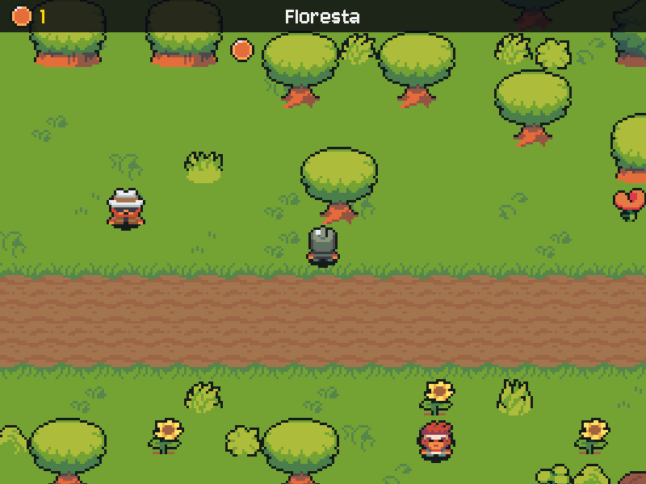

# MÓDULO 03A: Moedas e HUD — tesouro no chão, ajustes fora do código

Engenheiro, o reino tem dinheiro espalhado pelo chão e ninguém conta quanto você leva. Hoje o jogo ganha moedas que giram, somem quando você passa por cima e somam num contador no topo da tela, o HUD. As moedas não estão no código: você as posiciona no Tiled. E os números que regulam o jogo (velocidades, tempos, tamanhos) saem do `main.py` para um arquivo só deles. O conceito do dia é **configuração separada do código**.

## 🎯 O que você vai ver na tela ao final

Moedas de cobre girando na floresta e na entrada da masmorra. Ao passar por cima, a moeda some com um som curto e o contador do canto superior esquerdo sobe. "Novo jogo" zera o contador e devolve as moedas ao chão. Por dentro, o jogo ganhou o `config.py`, a classe `ServicoIA` e um cache de imagens.



## 🏢 Onde isso aparece no mercado

Todo sistema sério separa código e configuração: o mesmo programa roda em teste e em produção trocando só um arquivo ou variáveis de ambiente (é um dos princípios do "Twelve-Factor App"). Estúdios de jogos chamam isso de *data-driven design*: o designer ajusta níveis, preços e tempos sem pedir um programador. Interfaces de serviço e cache estão em qualquer backend, de um e-commerce ao seu banco: o código depende de "um serviço que responde", e o que é caro de buscar fica guardado na memória.

## 🚦 Ponto de partida

- Seu projeto deve estar como no fim do M02C, com o desafio concluído: o salão como mapa, ligado à floresta, com o Mago e a Sentinela, e a transição com escurecimento.
- Arquivos prontos deste módulo: pasta `M03A/` dentro de `curso-arquivos/`, com `assets/itens/` (a moeda e a moeda rúnica do desafio) e `assets/sons/moeda.wav`. Se vier também uma pasta `nivelamento/`, não copie: é o plano B para o salão do M02C, e só entra se o seu salão não funcionar.
- Comando para conferir: com a venv ativa, `python main.py` abre o menu e, em "Novo jogo", o salão.
- Três sessões: **Sessão A**, Passos 1 e 2 (as moedas e o HUD); **Sessão B**, Passos 3 a 5b e o Quebre de propósito (o `config.py`, o cache e a IA atrás de uma interface); **Sessão C**, o desafio (a moeda rúnica e as constantes).

> **Andaime novo:** a partir deste módulo, parte do código vem com `# TODO` nos pontos-chave: uma decisão curta, que o texto explica. O resto vem pronto. Rode o jogo depois de cada `TODO`.

## ❓ Pergunta do dia

Num jogo comercial, o designer muda a velocidade do herói, o preço de um item ou o lugar de uma moeda sem pedir nada ao programador. Como o código precisa estar organizado para isso ser possível?

Ao longo dos passos aparecem caixas **🔍 Pare e pesquise**: pesquise as duas perguntas na hora, anote as respostas e, no fim, explique ao Engenheiro Sênior em até 5 minutos. **Sem mentor?** Grave um áudio de até 5 minutos explicando os termos e ouça de volta: onde você hesitar, o termo ainda não está claro.

## 🛠️ Passo a passo

### Passo 1 (Complete): moedas no chão

Copie o **conteúdo** de `curso-arquivos/M03A/assets/` para dentro da pasta `assets/` do projeto (chegam as pastas `itens/` e o som `sons/moeda.wav`). O `CREDITOS.md` será substituído por uma versão com as linhas novas: é esperado.

```powershell
# PowerShell (Windows), na raiz do projeto
Copy-Item -Recurse -Force $HOME\curso-arquivos\M03A\assets\* assets\
```

```bash
# bash (Linux), na raiz do projeto
cp -r ~/curso-arquivos/M03A/assets/. assets/
```

Os mapas não vêm no pacote deste módulo: a floresta é sua, com a clareira que você desenhou. As moedas entram nela pelo Tiled. Abra `assets/mapas/floresta.tmx` no Tiled e:

1. Camada → Nova → **Camada de objetos**. Dê clique duplo no nome e chame-a de `moedas` (exatamente assim, minúsculo e sem acento).
2. Com a camada `moedas` selecionada, escolha a ferramenta **Inserir Ponto** (I) e clique onde quer cada moeda: umas 8, algumas na estrada e outras escondidas entre as árvores. Deixe a clareira sem moedas por enquanto.
3. Salve com Ctrl+S. Faça o mesmo na `masmorra.tmx`, com 2 moedas.

Cada ponto vira uma moeda. O jogo não sabe quantas existem nem onde estão: ele lê o mapa.

No `main.py`, logo depois da `DURACAO_ESCURECER` (a última constante do topo, do desafio do M02C), acrescente as constantes da moeda:

```python
# Moedas
TAMANHO_MOEDA = 10  # cada quadro de itens/moeda.png tem 10×10 pixels
QUADROS_MOEDA = 4
TEMPO_QUADRO_MOEDA = 0.12  # a moeda gira mais rápido que o herói anda
VALOR_MOEDA = 1
```

A imagem `itens/moeda.png` tem 40×10 pixels: 4 quadros de 10×10 lado a lado, a moeda vista de frente, de lado e de costas. Logo antes da função `ampliar`, crie a classe `Moeda`:

```python
class Moeda:
    """Uma moeda no chão do mapa: gira em 4 quadros e vale VALOR_MOEDA na bolsa."""

    def __init__(self, centro):
        folha = carregar_imagem("itens/moeda.png")  # 4 quadros de 10×10 lado a lado
        self.quadros = [pygame.transform.scale_by(
            folha.subsurface((i * TAMANHO_MOEDA, 0, TAMANHO_MOEDA, TAMANHO_MOEDA)), ESCALA)
            for i in range(QUADROS_MOEDA)]
        self.rect = self.quadros[0].get_rect(center=centro)
        self.valor = VALOR_MOEDA

    def imagem(self, tempo):
        """O quadro da vez: o tempo de jogo decide, como na caminhada do herói."""
        # TODO: devolva o quadro da vez (um dos self.quadros). Pense: quantos quadros de
        #       TEMPO_QUADRO_MOEDA segundos já se passaram neste `tempo`? E como fazer esse
        #       número crescente dar a volta em 0, 1, 2, 3? (Dica: o operador %.)
```

A lista de `quadros` é montada uma vez, quando a moeda nasce: o `subsurface` recorta cada pedaço de 10×10 e o `scale_by` amplia 3×, como os tiles. A animação não precisa de variável própria: o `tempo` do jogo já diz qual quadro mostrar, e todas as moedas giram juntas.

Na `Cena`, depois da linha das `chegadas`, leia a camada nova:

```python
        # Moedas: um ponto do Tiled por moeda. Mudar ou acrescentar moedas é só editar o mapa.
        self.moedas = [Moeda((obj.x * ESCALA, obj.y * ESCALA)) for obj in objetos(dados, "moedas")]
```

Um ponto do Tiled tem só posição (`obj.x`, `obj.y`), em pixels do mapa; multiplicado pela `ESCALA`, vira o centro da moeda na tela. Mapa sem camada `moedas`, como o salão, devolve lista vazia, graças à função `objetos` do M02C.

Por fim, desenhe as moedas junto com árvores e personagens, para a profundidade valer também para elas. Na camada 2 do desenho, logo depois da linha `sprites = cena.arvores + ...`, acrescente:

```python
        sprites += [(moeda.rect, moeda.imagem(tempo)) for moeda in cena.moedas]
```

Rode `python main.py`, vá do salão para a floresta: as moedas giram onde você as pôs. Passe por cima de uma: nada acontece ainda. Esse é o Passo 2.

**Preveja:** você pôs 8 moedas na floresta. Quantas vezes o `carregar_imagem("itens/moeda.png")` roda quando a floresta é criada? Guarde o número: ele volta no Passo 4.

```bash
git add .
git commit -m "feat: moedas animadas lidas da camada do Tiled"
```

### Passo 2 (Complete): pegar a moeda e o HUD

No `main()`, logo depois da linha do `som_voz`, carregue o som e prepare o ícone do HUD (o primeiro quadro de uma moeda qualquer):

```python
    som_moeda = carregar_som("moeda.wav")
    # Ícone do HUD: o primeiro quadro da moeda.
    icone_moeda = Moeda((0, 0)).quadros[0]
```

No começo do `main()`, logo depois da linha que escolhe a cena inicial (`cena = cenas[...]`, a de antes do loop, não a do "Novo jogo"), crie a bolsa:

```python
    bolsa = 0  # quantas moedas o herói já pegou
```

No "Novo jogo", as moedas precisam voltar ao chão e a bolsa, zerar. Logo depois da linha `elif opcao == "Novo jogo":`, acrescente:

```python
                        cenas = criar_cenas()  # mapas relidos: todas as moedas de volta ao chão
                        bolsa = 0
```

Agora a coleta. Logo antes do bloco dos portais (o comentário `# Portais: objetos do mapa ...`), acrescente:

```python
        # Moedas: tocou, pegou. Percorre uma cópia ([:]) porque a lista muda dentro do for.
        if estado == Estado.EXPLORANDO:
            for moeda in cena.moedas[:]:
                if heroi_rect.colliderect(moeda.rect):
                    # TODO: três coisas: tirar a moeda de cena.moedas, somar o valor
                    #       dela na bolsa e tocar o som_moeda (com a função tocar).
```

O `[:]` faz uma cópia da lista. Tirar itens da lista que o `for` está percorrendo faz o Python pular o item seguinte; com a cópia, o `for` anda na cópia e você tira da original.

Por fim, o HUD. Na camada 3 do desenho, logo depois da linha `escrever(tela, fonte, cena.nome, COR_TEXTO, 20)`, acrescente:

```python
        # HUD: ícone da moeda e o total da bolsa, no canto esquerdo da faixa.
        tela.blit(icone_moeda, (12, 5))
        tela.blit(fonte.render(str(bolsa), False, COR_DESTAQUE), (50, 3))
```

HUD (*heads-up display*) é a camada de informação desenhada por cima do jogo, que não se move com a câmera: por isso não leva `- camera_x`.

Rode `python main.py`: o contador aparece no canto, e cada moeda pega some com som e soma 1. Troque de mapa e volte: as moedas pegas continuam fora do chão (cada `Cena` guarda a sua lista). Pause, volte ao menu principal e comece um novo jogo: contador em 0 e moedas de volta.

Perguntas de leitura:

- Por que o HUD é desenhado sem `- camera_x`, e as moedas com?
- O que acontece com as moedas pegas quando você vai à masmorra e volta? Em que objeto elas ficam guardadas?

> 🔍 **Pare e pesquise: configuração separada do código** — Que tipo de valor merece ir para um arquivo de configuração, e que tipo deve continuar no código? Por que "número mágico" (um `0.3` solto no meio da lógica) é considerado um problema de manutenção?

```bash
git add .
git commit -m "feat: coleta de moedas com som e HUD com contador"
```

> ⏸️ **Fim da Sessão A.** Commits feitos, jogo funcionando. Pare aqui e continue na próxima sessão, no Passo 3.

### Passo 3 (Modifique): o `config.py`

O topo do `main.py` virou um painel de ajustes misturado com o código. Ajustes têm outro ritmo de mudança: você mexe na velocidade do herói muito mais vezes do que na lógica da câmera. Eles vão morar num arquivo próprio.

Crie o arquivo `config.py`, na raiz do projeto, ao lado do `main.py`. Ele vem pronto, com as constantes que o jogo já tem, agrupadas por assunto, inclusive as quatro de moeda do Passo 1:

```python
"""
RPG Engine — configuração do jogo.

Tudo o que é ajuste (tamanhos, velocidades, tempos, caminhos, nomes) mora aqui.
O main.py só usa estes nomes: para mudar o jogo, você mexe neste arquivo,
não na lógica. Os segredos continuam no .env, que nunca vai para o Git.
"""
import os
from pathlib import Path

from dotenv import load_dotenv

# Caminhos sempre a partir deste arquivo: o jogo roda de qualquer pasta.
PASTA_PROJETO = Path(__file__).resolve().parent
PASTA_ASSETS = PASTA_PROJETO / "assets"
FONTE_PIXEL = PASTA_ASSETS / "fontes" / "Jersey10-Regular.ttf"

# Lê o arquivo .env e carrega as variáveis (a chave do Gemini fica só lá).
load_dotenv(PASTA_PROJETO / ".env")
NOME = os.getenv("NOME_ENGENHEIRO", "Engenheiro")
MODELO_IA = os.getenv("GEMINI_MODEL", "gemini-3.5-flash-lite")
NOME_JOGO = "Kernel Quest"  # o nome que você escolheu para o jogo

# Janela e ritmo
LARGURA, ALTURA = 800, 600
FPS = 60
ESCALA = 3  # tiles e sprites de 16×16 aparecem 3× maiores (48 px)

# Cores (vermelho, verde, azul)
COR_TEXTO = (240, 240, 240)
COR_DESTAQUE = (255, 215, 0)
COR_CAIXA = (60, 40, 40)  # texto escuro sobre o papel claro da caixa de diálogo

# Herói
VELOCIDADE = 200  # pixels por SEGUNDO (multiplicada por dt, vale em qualquer FPS)
TEMPO_QUADRO = 0.15  # segundos que cada quadro da caminhada fica na tela
# Ordem das colunas nas folhas do pacote (andar.png e parado.png).
COLUNA = {"baixo": 0, "cima": 1, "esquerda": 2, "direita": 3}

# Moedas
TAMANHO_MOEDA = 10  # cada quadro de itens/moeda.png tem 10×10 pixels
QUADROS_MOEDA = 4
TEMPO_QUADRO_MOEDA = 0.12  # a moeda gira mais rápido que o herói anda
VALOR_MOEDA = 1

# IA
INTERVALO_MINIMO = 2.0  # segundos entre duas chamadas à IA (reduz o risco do erro 429)

# Caixa de diálogo
LARGURA_TEXTO = 580  # largura máxima de uma linha na caixa de diálogo, em pixels
LINHAS_POR_PAGINA = 3
VELOCIDADE_ESCRITA = 40  # letras por segundo da máquina de escrever

# Transição entre mapas
DURACAO_ESCURECER = 0.3  # segundos para a tela escurecer (e outros tantos para clarear)
```

Atenção aos valores: o bloco traz os do projeto de exemplo. O `NOME_JOGO` é o **seu** (copie do `main.py`), e se você ajustou algum número (a velocidade da escrita, a duração do escurecer), copie o seu valor também. Os nomes são os mesmos: são os dos critérios de aceite do M02B e do M02C. O `Path(__file__)` agora é o `config.py`, que está na mesma pasta do `main.py`: os caminhos continuam iguais. O `load_dotenv` também mudou de casa: ler o ambiente é configuração.

No `main.py`, apague tudo o que foi para o `config.py`: do comentário `# Caminhos sempre a partir deste arquivo` até a linha das moedas, ficando só `OPCOES_MENU` e `OPCOES_PAUSA` (elas continuam no código porque a lógica do menu depende de cada texto: `if opcao == "Sair"`). Se o seu topo tem alguma constante que não está no bloco do `config.py` (algo que você criou num desafio), leve-a para o `config.py` e para a lista do `import` abaixo. Apague também os imports que só o `config.py` usa: `import os`, `from pathlib import Path` e `from dotenv import load_dotenv`.

Logo depois do `import ia`, importe as constantes, uma por uma:

```python
from config import (
    ALTURA, COLUNA, COR_CAIXA, COR_DESTAQUE, COR_TEXTO, DURACAO_ESCURECER, ESCALA,
    FONTE_PIXEL, FPS, INTERVALO_MINIMO, LARGURA, LARGURA_TEXTO, LINHAS_POR_PAGINA,
    MODELO_IA, NOME, NOME_JOGO, PASTA_ASSETS, QUADROS_MOEDA, TAMANHO_MOEDA,
    TEMPO_QUADRO, TEMPO_QUADRO_MOEDA, VALOR_MOEDA, VELOCIDADE,
    VELOCIDADE_ESCRITA,
)
```

A lista explícita (em ordem alfabética, para achar rápido) mostra exatamente o que o `main.py` usa do `config.py`. Existe o atalho `from config import *`, que traz tudo, mas ele esconde de onde vem cada nome: evite.

Rode `python main.py`: o jogo deve estar **idêntico**. Esse é o teste de uma reorganização: nada muda por fora. Agora mude `VELOCIDADE = 400` no `config.py`, rode e sinta a diferença; volte para 200. Você ajustou o jogo sem abrir o arquivo da lógica.

```bash
git add .
git commit -m "refactor: constantes e leitura do .env no config.py"
```

### Passo 4 (Complete): o cache de imagens

Cada `Moeda` chama `carregar_imagem("itens/moeda.png")` no `__init__`. Com 10 moedas, mais o `Moeda((0, 0))` do ícone do HUD, o mesmo arquivo é lido do disco 11 vezes, e de novo a cada "Novo jogo". Um **cache** resolve: a primeira leitura guarda a imagem num dicionário; as próximas pegam de lá.

Troque a função `carregar_imagem` inteira por:

```python
# Cache de imagens: nome do arquivo -> imagem já carregada. Cada .png sai do disco uma vez só.
imagens_carregadas = {}


def carregar_imagem(nome_arquivo):
    """Carrega um .png da pasta assets/ (só na primeira vez) ou explica de onde ele vem."""
    # TODO: se nome_arquivo já está em imagens_carregadas, devolva a imagem guardada
    #       (com return), sem passar pelo disco.
    caminho = PASTA_ASSETS / nome_arquivo
    if not caminho.exists():
        print(f"[ERRO] Arquivo não encontrado: {caminho}")
        print("Copie para assets/ a pasta assets/ que veio com os arquivos do módulo.")
        sys.exit(1)
    imagem = pygame.image.load(caminho).convert_alpha()
    # TODO: guarde a imagem em imagens_carregadas, com nome_arquivo como chave.
    return imagem
```

O dicionário fica fora da função porque precisa sobreviver entre uma chamada e outra; uma variável criada dentro da função nasceria vazia a cada chamada. Os NPCs também se beneficiam: o retrato e o sprite de cada um saem do disco uma vez só, mesmo relendo os mapas no "Novo jogo".

Nada muda na tela: a diferença está no trabalho que o jogo deixa de fazer. Para enxergar, acrescente um aviso de cada leitura do disco. Em `carregar_imagem`, logo antes da linha `imagem = pygame.image.load(caminho).convert_alpha()`:

```python
    print(f"[DISCO] lendo {nome_arquivo}")
```

Rode, comece um jogo, pause, volte ao "Menu principal" e comece outro "Novo jogo", olhando o terminal. Cada arquivo aparece uma vez, no começo; o segundo "Novo jogo" não lê nada do disco. Se o `itens/moeda.png` aparecer de novo, o primeiro `TODO` não está devolvendo a imagem guardada. Conferido, apague o `print` antes do commit (ele volta no Quebre de propósito).

**Preveja:** lembra do número do Passo 1? Com o cache, quantas vezes o `itens/moeda.png` sai do disco agora, contando o ícone do HUD e um "Novo jogo"? A resposta aparece no Quebre de propósito.

> 🔍 **Pare e pesquise: cache** — O que é um cache e que problema ele resolve? Quando um cache pode entregar um dado errado (desatualizado)?

```bash
git add .
git commit -m "perf: cache de imagens em dicionário"
```

### Passo 5a (Complete): a IA atrás de uma interface

O `ia.py` tem funções soltas e uma variável global (`_cliente`). O `main.py` chama `ia.responder(...)` e não quer saber de mais nada, o que é bom. Falta deixar isso explícito: uma classe **`ServicoIA`**, criada uma vez, com um método só que importa para quem usa, `responder(instrucao, fala)`. No M04A, os testes vão trocar esse serviço por um falso, sem rede, e o jogo nem vai perceber.

Primeiro, o tempo limite também é ajuste. No `config.py`, no grupo `# IA`, antes do `INTERVALO_MINIMO`:

```python
TIMEOUT_IA_MS = 30_000  # sem isso, uma rede travada deixaria o jogo esperando para sempre
```

No fim do `ia.py`, acrescente a classe. Ela vem pronta, com o mesmo `responder` que você já tem, agora como método; o `obter_cliente` é seu:

```python
class ServicoIA:
    """O serviço de IA do jogo. A interface é uma só: responder(instrucao, fala) -> texto.

    Quem usa não sabe se a resposta veio do Gemini ou da IA falsa, nem como o
    cliente é criado. Por isso, no M04A, os testes trocam este serviço por um falso.
    """

    def __init__(self, modelo, timeout_ms):
        self.modelo = modelo
        self.timeout_ms = timeout_ms
        self.cliente = None  # criado só na primeira chamada de verdade

    def obter_cliente(self):
        """Cria o cliente do Gemini uma única vez e reaproveita nas próximas chamadas."""
        # TODO: se self.cliente ainda é None, crie o cliente com
        #       genai.Client(http_options={"timeout": self.timeout_ms}) e guarde-o em
        #       self.cliente. Em qualquer caso, devolva self.cliente.

    def responder(self, instrucao, fala):
        """Pede ao Gemini a resposta do personagem descrito em `instrucao` para a `fala`."""
        if os.getenv("IA_FALSA") == "longa":
            return FALA_LONGA
        if os.getenv("IA_FALSA") == "1":
            return "(IA falsa) Arquitetura antes de feitiço, aprendiz. Volte com um plano."
        if not os.getenv("GEMINI_API_KEY"):
            return "[ERRO] GEMINI_API_KEY não configurada no arquivo .env."
        try:
            interacao = self.obter_cliente().interactions.create(
                model=self.modelo,
                system_instruction=instrucao,
                input=fala,
                store=False,  # cada fala é independente: não guardamos a conversa
            )
        except Exception as erro:
            mensagem = explicar_erro(erro)
            if mensagem is None:
                raise  # erro de programação: mostra o traceback completo para corrigir
            return f"[ERRO] {mensagem}"
        return interacao.output_text
```

O modelo e o tempo limite chegam pelo `__init__`: o `ia.py` não precisa saber de onde eles vêm (do `config.py`, de um teste, de outro jogo). O cliente continua sendo criado só na primeira chamada de verdade, agora guardado no próprio objeto, sem variável global.

No `main.py`, acrescente `TIMEOUT_IA_MS` no `from config import (...)`, na ordem alfabética (logo depois de `TEMPO_QUADRO_MOEDA`). No `main()`, logo depois da linha do `icone_moeda`, crie o serviço:

```python
    # A IA atrás de uma interface: o jogo só conhece servico_ia.responder().
    servico_ia = ia.ServicoIA(MODELO_IA, TIMEOUT_IA_MS)
```

E, na chamada à IA, troque `ia.responder(` por `servico_ia.responder(` (a segunda linha acompanha o parêntese, que andou para a direita):

```python
                fala = servico_ia.responder(pedindo.instrucao,
                                            f"O aprendiz {NOME} se aproxima e cumprimenta você.")
```

Rode `python main.py` e fale com o Mago: a resposta vem do Gemini, agora pelo serviço. Rode também com a IA falsa, que não gasta cota:

```powershell
# PowerShell (Windows)
$env:IA_FALSA = "1"; python main.py; Remove-Item Env:IA_FALSA
```

```bash
# bash (Linux)
IA_FALSA=1 python main.py
```

A fala "(IA falsa) Arquitetura antes de feitiço..." aparece.

Perguntas de leitura:

- Se você falar 5 vezes com o Mago, quantas vezes o `genai.Client(...)` é criado? Que linha do seu `TODO` garante isso?
- O `responder` do serviço lê o modelo de onde: do `.env`, do `config.py` ou do próprio objeto?

> 🔍 **Pare e pesquise: interface de serviço** — O que significa dizer que o código depende de uma interface, e não de uma implementação? Como isso permite trocar o serviço real por um falso num teste?

### Passo 5b (Leia): a faxina do `ia.py`

As funções antigas ficaram sem uso. No `ia.py`, apague a linha `TIMEOUT_MS = ...`, a linha `_cliente = None ...` e as funções `obter_cliente` e `responder` inteiras (as soltas, fora da classe). Mantenha `ERROS_DE_CONEXAO`, `FALA_LONGA` e `explicar_erro` (o `teste_conexao_gemini.py` também usa essa função).

Atualize a docstring do topo do `ia.py`:

```python
"""
RPG Engine — a IA do jogo (Gemini).

Tudo o que fala com o Gemini mora aqui, atrás da classe ServicoIA: o main.py
cria um serviço e só chama responder(). Com IA_FALSA=1 no ambiente,
responder() devolve uma fala fixa, sem rede e sem gastar cota (útil para
testar e para a verificação automática).
"""
```

E a do topo do `main.py`:

```python
"""
RPG Engine — Módulo 03A: Moedas e HUD.

O jogo abre num menu com música. O mundo é feito de mapas do Tiled
(assets/mapas/*.tmx), maiores que a janela: a câmera segue o herói, as
árvores bloqueiam o caminho e o herói passa por trás delas. Moedas
espalhadas pelos mapas (camada "moedas") somem ao serem tocadas e o HUD
conta quantas estão na bolsa. Perto de um NPC, ESPAÇO abre a caixa de
diálogo com a fala do Gemini. ESC pausa. Uma máquina de estados (MENU,
EXPLORANDO, DIALOGO, PAUSA, CREDITOS e TRANSICAO) decide o que cada tecla
faz e o que aparece na tela. Os ajustes moram no config.py.
"""
```

Rode `python main.py` de novo (com ou sem a IA falsa): tudo igual. O jogo não mudou; a fronteira entre o jogo e a IA ficou explícita.

Pergunta de leitura: o `teste_conexao_gemini.py` continua funcionando depois da faxina. Por quê, se você apagou funções do `ia.py`?

```bash
git status
git add .
git commit -m "refactor: ia.py vira a classe ServicoIA"
git push
```

## 💥 Quebre de propósito

Duas mudanças temporárias. Ponha de volta o `print` do disco do Passo 4 e desligue o cache: em `carregar_imagem`, comente (`#`) as duas linhas do `if nome_arquivo in imagens_carregadas:`. **Preveja:** quantas linhas `[DISCO] lendo itens/moeda.png` vão aparecer a cada "Novo jogo"? Rode e repita o roteiro (jogo, pausa, menu, novo jogo).

Sem o cache, cada moeda lê a imagem de novo (e cada NPC também), a cada "Novo jogo". Aqui são poucas moedas e o computador nem sente; num jogo com centenas de objetos, num PC mais lento ou no navegador do M10A, esse trabalho escondido vira lentidão espalhada pelo código. Com o cache, ele é feito uma vez, por construção.

Desfaça as duas mudanças (`git restore main.py` faz isso de uma vez, se o commit do Passo 5b já foi feito) e confira que o jogo voltou ao normal.

> ⏸️ **Fim da Sessão B.** Pare aqui; o desafio é a Sessão C.

## 🧯 Problemas comuns

| Sintoma | Causa provável | Como resolver |
| --- | --- | --- |
| As moedas não aparecem, sem nenhum erro | A camada no Tiled tem outro nome (`Moedas`, `moeda`) ou o mapa não foi salvo | O nome precisa ser exatamente `moedas`; Ctrl+S no Tiled antes de rodar |
| As moedas aparecem num lugar diferente do Tiled | Faltou multiplicar `obj.x`/`obj.y` pela `ESCALA` | `Moeda((obj.x * ESCALA, obj.y * ESCALA))` |
| `ValueError: subsurface rectangle outside surface area` | `TAMANHO_MOEDA` ou `QUADROS_MOEDA` diferente da imagem, ou outro arquivo no lugar de `itens/moeda.png` | A folha tem 40×10: 4 quadros de 10. Confira a imagem copiada |
| A moeda não gira | O `TODO` de `imagem()` devolve sempre o mesmo quadro | O índice do quadro precisa mudar com o `tempo`; releia a dica do `%` |
| O som da moeda não toca | O PC está sem dispositivo de áudio; o jogo segue mudo de propósito | `carregar_som` devolve `None` e `tocar` ignora; confira o áudio do sistema |
| Duas moedas coladas: só uma some | O `for` percorre `cena.moedas` sem a cópia `[:]` e pula o item seguinte | `for moeda in cena.moedas[:]:` |
| Uma moeda é impossível de alcançar | O ponto ficou dentro de um retângulo da camada `colisao` (a base de uma árvore) | Mova o ponto no Tiled para fora do vermelho e salve |
| O contador sobe sem parar em cima de uma moeda | A moeda não foi tirada da lista | No `TODO` da coleta, a primeira das três coisas: a moeda sai de `cena.moedas` |
| `ImportError: cannot import name 'X' from 'config'` | O nome `X` não foi movido para o `config.py` (ou foi escrito diferente) | Confira o nome no `config.py` e na lista do `from config import (...)` |
| `NameError: name 'X' is not defined` | O nome existe no `config.py`, mas faltou na lista do `from config import (...)` | Acrescente na lista |
| `NameError` com uma constante que você criou num desafio | Ela foi apagada do topo do `main.py` e não estava no bloco do `config.py` | Acrescente-a ao `config.py` e à lista do `import` |
| `TypeError: unsupported operand type(s) for +=: 'int' and 'str'` ao pegar a moeda rúnica | A propriedade `valor` foi criada como texto no Tiled | No painel Propriedades, apague e crie de novo como `int` |
| `AttributeError: module 'ia' has no attribute 'responder'` | A chamada ainda é `ia.responder(...)` | Use `servico_ia.responder(...)` |
| `TypeError: ServicoIA.__init__() missing 2 required positional arguments` | `ia.ServicoIA()` sem o modelo e o tempo limite | `ia.ServicoIA(MODELO_IA, TIMEOUT_IA_MS)` |
| O jogo não acha a chave do Gemini depois do Passo 3 | O `load_dotenv` ficou sem caminho ou o `.env` saiu da raiz | `load_dotenv(PASTA_PROJETO / ".env")` no `config.py`, com o `.env` ao lado dele |

## 🧩 Desafio de Engenharia

Duas tarefas de engenharia de dados: um tipo novo de moeda sem tocar na lógica, e a faxina dos números que ainda estão soltos no código.

O pacote deste módulo trouxe `assets/itens/moeda_runica.png`: a mesma moeda, cunhada em roxo, a cor do Cristal de Kernel. Ela vale 5.

**Critérios de aceite:**

- [ ] **Moeda rúnica:** pelo menos uma moeda rúnica (valor 5, arte `itens/moeda_runica.png`) na floresta, definida só por duas propriedades do objeto no Tiled, com estes nomes: `imagem` (texto, o caminho da arte) e `valor` (número inteiro). Sem `if` novo no código. Moedas sem propriedades continuam as de cobre, de valor 1.
- [ ] **Oito números de ajuste com nome no `config.py`**, com estes nomes, cada um usado no lugar do número solto do `main.py`: `TETO_DT` (o teto do `dt`), `ALCANCE_CONVERSA` (o quanto o NPC é alargado para dar para falar), `QUADROS_ANDAR` (os quadros da caminhada), `LETRAS_POR_VOZ` (a voz toca a cada quantas letras), `VOLUME_VOZ`, `PISCA_POR_SEGUNDO` (o ▼ da caixa), `RESPIRACAO_VELOCIDADE` e `RESPIRACAO_ALTURA` (o herói do menu).
- [ ] **A parte sua (Crie):** uma terceira moeda, sua, só com dados no Tiled: escolha o valor e qual das duas artes ela usa, e esconda-a num lugar da floresta ou da masmorra que exija explorar. Nenhuma linha de código nova.
- [ ] Você explica ao Engenheiro Sênior, sem ler e em até 5 minutos, os três termos das caixas 🔍 (configuração, interface de serviço e cache). **Sem mentor?** Grave a explicação em áudio e ouça de volta.
- [ ] Commits pequenos no padrão Conventional Commits e push na `main`.

> **Propriedade no Tiled:** selecione o ponto, e no painel **Propriedades** use o botão "+" (Adicionar propriedade): escolha o tipo (`string` para texto, `int` para número inteiro) e o nome. No jogo, o `obj.properties` é um dicionário com elas, como o `destino` dos portais do M02C.

Dica para a moeda: o que acontece se o objeto **não** tiver a propriedade? Um dicionário tem um método que devolve um valor padrão quando a chave não existe. E uma função (ou o `__init__`) pode ter parâmetros com valor padrão.

Dica para os números: cada um dos oito está escrito como número em algum lugar do `main.py` (o `0.1` do teto, o `100` do `inflate`, o `6` da voz...). O `QUADROS_ANDAR` é o número de linhas da folha `andar.png` (o segundo `4` de `recortar_quadros(..., 4, 4)`) e também o `% 4` da animação; o primeiro `4` é o número de direções. Troque um de cada vez, rode, e o jogo precisa continuar idêntico. Depois, **modifique**: `ALCANCE_CONVERSA = 300` e fale com o Mago de longe; `RESPIRACAO_ALTURA = 30` e veja o herói do menu pular. Volte aos valores originais.

Lembre as regras de uso de IA do M00B: pode pedir explicação de conceito e de erro, não pode pedir a solução pronta, e deve saber explicar ao Engenheiro Sênior cada trecho que veio de uma IA. **Sem mentor?** Escreva essa explicação na mensagem do commit.

**Entrega:** push na `main` e um print do HUD logo depois de pegar a moeda rúnica.

## ⭐ Bônus (opcional)

- **"+5" flutuante:** ao pegar uma moeda, o valor dela sobe e some acima do herói por meio segundo.
- **Total do mapa:** o HUD mostra também quantas moedas ainda restam no mapa atual.
- **Cache de sons:** o mesmo dicionário, agora para `carregar_som`.

## 💼 Resumo profissional

- **Conceito:** configuração separada do código (`config.py` com caminhos `pathlib`, variáveis de ambiente e parâmetros nomeados), conteúdo como dados (objetos e propriedades do Tiled), interface de serviço para a IA e cache de recursos em memória.
- **Linha para o currículo:** "Separei configuração e conteúdo do código num jogo 2D em Python (parâmetros centralizados, itens definidos por propriedades no editor Tiled), encapsulei a integração com o Gemini numa interface de serviço e reduzi leituras de disco com cache de recursos."
