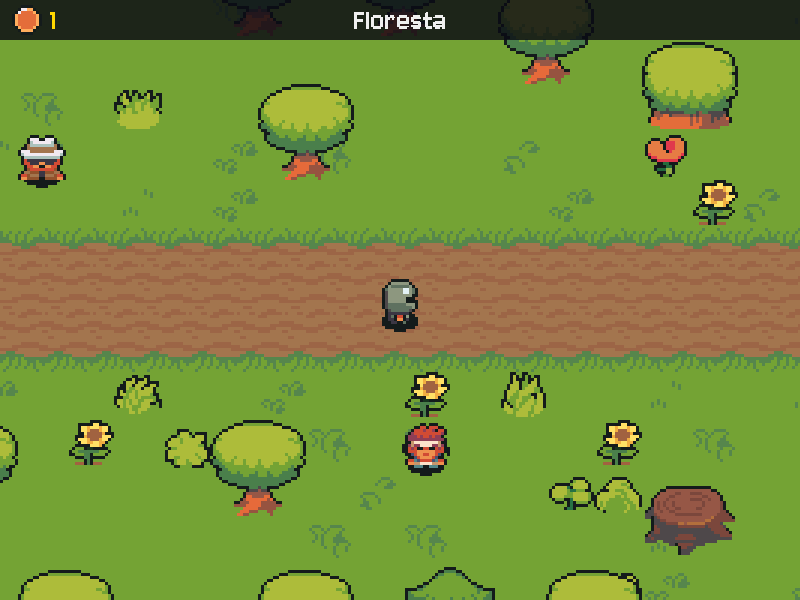

# MÓDULO 03B: Camadas — o mesmo jogo, organizado como software de verdade

Engenheiro, o `main.py` passou de 600 linhas e faz tudo: guarda onde o herói está, decide se ele bateu numa árvore, desenha a floresta, toca a música e conversa com o Gemini. Funciona, mas não dá para testar uma regra sem abrir a janela, e cada mudança mexe no arquivo inteiro. Hoje o jogo passa a viver em três camadas, cada uma com uma responsabilidade. Por fora, nada muda; é justamente essa a prova de que deu certo. O conceito do dia é **separação de responsabilidades (MVC)**.

## 🎯 O que você vai ver na tela ao final

O mesmo jogo do M03A, idêntico, agora rodando a partir da pasta `src/`, com o código dividido em `models.py`, `views.py` e `controllers.py`, e um `main.py` de umas 40 linhas que só monta as peças. E uma prova, no terminal, de que as regras do jogo funcionam sem abrir janela nenhuma.



## 🏢 Onde isso aparece no mercado

MVC e suas variações (MVP, MVVM, arquitetura em camadas) estão em praticamente todo framework: Django e Rails na web, Android e iOS no celular, Unity e Godot separando dados de cena e scripts. O motivo é o mesmo de hoje: a regra de negócio isolada pode ser testada e reaproveitada, a interface pode ser trocada sem mexer na regra, e duas pessoas trabalham em camadas diferentes sem pisar uma na outra.

## 🚦 Ponto de partida

- Seu projeto deve estar como no fim do M03A, com o desafio concluído: a moeda rúnica definida pelas propriedades `imagem` e `valor` no Tiled, e os oito números de ajuste com nome.
- Arquivos prontos deste módulo: pasta `M03B/` dentro de `curso-arquivos/`, com a pasta `src/` (o jogo em camadas), o `main.py` novo, o `prova_model.py` e o `teste_conexao_gemini.py` atualizado.
- Comando para conferir: com a venv ativa, `python main.py` abre o menu, e o jogo inteiro funciona.
- Duas sessões: **Sessão A**, Passos 1a a 2 (a estrutura nova, os seus dados nela e as regras do Model); **Sessão B**, Passos 3 e 4, o Quebre de propósito e o desafio (a leitura da View e do Controller, e o jogo passando a rodar pelas camadas).

> **Um ponto de encontro.** Até aqui, cada desafio deixou o seu código um pouco diferente do código de exemplo do curso. Hoje todos passam a ter a mesma estrutura: a pasta `src/` chega pronta, com espaços marcados para você completar, e o que é **seu** (o nome do jogo, as personas, o seu NPC, os créditos, os mapas) migra para ela. É o que um time faz quando padroniza a base de código: a autoria continua sua, nos dados. O seu código antigo não se perde: fica no histórico do Git (`git log`).

## ❓ Pergunta do dia

Como provar que a regra "o herói não atravessa paredes" funciona, sem abrir o jogo e andar até uma parede?

Ao longo dos passos aparecem caixas **🔍 Pare e pesquise**: pesquise as duas perguntas na hora, anote as respostas e, no fim, explique ao Engenheiro Sênior em até 5 minutos. **Sem mentor?** Grave um áudio de até 5 minutos explicando os termos e ouça de volta: onde você hesitar, o termo ainda não está claro.

## 🛠️ Passo a passo

### Passo 1a (Modifique): a estrutura nova e o que é seu nas regras

Copie para a raiz do projeto só a pasta `src/` e o `prova_model.py` do pacote `M03B/` (o `main.py` novo fica para o Passo 4):

```powershell
# PowerShell (Windows), na raiz do projeto
Copy-Item -Recurse $HOME\curso-arquivos\M03B\src .
Copy-Item $HOME\curso-arquivos\M03B\prova_model.py .
```

```bash
# bash (Linux), na raiz do projeto
cp -r ~/curso-arquivos/M03B/src .
cp ~/curso-arquivos/M03B/prova_model.py .
```

Chegaram cinco arquivos em `src/`: o `__init__.py` (que transforma a pasta num pacote Python, algo que se importa com `from src... import`), o `config.py`, o `models.py`, o `views.py` e o `controllers.py`. O seu `main.py` antigo continua mandando no jogo até o Passo 4, então o jogo segue rodando como antes.

Agora traga o que é seu para a estrutura nova, em dois blocos. Abra o seu `main.py` e o seu `config.py` antigos ao lado. Primeiro bloco:

1. **`src/config.py`:** o `NOME_JOGO` é o seu; e se você mudou algum valor (a velocidade, a duração do escurecer, os oito números do desafio do M03A), copie o seu valor. Os nomes já são os mesmos.
2. **`src/models.py`:** o texto das quatro personas é o seu: troque o texto de `INSTRUCAO_MAGO`, `INSTRUCAO_SENTINELA`, `INSTRUCAO_BROK` e `INSTRUCAO_CACADOR` pelo do seu `main.py`. A última é a do seu NPC do M02A: o nome da constante fica `INSTRUCAO_CACADOR` (é o nome da estrutura), o texto é o da persona que você criou.

Confira o que migrou (o mesmo comando funciona no PowerShell):

```bash
python -c "from src.config import NOME_JOGO; from src.models import INSTRUCAO_CACADOR; print(NOME_JOGO); print(INSTRUCAO_CACADOR[:60])"
```

Deve imprimir o nome do seu jogo e o começo da persona do seu NPC.

### Passo 1b (Modifique): o que é seu no mundo e na tela

Segundo bloco:

3. **`src/controllers.py`:** no `carregar_cenas`, as posições do Mago e da Sentinela são as do salão de exemplo: use as do seu `criar_cenas()`, as que você ajustou ao seu salão no desafio do M02C. A linha do Caçador é a do seu NPC do M02A: o nome que aparece no jogo e a pasta do sprite são os seus; a posição continua `(1080, 744)`.
4. **`src/views.py`:** a lista `CREDITOS`, no topo, é a sua tela de créditos do M02B: troque as linhas pelas suas.
5. **Algo mais que você mudou por gosto** (um texto do menu, uma cor)? Anote: depois do Passo 4, ache o mesmo lugar em `src/` e mude de novo.

Confira:

```bash
python -c "from src.views import CREDITOS; from src.controllers import carregar_cenas; print(CREDITOS); print([(n.nome, n.caixa.centro) for c in carregar_cenas().values() for n in c.npcs])"
```

Devem aparecer os seus créditos e os seus NPCs, com o centro de cada um no seu mundo (os mesmos números que você pôs no `carregar_cenas`).

O `ia.py` também é seu e vai para `src/` inteiro, no Passo 4. Os mapas não mudam de lugar: a pasta `assets/` é a mesma. Só confira no Tiled três coisas que o código novo lê pelo nome: o seu salão tem o ponto `inicio`; os portais têm a propriedade `destino`; a moeda rúnica tem as propriedades `imagem` (texto) e `valor` (inteiro).

> 🔍 **Pare e pesquise: separação de responsabilidades (MVC)** — O que cabe a cada camada: Model, View e Controller? Por que a regra "o Model não conhece a View" torna possível testar o jogo sem abrir uma janela?

### Passo 2 (Complete): as regras do Model

O **Model** guarda os dados do jogo e aplica as regras: onde o herói está, se ele bateu numa parede, se pegou uma moeda, se tocou um portal. A regra de ouro: **nada de pygame no Model**. Ele não desenha, não toca som e não lê teclado.

Abra o `src/models.py` e leia de cima para baixo. Sem pygame, o Model não tem `pygame.Rect`: ele tem o próprio retângulo, o `Retangulo`, uma *dataclass* (uma classe em que você declara os campos e o Python escreve o `__init__` sozinho). Repare no `sprite_id` do `NPC`: o Model não guarda imagem, guarda um **nome**; quem transforma o nome em imagem é a View. O `field(default_factory=list)` dá a cada herói uma lista nova; com `= []`, todos os heróis dividiriam a mesma lista.

Primeiro, rode a prova do Model, que chama cada regra direto, sem abrir janela:

```bash
python prova_model.py
```

Quase tudo sai `[FALTA]`: três regras estão marcadas com `# TODO`, e outras dependem delas. Duas vieram prontas, porque você já as escreveu antes: o `mudar_estado` (a tabela de transições do M02B, agora como método) e o `coletar_moedas` (o laço das moedas do M03A, que agora devolve quantas pegou). Leia as duas e compare com as suas. Depois complete as três, uma de cada vez, rodando a prova depois de cada uma:

1. **`Retangulo.colide`:** quando dois retângulos se sobrepõem.
2. **`Retangulo.ampliado`:** um retângulo maior, com o mesmo centro (é a área de conversa em volta de cada NPC).
3. **O fim do `Jogo.mover_heroi`:** manter o herói dentro do mapa, sem o `clamp_ip` do pygame.

**Preveja:** no `colide`, que diferença faz escrever `<=` em vez de `<`? Qual linha da prova viraria `[FALTA]`? (Se quiser, troque, rode a prova e volte.)

Quando todas as linhas da prova saírem `[OK]`, confira também que o Model não carrega o pygame:

```bash
python -c "import sys, src.models; print('pygame no Model?', 'pygame' in sys.modules)"
```

Deve imprimir `pygame no Model? False`. Nenhuma janela abriu em nada disso: são as regras do jogo rodando sozinhas.

Perguntas de leitura:

- O `coletar_moedas` devolve quantas moedas pegou, em vez de tocar o som, como fazia o seu laço do M03A. Quem toca o som agora, e por quê?
- O que o `@property` faz no `base` do `Retangulo`?

```bash
git add .
git commit -m "refactor: camadas em src/ com as regras do Model completas"
```

> ⏸️ **Fim da Sessão A.** Commit feito, jogo funcionando (ainda pelo `main.py` antigo). Pare aqui e continue na próxima sessão, no Passo 3.

### Passo 3 (Leia): a View e o Controller

A **View** (`src/views.py`) carrega arte, fontes e sons, e desenha. Ela **lê** o Model, mas nunca o altera. O **Controller** (`src/controllers.py`) lê o teclado, pede ao Model que aplique as regras, chama a IA e diz à View o que tocar; também monta o Model a partir dos mapas. Os dois chegaram prontos. Leia cada um com as perguntas abaixo; elas são o mapa do arquivo.

Na View:

- Procure no arquivo inteiro por uma atribuição ao Model: `jogo.` seguido de um `=` sozinho (não o `==` de comparação). Quantas há? Por que esse número precisa ser esse?
- No método `desenhar`, onde a imagem de cada NPC é escolhida a partir do `sprite_id`?
- Os sons ganharam nomes (`"ok"`, `"moeda"`). Quem pede para tocar, e por que essa pessoa não precisa saber o nome do arquivo `.wav`?

No Controller:

- Em que métodos o Controller chama as regras do Model que você completou no Passo 2?
- Por que a leitura dos mapas (`pytmx`) fica no Controller, e não no Model? (Dica: o que o `pytmx` importa?)
- O que o `Controle` recebe pronto no `__init__`, em vez de criar?

> 🔍 **Pare e pesquise: injeção de dependências** — O que significa uma classe "receber pronto" o que usa, em vez de criar? Que vantagem isso dá quando você quer trocar uma peça (por exemplo, a IA de verdade por uma falsa)?

### Passo 4 (Complete): o novo `main.py`

Agora o jogo passa a rodar pelas camadas. Mova o seu `ia.py` para dentro de `src/` e tire o `config.py` antigo da raiz, com o Git, que assim registra que os arquivos mudaram de lugar (e não que foram apagados e criados). Os comandos são os mesmos no PowerShell e no bash:

```bash
git mv ia.py src/ia.py
git rm config.py
```

Copie o `main.py` novo e o `teste_conexao_gemini.py` atualizado (a única linha que mudou nele é o import: `from src.ia import explicar_erro`) por cima dos seus:

```powershell
# PowerShell (Windows), na raiz do projeto
Copy-Item -Force $HOME\curso-arquivos\M03B\main.py, $HOME\curso-arquivos\M03B\teste_conexao_gemini.py .
```

```bash
# bash (Linux), na raiz do projeto
cp ~/curso-arquivos/M03B/main.py ~/curso-arquivos/M03B/teste_conexao_gemini.py .
```

Abra o `main.py` novo: ele perdeu tudo. O que sobrou é montar as peças e girar o game loop, que continua com as mesmas três etapas (eventos, atualizar, desenhar), agora em três linhas. Falta uma coisa, marcada com `# TODO`: criar as três peças. É a **injeção de dependências**: cada peça é criada aqui, uma vez, e entregue pronta a quem usa. Complete as três linhas.

**Preveja antes de rodar:** se você criar o `Controle` antes da `Tela`, o que acontece?

Rode `python main.py` e confira o **roteiro de teste manual**, um item de cada vez:

1. Menu e créditos (com os seus créditos);
2. o Mago fala (com a IA falsa ou de verdade);
3. a moeda comum soma 1 e a rúnica soma 5;
4. os portais escurecem a tela e levam até a masmorra e de volta;
5. "Novo jogo" zera a bolsa e devolve as moedas.

Os cinco iguais ao M03A? Então a refatoração deu certo: a estrutura mudou, o comportamento não. Confira também que o teste de conexão continua funcionando (`python teste_conexao_gemini.py`).

> 🔍 **Pare e pesquise: refatoração** — O que diferencia refatorar de reescrever? Como provar que uma refatoração não mudou o comportamento do programa?

```bash
git status
git add .
git commit -m "refactor: main.py só monta as peças"
git push
```

## 💥 Quebre de propósito

No `src/models.py`, acrescente `import pygame` nos imports e, no começo de `coletar_moedas`, uma linha que desenha (um "efeito" de brilho no Model):

```python
        pygame.draw.rect(pygame.display.get_surface(), (255, 215, 0), (0, 0, 10, 10))
```

**Preveja:** o jogo continua funcionando? E a prova do Model? Rode `python main.py`: o jogo **funciona** (há uma janela aberta). Agora rode a prova:

```bash
python prova_model.py
```

Erro: `TypeError` (`argument 1 must be pygame.surface.Surface, not None`): sem janela, não há superfície para desenhar, e a regra de pegar moeda quebrou por causa de um desenho. Repare também que o brilho nunca apareceu no jogo: a View pinta o quadro inteiro por cima, depois das regras, porque desenhar é tarefa dela. É exatamente o que a separação evita: no M04A, os testes chamam as regras do Model centenas de vezes, sem janela. Desfaça as duas linhas.

## 🧯 Problemas comuns

| Sintoma | Causa provável | Como resolver |
| --- | --- | --- |
| `ModuleNotFoundError: No module named 'src'` | O jogo foi rodado de dentro de `src/`, ou a pasta foi copiada para outro lugar | Rode da raiz do projeto; confira que existe `src/__init__.py` |
| `ModuleNotFoundError: No module named 'ia'` (ou `'config'`) ao rodar o jogo depois do Passo 4 | O `main.py` antigo continua lá, ou o `ia.py` não foi movido | Copie o `main.py` novo do pacote e confira o `git mv ia.py src/ia.py` |
| `[FALTA]` que não vira `[OK]` no `colide` | A conta compara a borda com `<=` (aí encostar conta como colisão), ou testa só um eixo | Os dois eixos, com `<`: cada um começa antes de o outro terminar |
| `[FALTA]` no `ampliado` | O canto não andou para trás, ou andou a margem inteira em vez da metade | O canto vai `margem / 2` para cima e para a esquerda; largura e altura ganham `margem` |
| O Mago ou a Sentinela dentro da parede, ou fora do salão | As posições no `carregar_cenas` são as do salão de exemplo | Use as do seu `criar_cenas()` antigo (item 3 do Passo 1b) |
| `[FALTA]` no canto de baixo à direita | O limite não desconta a largura (ou a altura) do herói, ou falta o `min` | O x fica entre o começo da área e o fim dela menos a largura da caixa; o y, igual com a altura |
| Tudo funciona, mas o som da moeda não toca | O `coletar_moedas` não devolve quantas pegou (devolve `None`) | Devolva a contagem no fim do método |
| `TypeError: Controle.__init__() missing 1 required positional argument` | O `Controle` foi criado sem uma das três peças | Ele recebe três: o Model, a View e o serviço de IA |
| `KeyError: 'inicio'` (ou o nome de um mapa) ao começar o jogo | O ponto de chegada ou o `destino` do seu mapa tem outro nome | Confira no Tiled os nomes da conferência do Passo 1 |
| A moeda rúnica vale 1 ou aparece de cobre | As propriedades no Tiled têm outro nome (ou o `valor` é texto) | `imagem` (texto) e `valor` (inteiro) |

## 🧩 Desafio de Engenharia

A camada certa no lugar certo, provada com dados e com um roteiro.

**Critérios de aceite:**

- [ ] **Moedas também na clareira, só com dados:** pelo menos três moedas novas entre os tocos da clareira, postas no Tiled, sem mudar nenhum arquivo `.py` (nem a View, nem o Model). Onde ficam e quantas são, é com você.
- [ ] **Nenhum `import pygame` em `models.py`** (`pygame no Model? False`) e a prova do Model toda `[OK]`.
- [ ] **Roteiro de teste manual de 5 itens** conferido e anotado na mensagem do commit, um item por linha, com o resultado.
- [ ] Commits pequenos no padrão Conventional Commits e push na `main`.
- [ ] Você explica ao Engenheiro Sênior, sem ler e em até 5 minutos, os três termos das caixas 🔍 (MVC, injeção de dependências e refatoração). **Sem mentor?** Grave a explicação em áudio e ouça de volta.

Dica para a clareira: um ponto embaixo da copa de uma árvore fica escondido e, dentro da base dela, impossível de pegar. Rode o jogo e pegue cada moeda nova.

Dica para o commit: a mensagem pode ter várias linhas. Escreva o título, uma linha em branco e o roteiro:

```text
feat: moedas na clareira só com dados

Roteiro manual:
1. Menu e créditos iguais: ok
2. ...
```

Duas formas de escrever: com vários `-m`, cada um vira um parágrafo (`git commit -m "feat: moedas na clareira só com dados" -m "Roteiro manual: 1. ... ok; 2. ... ok"`, igual no PowerShell e no bash); ou `git commit` sem o `-m`, que abre o editor (no VS Code, configure antes com `git config --global core.editor "code --wait"`).

Lembre as regras de uso de IA do M00B: pode pedir explicação de conceito e de erro, não pode pedir a solução pronta, e deve saber explicar ao Engenheiro Sênior cada trecho que veio de uma IA. **Sem mentor?** Escreva essa explicação na mensagem do commit.

**Entrega:** push na `main`, com o roteiro na mensagem do commit, e um print da clareira com as moedas.

## ⭐ Bônus (opcional)

**Um minimapa: uma segunda View do mesmo Model.** O mapa inteiro em miniatura no canto da tela, com as moedas que faltam e o herói, sem mudar uma linha do `models.py`. É a melhor prova de que a separação funciona: a mesma regra, duas maneiras de mostrar.

No `__init__` da `Tela`, logo depois da linha `self.moedas = {}`, guarde as miniaturas já prontas:

```python
        self.minis = {}  # mapa -> miniatura do minimapa
```

Na `Tela`, logo antes do método `desenhar`, acrescente o método do minimapa:

```python
    def desenhar_minimapa(self, jogo):
        """Uma segunda View do mesmo Model: o mapa inteiro em miniatura, no canto da tela."""
        fundo, _ = self.mapa(jogo.cena.mapa)
        escala = 150 / fundo.get_width()  # o minimapa tem 150 pixels de largura
        if jogo.cena.mapa not in self.minis:
            self.minis[jogo.cena.mapa] = pygame.transform.scale_by(fundo, escala)
        mini = self.minis[jogo.cena.mapa]
        x, y = LARGURA - mini.get_width() - 10, 50
        self.superficie.blit(mini, (x, y))
        pygame.draw.rect(self.superficie, COR_DESTAQUE, (x, y, mini.get_width(), mini.get_height()), 1)
        for moeda in jogo.cena.moedas:  # pontos brancos: as moedas que ainda estão no chão
            moeda_x, moeda_y = moeda.caixa.centro
            pygame.draw.circle(self.superficie, COR_TEXTO, (x + moeda_x * escala, y + moeda_y * escala), 2)
        heroi_x, heroi_y = jogo.heroi.caixa.centro  # o ponto dourado, maior: o herói
        pygame.draw.circle(self.superficie, COR_DESTAQUE, (x + heroi_x * escala, y + heroi_y * escala), 4)

```

No `desenhar`, logo depois das duas linhas do HUD (o ícone e o total da bolsa), chame o método:

```python
        self.desenhar_minimapa(jogo)
```

Rode: o minimapa aparece no canto e o ponto dourado anda com você. Experimente pegar uma moeda e ver o ponto branco sumir dos dois lugares ao mesmo tempo.

**NPCs vindos do mapa:** uma camada de objetos `npcs` com um ponto por personagem (nome = `sprite_id`, propriedade `persona`), lida no `ler_cena`, no lugar das posições escritas no `carregar_cenas`.

## 💼 Resumo profissional

- **Conceito:** separação de responsabilidades em Model, View e Controller, refatoração guiada por roteiro de teste e injeção de dependências; regra de negócio isolada de framework gráfico e provada sem interface.
- **Linha para o currículo:** "Reorganizei um jogo 2D em Python na arquitetura MVC (regras sem dependência de pygame, view somente leitura, controller com injeção de dependências), mantendo o comportamento e provando as regras sem interface gráfica."
