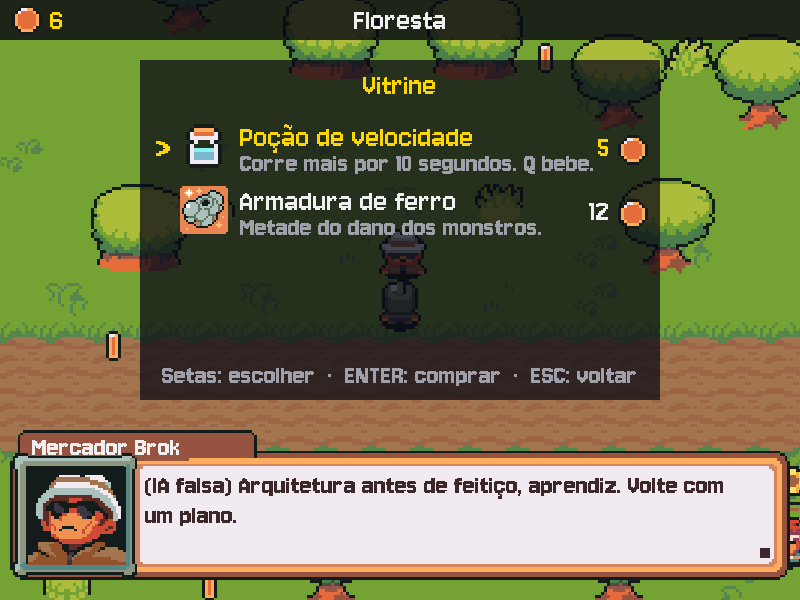

# MÓDULO 03C: Loja do Brok e GitHub — as moedas ganham utilidade, e o código passa por revisão

Engenheiro, a bolsa enche, mas as moedas não servem para nada. Hoje o Brok abre a loja: na conversa com ele aparece uma barra de ações, e o Tab mostra a vitrine com uma poção de velocidade e uma armadura de ferro. Junto vem a forma como um time trabalha de verdade: nada entra na `main` sem passar por uma branch, um Pull Request e a revisão do Engenheiro Sênior. O conceito do dia é **Pull Request e code review**.

## 🎯 O que você vai ver na tela ao final

Na conversa com o Brok, quando a fala termina, a barra "Tab Loja · Esc Sair" aparece acima da caixa. O Tab abre a vitrine; o ENTER compra, desconta as moedas e põe o item no canto direito do HUD; o Brok comenta a compra. Fora da conversa, a tecla Q bebe a poção e o herói corre por 10 segundos.



## 🏢 Onde isso aparece no mercado

Em praticamente toda empresa de software, a `main` é protegida: cada mudança nasce numa branch, vira um Pull Request (no GitLab, "Merge Request") e só entra depois que outra pessoa revisa e aprova. É assim no GitHub da Microsoft, do Google e em projetos de código aberto como o Python e o pygame. O review pega erro, espalha conhecimento pelo time e deixa um registro de por que cada mudança foi feita. Os logs com nível e origem são o que a equipe de operação lê quando algo dá errado em produção.

## 🚦 Ponto de partida

- Seu projeto deve estar como no fim do M03B, com o desafio concluído: o jogo em camadas (`src/models.py` sem pygame, `src/views.py`, `src/controllers.py`) e as moedas da clareira só com dados.
- Arquivos prontos deste módulo: pasta `M03C/` dentro de `curso-arquivos/`, com `assets/itens/` (poção, armadura e o amuleto do desafio), `assets/sons/` (compra e poção), o `CREDITOS.md` atualizado e o `.env.example` com uma linha nova.
- Comando para conferir: com a venv ativa, `python main.py` abre o menu, e o jogo inteiro funciona.
- Você vai usar o GitHub CLI (`gh`), instalado e autenticado no M00B. Confira com `gh auth status`.
- **Chegou direto aqui pelo repositório-modelo?** O projeto criado pelo "Use this template" já é o ponto de partida deste módulo. Confira antes a lista "Antes de começar" do README do modelo (Python 3.12, Git, GitHub CLI autenticado, Tiled e a chave do Gemini).

> **A partir de hoje, a entrega é por Pull Request.** Você não faz mais push na `main`. O trabalho do módulo inteiro vai para a branch `modulo-03c`, e o Engenheiro Sênior revisa antes de entrar. **Sem mentor?** O review pode ser de um colega do curso ou uma autorrevisão: o caminho está em "Depois do desafio: o review e o merge".

- Cinco sessões: **Sessão A**, Passos 1a a 2 (branch, barra de ações, a issue da loja e a regra da compra); **Sessão B**, Passos 3a a 3c (a vitrine e a compra); **Sessão C**, Passos 4a e 4b (o inventário e a poção); **Sessão D**, Passos 5a a 6 (o log e o Pull Request aberto); **Sessão E**, com o Sênior (ou com um colega, ou sozinho): o Quebre de propósito, o desafio, o review e o merge.

> **Andaime:** parte do código vem com `# TODO` nos pontos-chave. O texto explica o que fazer; o código é seu. Rode o jogo depois de cada `TODO`.

## ❓ Pergunta do dia

Num time, como uma mudança no código chega ao produto sem que ninguém precise confiar cegamente em quem a escreveu? E como o jogo conta o que está fazendo, sem encher a tela de avisos?

Ao longo dos passos aparecem caixas **🔍 Pare e pesquise**: pesquise as duas perguntas na hora, anote as respostas e, no fim, explique ao Engenheiro Sênior em até 5 minutos. **Sem mentor?** Grave um áudio de até 5 minutos explicando os termos e ouça de volta: onde você hesitar, o termo ainda não está claro.

## 🛠️ Passo a passo

### Passo 1a: a branch

Antes de qualquer código, a **branch**. Confira que está na `main`, atualizada, e crie a sua:

```bash
git switch main
git pull
git switch -c modulo-03c
```

O `switch -c` cria a branch `modulo-03c` a partir de onde a `main` está e já muda para ela. Todo commit deste módulo cai nela; a `main` fica parada. Confira com `git branch`: o asterisco marca onde você está.

### Passo 1b (Preveja): a loja nos dados do NPC

Cada NPC diz quais ações oferece, como dado. No `src/models.py`, na classe `NPC`, logo depois da linha `direcao: str = "baixo"`, acrescente:

```python
    acoes: list = field(default_factory=list)  # botões da barra na conversa, ex.: ["Loja"]
```

No `src/controllers.py`, o `criar_npc` passa as ações adiante. Substitua a função por:

```python
def criar_npc(nome, sprite_id, centro, instrucao, acoes=()):
    """Um NPC com a caixa de 48×48 centrada em `centro` (pixels do mapa já ampliado)."""
    caixa = retangulo_no_centro(centro, TAMANHO_SPRITE, TAMANHO_SPRITE)
    return NPC(nome, sprite_id, caixa, instrucao, acoes=list(acoes))
```

E, no `carregar_cenas`, o Brok ganha a loja (troque a linha dele):

```python
            criar_npc("Mercador Brok", "brok", (696, 456), INSTRUCAO_BROK, acoes=["Loja"]),
```

O `acoes=()` com uma tupla vazia como padrão é proposital: um padrão de função é criado uma vez só, e uma lista ali seria compartilhada por todos os NPCs. Por isso o `list(acoes)` cria uma lista nova para cada um.

Nada muda na tela ainda, mas o dado já existe. Confira sem janela:

```bash
python -c "from src.controllers import carregar_cenas; print([(n.nome, n.acoes) for n in carregar_cenas()['floresta'].npcs])"
```

**Preveja antes de rodar:** quais ações o Brok e o seu NPC do M02A vão mostrar? Rode e confira.

### Passo 1c (Preveja): a barra de ações

A barra aparece quando a fala terminou, junto com o ■. No `src/views.py`, na classe `Dialogo`, logo depois do método `ultima_pagina`, acrescente:

```python
    def terminou(self):
        """A fala inteira já apareceu (é quando o ■ surge)."""
        return self.ultima_pagina() and self.pagina_completa()
```

Na classe `Tela`, logo antes do método `desenhar`, acrescente o desenho da barra:

```python
    def desenhar_acoes(self, npc):
        """A barra de ações da conversa, acima da caixa: "Tab Loja · Esc Sair"."""
        texto = "  ·  ".join([f"Tab {acao}" for acao in npc.acoes] + ["Esc Sair"])
        imagem = self.fonte_fala.render(texto, False, COR_DESTAQUE)
        fundo = pygame.Surface((imagem.get_width() + 24, imagem.get_height() + 4), pygame.SRCALPHA)
        fundo.fill(COR_PAINEL)
        topo = ALTURA - self.caixa.get_height() - 20 - fundo.get_height()
        x = LARGURA - (LARGURA - self.caixa.get_width()) // 2 - fundo.get_width()  # à direita
        self.superficie.blit(fundo, (x, topo))
        self.superficie.blit(imagem, (x + 12, topo + 2))
```

O `"  ·  ".join(...)` cola os textos de uma lista com o separador entre eles: `["Tab Loja", "Esc Sair"]` vira `"Tab Loja  ·  Esc Sair"`. Um NPC sem ações mostra só "Esc Sair".

Por fim, no `desenhar`, dentro do `elif jogo.estado == Estado.DIALOGO:`, logo depois da linha `controle.dialogo.desenhar(tela, self.caixa, retrato, tempo)`, acrescente:

```python
            if controle.dialogo.terminou() and not controle.pedindo:  # a fala acabou: ações
                self.desenhar_acoes(controle.dialogo.npc)
```

**Preveja:** a barra só aparece com `terminou()` verdadeiro. Enquanto a máquina de escrever ainda está escrevendo a fala, ela aparece?

Rode `python main.py` e fale com o Brok: quando a fala termina, a barra "Tab Loja · Esc Sair" aparece acima da caixa. Com o Mago, só "Esc Sair". O Tab ainda não faz nada.

Commit **na branch** e o primeiro push dela. O `-u` liga a sua branch local à branch de mesmo nome no GitHub; dali em diante, `git push` sozinho basta:

```bash
git add .
git commit -m "feat: barra de ações na conversa"
git push -u origin modulo-03c
```

Agora o backlog: a lista de tarefas que o time enxerga. No GitHub, cada tarefa é uma issue. Crie a primeira, a da loja, com as suas palavras: um título curto e, no texto, o que a loja precisa fazer para estar pronta (o jogador abre de onde? compra como? o que acontece sem dinheiro?). Pelo site é mais fácil na primeira vez: aba "Issues", botão "New issue" (o `gh issue create` também serve, mas pode abrir um editor no terminal). Uma boa issue diz o que é para fazer e como saber que ficou pronto. Ela ganha um número (`#2`, por exemplo): anote, o Pull Request vai citá-lo.

> 🔍 **Pare e pesquise: branch** — O que é uma branch no Git, e o que acontece com a `main` enquanto você trabalha na sua? O que é um merge?

### Passo 2 (Complete): itens como dados e a regra no Model

Copie o **conteúdo** de `curso-arquivos/M03C/assets/` para dentro da pasta `assets/` do projeto (chegam a poção, a armadura, o amuleto do desafio e dois sons). O `CREDITOS.md` será substituído por uma versão com as linhas novas: é esperado.

```powershell
# PowerShell (Windows), na raiz do projeto
Copy-Item -Recurse -Force $HOME\curso-arquivos\M03C\assets\* assets\
```

```bash
# bash (Linux), na raiz do projeto
cp -r ~/curso-arquivos/M03C/assets/. assets/
```

A loja é um estado novo da máquina de estados. No `src/models.py`, na classe `Estado`, depois de `TRANSICAO`, acrescente:

```python
    LOJA = auto()  # a vitrine, aberta de dentro da conversa
```

Na tabela `TRANSICOES`, a conversa passa a poder abrir a loja, e a loja só volta para a conversa. Troque a linha do `DIALOGO` e acrescente a do `LOJA` no fim da tabela:

```python
    Estado.DIALOGO: {Estado.EXPLORANDO, Estado.LOJA},
```

```python
    Estado.LOJA: {Estado.DIALOGO},  # fechar a loja volta para a conversa, não para o mapa
```

Agora os itens. Um item é só dado: nome, preço, imagem e descrição. Logo depois da tabela `TRANSICOES` (e **antes** do `FORMATO` e das personas, porque a persona do Brok vai usar a lista no Passo 3), acrescente:

```python
@dataclass(frozen=True)  # frozen: um item não muda depois de criado
class Item:
    """Uma mercadoria. Só dados: a loja vende e a View desenha qualquer item desta forma."""
    nome: str
    preco: int
    imagem: str  # caminho dentro de assets/: a View desenha o ícone por ele
    descricao: str
    unico: bool = False  # True: o herói só pode ter um (comprar de novo é recusado)


POCAO = Item("Poção de velocidade", 5, "itens/pocao.png", "Corre mais por 10 segundos. Q bebe.")
ARMADURA = Item("Armadura de ferro", 12, "itens/armadura.png", "Metade do dano dos monstros.",
                unico=True)
# A vitrine do Brok, na ordem em que aparece. Item novo na loja = uma linha aqui.
ITENS_LOJA = [POCAO, ARMADURA]
```

O `frozen=True` impede mudar um item depois de criado (`POCAO.preco = 0` dá erro): o preço da loja não muda por acidente no meio do jogo. A armadura ainda não protege de nada; o efeito chega com os slimes, no M04B.

Atualize o comentário do inventário no `Heroi`, que agora guarda itens:

```python
    inventario: list = field(default_factory=list)  # [Item]: o que ele comprou (ou ganhou)
```

E a regra da compra, no `Jogo`. Ela mora no Model, não na tela: qualquer forma de comprar (a vitrine hoje; a fala do Brok no M06B) passa pela mesma regra. Logo antes do método `tocar_portal`, acrescente:

```python
    def comprar(self, item):
        """Compra o item, se der. Devolve o motivo da recusa, ou None se a compra saiu.

        A regra mora aqui, no Model: a View só mostra o resultado. Assim nenhuma
        tela nova (nem a loja pela fala da IA, no M06B) consegue vender fiado.
        """
        heroi = self.heroi
        # TODO: duas recusas, nesta ordem, cada uma com return de uma frase:
        #       1. item.unico e o item já está em heroi.inventario: "Você já tem: <nome>."
        #       2. heroi.moedas menor que item.preco: "<nome> custa <preço>; você tem <moedas>."
        #       Use f-strings com item.nome, item.preco e heroi.moedas.
        heroi.moedas -= item.preco
        heroi.inventario.append(item)
        return None
```

O método devolve `None` quando dá certo e um texto quando não dá. Quem chamou testa `if motivo:` e mostra o texto ao jogador; a decisão continua aqui.

A janela ainda não mostra a loja, mas a regra já pode ser provada **sem janela**, porque o Model não usa pygame. Rode, da raiz do projeto:

```bash
python -c "from src.models import ARMADURA, POCAO, Jogo; j = Jogo({'salao': None}); print(j.comprar(POCAO)); j.heroi.moedas = 20; print(j.comprar(ARMADURA), j.comprar(ARMADURA), j.heroi.moedas)"
```

Você deve ver `Poção de velocidade custa 5; você tem 0.` e depois `None Você já tem: Armadura de ferro. 8`: a primeira compra sem dinheiro é recusada; com 20 moedas a armadura sai, a segunda é recusada e sobram 8. Rode `python main.py`: o jogo continua como no Passo 1.

```bash
git add .
git commit -m "feat: itens como dados e a regra da compra no Model"
git push
```

> ⏸️ **Fim da Sessão A.** Commit enviado, a regra da compra provada sem janela. Pare aqui e continue na próxima sessão, no Passo 3a.

### Passo 3a (Leia): as peças da vitrine

A View precisa de ícones de tamanhos diferentes (a poção tem 9×11 pixels; a armadura, 24×24). No `src/config.py`, logo antes do grupo `# IA`, crie o grupo da loja:

```python
# Loja e itens
TAMANHO_ICONE_LOJA = 48  # lado máximo do ícone de um item na vitrine, em pixels
```

No `src/views.py`, importe `TAMANHO_ICONE_LOJA` do `config` (em ordem alfabética, junto dos outros `TAMANHO_...`) e troque `from src.models import Estado` por:

```python
from src.models import ITENS_LOJA, Estado
```

Logo depois da linha `self.moedas = {}  # imagem -> quadros girando`, o cache dos ícones e o painel da vitrine:

```python
        self.icones = {}  # (imagem, lado) -> ícone de item ampliado
        self.vitrine = pygame.Surface((520, 340), pygame.SRCALPHA)
        self.vitrine.fill(COR_PAINEL)
```

Rode `python main.py`: o jogo está igual (as peças ainda não aparecem); rodar agora pega erros de import antes de seguir.

Ainda na `Tela`, logo antes do `desenhar_acoes`, o método que amplia um ícone sem borrar o pixel:

```python
    def icone(self, imagem, lado):
        """O ícone de um item, ampliado num número inteiro de vezes até caber em lado × lado."""
        if (imagem, lado) not in self.icones:
            original = carregar_imagem(imagem)
            vezes = max(lado // max(original.get_size()), 1)  # inteiro: o pixel não borra
            self.icones[(imagem, lado)] = pygame.transform.scale_by(original, vezes)
        return self.icones[(imagem, lado)]
```

A conta: a poção tem 11 pixels de altura, e `48 // 11` dá 4 (fica com 36×44); a armadura tem 24, e `48 // 24` dá 2 (48×48). A chave do cache é a dupla `(imagem, lado)`, porque o mesmo item aparece em dois tamanhos (no Passo 4, no HUD).

Logo antes do `desenhar`, a vitrine. Ela percorre `ITENS_LOJA` e desenha qualquer item que estiver lá, sem saber qual é:

```python
    def desenhar_loja(self, controle):
        """A vitrine: um item por linha, com ícone, nome, descrição e preço. Só lê os dados."""
        tela = self.superficie
        x, y = (LARGURA - self.vitrine.get_width()) // 2, 60
        tela.blit(self.vitrine, (x, y))
        escrever(tela, self.fonte, "Vitrine", COR_DESTAQUE, y + 25)
        for i, item in enumerate(ITENS_LOJA):
            topo = y + 60 + i * 64
            cor = COR_DESTAQUE if i == controle.escolha else COR_TEXTO
            if i == controle.escolha:
                tela.blit(self.fonte.render(">", False, cor), (x + 16, topo + 10))
            icone = self.icone(item.imagem, TAMANHO_ICONE_LOJA)
            tela.blit(icone, icone.get_rect(center=(x + 64, topo + 26)))
            tela.blit(self.fonte.render(item.nome, False, cor), (x + 100, topo))
            descricao = self.fonte_fala.render(item.descricao, False, COR_APAGADA)
            tela.blit(descricao, (x + 100, topo + 28))
            preco = self.fonte.render(str(item.preco), False, cor)
            tela.blit(preco, (x + 470 - preco.get_width(), topo + 10))
            tela.blit(self.icone_moeda, (x + 478, topo + 15))
        if controle.aviso:
            escrever(tela, self.fonte_fala, controle.aviso, COR_DESTAQUE, y + 280)
        escrever(tela, self.fonte_fala, "Setas: escolher  ·  ENTER: comprar  ·  ESC: voltar",
                 COR_APAGADA, y + 315)
```

O preço é alinhado pela direita (`x + 470 - preco.get_width()`): 5 e 12 terminam na mesma coluna, encostados no ícone da moeda.

Rode `python main.py`: o jogo está **igual** (ninguém abre a vitrine ainda); rodar agora pega os erros de sintaxe deste trecho grande.

Perguntas de leitura:

- Na vitrine, o que muda na linha do item escolhido, e qual variável decide isso?
- Se você acrescentar um terceiro item ao `ITENS_LOJA`, quantas linhas da `desenhar_loja` precisam mudar?

### Passo 3b (Leia): a vitrine ligada à conversa

No dicionário `self.sons` da `Tela`, depois da linha da moeda, acrescente o som da compra:

```python
            "compra": carregar_som("compra.wav"),
```

No `desenhar`, a vitrine aparece por cima da conversa: a caixa com a fala do Brok continua embaixo. Substitua o bloco do `DIALOGO` que você editou no Passo 1c por:

```python
        elif jogo.estado in (Estado.DIALOGO, Estado.LOJA):
            _, retrato = self.sprite_npc(controle.dialogo.npc.sprite_id)
            controle.dialogo.desenhar(tela, self.caixa, retrato, tempo)
            if jogo.estado == Estado.LOJA:
                self.desenhar_loja(controle)
            elif controle.dialogo.terminou() and not controle.pedindo:  # a fala acabou: ações
                self.desenhar_acoes(controle.dialogo.npc)
```

Agora o Controller. No `src/controllers.py`, acrescente `ITENS_LOJA` ao import de `src.models` (em ordem alfabética, depois de `INSTRUCAO_SENTINELA`). No `__init__` do `Controle`, logo depois da linha do `self.pedindo`:

```python
        self.fala_jogador = ""  # o que o jogo conta ao NPC nesse pedido
        self.aviso = None  # a recusa da última compra, mostrada na vitrine
```

Até aqui, o jogo sempre contava ao NPC a mesma coisa ("o aprendiz se aproxima e cumprimenta você"). Depois de uma compra, ele vai contar outra. Logo antes do `tratar_evento`, crie um método que abre a conversa com qualquer fala:

```python
    def conversar(self, npc, fala_jogador):
        """Abre a caixa com "Pensando..."; a chamada à IA sai em atualizar(), quando ele aparece."""
        self.dialogo = self.tela.novo_dialogo(npc, "Pensando...")
        self.pedindo = npc
        self.fala_jogador = fala_jogador
```

Rode `python main.py`: tudo igual. As peças estão no lugar; no 3c, o Tab liga tudo.

Perguntas de leitura:

- Por que, no `desenhar`, a vitrine é desenhada depois da caixa do diálogo?
- Além do ESPAÇO, quem vai chamar o `conversar`, e com que fala?

### Passo 3c (Complete): o Tab, a compra e o comentário do Brok

No `tratar_evento`, no ESPAÇO do estado `EXPLORANDO`, troque as três linhas que abriam a caixa (o comentário, o `self.dialogo = ...` e o `self.pedindo = perto`) por:

```python
                self.conversar(perto, f"O aprendiz {NOME} se aproxima e cumprimenta você.")
```

E, no `atualizar`, a chamada à IA passa a usar essa fala (troque as duas linhas do `fala = self.servico_ia.responder(...)` por):

```python
                fala = self.servico_ia.responder(self.pedindo.instrucao, self.fala_jogador)
```

Agora o Tab e a loja. No `tratar_evento`, no bloco do `DIALOGO`, logo depois do `elif tecla == pygame.K_ESCAPE:` e da linha dele, acrescente o Tab e, em seguida, o bloco inteiro do estado `LOJA`:

```python
            elif (tecla == pygame.K_TAB and "Loja" in self.dialogo.npc.acoes
                  and self.dialogo.terminou()):
                self.tela.tocar("ok")
                self.escolha = 0  # a vitrine abre no primeiro item
                self.aviso = None
                jogo.mudar_estado(Estado.LOJA)
        elif jogo.estado == Estado.LOJA:
            # TODO: setas para cima e para baixo (e W/S) mudam self.escolha, dando a volta
            #       como no menu, mas com len(ITENS_LOJA); em cada uma, apague o aviso
            #       (self.aviso = None): a recusa era do item anterior.
            elif tecla == pygame.K_ESCAPE:
                self.tela.tocar("voltar")
                jogo.mudar_estado(Estado.DIALOGO)  # a caixa ainda tem a última fala do Brok
            elif tecla == pygame.K_RETURN:
                item = ITENS_LOJA[self.escolha]
                self.aviso = jogo.comprar(item)  # a regra é do Model; aqui só o efeito na tela
                if self.aviso:
                    self.tela.tocar("voltar")
                else:
                    self.tela.tocar("compra")
                    # De volta à conversa: o Brok comenta a compra (a IA sabe os preços).
                    self.conversar(self.dialogo.npc, f"O aprendiz {NOME} acaba de comprar "
                                   f"{item.nome} por {item.preco} moedas.")
                    jogo.mudar_estado(Estado.DIALOGO)
```

Atenção ao `TODO`: o primeiro teste do bloco é um `if`, e o `elif tecla == pygame.K_ESCAPE` vem depois dele. Sem o `if`, o Python acusa erro de sintaxe.

Repare na divisão: o Controller recebe o ENTER, pede a compra ao Model e decide o efeito na tela (som, aviso, voltar à conversa). A conta das moedas, ele não faz.

Por último, o Brok precisa saber os preços para comentar a compra. No `src/models.py`, na `INSTRUCAO_BROK`, logo antes da linha `+ FORMATO` (o texto da persona é o seu; os preços entram depois dele), acrescente:

```python
    # Os preços saem da mesma lista da vitrine: mudou a loja, o Brok já sabe.
    + "Você vende: " + "; ".join(f"{item.nome} por {item.preco} moedas" for item in ITENS_LOJA)
    + ". Quando o aprendiz compra, comente a compra. "
```

A instrução é montada a partir da mesma lista que a vitrine desenha: se um preço mudar, a tela e a IA mudam juntas.

**Preveja:** sem moedas, o que o ENTER mostra na vitrine, e a bolsa muda?

Rode `python main.py`. Pegue moedas na floresta (a rúnica vale 5), fale com o Brok e, com a fala terminada, aperte Tab: a vitrine abre por cima da conversa. Sem moedas, o ENTER mostra o preço e o que você tem, e a bolsa não muda. Com moedas, toca o som, a bolsa desconta e o Brok comenta a compra. O ESC na vitrine volta para a conversa, não para o mapa. (Com `IA_FALSA=1`, o comentário é a frase fixa da IA falsa, que não fala da compra: é esperado.)

```bash
git add .
git commit -m "feat: vitrine do Brok e compra comentada pela IA"
git push
```

> ⏸️ **Fim da Sessão B.** Commit enviado, a loja funcionando. Pare aqui e continue na próxima sessão, no Passo 4a.

### Passo 4a (Complete): a poção no Model

No `src/config.py`, no grupo `# Loja e itens`, logo depois do `TAMANHO_ICONE_LOJA`:

```python
TAMANHO_ICONE_HUD = 33  # e na faixa do topo
DURACAO_POCAO = 10  # segundos de efeito da poção de velocidade
FATOR_POCAO = 1.6  # com a poção, o herói anda 1,6 vez mais rápido
```

No `src/models.py`, importe `DURACAO_POCAO` e `FATOR_POCAO` do `config` (em ordem alfabética). No `Heroi`, logo depois do `inventario`:

```python
    pressa: float = 0.0  # segundos de efeito da poção que ainda restam
```

No `novo_jogo`, logo depois de `self.heroi.inventario = []`, zere o efeito também:

```python
        self.heroi.pressa = 0.0
```

No `mover_heroi`, a velocidade passa a depender da poção. Troque o bloco de seis linhas, do `caixa.x += dx * VELOCIDADE * dt` até o último `caixa.y -= dy * VELOCIDADE * dt` (os dois `if any(...)` no meio fazem parte), por:

```python
        passo = VELOCIDADE * (FATOR_POCAO if heroi.pressa else 1) * dt  # a poção acelera
        caixa.x += dx * passo
        if any(caixa.colide(obstaculo) for obstaculo in obstaculos):
            caixa.x -= dx * passo
        caixa.y += dy * passo
        if any(caixa.colide(obstaculo) for obstaculo in obstaculos):
            caixa.y -= dy * passo
```

O `FATOR_POCAO if heroi.pressa else 1` é uma expressão condicional: vale 1,6 enquanto sobra tempo de poção, e 1 quando a `pressa` chega a 0 (o zero conta como falso).

Rode `python main.py`: o herói anda como antes (sem poção, o fator é 1).

Logo antes do `tocar_portal`, beber a poção e o tempo que passa:

```python
    def beber_pocao(self):
        """Gasta uma poção do inventário, se houver; devolve True se bebeu."""
        # TODO: sem poção no inventário, devolva False. Com poção: gaste UMA (o remove()
        #       tira só a primeira), ligue a pressa por DURACAO_POCAO segundos e devolva True.

    def passar_tempo(self, dt):
        """O efeito da poção acaba com o tempo (só enquanto o jogador explora)."""
        self.heroi.pressa = max(self.heroi.pressa - dt, 0.0)
```

Nada muda na tela ainda (ninguém bebe a poção). Prove a regra sem janela:

```bash
python -c "from src.models import POCAO, Jogo; j = Jogo({'salao': None}); j.heroi.inventario.append(POCAO); print(j.beber_pocao(), j.heroi.pressa, j.beber_pocao())"
```

**Preveja antes de rodar:** o herói tem uma poção só. O que as duas chamadas de `beber_pocao` devolvem, e quanto vale a pressa no meio? Rode e confira.

### Passo 4b (Modifique): o Q e o inventário no HUD

No `src/controllers.py`, no `tratar_evento`, logo depois do bloco do ESPAÇO no estado `EXPLORANDO` (depois da linha `jogo.mudar_estado(Estado.DIALOGO)` dele):

```python
            elif tecla == pygame.K_q and jogo.beber_pocao():
                self.tela.tocar("pocao")
```

No `atualizar`, logo depois de `if jogo.estado == Estado.EXPLORANDO:` (o bloco que pega moedas), como primeira linha:

```python
            jogo.passar_tempo(dt)  # a poção vai acabando
```

O tempo só passa explorando: na pausa, na conversa e na loja, o efeito fica parado.

Rode `python main.py`, compre uma poção e aperte Q fora da conversa: o herói corre por 10 segundos (o HUD ainda não mostra nada).

Agora o HUD. No `src/views.py`, importe `TAMANHO_ICONE_HUD`; no dicionário `self.sons`, depois da compra:

```python
            "pocao": carregar_som("pocao.wav"),
```

Logo antes do `desenhar`, o inventário no canto direito da faixa:

```python
    def desenhar_inventario(self, heroi):
        """No canto direito da faixa: um ícone por item, com a quantidade se tiver mais de um."""
        vistos = []  # cada item uma vez só, na ordem em que entrou na bolsa
        for item in heroi.inventario:
            if item not in vistos:
                vistos.append(item)
        x = LARGURA - 12
        for item in reversed(vistos):  # da direita para a esquerda: o último comprado na borda
            quantos = heroi.inventario.count(item)
            if quantos > 1:
                numero = self.fonte.render(str(quantos), False, COR_TEXTO)
                x -= numero.get_width()
                self.superficie.blit(numero, (x, 3))
            icone = self.icone(item.imagem, TAMANHO_ICONE_HUD)
            x -= icone.get_width() + 4
            self.superficie.blit(icone, icone.get_rect(midleft=(x, 20)))
            x -= 10
        if heroi.pressa:  # a poção fazendo efeito: os segundos que faltam
            restam = self.fonte.render(f"{math.ceil(heroi.pressa)} s", False, COR_DESTAQUE)
            self.superficie.blit(restam, (x - restam.get_width(), 3))
```

Duas ideias aqui. A lista `vistos` guarda cada item uma vez só: duas poções no inventário viram um ícone com o número 2 (o `count` conta quantas há). E o desenho vai da direita para a esquerda: o `x` começa na borda e diminui a cada ícone, por isso o `reversed`.

No `desenhar`, logo depois da linha que escreve o total da bolsa (`tela.blit(self.fonte.render(str(heroi.moedas), ...`), acrescente:

```python
        self.desenhar_inventario(heroi)
```

Rode `python main.py`. Compre duas poções (ou a poção e a armadura): os ícones aparecem no canto direito do HUD, e duas poções mostram o número 2. Saia da conversa e aperte Q: toca o som, uma poção some, o HUD conta os segundos e o herói anda bem mais rápido. Aperte ESC no meio: na pausa, o contador para.

**Modifique:** `FATOR_POCAO = 3` no `config.py`, beba uma poção e sinta a diferença. Volte para 1.6.

Perguntas de leitura:

- No `desenhar_inventario`, por que o `x` diminui a cada ícone?
- O que daria errado sem a lista `vistos`?

```bash
git add .
git commit -m "feat: inventário no HUD e poção de velocidade"
git push
```

> ⏸️ **Fim da Sessão C.** Commit enviado, a poção funcionando. Pare aqui e continue na próxima sessão, no Passo 5a.

### Passo 5a (Preveja): o log ligado

Até aqui o jogo avisava o que acontecia com `print`. Funciona, mas tudo sai igual: não dá para saber a hora, de que arquivo veio, nem esconder o detalhe quando você não precisa dele. O módulo `logging` do Python resolve isso com níveis: `DEBUG` (detalhe para quem investiga), `INFO` (o normal), `WARNING` (algo estranho), `ERROR` (algo falhou).

Copie o `.env.example` do pacote `M03C/` por cima do seu: ele ganhou o `NIVEL_LOG`, comentado.

```powershell
# PowerShell (Windows), na raiz do projeto
Copy-Item -Force $HOME\curso-arquivos\M03C\.env.example .
```

```bash
# bash (Linux), na raiz do projeto
cp ~/curso-arquivos/M03C/.env.example .
```

No `src/config.py`, logo depois do `NOME_JOGO`:

```python
# Quanto detalhe o log mostra: DEBUG (tudo), INFO (o normal), WARNING (só problemas).
NIVEL_LOG = os.getenv("NIVEL_LOG", "INFO").upper()  # "debug" também vale
```

O `logging` só aceita o nome do nível em maiúsculas; o `.upper()` perdoa quem escreve `debug` no `.env`.

O log é configurado uma vez, no começo do programa. No `main.py`, acrescente `import logging` antes do `import pygame` (com uma linha em branco entre os dois: primeiro a biblioteca padrão do Python, depois as de fora), importe `NIVEL_LOG` do `config` e, como primeiras linhas da função `main()`:

```python
    # Log no terminal: hora, nível, de onde veio e a mensagem. Configurado uma vez, aqui.
    logging.basicConfig(level=NIVEL_LOG, format="%(asctime)s %(levelname)-7s %(name)s: %(message)s",
                        datefmt="%H:%M:%S")
```

Rode `python main.py`: tudo igual (ninguém escreve no log ainda).

Cada arquivo que escreve no log cria o seu logger, com o nome do próprio módulo. No `src/models.py`, acrescente `import logging` como primeiro import (antes do `from dataclasses ...`) e, logo depois do bloco `from src.config import (...)`:

```python
# Um logger por arquivo: no log, cada linha diz de onde veio (aqui, "src.models").
logger = logging.getLogger(__name__)
```

Agora troque os dois `print` do `mudar_estado` por logs. O texto vem primeiro, com `%s` (texto) e `%d` (inteiro) no lugar dos valores, e os valores depois, separados por vírgula: o `logging` só monta a frase se aquele nível for aparecer. As duas mensagens:

```python
            logger.warning("Bloqueado: %s -> %s, fora da tabela de transições",
                           self.estado.name, novo.name)
            return
        logger.debug("Estado: %s -> %s", self.estado.name, novo.name)
```

A mudança de estado acontece o tempo todo: é detalhe, vai para `DEBUG`. Um bloqueio indica bug: `WARNING`.

**Preveja:** com o nível `INFO` (o padrão), as mudanças de estado ainda aparecem no terminal? Rode `python main.py`, entre no jogo, pause e confira.

> 🔍 **Pare e pesquise: logging** — Qual a diferença entre `print` e um log com nível (`DEBUG`, `INFO`, `WARNING`, `ERROR`)? Por que um log diz a hora e de onde a mensagem veio?

```bash
git add .
git commit -m "feat: log ligado, com nível no .env"
git push
```


### Passo 5b (Complete): os logs da compra, da poção e dos arquivos

No `comprar`, logo depois de `heroi.inventario.append(item)`:

```python
        logger.info("Compra: %s por %d moedas (sobram %d)", item.nome, item.preco, heroi.moedas)
```

No `beber_pocao`, logo depois da linha que põe `DURACAO_POCAO` na `pressa`, o log é seu:

```python
        # TODO: um log de nível INFO que diga quantos segundos de velocidade a poção dá
        #       (use %d no texto e DURACAO_POCAO como valor, como no log da compra).
```

No `src/views.py`, acrescente `import logging` junto dos imports da biblioteca padrão (antes do `import math`) e `logger = logging.getLogger(__name__)` logo depois do último import. Depois, no `carregar_imagem`, troque os dois `print` do arquivo não encontrado por:

```python
        logger.error("Arquivo não encontrado: %s", caminho)
        logger.error("Copie para assets/ a pasta assets/ que veio com os arquivos do módulo.")
```

Rode `python main.py`, compre algo e beba uma poção: o terminal mostra `src.models: Compra: ...` e a sua linha da poção.

### Passo 5c (Leia): os logs da IA e o README

No `src/controllers.py`, acrescente `import logging` antes do `import time` e `logger = logging.getLogger(__name__)` logo depois do último import. No `atualizar`, troque o `print` do `[REDE] ... está pensando...` (as duas linhas dele) por:

```python
                logger.info("%s está pensando... (o jogo congela até a resposta)",
                            self.pedindo.nome)
```

E o `print` da fala recebida, com o tempo, por:

```python
                logger.info("%s (%.1f s): %s", self.pedindo.nome,
                            self.ultima_chamada - inicio, fala)
```

Confira que não sobrou nenhum `print` no jogo (o `teste_conexao_gemini.py` continua com `print`: ele é uma ferramenta de terminal que conversa com você, não um programa que registra o que fez):

```powershell
# PowerShell (Windows)
Select-String -Path main.py, src\*.py -Pattern "print\("
```

```bash
# bash (Linux)
grep -n "print(" main.py src/*.py
```

Nenhuma linha na resposta: tudo virou log. Rode `python main.py` e fale com o Brok: a fala chega com hora e origem no terminal.

Pergunta de leitura: por que os logs usam `%s` e os valores depois, e não uma f-string?

Por último, o README ganha os créditos: a arte é de outras pessoas, e a licença pede (ou a boa prática manda) dizer de quem é. No fim do `README.md`, acrescente:

```markdown
## Créditos

- Arte, músicas e sons: pacote [Ninja Adventure](https://pixel-boy.itch.io/ninja-adventure-asset-pack), de Pixel-boy e AAA (licença CC0). Arquivo por arquivo em `assets/CREDITOS.md`.
- Fonte: [Jersey 10](https://fonts.google.com/specimen/Jersey+10), de Sarah Cadigan-Fried (licença OFL, em `assets/fontes/OFL.txt`).
- Falas dos personagens: Google Gemini.
```

E atualize a docstring do `main.py` (ela é a primeira coisa que alguém lê no projeto). O começo e o fim dela ficam assim:

```python
"""
RPG Engine — Módulo 03C: Loja do Brok e GitHub.

O jogo (menu, mapas do Tiled, moedas, HUD, diálogo com o Gemini e, desde o
M03C, a loja do Brok) fica em camadas dentro de src/:
```

```python
Este arquivo liga o log, monta as peças e roda o game loop.
"""
```

Rode `python main.py`, fale com o Brok e compre algo. O terminal mostra linhas como:

```text
08:20:31 INFO    src.controllers: Mercador Brok está pensando... (o jogo congela até a resposta)
08:20:33 INFO    src.models: Compra: Poção de velocidade por 5 moedas (sobram 1)
```

Agora, no seu `.env`, acrescente a linha `NIVEL_LOG=DEBUG` e rode de novo: aparecem também as mudanças de estado (`src.models: Estado: MENU -> EXPLORANDO`) e até o log de bibliotecas, como o `pytmx`, que também usa `logging`. Volte para `INFO` (ou apague a linha) quando terminar.

```bash
git add .
git commit -m "feat: logging no lugar de print; créditos no README"
git push
```

 O desafio, o review e o merge ficam para a Sessão E.

### Passo 6: o Pull Request

A branch tem cinco commits que a `main` não tem. Um Pull Request é o pedido para juntar uma branch na outra, com uma página onde o time lê a diferença, comenta linha por linha e aprova.

Escreva a descrição num arquivo `pr.md`, **fora** do projeto (por exemplo, na sua pasta de usuário), para não ir parar num commit. Uma boa descrição diz o que muda, como testar e o que veio de IA:

```markdown
## O que muda
- Na conversa com o Brok, quando a fala termina, a barra "Tab Loja · Esc Sair" abre a vitrine.
- A vitrine lista os itens de `ITENS_LOJA` (Model). ENTER compra; a regra (saldo e item único)
  está em `Jogo.comprar()`, e a View só mostra o motivo da recusa.
- Depois da compra o Brok comenta pela IA; os preços entram na instrução dele pela mesma lista.
- Inventário no HUD; Q bebe a poção (1,6× por 10 s).
- `logging` no lugar de `print` (`NIVEL_LOG=DEBUG` no `.env` mostra os estados).
- Créditos no README.

Closes #2

## Como testar
1. `python main.py`, Novo jogo, pegue moedas na floresta e fale com o Brok.
2. Tab com a fala terminada; tente comprar sem moedas (a vitrine mostra o preço e o que você tem).
3. Compre a poção; ESC até sair; Q bebe e o HUD conta os segundos.

## Trechos com ajuda de IA
Nenhum. (Se houver: qual trecho, o que pedi e o que entendi dele.)
```

Use o número da **sua** issue da loja. O `Closes #2` é uma palavra-chave do GitHub: quando o PR entrar na `main`, a issue 2 fecha sozinha. Ela precisa estar em inglês (`Closes`, `Fixes` ou `Resolves`), uma linha por issue; "Fecha #2" o GitHub não entende. A issue do desafio fica para quando você terminar o desafio, que entra **neste mesmo PR**: nessa hora, acrescente o `Closes` dela no `pr.md` e atualize a descrição com `gh pr edit --body-file ~/pr.md` (no PowerShell, `$HOME\pr.md`), ou pelo botão "Edit" da descrição, no site.

Abra o Pull Request:

```powershell
# PowerShell (Windows), na raiz do projeto
gh pr create --base main --head modulo-03c --title "Módulo 03C: loja do Brok" --body-file $HOME\pr.md
```

```bash
# bash (Linux), na raiz do projeto
gh pr create --base main --head modulo-03c --title "Módulo 03C: loja do Brok" --body-file ~/pr.md
```

O comando responde com o endereço do PR. Abra no navegador (`gh pr view --web`) e veja a aba **Files changed**: é exatamente o que quem revisa vai ler. Na aba **Commits**, os cinco commits; na lateral, as issues ligadas.

Daqui em diante, todo `git push` na `modulo-03c` atualiza o PR sozinho. **Não faça o merge ainda:** o desafio entra neste mesmo PR, e o review vem depois dele.

> ⏸️ **Fim da Sessão D.** PR aberto. A Sessão E é com quem revisa (o Sênior, um colega ou você mesmo, no dia seguinte): o Quebre de propósito, o desafio, o review e o merge.

## 💥 Quebre de propósito

Fora do projeto (o `cd ~` vai para a sua pasta de usuário: um repositório dentro do outro confunde o Git), num repositório descartável, faça o que o time proíbe: um commit direto na `main` enquanto o trabalho está numa branch. **Preveja:** o seu Pull Request mostraria esse commit? Depois rode:

```bash
cd ~
mkdir quebre
cd quebre
git init -b main
echo "# Kernel Quest" > README.md
git add .
git commit -m "docs: README"
git switch -c modulo-03c
echo "loja" > loja.txt
git add .
git commit -m "feat: loja do Brok"
git switch main
echo "atalho" > atalho.txt
git add .
git commit -m "fix: atalho direto na main"
git log --oneline --graph --all
```

(Os mesmos comandos funcionam no PowerShell.) O histórico se bifurca (os códigos dos commits mudam a cada vez):

```text
* 930902c fix: atalho direto na main
| * 1002f23 feat: loja do Brok
|/
* d2705d2 docs: README
```

Pergunte ao Git o que cada lado tem que o outro não tem:

```bash
git log --oneline main..modulo-03c
git log --oneline modulo-03c..main
```

O primeiro mostra o trabalho da branch, que vai passar por review. O segundo mostra o "atalho": algo que entrou na `main` sem ninguém ler, e que o seu Pull Request nem mostra, porque não é dele. Num time de dez pessoas, cada atalho é código que ninguém revisou rodando para todo mundo. É por isso que os times **protegem** a `main` no GitHub (só entra por PR aprovado) e por isso, a partir de hoje, você não faz mais push nela. Apague a pasta `quebre` ao terminar: `Remove-Item -Recurse -Force ~\quebre` no PowerShell (os arquivos do `.git` são só leitura), `rm -rf ~/quebre` no bash.

## 🧯 Problemas comuns

| Sintoma | Causa provável | Como resolver |
| --- | --- | --- |
| Tab não abre a loja | A fala ainda está sendo escrita, ou o NPC não tem `"Loja"` nas `acoes` | Espere o ■ (ou ENTER para completar a fala); confira o `acoes=["Loja"]` do Brok no `carregar_cenas` |
| Fechar a loja sai da conversa | A transição do ESC na loja vai para `EXPLORANDO` | `jogo.mudar_estado(Estado.DIALOGO)`; e na tabela, `Estado.LOJA: {Estado.DIALOGO}` |
| `[BLOQUEADO] DIALOGO -> LOJA` (ou, depois do Passo 5a, `Bloqueado: DIALOGO -> LOJA`) e a loja não abre | A tabela `TRANSICOES` não deixa a conversa ir para a loja | `Estado.DIALOGO: {Estado.EXPLORANDO, Estado.LOJA}` |
| Compra com saldo insuficiente passa (a bolsa fica negativa) | A regra está faltando no `comprar` do Model, ou foi feita na View | As duas recusas no `comprar`, antes de descontar; a View só desenha o `aviso` |
| `NameError: name 'ITENS_LOJA' is not defined` ao abrir o jogo | A classe `Item` e a lista ficaram depois da `INSTRUCAO_BROK`, que já usa a lista | Mova o bloco dos itens para antes do `FORMATO` |
| `SyntaxError` no bloco da loja | O `TODO` das setas não começou com `if`, e o bloco abre com um `elif` | `if tecla in (pygame.K_UP, pygame.K_w): ...` e depois os `elif` |
| O herói fica rápido para sempre | O `passar_tempo` não é chamado | `jogo.passar_tempo(dt)` dentro do `if jogo.estado == Estado.EXPLORANDO:` do `atualizar` |
| O terminal não mostra nada do log | O `logging.basicConfig` não foi chamado, ou foi chamado depois de algum log | Primeira linha do `main()` |
| `ValueError: Unknown level: 'debug'` ao abrir | O `NIVEL_LOG` do `.env` em minúsculas, sem o `.upper()` no `config.py` | `os.getenv("NIVEL_LOG", "INFO").upper()` |
| `fatal: The current branch modulo-03c has no upstream branch` | O primeiro push da branch foi sem `-u` | `git push -u origin modulo-03c` uma vez; depois, `git push` |
| A issue não fechou depois do merge | A descrição usou "Fecha #2" ou várias issues num `Closes` só | `Closes #2`, uma linha por issue, em inglês; feche a issue à mão desta vez |
| `gh pr create` diz que já existe um PR | Você já abriu o PR desta branch | Basta `git push`: o PR existente se atualiza |
| Conflito no merge | A `main` mudou depois que você criou a branch | Chame o Sênior e resolvam juntos no VS Code (ele marca os dois lados do conflito). **Sem mentor?** No VS Code, o arquivo em conflito mostra os dois lados com os botões "Accept Current", "Accept Incoming" e "Accept Both": escolha, rode o jogo, depois `git add` e `git commit` |

## 🧩 Desafio de Engenharia

A loja provou que os itens são dados e que a View desenha qualquer um. Agora prove isso com um item seu, e passe o módulo inteiro pelo review.

Antes de começar, a segunda issue: a do desafio, com as suas palavras (o item que você vai criar e como saber que ficou pronto). Quando terminar, acrescente o `Closes` dela no `pr.md` e atualize a descrição do PR.

**Critérios de aceite:**

- [ ] **Item novo na loja sem mexer na View:** um terceiro item à venda (a arte `itens/amuleto.png` veio no pacote; se preferir outra, use um ícone do pacote e registre no `CREDITOS.md`), com nome, preço e descrição seus, mudando só o Model e os dados, num commit próprio. Confira com `git show --stat HEAD` logo depois desse commit: aparecem só `src/models.py` (e, se trocou a arte, `assets/`), nunca `src/views.py` nem `src/controllers.py`.
- [ ] **README com os controles do jogo:** uma seção "Controles" com as teclas de cada situação (menu, explorando, conversa, loja).
- [ ] **Pull Request com descrição clara** (o que muda, como testar, `Closes` para cada issue, o que veio de IA) e **todos os comentários do review respondidos**, com mudança ou justificativa.
- [ ] Você explica ao Engenheiro Sênior, sem ler e em até 5 minutos, os três termos das caixas 🔍 (branch, logging e Pull Request com code review). **Sem mentor?** Grave a explicação em áudio e ouça de volta.

Dicas: o item novo não precisa ter efeito no jogo; precisa aparecer na vitrine, ser comprado, ir para o HUD e ser comentado pelo Brok com o preço certo. Rode o jogo e olhe a vitrine com atenção: uma descrição longa demais tem consequência visível. Para a tabela de controles, um `README` aceita tabelas em Markdown (`| Tecla | ... |`).

Lembre as regras de uso de IA do M00B: pode pedir explicação de conceito e de erro, não pode pedir a solução pronta, e deve dizer na descrição do PR cada trecho que veio de uma IA, sabendo explicá-lo.

**Entrega:** Pull Request `modulo-03c` para a `main`, com a descrição, os comentários respondidos e o merge feito depois da aprovação do Sênior (a seguir; sem mentor, a aprovação de um colega ou a autorrevisão).

### Depois do desafio: o review e o merge

> 🤝 **Com o Sênior.** O primeiro review é feito junto: o Sênior lê a aba "Files changed" ao seu lado e comenta em voz alta enquanto escreve; você responde ali mesmo, primeiro em voz alta, depois no fio do comentário. É o primeiro review da sua vida profissional: o jeito de responder a um comentário vale tanto quanto o código.
>
> **Sem mentor?** Duas saídas, nesta ordem:
> 1. **Um colega do curso revisa.** Adicione-o como colaborador (Settings > Collaborators) e peça o review pelo botão "Reviewers" do PR. Ele comenta nas linhas e aprova, exatamente como o texto abaixo descreve para o Sênior. Depois, retribua: revisar o código de outra pessoa ensina tanto quanto ser revisado.
> 2. **Autorrevisão.** No dia seguinte, com olhos descansados, abra "Files changed" e comente você mesmo pelo menos três linhas, guiado por estas perguntas: sobrou algum `print`? Alguma regra do jogo foi parar na View? A descrição diz como testar? Algum trecho veio de IA e não está na descrição? Os nomes são os dos critérios? Responda cada comentário seu como responderia ao de outra pessoa. O GitHub não deixa o autor aprovar o próprio PR: depois de responder a todos, faça o merge sem a aprovação.

> 🔍 **Pare e pesquise: Pull Request e code review** — O que um Pull Request mostra a quem revisa, e o que uma boa descrição de PR deve conter? Por que até engenheiros experientes têm o código revisado antes de entrar na `main`?

**O review.** O Sênior comenta direto nas linhas do código, na aba "Files changed". Cada comentário pede uma de duas respostas:

- **Mudança:** você corrige, faz commit e push na mesma branch, e responde no comentário dizendo o que mudou e em qual commit.
- **Justificativa:** você explica por que manteve como está. "Discordo, porque..." é uma resposta válida; ignorar não é.

Responda cada comentário no próprio fio (botão "Reply" na página do PR). Quando o Sênior aprovar ("Approve") (ou o colega; na autorrevisão, quando todos os seus comentários estiverem respondidos), faça o **merge** com o botão "Merge pull request" (opção "Create a merge commit") ou pelo terminal:

```bash
gh pr merge --merge --delete-branch
```

O `--delete-branch` apaga a branch no GitHub e na sua máquina: o trabalho já está na `main`. As issues citadas com `Closes` fecham sozinhas. Por fim, volte para a `main` e traga o merge:

```bash
git switch main
git pull
git log --oneline --graph -8
```

O `--graph` desenha o histórico: os commits da branch aparecem num ramo ao lado, que volta para a `main` no commit de merge.

## ⭐ Bônus (opcional)

- **Log também em arquivo:** passe `handlers=[logging.StreamHandler(), logging.FileHandler("jogo.log", encoding="utf-8")]` ao `basicConfig` e ponha `jogo.log` no `.gitignore`. Depois de jogar, abra o arquivo: é o que uma equipe de operação lê quando o jogo falha na máquina de outra pessoa.
- **Modelo de PR:** crie `.github/pull_request_template.md` com as seções "O que muda", "Como testar" e "Trechos com ajuda de IA". O GitHub passa a abrir todo PR novo já com esse esqueleto.

## 💼 Resumo profissional

- **Conceito:** fluxo de trabalho de time com branch, Pull Request e code review (backlog em issues, descrição com critério de teste, resposta a revisão, merge); regras de negócio no Model e interface dirigida por dados; logging com níveis.
- **Linha para o currículo:** "Implementei uma loja dirigida por dados num jogo 2D em Python (regras no Model, vitrine genérica na View, preços compartilhados com a IA) e entreguei o trabalho por Pull Request com code review, issues e logging com níveis."
