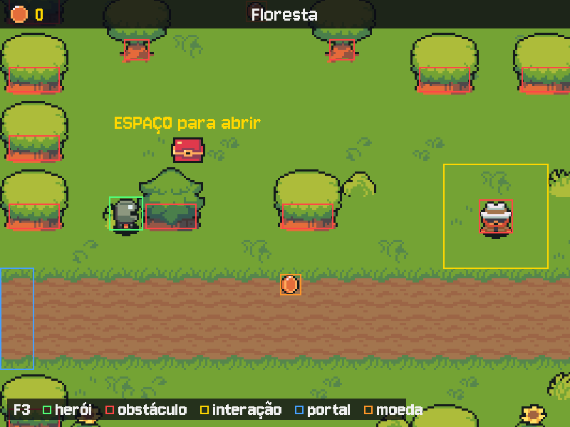

# MÓDULO 04A: Testes — o jogo se prova sozinho

Engenheiro, até aqui cada mudança exigiu jogar de novo para saber se nada quebrou. Hoje o jogo ganha um baú na floresta e um modo depuração (F3) que mostra o que as regras estão vendo. Junto vem o hábito que separa um projeto amador de um profissional: provar as regras com código que roda em menos de um segundo, sem abrir a janela. O conceito do dia é **teste automatizado**.

## 🎯 O que você vai ver na tela ao final

O F3 desenha por cima do jogo os retângulos que o Model usa: a caixa do herói em verde, os obstáculos em vermelho, as áreas de interação em amarelo, os portais em azul. Na floresta, um baú abre com ESPAÇO e dá 7 moedas. No terminal, `python -m pytest -q` responde em menos de um segundo se as regras continuam certas.



## 🏢 Onde isso aparece no mercado

Todo software sério tem testes automatizados: bancos, lojas virtuais, apps de mensagem, motores de jogos. Antes de qualquer mudança entrar, milhares de testes rodam sozinhos e apontam o que quebrou, em segundos, sem ninguém clicar em nada. Testes que trocam serviços caros ou lentos (pagamento, e-mail, uma IA) por objetos falsos são o padrão: ninguém gasta dinheiro nem espera a rede para saber se o código está certo. O modo depuração é o primo visual disso: todo motor de jogo tem um.

## 🚦 Ponto de partida

- Seu projeto deve estar como no fim do M03C, com o desafio concluído e o Pull Request mergeado: a loja do Brok, a poção e o inventário funcionando.
- Arquivos prontos deste módulo: pasta `M04A/` dentro de `curso-arquivos/`, com `assets/` (o baú e o som de abrir, mais o `CREDITOS.md` atualizado), `src/depuracao.py`, `requirements-dev.txt`, a pasta `tests/` e `ferramentas/plantar_bug.py` (para o desafio).
- Comando para conferir: com a venv ativa, `python main.py` abre o menu, e a loja funciona.
- Entrega por Pull Request, como no M03C: o trabalho vai para a branch `modulo-04a`.
- Três sessões: **Sessão A**, Passos 1 a 3c (o F3 e o baú no jogo); **Sessão B**, Passos 4 a 7 (os testes); **Sessão C**, o Quebre de propósito, o desafio e o Pull Request.

> **Andaime:** parte do código vem com `# TODO` nos pontos-chave. O texto explica o que fazer; o código é seu. Rode o jogo (ou os testes) depois de cada `TODO`.

## ❓ Pergunta do dia

Depois de mexer na loja, como você sabe que comprar sem saldo continua bloqueado, sem jogar tudo de novo?

Ao longo dos passos aparecem caixas **🔍 Pare e pesquise**: pesquise as duas perguntas na hora, anote as respostas e, no fim, explique ao Engenheiro Sênior em até 5 minutos. **Sem mentor?** Grave um áudio de até 5 minutos explicando os termos e ouça de volta: onde você hesitar, o termo ainda não está claro.

## 🛠️ Passo a passo

### Passo 1 (Leia): o modo depuração

Primeiro a branch do módulo, a partir da `main` atualizada:

```bash
git switch main
git pull
git switch -c modulo-04a
```

Copie `curso-arquivos/M04A/src/depuracao.py` para a pasta `src/` do projeto (arraste no VS Code ou use o comando abaixo). É um arquivo novo e inteiro: leia-o com calma antes de ligar.

```powershell
# PowerShell (Windows), na raiz do projeto
Copy-Item $HOME\curso-arquivos\M04A\src\depuracao.py src\
```

```bash
# bash (Linux), na raiz do projeto
cp ~/curso-arquivos/M04A/src/depuracao.py src/
``` Três perguntas para responder olhando o código:

1. Por que `desenhar_depuracao` recebe `camera_x` e `camera_y`?
2. A caixa do herói é a última a ser desenhada. O que mudaria se ela viesse primeiro?
3. Em que camada do MVC este arquivo está, e o que ele nunca faz com o `jogo`?

Agora as três ligações. No `src/controllers.py`, no `__init__` do `Controle`, logo depois da linha do `self.ultima_chamada`:

```python
        self.depuracao = False  # F3 liga e desliga: a View desenha os retângulos do Model
```

No `tratar_evento`, logo depois da linha `tecla = evento.key`:

```python
        if tecla == pygame.K_F3:  # vale em qualquer estado
            self.depuracao = not self.depuracao
            return
```

No `src/views.py`, importe a função, logo antes do `from src.models import ...`:

```python
from src.depuracao import desenhar_depuracao
```

E no `desenhar`, logo depois do `for` que desenha os sprites em ordem de profundidade (o que termina em `tela.blit(imagem, (x - camera_x, y - camera_y))`):

```python
        if controle.depuracao:  # F3: os retângulos do Model por cima do mundo
            desenhar_depuracao(tela, self.fonte_fala, jogo, camera_x, camera_y)
```

Rode `python main.py`, comece um jogo e aperte F3: a caixa verde do herói, o Mago e a Sentinela em vermelho com a área amarela de conversa em volta, as paredes em vermelho, o portal em azul e a legenda no rodapé. F3 de novo desliga.

### Passo 2 (Preveja / Modifique): a área de conversa

**Preveja**, antes de andar: com o F3 ligado, o "ESPAÇO para falar" aparece quando o quadrado verde **encosta** no amarelo do Mago ou só quando entra **inteiro** nele? Ande devagar até o Mago e confira.

Agora mexa num número e veja a regra mudar. No `src/config.py`, troque o `ALCANCE_CONVERSA` de `100` para `300` e rode: a área amarela de todos os NPCs cresce, e o aviso aparece de longe. Volte para `100`.

O F3 não inventa nada: ele desenha os mesmos `Retangulo` que o `npc_perto()` e o `mover_heroi()` usam. Quando uma regra parecer errada, ligue o F3 antes de mexer no código.

### Passo 3a (Leia): o baú nos dados

Copie o **conteúdo** de `curso-arquivos/M04A/assets/` para dentro da pasta `assets/` do projeto (chegam `itens/bau.png` e `sons/bau.wav`). O `CREDITOS.md` será substituído por uma versão com a linha nova: é esperado.

```powershell
# PowerShell (Windows), na raiz do projeto
Copy-Item -Recurse -Force $HOME\curso-arquivos\M04A\assets\* assets\
```

```bash
# bash (Linux), na raiz do projeto
cp -r ~/curso-arquivos/M04A/assets/. assets/
```

No `src/config.py`, logo antes do grupo `# Loja e itens`:

```python
# Baú
LARGURA_BAU, ALTURA_BAU = 16, 14  # cada quadro de itens/bau.png (fechado e aberto, lado a lado)
MOEDAS_BAU = 7  # o que um baú guarda; um objeto do Tiled pode trocar com a propriedade "moedas"
```

No `src/models.py`, logo antes da classe `Cena`, o baú como dado (repare na `area_abrir`: é a mesma ideia da `area_conversa` do NPC):

```python
@dataclass
class Bau:
    """Um baú no chão: onde está, quantas moedas guarda e se já foi aberto."""
    caixa: Retangulo
    moedas: int
    aberto: bool = False

    @property
    def area_abrir(self):
        """Perto o bastante para abrir: a caixa alargada, como a área de conversa dos NPCs."""
        return self.caixa.ampliado(ALCANCE_CONVERSA)


```

Por que o `aberto` tem um valor padrão e o `moedas` não?

E na `Cena`, logo depois da linha do `chegadas`, a lista de baús. O valor padrão deixa sem baú os mapas que não têm a camada:

```python
    baus: list = field(default_factory=list)  # [Bau]; mapa sem a camada "baus" fica sem nenhum
```

Rode `python main.py`: nada muda na tela ainda. O jogo abrir é o que importa: o Model aceitou o dado novo.

### Passo 3b (Crie / Leia): o baú no mapa e na tela

Abra `assets/mapas/floresta.tmx` no Tiled. Crie uma camada de objetos nova (*Layer > New > Object Layer*) com o nome `baus`, exatamente assim. Com a ferramenta *Insert Point*, clique num lugar livre do mapa, longe das árvores, onde o herói passa (perto do início da estrada é um bom lugar). Salve (Ctrl+S). Onde fica o seu baú é decisão sua. Um ponto por baú, como as moedas do M03A. Para um baú com outra quantia, acrescente ao ponto uma propriedade `moedas` do tipo `int`; sem ela, vale o `MOEDAS_BAU`.

No `src/controllers.py`, importe `ALTURA_BAU`, `LARGURA_BAU` e `MOEDAS_BAU` do `config` e `Bau` do `models` (em ordem alfabética). No `ler_cena`, dentro do `return Cena(...)`, logo depois da linha do `chegadas=`:

```python
        # Baús: um ponto do Tiled por baú, como as moedas; a propriedade "moedas" troca o padrão.
        baus=[Bau(retangulo_no_centro((obj.x * ESCALA, obj.y * ESCALA),
                                      LARGURA_BAU * ESCALA, ALTURA_BAU * ESCALA),
                  obj.properties.get("moedas", MOEDAS_BAU))
              for obj in objetos(dados, "baus")],
```

No `src/views.py`, no `__init__` da `Tela`, logo depois da linha do `self.sombra`, os dois quadros do baú:

```python
        # Baú: 2 quadros lado a lado, fechado (0) e aberto (1); cada um com metade da largura.
        folha_bau = carregar_imagem("itens/bau.png")
        largura_bau = folha_bau.get_width() // 2
        self.quadros_bau = [pygame.transform.scale_by(folha_bau.subsurface(
            (i * largura_bau, 0, largura_bau, folha_bau.get_height())), ESCALA) for i in range(2)]
```

No `desenhar`, logo antes do `for moeda in cena.moedas:` que monta a lista de sprites:

```python
        for bau in cena.baus:  # bau.aberto é False (0) ou True (1): escolhe o quadro
            sprites.append((bau.caixa.x, bau.caixa.y, bau.caixa.base, self.quadros_bau[bau.aberto]))
```

Rode `python main.py` e vá à floresta: o baú fechado está onde você pôs o ponto. Por enquanto o herói passa por cima dele.

### Passo 3c (Leia): ESPAÇO perto do baú

No `src/models.py`, logo antes do `def comprar`, a regra de achar o baú e a de abrir. A primeira chega pronta; a segunda é a primeira tarefa da Sessão B, e por enquanto não faz nada:

```python
    def bau_perto(self):
        """O baú fechado ao alcance do herói, se houver."""
        for bau in self.cena.baus:
            if not bau.aberto and self.heroi.caixa.colide(bau.area_abrir):
                return bau
        return None

    def abrir_bau(self, bau):
        """Abre o baú e põe as moedas dele na bolsa. Devolve quantas moedas o herói ganhou."""
        # TODO: um baú já aberto não dá nada (devolva 0). Fechado: marque como aberto,
        #       some as moedas dele à bolsa do herói e devolva quantas foram.
        return 0
```

Leia o `bau_perto`: por que ele pula os baús abertos?

O baú também passa a ser sólido. No `mover_heroi`, troque a linha `obstaculos = ...` por:

```python
        obstaculos = (self.cena.colisoes + [npc.caixa for npc in self.cena.npcs]
                      + [bau.caixa for bau in self.cena.baus])
```

No `src/controllers.py`, no `tratar_evento`, no bloco do `EXPLORANDO`, logo antes do `elif tecla == pygame.K_q and jogo.beber_pocao():`:

```python
            elif tecla == pygame.K_SPACE and jogo.bau_perto():
                if jogo.abrir_bau(jogo.bau_perto()):  # a regra é do Model; aqui só o som
                    self.tela.tocar("bau")
```

No `src/views.py`, no dicionário `self.sons`, logo depois da linha da `"pocao"`:

```python
            "bau": carregar_som("bau.wav"),
```

E no `desenhar`, troque o bloco do aviso "ESPAÇO para falar" (o `if jogo.estado == Estado.EXPLORANDO and perto:` e o `escrever` dele) por:

```python
        bau = jogo.bau_perto()
        if jogo.estado == Estado.EXPLORANDO and perto:
            escrever(tela, self.fonte, "ESPAÇO para falar", COR_DESTAQUE,
                     perto.caixa.y - 15 - camera_y, perto.caixa.centro[0] - camera_x)
        elif jogo.estado == Estado.EXPLORANDO and bau:
            escrever(tela, self.fonte, "ESPAÇO para abrir", COR_DESTAQUE,
                     bau.caixa.y - 15 - camera_y, bau.caixa.centro[0] - camera_x)
```

O `elif` que vinha logo depois (o do `DIALOGO` e da `LOJA`) continua igual.

Rode `python main.py`: o herói não passa mais por cima do baú, e perto dele aparece "ESPAÇO para abrir". Mas o ESPAÇO não faz nada. Ainda. Faça o commit:

```bash
git add .
git commit -m "feat: F3 de depuração e o baú na floresta"
git push -u origin modulo-04a
```

> ⏸️ **Fim da Sessão A.** Commit enviado, o F3 e o baú no jogo. Pare aqui e continue na próxima sessão, no Passo 4.

### Passo 4 (Leia / Preveja): o pytest

O **pytest** é a ferramenta de testes mais usada em Python. Ele não é do jogo, é de quem desenvolve: por isso vai num arquivo separado. Copie para a raiz do projeto o `curso-arquivos/M04A/requirements-dev.txt` e a pasta `curso-arquivos/M04A/tests/` inteira, e instale:

```powershell
# PowerShell (Windows), na raiz do projeto
Copy-Item $HOME\curso-arquivos\M04A\requirements-dev.txt .
Copy-Item -Recurse $HOME\curso-arquivos\M04A\tests .
pip install -r requirements-dev.txt
```

```bash
# bash (Linux), na raiz do projeto
cp ~/curso-arquivos/M04A/requirements-dev.txt .
cp -r ~/curso-arquivos/M04A/tests .
pip install -r requirements-dev.txt
```

A primeira linha dele, `-r requirements.txt`, puxa também tudo o que o jogo usa. Se você ainda tem o `prova_model.py` do M03B, apague-o (`git rm prova_model.py`, ou apague o arquivo, se ele nunca entrou no Git): os testes fazem o mesmo trabalho, melhor.

Abra `tests/conftest.py`. O pytest lê esse arquivo sozinho, antes dos testes. Ele liga o vídeo e o som "de mentira" e a IA falsa, monta um mundo pequeno à mão (um salão com uma moeda, um baú, um NPC e um portal, e uma floresta vazia) e oferece **fixtures**: funções que entregam algo pronto a cada teste. Um teste que pede `jogo` como parâmetro recebe um jogo novo, explorando o salão, com a bolsa vazia.

> 🔍 **Pare e pesquise: Teste automatizado** — O que um teste automatizado faz que jogar o jogo não faz, e por que ele precisa ser rápido? Por que cada teste deve começar de um estado novo, sem depender do que outro teste deixou?

Agora abra `tests/test_regras.py` e leia o primeiro teste, `test_coletar_moeda`. Responda olhando o código:

1. O que ele **prepara**? (A situação antes da regra.)
2. O que ele **executa**? (A regra que está sendo testada.)
3. O que ele **afirma**? (O `assert`: se for falso, o teste fica vermelho.)

Repare que o mundo dos testes não é o seu mapa: os testes não quebram quando você muda a floresta no Tiled.

**Preveja:** o `abrir_bau()` ainda é `TODO`, e três testes de `test_regras.py` também. Quantos dos 6 testes passam, e quais falham? Anote e rode, da raiz do projeto:

```bash
python -m pytest -q
```

Cada ponto verde é um teste que passou; cada `F`, um que falhou. Embaixo, o pytest mostra cada falha: a linha do `assert` e os valores que ele encontrou.

### Passo 5 (Complete): o baú abre, guiado por um teste

O `test_abrir_bau` diz exatamente o que se espera: abrir o baú do salão devolve 7, a bolsa fica com 7 e o baú fica aberto. Complete o `TODO` do `abrir_bau()` no `src/models.py` (troque o `return 0` pelo código; um `logger.info` com as moedas é bem-vindo) e rode:

```bash
python -m pytest -q
```

O `test_abrir_bau` fica verde. Só então rode `python main.py`, vá ao baú e aperte ESPAÇO: som, baú aberto, 7 moedas na bolsa. Você escreveu a regra sem abrir o jogo nenhuma vez, e ela funcionou de primeira na tela. Os outros três `F` são os `TODO` do próximo passo.

### Passo 6 (Complete): as asserções

Os três testes que faltam já preparam e executam a regra; falta afirmar. Em cada um, troque a linha `assert False, "TODO: ..."` pelas asserções que o comentário pede, e rode `python -m pytest -q` depois de cada um:

1. `test_bau_abre_uma_vez_so`: o que a segunda abertura devolve, e quanto a bolsa tem.
2. `test_comprar_sem_saldo`: o que o `comprar()` devolveu, a bolsa e o inventário.
3. `test_transicao_de_cena`: em que cena e em que estado o jogo termina.

> 🔍 **Pare e pesquise: Asserção** — O que exatamente um `assert` afirma, e o que acontece com o teste quando ele é falso? Um teste sem nenhum `assert` passa ou falha, e por que isso é perigoso?

No fim, `6 passed`. Este é o momento de responder à pergunta do dia: o `test_comprar_sem_saldo` prova, em menos de um segundo, que a loja continua sem vender fiado. Qualquer mudança futura que quebre essa regra deixa o teste vermelho.

### Passo 7 (Leia / Modifique): a IA falsa

Abra `tests/test_conversa.py`. Ele testa o Controller inteiro numa conversa, mas sem o Gemini: o `ServicoIAFalso` do `conftest.py` entra no lugar do `ServicoIA`, pela mesma porta que o `main.py` usa (a injeção de dependências do M03B). O falso tem o mesmo `responder(instrucao, fala)`, devolve sempre a mesma fala e anota cada pedido em `pedidos`.

Leia e responda:

1. Por que o teste chama `controle.dialogo.avancar()` antes do `atualizar()`? (Lembre quando o Controller chama a IA.)
2. O primeiro `assert` confere o que o jogo **pediu**; o segundo, o que ele **mostrou**. Por que conferir os dois?

> 🔍 **Pare e pesquise: Objeto falso (fake)** — Por que trocar um serviço de verdade (a IA, um banco, um pagamento) por um falso nos testes? O que um falso precisa ter em comum com o verdadeiro para a troca funcionar?

**Modifique:** no `conftest.py`, troque o padrão `fala="Fala de teste."` do `ServicoIAFalso` por outra frase e rode `python -m pytest -q`. Qual teste fica vermelho, e por quê? Volte à frase original.

Por fim, o cabeçalho do `main.py` conta o que o projeto tem agora. Troque o começo da docstring, da linha do `RPG Engine — Módulo 03C` até a linha do `controllers.py`, por:

```python
"""
RPG Engine — Módulo 04A: Testes.

O jogo (menu, mapas do Tiled, moedas, baú, HUD, diálogo com o Gemini e a loja
do Brok) fica em camadas dentro de src/, e as regras se provam sozinhas com
os testes de tests/ (python -m pytest -q, da raiz do projeto):
  models.py       dados e regras, sem pygame (testável sem janela)
  views.py        desenho e som; só lê o Model
  controllers.py  teclado e coordenação; monta o Model a partir dos mapas
  depuracao.py    F3: os retângulos do Model desenhados por cima do jogo
```

Commit e push:

```bash
git add .
git commit -m "test: pytest com as regras do Model e a conversa com a IA falsa"
git push
```

> ⏸️ **Fim da Sessão B.** Commit enviado, `6 passed`. Pare aqui e continue na próxima sessão, no Quebre de propósito.

## 💥 Quebre de propósito

No `abrir_bau()`, apague as linhas que devolvem 0 quando o baú já está aberto (a trava). **Preveja:** qual teste fica vermelho, e com que números? Rode `python -m pytest -q`.

O `test_bau_abre_uma_vez_so` falha com `assert 7 == 0` (ou `assert 14 == 7`, se o seu primeiro `assert` confere a bolsa): a segunda abertura deu as 7 moedas de novo. O `test_abrir_bau` continua verde, porque abrir uma vez funciona. E no jogo nada denunciaria o erro: o `bau_perto()` ignora baús abertos, então o aviso some e o ESPAÇO não chama o `abrir_bau()` de novo. O bug ficaria escondido até alguém chamar a regra por outro caminho. Só o teste que afirma "a segunda vez não dá nada" pega.

Desfaça (Ctrl+Z) e rode de novo: `6 passed`.

## 🧯 Problemas comuns

| Sintoma | Causa provável | Como resolver |
| --- | --- | --- |
| `No module named pytest` | O `requirements-dev.txt` não foi instalado, ou a venv não está ativa | Ative a venv e rode `pip install -r requirements-dev.txt` |
| `ModuleNotFoundError: No module named 'src'` | O pytest rodou fora da raiz do projeto, ou como `pytest` sozinho | Na raiz do projeto: `python -m pytest -q` |
| `pygame.error: No available video device` nos testes | O `tests/conftest.py` não está na pasta `tests/` | Copie a pasta `tests/` inteira de `curso-arquivos/M04A/` |
| `TypeError: Cena.__init__() got an unexpected keyword argument 'baus'` | Falta o campo `baus` na `Cena` | Passo 3a, a linha do `baus: list = field(...)` |
| `AttributeError: 'Jogo' object has no attribute 'abrir_bau'` | O `bau_perto` e o `abrir_bau` foram colados fora da classe `Jogo` | Recuo de 4 espaços, dentro da classe, logo antes do `def comprar` |
| O baú não aparece no mapa | A camada do Tiled tem outro nome, ou o mapa não foi salvo | O nome da camada é `baus`, em minúsculas e sem acento; Ctrl+S no Tiled |
| O F3 não faz nada | A checagem do F3 ficou depois de algum `return` do `tratar_evento` | O `if tecla == pygame.K_F3:` vem logo depois de `tecla = evento.key` |
| Os retângulos do F3 ficam deslocados do desenho | Faltou descontar a câmera | Passe `camera_x` e `camera_y` ao `desenhar_depuracao`, como no Passo 1 |

## 🧩 Desafio de Engenharia

Os 6 testes do módulo estão verdes. Isso prova que **todas** as regras do jogo estão certas? Não: um teste só pega o que afirma. O desafio é caçar um bug escondido numa regra que ainda não tem teste.

1. **Plante o bug.** Faça antes o commit de tudo.
   - Com mentor: peça ao Sênior que plante um bug numa regra do `src/models.py` que os testes do módulo não cobrem (não vale "comprar sem saldo": o `test_comprar_sem_saldo` já pega) e faça o commit dele, sem dizer qual.
   - **Sem mentor?** Copie `curso-arquivos/M04A/ferramentas/plantar_bug.py` para a pasta `ferramentas/` do projeto e rode `python ferramentas/plantar_bug.py`. Ele sorteia um bug entre alguns possíveis, muda uma linha do `models.py`, faz o commit dessa mudança e guarda a resposta em `ferramentas/saida/` (fora do Git). Não abra esse arquivo nem olhe o último commit (`git show`): quem tem que achar o bug é o teste.
2. **Rode `python -m pytest -q`.** Tudo verde: os testes do módulo não pegam o bug.
3. **Cace.** Liste as regras do `Jogo` que ainda não têm teste (as de moedas, poção e compra têm casos que ninguém afirmou) e escreva testes para elas, em `tests/test_regras.py` ou num arquivo novo `tests/test_<nome>.py`, até um ficar vermelho. Travou? `python ferramentas/plantar_bug.py --dica`.
4. **Corrija** o `models.py` até o teste ficar verde. Agora sim: `git diff src/models.py` mostra a linha que você consertou (a diferença entre o commit do bug e a sua correção), e `python ferramentas/plantar_bug.py --revelar` conta qual era o bug (sem mentor). Commit da correção junto com o teste.
5. **O F3 mostra o baú.** No `src/depuracao.py`, desenhe a caixa de cada baú (como obstáculo) e a área de abrir (como área de interação). A área de um baú já aberto aparece ou não? A decisão é sua.

**Critérios de aceite:**

- [ ] **Bug encontrado por um teste seu:** um teste escrito por você fica vermelho com o bug plantado e verde depois da correção. Na descrição do PR: qual regra o bug quebrava e o que o seu teste afirma.
- [ ] **Testes verdes:** `python -m pytest -q` passa com pelo menos 7 testes (os 6 do módulo e o seu), entre eles o `test_conversa_usa_o_servico_de_ia`, com o `ServicoIAFalso`.
- [ ] **F3 com o baú:** a caixa e a área de abrir do baú aparecem com o F3.
- [ ] **Nomes que o próximo módulo usa:** `requirements-dev.txt` e `tests/conftest.py` na raiz do projeto (o CI do M04B roda os dois); `ServicoIAFalso` com o mesmo `responder(instrucao, fala)` do `ServicoIA`; `Jogo.abrir_bau(bau)` devolvendo as moedas ganhas; a camada de objetos `baus` no `floresta.tmx`; a tecla F3.
- [ ] Você explica ao Engenheiro Sênior, sem ler e em até 5 minutos, os três termos das caixas 🔍 (teste automatizado, asserção e objeto falso). **Sem mentor?** Grave a explicação em áudio e ouça de volta.

Dicas: um bom teste de bug prepara a situação exata em que a regra erra (o herói parado em cima da moeda por dois quadros, uma poção bebida e o tempo passando, um item único comprado duas vezes...). O `test_coletar_moeda` olha a bolsa; ele olha o chão?

Lembre as regras de uso de IA do M00B: pode pedir explicação de conceito e de erro, não pode pedir a solução pronta, e deve dizer na descrição do PR cada trecho que veio de uma IA, sabendo explicá-lo.

**Entrega:** Pull Request `modulo-04a` para a `main`, com a descrição (o que muda, como testar, o bug que você caçou, o que veio de IA), o review respondido e o merge depois da aprovação, como no M03C. **Sem mentor?** Review de um colega do curso ou autorrevisão no dia seguinte, como no M03C.

## ⭐ Bônus (opcional)

- **Mais detalhe no pytest:** `python -m pytest -v` mostra o nome de cada teste; `-k bau` roda só os que têm "bau" no nome; `--lf` roda só os que falharam da última vez.
- **README:** acrescente o F3 à seção "Controles".
- **Um teste para o `bau_perto`:** o herói longe do baú recebe `None`; perto, recebe o baú; perto de um baú aberto, `None` de novo.

## 💼 Resumo profissional

- **Conceito:** testes automatizados com pytest (fixtures, asserções, preparar-executar-afirmar), objeto falso no lugar de um serviço externo (a IA) por injeção de dependências, teste guiando a implementação de uma regra e caça a bug por teste; ferramenta visual de depuração.
- **Linha para o currículo:** "Criei a suíte de testes de um jogo 2D em Python com pytest (regras do Model testadas sem janela, IA substituída por um objeto falso) e usei os testes para guiar novas regras e localizar bugs."
