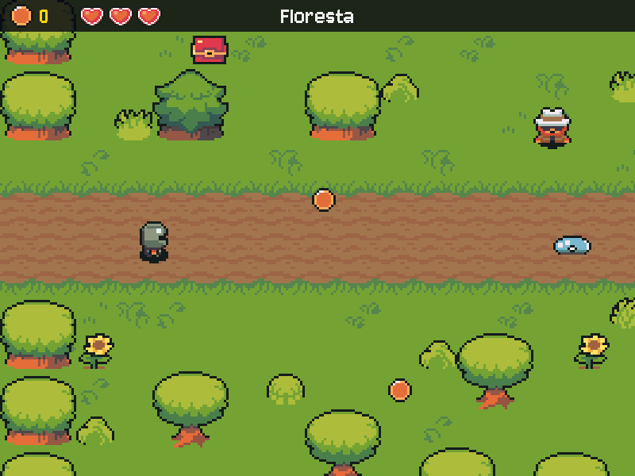

# MÓDULO 04B: CI e slimes — um servidor prova o jogo a cada push, e a floresta fica perigosa

Engenheiro, os testes do M04A provam as regras na sua máquina. Hoje um servidor do GitHub passa a rodar esses testes sozinho, a cada mudança, numa máquina limpa que nunca viu o seu projeto. Com essa rede de segurança, o jogo ganha perigo de verdade: slimes patrulham a floresta, encostar neles tira vida, e a armadura que você comprou do Brok finalmente serve para alguma coisa. O conceito do dia é **integração contínua**.

## 🎯 O que você vai ver na tela ao final

No GitHub, cada commit e o Pull Request mostram um ✓ verde: o CI instalou o projeto do zero, rodou os testes e abriu o jogo sem janela. Depois do merge, o selo verde aparece no topo do README. No jogo, três corações no HUD e slimes pulsando na floresta; encostar num deles tira meio coração, e o herói pisca por um segundo.



## 🏢 Onde isso aparece no mercado

Em times de software, nenhuma mudança entra na `main` sem passar pelo **CI** (integração contínua): GitHub Actions, GitLab CI, Jenkins. A cada push, uma máquina limpa instala tudo do zero e roda os testes; se falhar, o PR mostra um X vermelho e ninguém faz merge. É o que pega o famoso "na minha máquina funciona": a dependência esquecida, o arquivo que só existia no seu disco, o teste que dependia da sua configuração.

## 🚦 Ponto de partida

- Seu projeto deve estar como no fim do M04A, com o desafio concluído e o PR mergeado: o baú, o F3 e `python -m pytest -q` verde.
- Arquivos prontos deste módulo: pasta `M04B/` dentro de `curso-arquivos/`, com `ferramentas/verificar.py`, `.github/workflows/ci.yml` (a pasta `.github` começa com ponto e pode ficar oculta: confira que ela chegou), `tests/test_slimes.py` e `assets/` (o slime, os corações, o som de dano e o `CREDITOS.md` atualizado).
- Comando para conferir: com a venv ativa, `python -m pytest -q` passa.
- Entrega por Pull Request, como no M03C: o trabalho vai para a branch `modulo-04b`, e o PR é aberto no fim. O CI roda a cada push, desde a Sessão A.
- Três sessões: **Sessão A**, Passos 1 a 3 (o CI); **Sessão B**, Passos 4a a 5b (a vida e os slimes no mundo); **Sessão C**, Passos 6a a 7, o Quebre de propósito e o desafio (o dano e os testes).

> **Andaime:** parte do código vem com `# TODO` nos pontos-chave. O texto explica o que fazer; o código é seu. Rode o jogo (ou os testes) depois de cada `TODO`.

## ❓ Pergunta do dia

O teste passa na sua máquina. O que garante que ele passa na máquina de outra pessoa?

Ao longo dos passos aparecem caixas **🔍 Pare e pesquise**: pesquise as duas perguntas na hora, anote as respostas e, no fim, explique ao Engenheiro Sênior em até 5 minutos. **Sem mentor?** Grave um áudio de até 5 minutos explicando os termos e ouça de volta: onde você hesitar, o termo ainda não está claro.

## 🛠️ Passo a passo

### Passo 1 (Leia): o jogo sem janela

Primeiro a branch do módulo, a partir da `main` atualizada:

```bash
git switch main
git pull
git switch -c modulo-04b
```

Copie `curso-arquivos/M04B/ferramentas/verificar.py` para a pasta `ferramentas/` do projeto e rode, da raiz:

```powershell
# PowerShell (Windows), na raiz do projeto
Copy-Item $HOME\curso-arquivos\M04B\ferramentas\verificar.py ferramentas\
python ferramentas\verificar.py
```

```bash
# bash (Linux), na raiz do projeto
cp ~/curso-arquivos/M04B/ferramentas/verificar.py ferramentas/
python ferramentas/verificar.py
```

Nenhuma janela abre. O jogo roda 120 quadros "no escuro", com vídeo e som de mentira e a IA falsa, salva o último quadro em `ferramentas/saida/tela.png` e termina com `[OK]`. Abra o print: é o menu do jogo. Um servidor não tem tela nem alto-falante; é assim que ele prova que o jogo abre. Você não precisa entender o arquivo inteiro. Leia só o começo da função `main` e responda:

1. Que variáveis de ambiente ele define antes de importar o jogo, e para quê?
2. O que ele faz se o jogo travar e não chegar ao último quadro?

### Passo 2 (Complete / Preveja): o workflow do GitHub Actions

Copie a pasta `curso-arquivos/M04B/.github/` para a raiz do projeto (ela tem `workflows/ci.yml` dentro):

```powershell
# PowerShell (Windows), na raiz do projeto
Copy-Item -Recurse $HOME\curso-arquivos\M04B\.github .
```

```bash
# bash (Linux), na raiz do projeto
cp -r ~/curso-arquivos/M04B/.github .
```

O GitHub procura workflows exatamente em `.github/workflows/`. Abra o `ci.yml`: ele diz **quando** rodar (`on: push`, a cada push, em qualquer branch), **onde** (`runs-on: ubuntu-latest`, uma máquina Linux nova a cada vez) e **o quê** (os `steps:`, em ordem). Os três primeiros passos chegam prontos: baixar o código, instalar o Python 3.12 (com cache dos pacotes), instalar as dependências. Complete o `TODO`: os dois passos que provam o projeto, com os mesmos comandos que você roda na sua máquina. Atenção ao recuo: no YAML, os espaços no começo da linha são a estrutura.

> 🔍 **Pare e pesquise: Integração contínua** — O que a integração contínua faz a cada push, e por que numa máquina limpa e não na sua? Por que um time combina que um Pull Request só entra com o CI verde?

**Preveja:** o CI não tem o seu `.env`, então não tem a chave do Gemini. Os testes e o jogo sem janela vão passar ou falhar por isso? Anote e confira no próximo passo.

Faça o commit e o push. O push já dispara o CI:

```bash
git add .
git commit -m "ci: workflow do GitHub Actions com pytest e o jogo sem janela"
git push -u origin modulo-04b
```

### Passo 3: o ✓ verde e o selo

Abra o repositório no navegador (`gh repo view --web`) e vá à aba **Actions**: a execução do seu push aparece rodando (bolinha amarela) e, em um ou dois minutos, termina. Clique nela e depois no job `testes` para ver cada passo, com a saída de cada comando, como se você estivesse olhando o terminal de outra máquina. No terminal, `gh run list` mostra o mesmo. Quando você abrir o PR, no fim do módulo, ele mostra o resultado do último commit da branch.

> 🔍 **Pare e pesquise: Ambiente reproduzível** — Por que o CI instala tudo do zero, a partir do `requirements.txt`, em vez de copiar a sua venv? O que o `python-version: "3.12"` do workflow garante?

Agora o selo. No topo do `README.md`, logo depois do título, acrescente esta linha, trocando `SEU-USUARIO` e `SEU-REPOSITORIO` pelos seus (os mesmos da URL do repositório no GitHub):

```markdown

```

Commit e push. O selo mostra o estado do CI na `main`: até o merge, ele aparece como "no status"; depois, verde. Até lá, vale o ✓ de cada commit na aba Actions.

> **Combinado de time:** a partir de hoje, PR só entra com o CI verde. O GitHub sabe bloquear o merge sozinho (proteção de branch), mas em repositório privado isso exige um plano pago; aqui, a regra é combinada.

> ⏸️ **Fim da Sessão A.** CI verde na branch. Pare aqui e continue na próxima sessão, no Passo 4a.

### Passo 4a (Leia): a vida nos dados

Copie o **conteúdo** de `curso-arquivos/M04B/assets/` para dentro da pasta `assets/` do projeto (chegam `monstros/slime.png`, `interface/coracao.png` e `sons/dano.wav`; o `CREDITOS.md` é substituído):

```powershell
# PowerShell (Windows), na raiz do projeto
Copy-Item -Recurse -Force $HOME\curso-arquivos\M04B\assets\* assets\
```

```bash
# bash (Linux), na raiz do projeto
cp -r ~/curso-arquivos/M04B/assets/. assets/
```

No `src/config.py`, logo antes do grupo `# Loja e itens`:

```python
# Vida e slimes
VIDA_MAXIMA = 3  # corações; cada um vai de vazio a cheio em quartos (coracao.png tem 5 estados)
TEMPO_INVENCIVEL = 1.0  # segundos sem sofrer dano depois de um golpe (o herói pisca)
DANO_SLIME = 0.5  # meio coração por encostão (um quarto com a armadura)
VELOCIDADE_SLIME = 60  # pixels por segundo
ALCANCE_SLIME = 32  # pixels do Tiled (2 tiles) para cada lado; a propriedade "alcance" troca
```

No `src/models.py`, importe do `config` os quatro primeiros nomes novos de uma vez (`DANO_SLIME`, `TEMPO_INVENCIVEL`, `VELOCIDADE_SLIME`, `VIDA_MAXIMA`, em ordem alfabética com os outros). No `Heroi`, logo depois da linha da `pressa`:

```python
    vida: float = VIDA_MAXIMA  # em corações: 2.75 = dois corações e três quartos
    invencivel: float = 0.0  # segundos sem sofrer dano que ainda restam (o herói pisca)
```

No `novo_jogo`, logo depois de `self.heroi.pressa = 0.0`, a vida volta cheia:

```python
        self.heroi.vida = VIDA_MAXIMA
        self.heroi.invencivel = 0.0
```

Por que a `vida` é `float`, e não `int`?

Rode `python main.py`: nada muda na tela ainda. Rode também `python -m pytest -q`: continua verde.

### Passo 4b (Leia): os corações no HUD

No `src/views.py`, importe `VIDA_MAXIMA` do `config` (em ordem alfabética). No `__init__` da `Tela`, logo depois do bloco dos quadros do baú (o que termina em `for i in range(2)]`), a arte do slime e dos corações:

```python
        # Slime: a mesma folha 4×4 do herói; a coluna 0 (de frente) basta para ele "pulsar".
        self.quadros_slime = recortar_quadros(carregar_imagem("monstros/slime.png"), 1, 4)[0]
        # Corações: 5 estados de 16×16 lado a lado, de vazio (0) a cheio (4), em quartos.
        folha_coracao = carregar_imagem("interface/coracao.png")
        self.coracoes = [pygame.transform.scale_by(folha_coracao.subsurface(
            (i * TAMANHO_TILE, 0, TAMANHO_TILE, TAMANHO_TILE)), 2) for i in range(5)]
```

Logo antes do `def desenhar_inventario`, o desenho da vida:

```python
    def desenhar_vida(self, heroi):
        """Um coração por ponto de VIDA_MAXIMA, cada um cheio, vazio ou em quartos."""
        for i in range(VIDA_MAXIMA):
            parte = min(max(heroi.vida - i, 0), 1)  # quanto deste coração ainda resta, de 0 a 1
            self.superficie.blit(self.coracoes[round(parte * 4)], (100 + i * 36, 4))

```

E no `desenhar`, logo depois da linha que escreve o total de moedas no HUD (`tela.blit(self.fonte.render(str(heroi.moedas), ...`):

```python
        self.desenhar_vida(heroi)
```

Leia o `desenhar_vida` com a vida em 2.75: para cada um dos três corações, quanto vale `parte` e qual imagem (0 a 4) aparece?

Rode `python main.py` e comece um jogo: três corações cheios ao lado das moedas.

### Passo 5a (Leia): os slimes nos dados

No `src/models.py`, logo antes da classe `Cena`, o slime como dado:

```python
@dataclass
class Slime:
    """Um slime que patrulha na horizontal, indo e voltando em volta do ponto de origem."""
    caixa: Retangulo
    origem_x: float  # x da caixa no ponto do Tiled: o meio da patrulha
    alcance: float  # quantos pixels ele anda para cada lado da origem
    sentido: int = 1  # 1 = direita, -1 = esquerda


```

Na `Cena`, logo depois da linha dos `baus`:

```python
    slimes: list = field(default_factory=list)  # [Slime]; idem com a camada "slimes"
```

No `src/controllers.py`, importe `ALCANCE_SLIME` do `config` e `Slime` do `models` (em ordem alfabética). No `ler_cena`, dentro do `return Cena(...)`, logo depois do bloco dos `baus=` (o que termina em `for obj in objetos(dados, "baus")],`):

```python
        slimes=[criar_slime(obj) for obj in objetos(dados, "slimes")],
```

E logo depois do `ler_cena` (antes do `def criar_npc`), a função que monta cada slime:

```python
def criar_slime(obj):
    """Um slime de 48×48 centrado no ponto do Tiled; a propriedade "alcance" troca o padrão."""
    caixa = retangulo_no_centro((obj.x * ESCALA, obj.y * ESCALA), TAMANHO_SPRITE, TAMANHO_SPRITE)
    # O alcance vem em pixels do Tiled, como as posições: vezes ESCALA, vira pixels do jogo.
    return Slime(caixa, caixa.x, obj.properties.get("alcance", ALCANCE_SLIME) * ESCALA)


```

Rode `python main.py`: o jogo abre como antes. Os slimes ainda não existem no mapa: eles chegam no próximo passo.

### Passo 5b (Crie / Leia): os slimes no mapa e a patrulha

No Tiled, abra `assets/mapas/floresta.tmx`, crie uma camada de objetos chamada `slimes` e ponha um ponto por slime: no meio do caminho que ele vai patrulhar, de um lado para o outro, na horizontal (um deles na estrada, perto da chegada do salão, deixa o perigo à vista). Salve. Para um slime com outra distância de patrulha, acrescente ao ponto uma propriedade `alcance` do tipo `int`, em pixels do Tiled, como as posições (16 = um tile para cada lado; o padrão é 32).

No `src/models.py`, logo depois do `passar_tempo`, o movimento:

```python
    def mover_slimes(self, dt):
        """Cada slime anda na horizontal e dá meia-volta ao chegar no fim da patrulha."""
        for slime in self.cena.slimes:
            slime.caixa.x += slime.sentido * VELOCIDADE_SLIME * dt
            if abs(slime.caixa.x - slime.origem_x) >= slime.alcance:
                # Volta para dentro do limite e troca o sentido.
                slime.caixa.x = slime.origem_x + slime.sentido * slime.alcance
                slime.sentido = -slime.sentido
```

No `src/controllers.py`, no `atualizar`, dentro do `if jogo.estado == Estado.EXPLORANDO:`, logo antes do `jogo.passar_tempo(dt)`:

```python
            jogo.mover_slimes(dt)
```

No `src/views.py`, no `desenhar`, logo antes do `for bau in cena.baus:` que monta a lista de sprites:

```python
        for slime in cena.slimes:
            imagem = self.quadros_slime[int(tempo / TEMPO_QUADRO) % len(self.quadros_slime)]
            sprites.append((slime.caixa.x, slime.caixa.y, slime.caixa.base, imagem))
```

Leia o `mover_slimes`: por que o `abs()`, e o que aconteceria sem a linha que põe o slime de volta no limite (o `slime.caixa.x = ...`)?

Rode `python main.py`: os slimes pulsam e patrulham. Encostar neles ainda não faz nada. Commit e push (o CI roda de novo):

```bash
git add .
git commit -m "feat: vida no HUD e slimes patrulhando a floresta"
git push
```

> ⏸️ **Fim da Sessão B.** Commit enviado, slimes na floresta. Pare aqui e continue na próxima sessão, no Passo 6.

### Passo 6a (Complete / Preveja): o dano

No `src/models.py`, no `passar_tempo`, logo depois da linha da `pressa`, a invencibilidade também passa com o tempo:

```python
        self.heroi.invencivel = max(self.heroi.invencivel - dt, 0.0)  # e a invencibilidade
```

Logo depois do `mover_slimes`, a regra do dano e o encostão:

```python
    def sofrer_dano(self, dano):
        """Tira `dano` corações do herói, se ele não estiver invencível. Devolve True se doeu."""
        heroi = self.heroi
        # TODO: invencível (heroi.invencivel maior que 0), não dói: devolva False. Senão: com a
        #       ARMADURA no inventário, o dano cai pela metade; tire o dano da vida (nunca abaixo
        #       de 0), ligue a invencibilidade por TEMPO_INVENCIVEL segundos e devolva True.
        return False

    def tocar_slimes(self):
        """Encostar num slime custa DANO_SLIME. Devolve True se doeu (o Controller toca o som)."""
        if any(self.heroi.caixa.colide(slime.caixa) for slime in self.cena.slimes):
            return self.sofrer_dano(DANO_SLIME)
        return False
```

No `src/controllers.py`, no `atualizar`, logo depois do `jogo.mover_slimes(dt)`:

```python
            if jogo.tocar_slimes():
                self.tela.tocar("dano")
```

No `src/views.py`, no dicionário `self.sons`, logo depois da linha do `"bau"`:

```python
            "dano": carregar_som("dano.wav"),
```

**Preveja**, antes de completar o `TODO`: sem a invencibilidade, o `tocar_slimes` roda a cada quadro, 60 vezes por segundo. Quantos corações o herói perde encostando um segundo inteiro no slime?

Complete o `TODO` do `sofrer_dano` (troque o `return False` pelo código) e rode `python main.py`: encoste num slime, ouça o golpe e veja meio coração sumir. Compre a armadura no Brok e encoste de novo: um quarto de coração. Repare que, logo depois de um golpe, encostar de novo não dói: é a invencibilidade. Só não dá para ver que ela está valendo.

### Passo 6b (Modifique): o herói pisca

No `src/views.py`, no `desenhar`, troque a linha que põe o herói na lista de sprites (`sprites.append((heroi.caixa.x, ...` com o `imagem_heroi`) por:

```python
        # Invencível, o herói pisca: some em metade dos décimos de segundo.
        if not heroi.invencivel or int(heroi.invencivel * 10) % 2 == 0:
            sprites.append((heroi.caixa.x, heroi.caixa.y, heroi.caixa.base, imagem_heroi))
```

Rode e encoste num slime: o herói pisca durante a invencibilidade.

> 🔍 **Pare e pesquise: Regra de jogo testável** — Por que a regra do dano mora no Model, numa função que recebe o dano e devolve True ou False, e não no Controller, junto do som? Como um teste prova a invencibilidade sem esperar um segundo de verdade?

**Modifique:** no `src/config.py`, ponha `DANO_SLIME = 1` e `TEMPO_INVENCIVEL = 3`, rode e sinta a diferença. Volte para `0.5` e `1.0`.

### Passo 7 (Leia / Complete): o teste do dano

Copie `curso-arquivos/M04B/tests/test_slimes.py` para a pasta `tests/`. O primeiro teste, `test_slime_patrulha_e_volta`, chega pronto: leia como ele usa a `VELOCIDADE_SLIME` em vez de um número solto, e por quê. No segundo, `test_encostar_no_slime_doi`, troque o `assert False, "TODO: ..."` pelas asserções que o comentário pede e rode:

```bash
python -m pytest -q
```

`12 passed`. Por fim, o cabeçalho do `main.py`: troque o começo da docstring, da linha do `RPG Engine — Módulo 04A` até a linha que termina em `da raiz do projeto):`, por:

```python
"""
RPG Engine — Módulo 04B: CI e slimes.

O jogo (menu, mapas do Tiled, moedas, baú, slimes e vida, HUD, diálogo com o
Gemini e a loja do Brok) fica em camadas dentro de src/. As regras se provam
com os testes de tests/, que o GitHub Actions roda a cada push (.github/):
```

Commit e push: o CI roda os 12.

```bash
git add .
git commit -m "feat: dano dos slimes com invencibilidade e armadura"
git push
```

## 💥 Quebre de propósito

Faça o que todo mundo faz um dia: use uma biblioteca que só existe na sua máquina. Instale o `rich` na sua venv (`pip install rich`) e, no `src/models.py`, logo depois do `import logging`, acrescente:

```python
from rich import print  # o print colorido da biblioteca rich
```

Rode `python -m pytest -q`: verde, na sua máquina. **Preveja:** e no CI? Faça o commit e o push e olhe a aba Actions.

Na aba Actions, a execução fica vermelha, no passo "Testes": `ModuleNotFoundError: No module named 'rich'`. A máquina do CI só tem o que o `requirements.txt` e o `requirements-dev.txt` dizem, e o `rich` não está lá. É exatamente o "na minha máquina funciona" que o CI existe para pegar, antes de chegar a outra pessoa. Apague a linha, commit, push: verde de novo. (Se fosse de verdade, a correção seria acrescentar o pacote ao `requirements.txt`.)

## 🧯 Problemas comuns

| Sintoma | Causa provável | Como resolver |
| --- | --- | --- |
| A aba Actions não mostra nenhuma execução | O `ci.yml` não está em `.github/workflows/`, ou a pasta `.github` não foi copiada (começa com ponto e fica oculta) | `git ls-files .github` deve listar `.github/workflows/ci.yml` |
| `Invalid workflow file` na aba Actions | Recuo errado no YAML (tabulação ou espaços a mais ou a menos) | Os passos novos com o mesmo recuo dos de cima: `- name:` alinhado com os outros `- name:` |
| CI falha com `No module named ...` e local passa | Pacote instalado só na sua venv | Acrescente ao `requirements.txt` (ou tire o import, como no Quebre de propósito) |
| `pygame.error: No available video device` no CI | O passo do jogo não usa o `verificar.py` | `python ferramentas/verificar.py ...`: ele liga o vídeo de mentira sozinho |
| O selo mostra "no status" | Ainda não houve CI na `main` | Normal até o merge; até lá, vale o ✓ dos commits na aba Actions |
| Herói perde a vida toda de uma vez | Falta a invencibilidade no `sofrer_dano` | Invencível, devolva `False` antes de tirar vida; depois do dano, `heroi.invencivel = TEMPO_INVENCIVEL` |
| O herói nunca pisca | O `passar_tempo` não desconta a invencibilidade, ou a linha do herói não foi trocada | Passos 6a (a linha do `invencivel`) e 6b (o `if not heroi.invencivel or ...`) |
| Os slimes não aparecem | Camada com outro nome, ou o mapa não foi salvo | O nome da camada é `slimes`; Ctrl+S no Tiled |

## 🧩 Desafio de Engenharia

Hoje a vida chega a zero e nada acontece: o herói continua andando com três corações vazios. Dê consequência a isso e prove as regras de vida com testes.

**Critérios de aceite:**

- [ ] **Vida zerada:** quando a vida chega a 0, o herói volta ao salão, no ponto `inicio`, com a vida cheia. A regra mora no Model (no `sofrer_dano` ou numa função que ele chama), não no Controller nem na View.
- [ ] **Testes das regras de vida**, sem abrir a janela: um teste prova a invencibilidade (o segundo golpe seguido não dói; passado o `TEMPO_INVENCIVEL`, dói), um prova o efeito da armadura (meio dano) e um prova a vida zerada (a cena, a vida e a posição depois do último golpe).
- [ ] **CI verde no PR**, rodando sem a chave do Gemini, com todos os testes (os 12 do módulo e os seus).
- [ ] **Nomes que os próximos módulos usam:** `.github/workflows/ci.yml` (o M11A acrescenta o deploy a ele); `Jogo.sofrer_dano(dano)` devolvendo se doeu; `Heroi.vida` em corações; `VIDA_MAXIMA` e `TEMPO_INVENCIVEL` no `config.py`; a camada de objetos `slimes` no Tiled.
- [ ] Você explica ao Engenheiro Sênior, sem ler e em até 5 minutos, os três termos das caixas 🔍 (integração contínua, ambiente reproduzível e regra de jogo testável). **Sem mentor?** Grave a explicação em áudio e ouça de volta.

Dicas: o mundo de teste do `conftest.py` tem o salão (com o ponto `inicio`) e a floresta; ponha o herói na floresta antes do último golpe. Depois de voltar ao salão, o herói ainda está invencível: isso é bom ou ruim? Para a música do salão tocar ao voltar, o Controller precisa perceber que a cena mudou.

Lembre as regras de uso de IA do M00B: pode pedir explicação de conceito e de erro, não pode pedir a solução pronta, e deve dizer na descrição do PR cada trecho que veio de uma IA, sabendo explicá-lo.

**Entrega:** Pull Request `modulo-04b` para a `main`, aberto como no M03C (`gh pr create --body-file`), com a descrição (o que muda, como testar, o que veio de IA). O PR mostra o ✓ do CI do último commit. Merge só com o CI verde e a aprovação. Depois do merge, o selo do README fica verde. **Sem mentor?** Review de um colega do curso ou autorrevisão no dia seguinte, como no M03C.

## ⭐ Bônus (opcional)

- **Slimes no F3:** no `src/depuracao.py`, um contorno para cada slime, numa cor nova (perigo), e a legenda.
- **Python em duas versões:** no `ci.yml`, uma `strategy: matrix:` com `python-version: ["3.12", "3.13"]` roda tudo nas duas versões, em paralelo.
- **Selo no Discord do time:** só depois do M07B.

## 💼 Resumo profissional

- **Conceito:** integração contínua com GitHub Actions (workflow em YAML, máquina limpa a cada push, cache de dependências, check obrigatório no Pull Request, selo de status), ambiente reproduzível pelo `requirements.txt`, regras de jogo no Model provadas por testes.
- **Linha para o currículo:** "Configurei integração contínua com GitHub Actions para um jogo 2D em Python (testes pytest e execução headless a cada Pull Request) e implementei regras de vida, dano e invencibilidade testadas sem interface gráfica."
