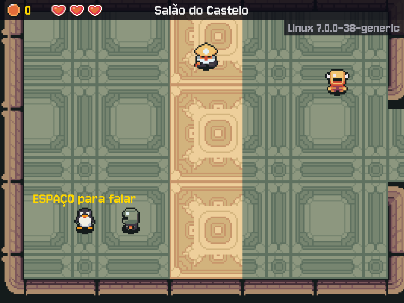

# MÓDULO 05A: Território Pinguim — o jogo no Linux, e um ermitão que só aparece lá

Engenheiro, até aqui o jogo rodou no Windows. Hoje ele muda de casa: a maioria dos servidores do mundo roda Linux, o CI do M04B já roda numa máquina Linux, e daqui em diante o curso também roda. O jogo percebe onde está: mostra o sistema e o kernel no HUD, e quem joga no Linux encontra o Tux, um ermitão que fala de comandos como se fossem ritos antigos. O conceito do dia é **Linux e terminal**: arquivos, permissões e processos.

## 🎯 O que você vai ver na tela ao final

O jogo aberto no Linux, por um script seu (`./run.sh`). No salão, no canto inferior esquerdo, o Tux; abaixo da faixa do topo, à direita, o sistema e a versão do kernel (algo como "Linux 6.8.0-45-generic"). Falando com o Tux, ele cita essa versão e ensina um comando de terminal disfarçado de rito.



## 🏢 Onde isso aparece no mercado

Servidores web, bancos de dados, containers, a nuvem inteira (AWS, Google Cloud, Azure) e as máquinas do CI rodam Linux, quase sempre sem tela: tudo se faz pelo terminal, muitas vezes por uma conexão remota. Saber achar um arquivo, ler uma permissão, encontrar o processo que travou e encerrá-lo é o dia a dia de quem cuida de sistemas (DevOps, SRE, backend). E todo projeto sério tem um script que sobe o ambiente com um comando só.

## 🚦 Ponto de partida

- Seu projeto deve estar como no fim do M04B, com o desafio concluído e o PR mergeado: o CI verde na `main`.
- **Um Linux para trabalhar.** O curso foi testado no **Ubuntu 24.04 LTS**. Escolha um caminho:

| Caminho | Para quem | O que saber |
| --- | --- | --- |
| Dual boot (Windows e Ubuntu no mesmo PC) | Quem tem PC próprio e quer o Linux de verdade | Exige particionar o disco: faça backup antes. Na hora de ligar o PC, você escolhe o sistema |
| WSL2 com Ubuntu 24.04 | Windows 11 | `wsl --install -d Ubuntu-24.04` no PowerShell como administrador e reinicie. A janela do jogo abre pelo WSLg; o som pode falhar com avisos `ALSA` (inofensivos). Trabalhe dentro do Linux (`~`), nunca em `/mnt/c` |
| Máquina virtual (VirtualBox) | Qualquer PC com 8 GB de memória ou mais | Ubuntu 24.04 numa janela. O jogo roda, com gráficos mais lentos |
| Linux que você já usa | Quem já tem | Outras distribuições funcionam; troque o `apt` pelo gerenciador de pacotes dela |

> 🤝 **Com o Sênior (antes da sessão).** Instalem juntos o Linux no seu PC (o dual boot mexe no disco: um erro apaga o Windows). Essa instalação fica fora do tempo do módulo.
> **Sem mentor?** O WSL2 é o caminho mais seguro, porque não mexe no disco. Para o dual boot, siga o tutorial oficial "Install Ubuntu desktop" (ubuntu.com/tutorials) e faça backup antes. Para a VM, o tutorial oficial do Ubuntu para VirtualBox.

- **Arquivos prontos deste módulo:** pasta `M05A/` do repositório do curso, com `assets/` (o Tux provisório e o `CREDITOS.md` atualizado), `run.sh` e `tests/test_tux.py`. O Passo 1 mostra como trazê-la para o Linux.
- **Comandos:** a partir daqui, bash. O PowerShell só aparece onde o Windows ainda importa.
- Entrega por Pull Request `modulo-05a`, como no M04B.
- Duas sessões: **Sessão A**, Passos 1 a 4 (o jogo no Linux e o Tux); **Sessão B**, Passos 5 a 8, o Quebre de propósito e o desafio (o terminal).

> **Andaime:** parte do código vem com `# TODO` nos pontos-chave. O texto explica o que fazer; o código é seu. Rode o jogo depois de cada `TODO`.

## ❓ Pergunta do dia

O mesmo código roda no Windows e no Linux. O que muda por baixo, e como o jogo pode saber onde está?

Ao longo dos passos aparecem caixas **🔍 Pare e pesquise**: pesquise as duas perguntas na hora, anote as respostas e, no fim, explique ao Engenheiro Sênior em até 5 minutos. **Sem mentor?** Grave um áudio de até 5 minutos explicando os termos e ouça de volta: onde você hesitar, o termo ainda não está claro.

## 🛠️ Passo a passo

### Passo 1: o jogo no Linux

> **Já fazia o curso no Linux?** Pule a instalação, o `git config` e os clones: o seu `~/rpg-engine` e o `~/kernel-quest-curso` já existem. Rode `cd ~/rpg-engine`, `git switch main`, `git pull`, `source .venv/bin/activate` e `pip install -r requirements-dev.txt`, traga a pasta deste módulo (`git -C ~/kernel-quest-curso pull` e `cp -r ~/kernel-quest-curso/arquivos/M05A ~/curso-arquivos/`) e siga para a branch, no fim deste passo.

Abra o terminal (no Ubuntu, `Ctrl+Alt+T`; no WSL, o app "Ubuntu"). Primeiro, as ferramentas. O Ubuntu 24.04 já traz o Python 3.12; faltam o módulo de venv, o Git e o GitHub CLI:

```bash
sudo apt update
sudo apt install python3.12-venv git gh
python3 --version
```

O `sudo` roda um comando como administrador (ele pede a **sua** senha do Linux, e nada aparece enquanto você digita; o `apt install` ainda pergunta `[S/n]`: `Enter` confirma). O `apt` é o gerenciador de pacotes: instala programas de um repositório oficial, como uma loja de aplicativos de linha de comando. A última linha deve mostrar `Python 3.12.x`.

Agora o GitHub e a sua identidade no Git. A máquina é nova, então os dois precisam ser configurados de novo, como no M00B:

```bash
gh auth login
git config --global user.name "Seu Nome"
git config --global user.email "seu-email@exemplo.com"
```

No `gh auth login`, escolha GitHub.com, HTTPS e "Login with a web browser", e responda sim quando ele perguntar se deve autenticar o Git. Use no `git config` o mesmo nome e e-mail dos seus commits no Windows.

Clone o seu repositório na sua pasta pessoal (`~`), crie a venv e instale as dependências. Troque `SEU-USUARIO` pelo seu usuário do GitHub (e `rpg-engine` pelo nome do seu repositório, se for outro):

```bash
cd ~
git clone https://github.com/SEU-USUARIO/rpg-engine.git
cd rpg-engine
python3.12 -m venv .venv
source .venv/bin/activate
pip install -r requirements-dev.txt
```

O `.env` não veio no clone: ele está no `.gitignore`, de propósito (a chave nunca vai para o Git). Crie de novo a partir do modelo e cole a sua chave do Gemini, a mesma do Windows. O `nano` é um editor de texto dentro do terminal: edite, salve com `Ctrl+O` e `Enter`, saia com `Ctrl+X`:

```bash
cp .env.example .env
nano .env
```

Traga também os arquivos do módulo. O clone do curso e a pasta `curso-arquivos/` ficaram no Windows; no Linux, clone o curso de novo, como no M00B, e copie a pasta deste módulo:

```bash
git clone https://github.com/sebagonella/kernel-quest-curso.git ~/kernel-quest-curso
mkdir -p ~/curso-arquivos
cp -r ~/kernel-quest-curso/arquivos/M05A ~/curso-arquivos/
```

(Nos próximos módulos, como no Windows, o Ponto de partida traz o `git -C ~/kernel-quest-curso pull` e a cópia da pasta nova.)

Para editar o código, use o VS Code também no Linux. No dual boot ou na máquina virtual, instale com `sudo snap install code --classic` e, dentro dele, a extensão "Python", como no M00A. No WSL2, instale no VS Code do Windows a extensão "WSL" e, no terminal do Ubuntu, rode `code .` dentro da pasta do projeto: o VS Code do Windows abre a pasta do Linux; instale então a extensão "Python" do lado do Linux (botão "Install in WSL: Ubuntu"). Nos dois casos, escolha o interpretador da `.venv` (como no M00A) e confira que o `.vscode/settings.json` veio no clone.

Por fim, a branch do módulo e o jogo:

```bash
git switch -c modulo-05a
python main.py
```

O jogo abre no Linux. No menu, o rodapé já diz "Linux" no lugar de "Windows". Nada no código mudou: o mesmo `main.py`, as mesmas bibliotecas, instaladas de novo pelo `requirements-dev.txt`, como o CI faz a cada push.

### Passo 2 (Leia): o sistema no HUD

Copie o **conteúdo** de `~/curso-arquivos/M05A/assets/` para dentro da pasta `assets/` do projeto (chegam `personagens/tux/parado.png` e `retrato.png`, e o `CREDITOS.md` é substituído):

```bash
cp -r ~/curso-arquivos/M05A/assets/. assets/
```

No `src/views.py`, na classe `Tela`, logo antes do `def desenhar(self, jogo, controle, dt, tempo):`, um desenho novo, pronto:

```python
    def desenhar_sistema(self):
        """Abaixo da faixa, à direita: o sistema e o kernel em que o jogo está rodando."""
        # platform pergunta ao sistema operacional: "Linux" e "6.8.0-45-generic", por exemplo.
        texto = self.fonte_fala.render(f"{platform.system()} {platform.release()}", False,
                                       COR_APAGADA)
        fundo = pygame.Surface((texto.get_width() + 16, texto.get_height()), pygame.SRCALPHA)
        fundo.fill(COR_PAINEL)
        x = LARGURA - fundo.get_width()
        self.superficie.blit(fundo, (x, 40))
        self.superficie.blit(texto, (x + 8, 40))

```

E no `desenhar`, logo depois da linha `self.desenhar_inventario(heroi)`:

```python
        self.desenhar_sistema()
```

O `import platform` já existe no `views.py` desde o M00B (é ele que escreve "Python 3.12" no menu). Leia o `desenhar_sistema`:

1. O que `platform.system()` e `platform.release()` devolveriam no seu Windows?
2. Por que o texto fica abaixo da faixa do topo, e não dentro dela?

Rode `python main.py` e comece um jogo: abaixo da faixa, à direita, "Linux" e a versão do kernel. Confira com o terminal: `uname -r` mostra a mesma versão.

> 🔍 **Pare e pesquise: Introspecção de sistema** — Como um programa descobre em que sistema operacional e em que versão está rodando? Quando faz sentido um programa se comportar diferente em cada sistema, e quando isso vira um problema?

### Passo 3 (Crie): a persona do Tux

O Tux é o mascote do Linux, e no jogo é um ermitão que só se mostra a quem chega pelo Linux. Ele sabe em que chão pisa: a persona dele recebe a versão do kernel.

No `src/models.py`, logo depois do `import logging`:

```python
import platform
```

E logo depois do `INSTRUCAO_CACADOR` (o parêntese que fecha a persona do seu NPC do M02A), a persona do Tux:

```python
# platform.release() é a versão do kernel da máquina: o Tux conhece o chão que pisa.
INSTRUCAO_TUX = (
    "Você é Tux, ermitão que vive num canto esquecido do salão. Guarda a memória de um tempo "
    "sem janelas, em que tudo se fazia por palavras, e esconde que já serviu ao castelo. "
    "Enigmático e paciente, fala dos comandos do terminal como ritos antigos e desconfia de pressa. "
    f"O núcleo deste mundo traz a inscrição {platform.release()}: cite-a como coisa sagrada. "
    "Em cada resposta, ensine um comando real do terminal, escrito como se digita, "
    "disfarçado de rito. "
    + FORMATO
)
```

Esse é um exemplo. A persona é sua: reescreva o texto com as suas palavras, no tom do jogo (sombrio, frases curtas, nada de piada de informática; um personagem que quer algo e esconde algo), mantendo três coisas: a versão do kernel pela `platform.release()` (repare no `f` antes das aspas), um comando real do terminal em cada resposta e o `FORMATO` no fim.

Rode no terminal, para ver a persona como o Gemini vai recebê-la, já com a versão do seu kernel no meio:

```bash
python -c "from src.models import INSTRUCAO_TUX; print(INSTRUCAO_TUX)"
```

### Passo 4 (Complete / Preveja): o Tux só no Linux

Primeiro, a View aprende a desenhar um personagem com um quadro só. As folhas do pacote têm 4 colunas, uma por direção; o Tux provisório tem uma (e o seu, no M05B, também). No `src/views.py`, substitua a função `sprite_npc` inteira por:

```python
    def sprite_npc(self, sprite_id):
        """Quadros parados e retrato de personagens/<sprite_id>/."""
        if sprite_id not in self.npcs:
            folha = carregar_imagem(f"personagens/{sprite_id}/parado.png")
            # Uma coluna por direção; folha de um quadro só (o Tux): o mesmo nas 4 direções.
            colunas = folha.get_width() // TAMANHO_TILE
            # Retrato de 38×38 ampliado na mesma escala da caixa de diálogo.
            retrato = carregar_imagem(f"personagens/{sprite_id}/retrato.png")
            self.npcs[sprite_id] = (recortar_quadros(folha, colunas, 1) * (len(COLUNA) // colunas),
                                    pygame.transform.scale_by(retrato, ESCALA_CAIXA))
        return self.npcs[sprite_id]
```

(Uma lista vezes um número repete a lista: `[a] * 4` é `[a, a, a, a]`.) Rode `python main.py`: nada muda na tela, e é isso que se espera (os personagens do pacote têm 4 colunas, e para eles a conta dá 1).

Agora o Controller. No `src/controllers.py`, logo depois do `import logging`:

```python
import sys
```

Importe `INSTRUCAO_TUX` do `models` (em ordem alfabética, depois do `INSTRUCAO_SENTINELA`). Logo antes do `def carregar_cenas():`, a função que decide quem aparece em cada sistema:

```python
def npcs_do_sistema():
    """NPCs que dependem do sistema em que o jogo roda: no Linux, o ermitão Tux."""
    # sys.platform diz para que sistema o Python foi feito: "linux", "win32", "darwin"...
    if False:  # TODO: troque o False pela condição "o sys.platform começa com linux"
        return [criar_npc("Tux", "tux", (168, 456), INSTRUCAO_TUX)]
    return []


```

No `carregar_cenas`, a lista de NPCs do salão termina em `]),`. Troque essa linha (a do salão, logo depois da Sentinela) por:

```python
        ] + npcs_do_sistema()),  # no Linux, o Tux também
```

Complete o `TODO`: a decisão é a condição do `if` (dica: as strings têm `startswith()`). Rode `python main.py`: no salão, o Tux no canto inferior esquerdo. Chegue perto e aperte ESPAÇO: ele cita o seu kernel e ensina um comando.

**Preveja:** o CI do M04B roda numa máquina `ubuntu-latest`. Lá, o `npcs_do_sistema()` devolve o Tux? E no seu Windows?

Commit e push. O CI roda de novo, agora na branch nova:

```bash
git add .
git commit -m "feat: Tux só no Linux e o sistema no HUD"
git push -u origin modulo-05a
```

> ⏸️ **Fim da Sessão A.** O jogo roda no Linux, o Tux está no salão e o commit foi enviado. Pare aqui e continue na próxima sessão, no Passo 5.

### Passo 5 (Preveja): onde as coisas estão

A Sessão B é de terminal: missões dentro do seu próprio projeto, cada uma com um resultado para conferir. Abra o terminal na pasta do projeto (`cd ~/rpg-engine`) e ative a venv (`source .venv/bin/activate`).

**Missão 1: o que está aqui.** `pwd` diz onde você está; `ls` lista a pasta. **Preveja:** o `.env` aparece no `ls`? Rode `ls`, depois `ls -la`, e compare:

```bash
pwd
ls
ls -la
```

No Linux, todo arquivo cujo nome começa com ponto fica oculto: o `.env`, o `.gitignore`, a pasta `.git` e a `.venv` só aparecem com o `-a`. O `-l` mostra os detalhes: permissões, dono, tamanho, data. As duas primeiras linhas, `.` e `..`, são a própria pasta e a pasta de cima (`cd ..` sobe um nível; `cd ~` volta para a sua pasta pessoal; `cd -` volta para onde você estava).

**Missão 2: quem lê o `NIVEL_LOG`.** Desde o M03C, o `NIVEL_LOG` do `.env` escolhe quanto detalhe o log mostra. Em que arquivo e em que linha o jogo o lê? O `grep` procura um texto dentro de arquivos: `-r` em todas as subpastas, `-n` com o número da linha, `--include` só nos arquivos `.py` (nada de imagens ou binários) e `--exclude-dir` pula a pasta `.venv` inteira (sem ela, o `grep` leria também todos os `.py` das bibliotecas instaladas):

```bash
grep -rn NIVEL_LOG --include="*.py" --exclude-dir=.venv .
```

Três linhas: duas no `main.py` (o import e o `logging.basicConfig`) e uma no `src/config.py`, a que lê do ambiente. Agora junte dois comandos com um **pipe** (`|`): a saída do primeiro vira a entrada do segundo. Quais linhas do `ls -la` falam de `env`? (Repare quem mais aparece: o `grep` acha o texto em qualquer parte do nome.)

```bash
ls -la | grep env
```

> 🔍 **Pare e pesquise: Sistema de arquivos do Linux** — O que são `/`, `/home`, `~` e `/etc`, e por que no Linux não existe `C:`? O que significa o Linux diferenciar maiúsculas de minúsculas nos nomes de arquivo?

### Passo 6 (Leia): o run.sh e as permissões

Até aqui, rodar o jogo exige dois comandos (ativar a venv e chamar o Python), na pasta certa. Um **script de shell** junta isso num comando só. Copie o `run.sh` do módulo para a raiz do projeto e tente rodar:

```bash
cp ~/curso-arquivos/M05A/run.sh .
./run.sh
```

`Permissão negada` (ou `Permission denied`). O `./` diz "o arquivo desta pasta", e o Linux só executa um arquivo que tem permissão de execução. Veja as permissões dele:

```bash
ls -l run.sh
```

`-rw-rw-r--` (em alguns sistemas, como o WSL, `-rw-r--r--`): o primeiro caractere é o tipo (`-` arquivo, `d` pasta) e o resto são três trios de `r` (ler), `w` (escrever) e `x` (executar), para o **dono**, o **grupo** e os **outros**. Cada trio também é um número, a soma de `r` = 4, `w` = 2 e `x` = 1:

| Permissão | rwx | Octal |
| --- | --- | --- |
| Ler, escrever e executar | `rwx` | 7 |
| Ler e escrever | `rw-` | 6 |
| Ler e executar | `r-x` | 5 |
| Só ler | `r--` | 4 |
| Nada | `---` | 0 |

Então `-rw-rw-r--` é `664` (e `-rw-r--r--`, `644`). Dê a permissão de execução e confira:

```bash
chmod +x run.sh
ls -l run.sh
./run.sh
```

Agora é `-rwxrwxr-x`, ou `775` (no WSL, `-rwxr-xr-x`, `755`): o `+x` acrescentou o `x` nos três trios, sem mexer no resto, e o jogo abre. Feche o jogo e leia o `run.sh` (`cat run.sh` mostra o arquivo no terminal):

1. O que o `set -e` muda se a venv não existir?
2. O `cd "$(dirname "$0")"` leva para onde? Rode `cd ~` e depois `~/rpg-engine/run.sh`: o jogo abre mesmo fora da pasta do projeto. Por quê? (Feche o jogo e volte com `cd -`.)
3. O `exec` faz o Python ocupar o lugar do script. Você vai ver o efeito no Passo 7.

O `TODO` do `run.sh` é do desafio: por enquanto, deixe como está.

> 🔍 **Pare e pesquise: Permissões no Linux** — O que significam dono, grupo e outros, e o que `chmod 600` deixaria alguém fazer com o arquivo? Por que um arquivo baixado da Internet não vem executável?

> 🔍 **Pare e pesquise: Script de shell** — O que a primeira linha, `#!/usr/bin/env bash` (o "shebang"), diz ao sistema? Por que um projeto tem um script de "rodar" em vez de pedir os comandos de cabeça?

Por fim, o cabeçalho do `main.py`: troque o começo da docstring, da linha do `RPG Engine — Módulo 04B` até a linha que termina em `(.github/):`, por:

```python
"""
RPG Engine — Módulo 05A: Território Pinguim.

O jogo (menu, mapas do Tiled, moedas, baú, slimes e vida, HUD, diálogo com o
Gemini, a loja do Brok e, no Linux, o Tux) fica em camadas dentro de src/. No
Linux, ./run.sh ativa a venv e roda este arquivo. As regras se provam com os
testes de tests/, que o GitHub Actions roda a cada push (.github/):
```

Rode `./run.sh` de novo: o jogo abre igual.

### Passo 7 (Preveja): processos

Todo programa rodando é um **processo**, com um número (o PID). **Preveja:** com o jogo aberto pelo `run.sh`, quantas linhas com `main.py` a lista vai mostrar? Abra o jogo com `./run.sh` e deixe-o aberto. Abra uma segunda aba do terminal (`Ctrl+Shift+T`), entre na pasta do projeto e liste os processos que têm `main.py` na linha de comando:

```bash
ps aux | grep main.py
```

O `ps aux` lista todos os processos da máquina; o `grep` filtra. Uma das linhas é a do jogo, terminando em `python main.py`; a segunda coluna é o PID. A outra linha é o próprio `grep main.py`, que também é um processo (e também tem `main.py` na linha de comando). Graças ao `exec` do `run.sh`, o jogo é um processo só: sem ele, haveria também um `bash ./run.sh` esperando o Python terminar (que o `ps aux | grep run.sh` mostraria).

Agora o mesmo, ao vivo. Rode `htop` (no Ubuntu ele já vem; se faltar, `sudo apt install htop`). Aperte `F4`, digite `main.py` para filtrar, e veja o consumo de processador e de memória do jogo mudar enquanto você anda pelo mapa. `q` sai.

> 🔍 **Pare e pesquise: Processo** — O que é um processo, e o que é o PID? Qual a diferença entre um programa (o arquivo no disco) e um processo (o programa rodando)?

Feche o jogo (a janela ou `ESC` no menu). No desafio, você vai encerrá-lo pelo terminal.

### Passo 8 (Crie): um atalho no ~/.bashrc

O `~/.bashrc` é um script que o bash roda toda vez que abre um terminal: é onde moram os seus atalhos. Acrescente um **alias** (troque `rpg-engine` pelo nome da sua pasta, se for outro). O `>>` acrescenta ao fim do arquivo; um `>` só apagaria o `.bashrc` inteiro:

```bash
echo 'alias jogo="$HOME/rpg-engine/run.sh"' >> ~/.bashrc
source ~/.bashrc
cd ~
jogo
```

O `source` relê o arquivo sem fechar o terminal. Agora `jogo`, de qualquer pasta, abre o jogo. O nome do atalho é seu: crie outro, se quiser (um `testes` que roda o pytest, por exemplo). Feche o jogo, volte para o projeto e faça o commit e o push:

```bash
cd ~/rpg-engine
git add .
git commit -m "feat: run.sh para rodar o jogo no Linux"
git push
```

## 💥 Quebre de propósito

No Windows, `andar.png` e `Andar.png` são o mesmo arquivo. **Preveja:** e no Linux? Renomeie a folha da caminhada do herói com o `mv` (que move ou renomeia) e rode:

```bash
mv assets/personagens/heroi/andar.png assets/personagens/heroi/Andar.png
./run.sh
```

O jogo nem abre. O log mostra `Arquivo não encontrado: .../assets/personagens/heroi/andar.png` (a segunda linha, "Copie para assets/...", é a dica genérica de arquivo faltando; aqui a causa é outra): o código pede `andar.png`, e no Linux `Andar.png` é outro nome. É o erro clássico de quem desenvolve no Windows e publica num servidor Linux: na máquina do desenvolvedor funciona, no servidor não. Por isso o curso usa nomes sempre em minúsculas. Desfaça:

```bash
mv assets/personagens/heroi/Andar.png assets/personagens/heroi/andar.png
```

## 🧯 Problemas comuns

| Sintoma | Causa provável | Como resolver |
| --- | --- | --- |
| Mensagens `ALSA lib ...` no terminal | Avisos do áudio (comuns no WSL e em VMs) | Inofensivas; o jogo segue, com ou sem som |
| `Permission denied` no `./run.sh` | O arquivo não tem permissão de execução | `chmod +x run.sh` |
| `python3.12 -m venv` falha com `ensurepip is not available` | Faltou o pacote da venv | `sudo apt install python3.12-venv` e crie a venv de novo |
| `.venv/bin/activate: No such file or directory` no `run.sh` | A venv não foi criada nesta máquina (ela não vai para o Git) | `python3.12 -m venv .venv` e `pip install -r requirements-dev.txt` |
| O `git push` pede usuário e senha | O Git ainda não usa a conta do `gh` | `gh auth login` (sim para autenticar o Git) ou `gh auth setup-git` |
| `Please tell me who you are` no commit | Máquina nova, Git sem identidade | Os dois `git config --global` do Passo 1 |
| `gh auth login` não abre o navegador (WSL, VM sem navegador) | O terminal não tem um navegador associado | Abra no navegador do Windows a URL que ele mostra e digite o código de 8 letras |
| Jogo lento e `git status` demorado no WSL | Projeto dentro de `/mnt/c` (o disco do Windows) | Clone de novo dentro de `~` |
| `wsl --install` funciona, mas a janela do jogo não abre | Windows 10, sem o WSLg | Use a máquina virtual, ou atualize para o Windows 11 |
| O Tux não aparece | O `TODO` do Passo 4 ainda devolve a lista vazia, ou o jogo está rodando no Windows | Confira a condição com `sys.platform.startswith("linux")` |
| `ModuleNotFoundError` ao rodar `python main.py` | A venv não está ativa (o terminal usa o Python do sistema) | `source .venv/bin/activate`, ou use o `./run.sh`, que ativa sozinho |
| `bash\r: No such file or directory` ao rodar o `run.sh` | O arquivo foi copiado do Windows (`/mnt/c/...`), com o fim de linha do Windows (CRLF) | Copie do clone do curso feito no Linux (`~/kernel-quest-curso`), nunca de `/mnt/c` |

## 🧩 Desafio de Engenharia

Três tarefas de quem cuida de um sistema Linux: um script que falha bem, um teste que não depende da máquina e um processo encerrado pelo terminal.

1. **O `run.sh` falha com clareza.** Sem o `.env`, o jogo abre sem a chave e só reclama na primeira fala, longe da causa. Complete o `TODO` do `run.sh`: se o arquivo `.env` não existir, escreva uma mensagem que diga o que falta e o comando que resolve, e saia com `exit 1`. Teste renomeando o `.env` (`mv .env .env.guardado`), rodando e desfazendo. Dica: pesquise o `if [ ! -f arquivo ]` do bash.
2. **Um teste que não depende da máquina.** Copie `~/curso-arquivos/M05A/tests/test_tux.py` para a pasta `tests/`. O teste precisa provar a regra do Tux nos dois sistemas, mas roda numa máquina só: o seu Linux, ou o Ubuntu do CI. A saída é a fixture `monkeypatch` do pytest, que troca um valor só durante o teste e desfaz a troca no fim. O primeiro teste chega pronto e finge o Linux com `monkeypatch.setattr(sys, "platform", "linux")`; leia como ele faz. Complete o segundo: finja o Windows (`"win32"`) e o macOS (`"darwin"`) e prove que o Tux não aparece. Para conferir que o teste pega o erro, troque a condição do `npcs_do_sistema` por `True`, rode o pytest (ele deve falhar) e desfaça.
3. **Encerrar pelo terminal.** Com o jogo aberto pelo `run.sh` numa aba, encerre-o da outra aba com `kill` e o PID que o `ps aux | grep main.py` mostrar. Repare no que aparece na aba do jogo.

**Critérios de aceite:**

- [ ] `./run.sh` sem o `.env` mostra uma mensagem clara (o que falta e como resolver) e sai com código 1 (confira com `echo $?` logo depois); com o `.env`, abre o jogo.
- [ ] `tests/test_tux.py` usa o `monkeypatch` e prova que o Tux só existe quando `sys.platform` começa com `linux`; `python -m pytest -q` passa, com dois testes a mais que antes e falha se a condição do Tux for trocada por `True`.
- [ ] `ps aux | grep main.py` mostra o jogo rodando, e `kill <PID>` o encerra. Cole as duas saídas na descrição do PR.
- [ ] **Nomes que os próximos módulos usam:** `run.sh` na raiz do projeto; `assets/personagens/tux/parado.png` (o M05B troca só essa imagem); `INSTRUCAO_TUX` no `src/models.py`; o `sprite_id` `"tux"`; `npcs_do_sistema()` no `src/controllers.py`.
- [ ] Você explica ao Engenheiro Sênior, sem ler e em até 5 minutos, os cinco termos das caixas 🔍 (introspecção de sistema, sistema de arquivos, permissões, script de shell e processo). **Sem mentor?** Grave a explicação em áudio e ouça de volta.

Lembre as regras de uso de IA do M00B: pode pedir explicação de conceito e de erro, não pode pedir a solução pronta, e deve dizer na descrição do PR cada trecho que veio de uma IA, sabendo explicá-lo.

**Entrega:** Pull Request `modulo-05a` para a `main` (`gh pr create --body-file`), com a descrição (o que muda, como testar, as saídas do `ps` e do `kill`, o que veio de IA). Merge só com o CI verde e a aprovação. **Sem mentor?** Review de um colega do curso ou autorrevisão no dia seguinte, como no M03C.

## ⭐ Bônus (opcional)

- **Congelar sem matar:** com o jogo aberto, `kill -STOP <PID>` congela o processo (a janela para de responder, e o `ps` mostra um `T` na coluna `STAT`); `kill -CONT <PID>` devolve a vida. Depois compare o `kill` comum (o sinal `TERM`, um pedido para terminar) com o `kill -9` (o `KILL`, que o processo não consegue recusar): quando usar cada um?
- **O manual:** `man ls`, `man chmod`, `man ps`. O `q` sai; `/texto` procura dentro da página.

## 💼 Resumo profissional

- **Conceito:** Linux e terminal (sistema de arquivos, arquivos ocultos, `grep` e pipes, permissões rwx e octal, processos com `ps`, `htop` e `kill`, `~/.bashrc`), script de shell para subir o ambiente, introspecção de sistema (`sys.platform`, `platform.release()`), teste independente da máquina com `monkeypatch`.
- **Linha para o currículo:** "Migrei um jogo em Python do Windows para o Linux, com script de execução em bash, comportamento por sistema operacional coberto por testes (pytest com monkeypatch) e diagnóstico de processos pelo terminal."
