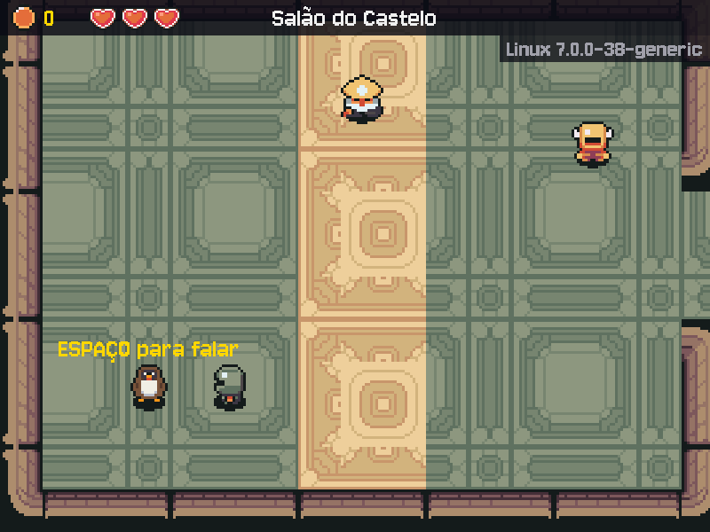

# MÓDULO 05B: Chave SSH e o Tux — o seu ermitão no jogo, e o repositório aberto por chave

Engenheiro, o Tux do M05A era provisório. Hoje ele dá lugar ao seu: você desenha o ermitão pixel a pixel e assina a arte nos créditos do jogo. Depois, o repositório deixa de pedir login pelo navegador e passa a reconhecer você por uma chave, do jeito que se entra em qualquer servidor de verdade. O conceito do dia é **criptografia de chave pública**.

## 🎯 O que você vai ver na tela ao final

No salão, o Tux desenhado por você no lugar do provisório, com a sua linha no `assets/CREDITOS.md`. No terminal, `ssh -T git@github.com` responde "Hi SEU-USUARIO! You've successfully authenticated", e o `git push` vai por SSH, sem pedir nada.



(No print, o Tux é um exemplo de desenho de aluno. O seu é o que você desenhar.)

## 🏢 Onde isso aparece no mercado

Chave SSH é a porta de entrada de quase todo servidor Linux, de quase todo repositório Git das empresas e das máquinas na nuvem: senha não entra, só chave. O mesmo par de chave pública e chave privada está por trás do HTTPS, das assinaturas de commits e de pacotes, e dos certificados. E arte, código e texto sempre têm um autor e uma licença: saber registrar o que é seu e respeitar o que é dos outros é obrigação em qualquer estúdio de jogos.

## 🚦 Ponto de partida

- Seu projeto deve estar como no fim do M05A, com o desafio concluído e o PR mergeado: o jogo roda no Linux pelo `./run.sh`, com o Tux provisório no salão.
- Este módulo não tem arquivos prontos: a arte é sua, e os comandos estão no texto.
- Uma sessão de 60 a 90 minutos. O desenho no Piskel pode ir para casa: dá para fazer o Passo 1 antes ou depois do resto.
- Entrega por Pull Request `modulo-05b`, como no M05A. Crie a branch a partir da `main` atualizada:

```bash
cd ~/rpg-engine
git switch main
git pull
git switch -c modulo-05b
```

## ❓ Pergunta do dia

Se você entrega a chave pública para qualquer um, o que exatamente impede que alguém se passe por você?

Ao longo dos passos aparecem caixas **🔍 Pare e pesquise**: pesquise as duas perguntas na hora, anote as respostas e, no fim, explique ao Engenheiro Sênior em até 5 minutos. **Sem mentor?** Grave um áudio de até 5 minutos explicando os termos e ouça de volta: onde você hesitar, o termo ainda não está claro.

## 🛠️ Passo a passo

### Passo 1 (Crie): o seu Tux no Piskel

O Piskel é um editor de pixel art gratuito que roda no navegador (na máquina virtual, use o navegador do próprio Ubuntu, para o arquivo baixado cair lá). Abra piskelapp.com e clique em **Create Sprite**. O Piskel abre com uma tela de 32 × 32: no painel da direita, em **Resize**, ponha 16 × 16 e confirme. É o tamanho de todo personagem do pacote (o jogo amplia 3 vezes).

**Primeiro, a versão rápida (10 minutos):** importe o Tux provisório (**Import**, no painel da direita, e escolha `assets/personagens/tux/parado.png` do projeto), mude a cor do corpo com o balde de tinta e acrescente um detalhe seu (um capuz, um cajado, uma cicatriz). Exporte e rode, como abaixo: o seu Tux já aparece no jogo. Depois, se quiser, desenhe um do zero, com calma (pode ser em casa); é só exportar por cima.

Desenhe o Tux **de frente**, olhando para baixo, que é como o jogo mostra os NPCs parados. Três regras de estilo, para ele combinar com o resto do jogo:

- **Contorno escuro** de 1 pixel em volta de tudo (os personagens do pacote usam um quase-preto, não um preto puro).
- **Fundo transparente:** não pinte o fundo; o xadrez cinza do Piskel é a transparência.
- **Poucas cores**, cada uma com um tom mais escuro para a sombra. O ermitão é seu: capuz, cajado, cicatriz, o que contar a história dele.

Para desenhar do zero com as cores do provisório, importe-o e use o conta-gotas.

Pronto o desenho, **Export**, aba **PNG**, com a escala em **1x** (16 × 16), e **Download**. Mova o arquivo baixado para o lugar do provisório, com o nome exato que o jogo procura. No Ubuntu, o download vai para `~/Downloads` (troque `New Piskel.png` pelo nome que aparecer; no WSL, a pasta é `/mnt/c/Users/<você>/Downloads`):

```bash
mv ~/Downloads/"New Piskel.png" assets/personagens/tux/parado.png
file assets/personagens/tux/parado.png
```

O `file` diz o tipo do arquivo pelo conteúdo, não pelo nome: deve mostrar `PNG image data, 16 x 16`. Rode `./run.sh` e vá até o canto inferior esquerdo do salão: o seu Tux, nítido, 3 vezes maior. O código não mudou: o jogo lê a imagem pelo caminho, e qualquer PNG de 16 × 16 nesse lugar vira o Tux.

### Passo 2 (Crie): a arte é sua, e os créditos dizem isso

Abra `assets/CREDITOS.md`. Cada linha diz de onde veio cada arquivo, quem fez e com que licença. A linha do Tux provisório ainda lista o `parado.png`, que agora é seu. Na última linha, troque `personagens/tux/parado.png, personagens/tux/retrato.png` por `personagens/tux/retrato.png` (o retrato da caixa de diálogo continua o provisório). Depois, no fim do arquivo, a sua linha (com o seu nome e a licença que você escolher):

```markdown
| personagens/tux/parado.png | Ada | Desenho próprio, feito no Piskel | CC BY 4.0 | Original |
```

A licença é decisão sua: **CC0** (qualquer um usa como quiser, sem nem citar você), **CC BY 4.0** (qualquer um usa, desde que cite você) ou "todos os direitos reservados" (ninguém usa sem pedir). O pacote Ninja Adventure, de onde vem quase toda a arte do jogo, é CC0.

> 🔍 **Pare e pesquise: Licença de arte** — O que muda entre CC0, CC BY e "todos os direitos reservados" para quem quer usar o seu desenho? Por que um jogo publicado precisa saber a licença de cada arquivo que usa?

Rode `./run.sh` de novo (nada muda na tela) e faça o commit e o push. O push ainda vai por HTTPS, pela conta do `gh`, como no M05A:

```bash
git add assets/
git commit -m "feat: o Tux desenhado por mim, com a licença nos créditos"
git push -u origin modulo-05b
```

### Passo 3 (Leia): o par de chaves

Agora o SSH. Uma chave SSH é um **par**: a chave **privada**, que fica só com você, e a chave **pública**, que você entrega a quem precisa reconhecer você (o GitHub, um servidor). O que a privada assina, a pública confere; mas, com a pública na mão, ninguém consegue fazer a privada.

Veja se você já tem alguma chave (o `~/.ssh` pode nem existir ainda, e tudo bem):

```bash
ls -la ~/.ssh
```

Gere o seu par. O `-t ed25519` escolhe o algoritmo (moderno, curto e seguro) e o `-C` põe um comentário para você reconhecer a chave depois (use o seu e-mail do GitHub):

```bash
ssh-keygen -t ed25519 -C "seu-email@exemplo.com"
```

Ele pergunta três coisas. O caminho: aperte `Enter` para aceitar o padrão (`~/.ssh/id_ed25519`). Se o `ls -la` de antes já mostrou um `id_ed25519`, ele pergunta `Overwrite (y/n)?`: responda `n`, porque `y` apaga a chave que você já tem, e siga com ela. A senha da chave (*passphrase*), duas vezes: escolha uma frase que você lembre, porque é ela que protege a chave se alguém copiar o arquivo. Nada aparece enquanto você digita, como no `sudo`. No fim ele mostra a impressão digital (`SHA256:...`) e um desenho de caracteres: é só uma forma visual da mesma impressão digital.

```bash
ls -la ~/.ssh
cat ~/.ssh/id_ed25519.pub
```

Leia o resultado:

1. Dos dois arquivos novos, qual é a chave pública e qual é a privada? Qual deles você acabou de mostrar na tela com o `cat`, e por que não tem problema?
2. O que está no fim da linha da chave pública, e de onde isso veio?

> 🔍 **Pare e pesquise: Criptografia de chave pública** — Por que a chave pública pode ir para qualquer lugar, e a privada não? Como o servidor confere que é você sem que a chave privada viaje pela rede?

### Passo 4 (Complete): as permissões da chave

Lembra da tabela do M05A? Leitura 4, escrita 2, execução 1, para o dono, o grupo e os outros. O SSH é exigente: ele se recusa a usar uma chave privada que outra pessoa da máquina possa ler. Decida você os números:

- a pasta `~/.ssh`: só você pode entrar, ler e criar arquivos nela (numa pasta, o `x` é o direito de entrar); o grupo e os outros, nada;
- a chave privada `~/.ssh/id_ed25519`: só você lê e escreve; ninguém executa; o grupo e os outros, nada.

Troque cada `NUMERO` pelo número que você decidiu e rode:

```bash
chmod NUMERO ~/.ssh
chmod NUMERO ~/.ssh/id_ed25519
ls -la ~/.ssh
```

Confira no `ls -la`: a linha do `.` (a própria pasta) deve começar com `drwx------`, e a da `id_ed25519` com `-rw-------`. O `ssh-keygen` já cria assim; o seu `chmod` confirma que você sabe ler e escrever essas permissões (no Quebre de propósito você vai ver o que acontece quando elas estão erradas). A chave pública, `id_ed25519.pub`, fica `-rw-r--r--`: qualquer um pode ler, e é para isso que ela existe.

### Passo 5 (Leia): o agente SSH

Com senha na chave, cada uso pediria a senha de novo. O **agente SSH** guarda a chave já destravada na memória enquanto você está logado: você digita a senha uma vez, e ele assina por você quando o `ssh` pedir. Pergunte ao agente que chaves ele tem:

```bash
ssh-add -l
```

Três respostas possíveis:

- `The agent has no identities.`: há um agente rodando, sem chaves (comum no Ubuntu com interface gráfica, que liga um agente ao entrar).
- `Could not open a connection to your authentication agent.`: não há agente neste terminal (o normal no WSL). Ligue um com `eval "$(ssh-agent -s)"` e pergunte de novo.
- Uma linha com `SHA256:...`: a chave já está lá.

Entregue a chave ao agente (ele pede a senha da chave; no Ubuntu com interface gráfica, a pergunta pode vir numa janela) e confira:

```bash
ssh-add ~/.ssh/id_ed25519
ssh-add -l
```

A linha com a impressão digital e o seu e-mail mostra que o agente tem a chave. Ela está destravada **na memória**: o arquivo no disco continua protegido pela senha. Leia o resultado:

1. A impressão digital do `ssh-add -l` é a mesma que o `ssh-keygen` mostrou no Passo 3? Por quê?
2. Se você sair da sessão (ou, no WSL, abrir outro terminal), o `ssh-add -l` ainda mostra a chave? Onde ela estava guardada?

> 🔍 **Pare e pesquise: Agente SSH** — O que o agente guarda, e onde? Se alguém copiar o seu arquivo `id_ed25519`, o que a senha da chave muda?

### Passo 6: a chave pública no GitHub

O GitHub precisa conhecer a sua chave **pública** (nunca a privada). Pela linha de comando:

```bash
gh ssh-key add ~/.ssh/id_ed25519.pub --title "Linux do curso"
```

Se ele reclamar de permissão (o `gh` não pediu esse acesso no login), autorize e repita: `gh auth refresh -h github.com -s admin:public_key`. **Sem o `gh`?** No navegador, GitHub → Settings → SSH and GPG keys → New SSH key, e cole o conteúdo do `cat ~/.ssh/id_ed25519.pub`, a linha inteira.

Agora teste a chave contra o GitHub:

```bash
ssh -T git@github.com
```

Na primeira vez, o `ssh` não conhece o servidor e pergunta `Are you sure you want to continue connecting (yes/no/[fingerprint])?`, mostrando a impressão digital do GitHub. É a sua chance de conferir que está falando com o GitHub de verdade: compare com a da página oficial "GitHub's SSH key fingerprints" (a ED25519 é `SHA256:+DiY3wvvV6TuJJhbpZisF/zLDA0zPMSvHdkr4UvCOqU`). Bateu, digite `yes`: ela fica guardada em `~/.ssh/known_hosts`, e da próxima vez o `ssh` confere sozinho. A resposta:

```text
Hi SEU-USUARIO! You've successfully authenticated, but GitHub does not provide shell access.
```

Você entrou com a chave, sem senha de conta, sem navegador. O "does not provide shell access" só diz que o GitHub não deixa ninguém abrir um terminal nos servidores dele: a chave serve para o Git.

### Passo 7 (Complete): o remoto por SSH

O seu repositório local ainda fala com o GitHub por HTTPS. Veja o endereço:

```bash
git remote -v
```

A URL é `https://github.com/SEU-USUARIO/SEU-REPOSITORIO.git`. A mesma URL, por SSH, tem outra forma: começa com `git@github.com:` (repare nos **dois-pontos**, não uma barra) e segue com `SEU-USUARIO/SEU-REPOSITORIO.git`. Monte a sua a partir da que o `git remote -v` mostrou, troque o `URL_SSH` por ela e rode:

```bash
git remote set-url origin URL_SSH
git remote -v
git push
```

O `git remote -v` deve mostrar a URL com `git@github.com:` nas duas linhas (fetch e push), e o `git push` vai sem pedir nada (se o PR tiver algo novo, ele envia; senão, responde `Everything up-to-date`, e isso também prova que a conexão funcionou). A partir de agora, todo push vai pela sua chave.

## 💥 Quebre de propósito

Tire a proteção da chave privada, deixando-a em `644` (qualquer um da máquina pode ler), e tente usar:

```bash
chmod 644 ~/.ssh/id_ed25519
ssh -T git@github.com
```

Funciona: o `ssh` pediu a assinatura ao agente, que tem a chave na memória, e nem abriu o arquivo. **Preveja:** e sem o agente, o `ssh` aceita usar o arquivo em `644`? O `SSH_AUTH_SOCK=` vazio, antes do comando, esconde o agente só para aquele comando:

```bash
SSH_AUTH_SOCK= ssh -T git@github.com
```

Ele recusa, com uma moldura de `@` que não dá para ignorar: `WARNING: UNPROTECTED PRIVATE KEY FILE!`, `Permissions 0644 for '/home/<você>/.ssh/id_ed25519' are too open`, `This private key will be ignored.`, e o GitHub responde `Permission denied (publickey)`. O SSH prefere não funcionar a funcionar com uma chave que qualquer um da máquina poderia ter copiado (o `ssh-add` recusa do mesmo jeito). Desfaça e teste de novo sem o agente: agora ele pede a senha da chave, porque precisa destravar o arquivo:

```bash
chmod 600 ~/.ssh/id_ed25519
SSH_AUTH_SOCK= ssh -T git@github.com
```

## 🧯 Problemas comuns

| Sintoma | Causa provável | Como resolver |
| --- | --- | --- |
| `Permission denied (publickey)` | A chave pública não está no GitHub, ou o agente está sem a chave | `gh ssh-key list` (ou a página SSH and GPG keys) e `ssh-add -l`; se faltar, Passo 6 ou `ssh-add ~/.ssh/id_ed25519` |
| `Could not open a connection to your authentication agent` | Não há agente neste terminal (comum no WSL) | `eval "$(ssh-agent -s)"` e `ssh-add ~/.ssh/id_ed25519`; no WSL, a cada terminal novo |
| `gh ssh-key add` falha por falta de permissão ou escopo | O login do `gh` não pediu o acesso às chaves | `gh auth refresh -h github.com -s admin:public_key` e repita |
| O `git push` ainda pede usuário e senha, ou abre o navegador | O remoto continua em HTTPS | `git remote -v`; troque com o `git remote set-url` do Passo 7 |
| `Host key verification failed` | Você respondeu `no` na primeira conexão, ou o `known_hosts` tem uma chave antiga do GitHub | Rode `ssh -T git@github.com` de novo e confira a impressão digital; se ele avisar que ela mudou, `ssh-keygen -R github.com` e confira com a página oficial antes do `yes` |
| O Tux aparece em pedaços, ou só um pedaço dele | A imagem não tem 16 × 16 (o `file` mostra `32 x 32`, por exemplo): a tela ficou no tamanho padrão do Piskel, ou o export saiu numa escala maior que 1x | **Resize** para 16 × 16 e exporte com a escala em 1x |
| O Tux tem um quadrado branco em volta | O fundo foi pintado | Apague o fundo no Piskel (borracha) e exporte de novo |
| O Tux aparece borrado | Alguém trocou o `scale_by` por `smoothscale` no código | Pixel art só se amplia com `scale_by` (ou `scale`), que não mistura cores |
| `mv: impossível obter estado de '...New Piskel.png'` | O arquivo baixado tem outro nome, ou está em outra pasta | `ls -lt ~/Downloads \| head` mostra os downloads mais recentes primeiro |

## 🧩 Desafio de Engenharia

O SSH é a base do que vem a seguir: o M05C abre um servidor SSH na sua máquina, e o M11A publica o jogo num servidor que você acessa por chave. Feche o módulo provando que a sua chave funciona e explicando, por escrito, por que ela é sua e só sua.

1. **Push por SSH.** O PR `modulo-05b` recebe pelo menos um commit enviado já pelo remoto SSH: o do item 3 serve.
2. **O Tux é seu, e os créditos dizem isso.** O seu desenho em `assets/personagens/tux/parado.png` e a sua linha no `CREDITOS.md`.
3. **Três frases no README.** Acrescente ao `README.md` do projeto uma seção curta, "Por que a chave privada nunca sai da máquina", com 3 frases suas: o que a chave privada prova, por que a pública pode circular, e o que fazer se a privada vazar.

**Critérios de aceite:**

- [ ] `git remote -v` mostra `git@github.com:` nas duas linhas, e o push do commit do README foi feito com o remoto já em SSH (cole na descrição do PR a saída do `git remote -v` e a do `git push`, que mostra `To github.com:...`).
- [ ] O Tux do jogo é o seu desenho, em `assets/personagens/tux/parado.png` (16 × 16, fundo transparente), registrado numa linha do `assets/CREDITOS.md` com autor e licença.
- [ ] O `README.md` explica, em 3 frases, por que a chave privada nunca sai da sua máquina.
- [ ] Nenhuma chave privada no repositório: `git ls-files | grep id_` não mostra nada.
- [ ] **Nomes que os próximos módulos usam:** `assets/personagens/tux/parado.png` (o mesmo do M05A) e a chave em `~/.ssh/id_ed25519` (o M05C usa para entrar no servidor SSH da sua máquina).
- [ ] Você explica ao Engenheiro Sênior, sem ler e em até 5 minutos, os três termos das caixas 🔍 (licença de arte, criptografia de chave pública e agente SSH). **Sem mentor?** Grave a explicação em áudio e ouça de volta.

Lembre as regras de uso de IA do M00B: pode pedir explicação de conceito e de erro, não pode pedir a solução pronta, e deve dizer na descrição do PR cada trecho que veio de uma IA, sabendo explicá-lo. As três frases do README são suas.

**Entrega:** Pull Request `modulo-05b` para a `main` (`gh pr create --body-file`), com a descrição (o que muda, a saída do `git remote -v`, o que veio de IA). Merge só com o CI verde e a aprovação. **Sem mentor?** Review de um colega do curso ou autorrevisão no dia seguinte, como no M03C.

## ⭐ Bônus (opcional)

- **O retrato também:** desenhe o retrato do Tux para a caixa de diálogo, 38 × 38 (o tamanho dos retratos do pacote), e salve em `assets/personagens/tux/retrato.png`. Atualize a linha do `CREDITOS.md`.
- **A impressão digital da sua chave:** `ssh-keygen -lf ~/.ssh/id_ed25519.pub` mostra a mesma `SHA256:...` que aparece na página SSH and GPG keys do GitHub. Por que comparar impressões digitais basta para saber que é a mesma chave?
- **O agente no WSL:** em vez do `eval "$(ssh-agent -s)"` a cada terminal, pesquise o `keychain` (`sudo apt install keychain`) e uma linha no `~/.bashrc`.

## 💼 Resumo profissional

- **Conceito:** criptografia de chave pública na prática (par ed25519 com senha, chave pública cadastrada, impressão digital do servidor em `known_hosts`), agente SSH, permissões exigidas pelo SSH (`700` e `600`), Git por SSH; arte própria em pixel art com autoria e licença registradas.
- **Linha para o currículo:** "Configurei autenticação por chave SSH (ed25519 com senha e agente) para o repositório de um jogo em Python, com permissões corretas e verificação da impressão digital do servidor, e criei e licenciei a arte de um personagem."
