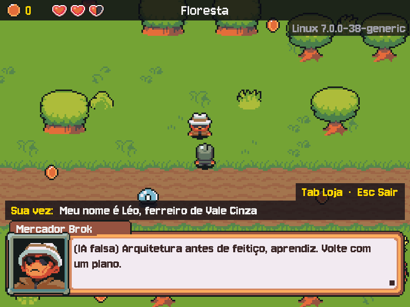

# MÓDULO 06A: Conversa de verdade — você digita, e o NPC lembra

Engenheiro, até aqui a conversa com um NPC era um monólogo: você apertava ESPAÇO, ele dizia uma frase e esquecia tudo. Hoje você digita o que quer dizer, e o NPC responde a isso e lembra o que já foi dito na mesma conversa. O conceito do dia é o que faz qualquer chatbot parecer ter memória: **conversa multi-turno com instrução de sistema**.

## 🎯 O que você vai ver na tela ao final

Na conversa com o Brok, quando a fala dele termina (■), aparece a faixa **"Sua vez:"** logo acima da caixa de diálogo. Você digita, com acento, e o ENTER manda a frase. Ele responde a ela, e duas frases depois ainda sabe o que você contou. Com o F3, os tokens que o jogo já gastou com a IA aparecem no alto da tela.



## 🏢 Onde isso aparece no mercado

Todo assistente de atendimento, copiloto de código e chatbot com IA resolve o mesmo problema: o modelo não guarda nada entre duas chamadas, então o contexto da conversa precisa voltar a cada turno, guardado pelo provedor ou pelo próprio produto. E cada turno é uma chamada paga, em tokens: a conta decide o tamanho da persona, quanto da conversa se guarda e quando ela termina.

## 🚦 Ponto de partida

- Seu projeto deve estar como no fim do M05C, com o desafio concluído e o PR mergeado.
- **Arquivos do curso:** traga a pasta deste módulo do seu clone do curso: `git -C ~/kernel-quest-curso pull` e `cp -r ~/kernel-quest-curso/arquivos/M06A ~/curso-arquivos/`.
- **Arquivos prontos deste módulo:** pasta `M06A/` dentro de `curso-arquivos/`, com `src/campo_texto.py` (o campo de texto, pronto) e `tests/conftest.py` (o serviço de IA falso, atualizado para conversas).
- Entrega por Pull Request `modulo-06a`. Crie a branch a partir da `main` atualizada, na pasta do projeto e com a venv ativa:

```bash
cd ~/rpg-engine
source .venv/bin/activate
git switch main
git pull
git switch -c modulo-06a
```

- Três sessões: **Sessão A**, Passos 1 a 4a (o campo de texto, a frase enviada e o serviço de IA preparado para conversas); **Sessão B**, Passos 4b a 6 e o Quebre de propósito (a memória de verdade, os tokens e o limite de turnos); **Sessão C**, o desafio (as despedidas e o teste da troca de turnos).
- **Cota:** cada fala com a IA de verdade gasta a sua cota do Gemini. Para testar a tela e as teclas, use a IA falsa (`IA_FALSA=1 ./run.sh`); deixe a IA real para quando o passo pedir (umas 15 falas no módulo inteiro bastam).

> **Andaime:** parte do código vem com `# TODO` nos pontos-chave. O texto explica o que fazer; o código é seu. Rode o jogo (ou os testes) depois de cada `TODO`.

## ❓ Pergunta do dia

O Gemini não guarda nada entre uma chamada e outra: cada pedido chega sozinho. Então como o Brok vai lembrar, na segunda frase, o que você disse na primeira?

Ao longo dos passos aparecem caixas **🔍 Pare e pesquise**: pesquise as duas perguntas na hora, anote as respostas e, no fim, explique ao Engenheiro Sênior em até 5 minutos. **Sem mentor?** Grave um áudio de até 5 minutos explicando os termos e ouça de volta: onde você hesitar, o termo ainda não está claro.

## 🛠️ Passo a passo

### Passo 1 (Leia): a faixa "Sua vez"

Traga os arquivos do módulo para o projeto (o `/.` copia o conteúdo da pasta: o `campo_texto.py` entra em `src/`, e o `conftest.py` novo substitui o de `tests/`):

```bash
cp -r ~/curso-arquivos/M06A/. .
python -m pytest -q
```

Todos os testes continuam verdes: o serviço falso do `conftest.py` só ganhou o que os próximos passos vão usar.

O `src/campo_texto.py` traz pronta a classe `CampoTexto`: ela guarda o que o jogador digita e desenha a faixa "Sua vez:", com o cursor piscando. Primeiro, ponha a faixa na tela. No `src/controllers.py`, logo antes da linha `from src.config import (`:

```python
from src.campo_texto import CampoTexto
```

No `__init__` do `Controle`, logo depois da linha do `self.depuracao`:

```python
        self.campo = CampoTexto()  # o que o jogador digita na conversa
        self.turnos = 0  # frases que o jogador já mandou nesta conversa
```

E logo antes do `def tratar_evento`, o método que diz quando é a vez do jogador:

```python
    def campo_ativo(self):
        """Sua vez de falar: a fala do NPC terminou (■) e ainda há turnos na conversa."""
        return (self.jogo.estado == Estado.DIALOGO and not self.pedindo
                and self.dialogo.terminou())

```

Agora a faixa na tela. No `src/views.py`, troque o método `desenhar_acoes` inteiro por este, que recebe a altura onde a barra de ações se apoia (`base`):

```python
    def desenhar_acoes(self, npc, base):
        """A barra de ações da conversa, logo acima de `base`: "Tab Loja · Esc Sair"."""
        texto = "  ·  ".join([f"Tab {acao}" for acao in npc.acoes] + ["Esc Sair"])
        imagem = self.fonte_fala.render(texto, False, COR_DESTAQUE)
        fundo = pygame.Surface((imagem.get_width() + 24, imagem.get_height() + 4), pygame.SRCALPHA)
        fundo.fill(COR_PAINEL)
        topo = base - fundo.get_height()
        x = LARGURA - (LARGURA - self.caixa.get_width()) // 2 - fundo.get_width()  # à direita
        self.superficie.blit(fundo, (x, topo))
        self.superficie.blit(imagem, (x + 12, topo + 2))
```

E no `desenhar`, troque a linha `self.desenhar_acoes(controle.dialogo.npc)` (a do `elif controle.dialogo.terminou() and not controle.pedindo:`) por estas, com o mesmo recuo: o campo entra entre a caixa e a barra, e a barra sobe para cima dele:

```python
                base = ALTURA - self.caixa.get_height() - 20  # o topo da caixa de diálogo
                if controle.campo_ativo():  # sua vez: o campo entra entre a caixa e as ações
                    x = (LARGURA - self.caixa.get_width()) // 2
                    base = controle.campo.desenhar(tela, self.fonte_fala, x, base,
                                                   self.caixa.get_width(), tempo)
                self.desenhar_acoes(controle.dialogo.npc, base)
```

Rode `IA_FALSA=1 ./run.sh`, saia do salão pela porta leste e suba até o Brok, acima da estrada. Fale com ele (ESPAÇO). Quando a fala termina (■), aparece a faixa "Sua vez:", com a dica apagada e o cursor piscando, e a barra "Tab Loja · Esc Sair" sobe para cima dela. Digitar ainda não faz nada, e o ESPAÇO ainda encerra a conversa: o Controller não sabe do campo. É o Passo 2.

Antes, leia o `src/campo_texto.py` e responda:

1. O `digitar` recebe `letras`, e não uma tecla. De onde vêm essas letras, e por que o campo corta tudo em `self.limite`?
2. O `limpar` devolve o texto **e** esvazia o campo. Por que fazer as duas coisas numa função só, em vez de ler `campo.texto` e depois apagar?
3. O `desenhar` devolve o `topo` da faixa. Quem usa esse número, no trecho que você acabou de colar no `views.py`?

### Passo 2 (Preveja): digitar na conversa

No `src/controllers.py`, logo depois do `campo_ativo`, dois métodos: o que o ENTER faz com a frase e como a conversa termina. O `enviar` chega com um `TODO`, que é o Passo 3:

```python
    def enviar(self):
        """ENTER no campo: a frase do jogador vira o próximo turno da conversa."""
        frase = self.campo.limpar()
        npc = self.dialogo.npc
        # TODO (Passo 3): o que o ENTER faz com o campo vazio, e o que faz com uma frase?

    def encerrar_conversa(self):
        """Fim da conversa: volta a explorar, e o NPC esquece o que foi dito nela."""
        self.campo.limpar()
        self.turnos = 0
        self.jogo.mudar_estado(Estado.EXPLORANDO)

```

Agora as teclas. Até hoje, o `tratar_evento` jogava fora tudo o que não fosse `KEYDOWN`. Para digitar, o jogo precisa de outro evento: o `TEXTINPUT`, que o sistema manda com o texto já pronto (com acento, maiúscula e cedilha), em vez de uma tecla. No `tratar_evento`, logo antes da linha `if evento.type != pygame.KEYDOWN:`:

```python
        # TEXTINPUT traz o texto já pronto (com acento e maiúscula); KEYDOWN só diz a tecla.
        if evento.type == pygame.TEXTINPUT and self.campo_ativo():
            self.campo.digitar(evento.text)
            return
```

No mesmo método, troque o bloco inteiro do diálogo, do `elif jogo.estado == Estado.DIALOGO and not self.pedindo:` até a linha `jogo.mudar_estado(Estado.LOJA)` (a última do Tab), por este. Repare na ordem: ESC, ↑ e Tab valem sempre; com o campo ativo, o ESPAÇO deixa de avançar a fala e vira letra:

```python
        elif jogo.estado == Estado.DIALOGO and not self.pedindo:
            if tecla == pygame.K_ESCAPE:
                self.encerrar_conversa()
            elif tecla == pygame.K_UP:
                self.dialogo.voltar()
            elif (tecla == pygame.K_TAB and "Loja" in self.dialogo.npc.acoes
                  and self.dialogo.terminou()):
                self.tela.tocar("ok")
                self.escolha = 0  # a vitrine abre no primeiro item
                self.aviso = None
                jogo.mudar_estado(Estado.LOJA)
            elif self.campo_ativo():  # sua vez: as letras (e o ESPAÇO) chegam pelo TEXTINPUT
                if tecla == pygame.K_BACKSPACE:
                    self.campo.apagar()
                elif tecla == pygame.K_RETURN:
                    self.enviar()
            elif tecla in (pygame.K_DOWN, pygame.K_RETURN, pygame.K_SPACE):
                if not self.dialogo.avancar():  # passou da última página: a conversa acabou
                    self.encerrar_conversa()
```

**Preveja antes de rodar:** com o campo na tela, o que o ESPAÇO faz agora? E o ENTER, com o `TODO` do `enviar` ainda sem código?

Rode `IA_FALSA=1 ./run.sh` e fale com o Brok de novo. No fim da fala, digite uma frase com acento e espaço (`Meu nome é Léo, sou ferreiro`): o texto aparece, o ESPAÇO vira espaço e o BACKSPACE apaga. O ENTER não faz nada: é o `TODO`. ESC sai da conversa.

> 🔍 **Pare e pesquise: entrada de texto (evento `TEXTINPUT`)** — Por que um jogo que lê só `KEYDOWN` não consegue montar "é" ou "ç" num teclado brasileiro? O que mais o sistema operacional resolve antes de entregar um `TEXTINPUT` (maiúsculas com Shift, teclas mortas, teclados de outros idiomas)?

### Passo 3 (Complete): a regra do ENTER

Complete o `TODO` do `enviar` no `src/controllers.py`, no lugar do comentário, com um `if not frase:` e um `else:`, nessa ordem (o Passo 6 vai acrescentar um caso entre os dois):

- **o `if`, campo vazio:** a frase é `""`, que conta como falso; a conversa acaba, como antes de o campo existir (o método que encerra já está ali embaixo);
- **o `else`, com uma frase:** um turno a mais em `self.turnos` e o pedido ao NPC, com o mesmo `conversar` que o ESPAÇO e a loja já usam (ele abre "Pensando..." e o Controller chama a IA no quadro seguinte).

Rode `./run.sh` (agora com a IA real, umas 3 falas). Fale com o Brok, conte quem você é e, depois que ele responder, pergunte "o que eu acabei de dizer?". Ele responde à sua frase, mas não faz ideia do que você contou antes: cada pedido ao Gemini chega sozinho. É a pergunta do dia, ao vivo.

Commit:

```bash
git add .
git commit -m "feat: campo de texto na conversa com os NPCs"
```

### Passo 4a (Leia): o serviço de IA guarda as conversas

Para o Brok lembrar, o jogo precisa dizer ao Gemini "isto continua aquela conversa". A Interactions API faz isso com o **id** de cada interação: o servidor guarda a conversa, e o pedido seguinte manda o `previous_interaction_id`, o id da última resposta. Quem guarda esse id, um por NPC, é o `ServicoIA`.

No `src/ia.py`, na docstring da classe `ServicoIA`, troque `A interface é uma só: responder(instrucao, fala) -> texto.` por `A interface: responder(instrucao, fala, conversa) -> texto.`. No `__init__`, logo depois da linha do `self.cliente`:

```python
        self.conversas = {}  # nome do NPC -> id da última interação da conversa com ele
        self.tokens_gastos = 0  # soma do uso de todas as respostas (o F3 mostra)
```

Troque o começo do `responder`, do `def responder(self, instrucao, fala):` até a linha do `return "(IA falsa) Arquitetura antes de feitiço...`, por este trecho. Ele acrescenta o `esquecer` e o parâmetro `conversa` (o nome do NPC), e a IA falsa passa a fingir memória, para dar para testar sem rede:

```python
    def esquecer(self, conversa):
        """Fim da conversa: o próximo turno com esse NPC começa do zero."""
        self.conversas.pop(conversa, None)

    def responder(self, instrucao, fala, conversa=None):
        """Pede ao Gemini a resposta do personagem descrito em `instrucao` para a `fala`.

        Com `conversa` (o nome do NPC), cada turno continua o anterior: o servidor
        guarda a conversa, e o NPC lembra o que já foi dito nela.
        """
        if os.getenv("IA_FALSA") == "longa":
            return FALA_LONGA
        if os.getenv("IA_FALSA") == "1":
            if conversa in self.conversas:  # do segundo turno em diante: devolve o que ouviu
                return f"(IA falsa) Você disse: \"{fala}\". Sem rede, eu só repito."
            if conversa:
                self.conversas[conversa] = "falsa"  # um id de mentira: o próximo turno "lembra"
            return "(IA falsa) Arquitetura antes de feitiço, aprendiz. Volte com um plano."
```

No `src/controllers.py`, no `atualizar`, troque a linha da chamada à IA, `fala = self.servico_ia.responder(self.pedindo.instrucao, self.fala_jogador)`, por estas: o nome do NPC passa a identificar a conversa:

```python
                fala = self.servico_ia.responder(self.pedindo.instrucao, self.fala_jogador,
                                                 conversa=self.pedindo.nome)
```

Rode `IA_FALSA=1 ./run.sh` e fale com o Brok: a primeira fala é a de sempre; a partir da sua primeira frase, a IA falsa repete o que você disse. Agora saia (ESC) e fale com ele de novo. Repare: ele já começa repetindo, como se a conversa antiga continuasse. Ninguém chama o `esquecer` ainda; isso fica para o Passo 4b.

> ⏸️ **Fim da Sessão A.** Commit feito, o campo funciona e o serviço sabe de quem é cada conversa. Pare aqui e continue na próxima sessão, no Passo 4b.

### Passo 4b (Complete): a memória de verdade

Na chamada ao Gemini, dois detalhes da Interactions API:

- **Encadear exige guardar:** o `previous_interaction_id` só funciona se o servidor guardou a interação anterior, o que o parâmetro `store` controla. Até hoje o jogo mandava `store=False` (nada guardado). Com uma conversa, passa a ser `store=True`. No plano gratuito, o Google guarda essas interações por 1 dia, e as regras do plano gratuito do M00B continuam valendo: nada de dados pessoais na conversa (use um apelido, não o seu nome completo).
- **A persona não é herdada:** a `system_instruction` vale só para o pedido em que vai. Por isso ela continua em todos os turnos (o Quebre de propósito mostra o que acontece sem ela).

No `src/ia.py`, troque a chamada inteira, do `interacao = self.obter_cliente().interactions.create(` até o parêntese que a fecha, por esta. Os dois `TODO` são seus. Pistas: o id de cada conversa está em `self.conversas`, que não tem nada numa conversa que começou agora (o `get` de um dicionário devolve `None` quando a chave não existe, e `None` é o que a API espera para "conversa nova"); e a fala da loja, sem conversa, não precisa ser guardada.

```python
            interacao = self.obter_cliente().interactions.create(
                model=self.modelo,
                system_instruction=instrucao,  # não é herdada do turno anterior: vai em todos
                input=fala,
                # TODO (Passo 4b): previous_interaction_id: com qual interação esta conversa continua?
                # TODO (Passo 4b): store: o servidor precisa guardar esta interação?
            )
```

E troque a última linha do `responder`, `return interacao.output_text`, por estas. Pistas: cada resposta tem um `interacao.id`; o `interacao.usage` tem vários totais, e o que soma tudo desta chamada é o `total_tokens`:

```python
        # TODO (Passo 4b): guarde o que o próximo turno desta conversa precisa para continuar
        # daqui, e some em self.tokens_gastos o custo desta resposta (o interacao.usage).
        return interacao.output_text
```

Por fim, no `src/controllers.py`, o `encerrar_conversa` passa a esquecer. Logo depois da docstring dele:

```python
        self.servico_ia.esquecer(self.dialogo.npc.nome)
```

Rode `./run.sh` (IA real, umas 3 falas). Fale com o Brok, diga um apelido e um ofício e, na frase seguinte, pergunte quem você é. Agora ele lembra. Saia e fale de novo: conversa nova, ele não sabe mais.

> 🔍 **Pare e pesquise: conversa multi-turno com instrução de sistema** — Se o modelo não guarda nada entre chamadas, o que o servidor faz com as frases anteriores quando recebe um `previous_interaction_id`? Por que a instrução de sistema (a persona) precisa ir em todo turno, em vez de ficar guardada na conversa como as frases?

### Passo 5 (Preveja): quanto custa cada turno

Cada resposta do Gemini traz o `usage`: quantos **tokens** (pedaços de palavra) o pedido e a resposta usaram. É por token que a cota acaba e que um produto de IA paga a conta. O `ServicoIA` já soma esse número; falta mostrar.

No `src/depuracao.py`, troque as duas primeiras linhas do `desenhar_depuracao` (o `def` e a docstring) por:

```python
def desenhar_depuracao(tela, fonte, jogo, camera_x, camera_y, tokens):
    """Os retângulos da cena atual, na mesma câmera do mundo, a legenda e os tokens gastos."""
```

E no fim da mesma função, depois do `for` da legenda (fora dele, com o recuo da função):

```python

    # Tokens: no alto, logo abaixo da faixa, para continuarem visíveis durante a conversa.
    texto = fonte.render(f"Tokens gastos: {tokens}", False, COR_TEXTO)
    fundo = pygame.Surface((texto.get_width() + 20, texto.get_height() + 4), pygame.SRCALPHA)
    fundo.fill(COR_PAINEL)
    tela.blit(fundo, (10, 46))
    tela.blit(texto, (20, 48))
```

No `src/views.py`, troque a linha `desenhar_depuracao(tela, self.fonte_fala, jogo, camera_x, camera_y)` por:

```python
            desenhar_depuracao(tela, self.fonte_fala, jogo, camera_x, camera_y,
                               controle.servico_ia.tokens_gastos)
```

**Preveja antes de rodar:** a sua frase tem umas 10 palavras. Cada turno vai custar perto de 10 tokens, perto de 50 ou perto de 200? O que mais vai junto com a sua frase em todo pedido?

Rode `./run.sh`, aperte F3 e converse com o Brok por três turnos, anotando quanto o total sobe a cada resposta (umas 3 falas reais). No teste do curso, cada turno custou perto de 190 tokens, com frases curtas: a persona do Brok, que vai em todo pedido, pesa uns 120 sozinha; a frase e a resposta somam o resto. Com a IA falsa, o total fica em 0: ela não gasta token nenhum.

> 🔍 **Pare e pesquise: tokens e custo** — O que é um token, e mais ou menos quantos caracteres de português cabem num? Por que encurtar a instrução de sistema de um NPC economiza mais do que pedir ao jogador frases curtas?

### Passo 6 (Modifique): o limite de turnos

Uma conversa sem fim gasta a cota sem fim. O jogo vai encerrar a conversa depois de um número de frases, com uma despedida fixa, que não chama a IA.

No `src/models.py`, logo antes do `INSTRUCAO_BROK = (`:

```python
# Quando os turnos acabam, o NPC encerra com uma fala fixa: não chama a IA nem gasta cota.
DESPEDIDA = "Por hoje basta. Volte quando tiver algo novo a dizer."
```

E na classe `NPC`, logo depois da linha do `quadro`:

```python
    despedida: str = DESPEDIDA  # a última fala, sem IA, quando os turnos da conversa acabam
```

Rode `python -m pytest -q`: tudo verde, nada usa a despedida ainda.

No `src/config.py`, logo depois da linha do `INTERVALO_MINIMO`:

```python
LIMITE_TURNOS = 5  # frases do jogador por conversa: cada turno é uma chamada paga
```

No `src/controllers.py`, importe `LIMITE_TURNOS` do `config`: acrescente o nome ao `from src.config import (...)`, em ordem alfabética, logo antes do `MOEDAS_BAU` (se uma linha passar de 100 caracteres, quebre-a como as outras).

No `campo_ativo`, a segunda linha do `return` ganha o limite (cuidado: a linha do Tab, mais abaixo, termina parecido). Troque o `return` inteiro por:

```python
        return (self.jogo.estado == Estado.DIALOGO and not self.pedindo
                and self.dialogo.terminou() and self.turnos <= LIMITE_TURNOS)
```

E no `enviar`, logo antes do `else:` que você escreveu no Passo 3:

```python
        elif self.turnos == LIMITE_TURNOS:
            self.turnos += 1  # passou do limite: o campo some e o próximo ENTER encerra
            self.dialogo = self.tela.novo_dialogo(npc, npc.despedida)  # sem IA: não gasta cota
```

**Modifique:** troque o `LIMITE_TURNOS = 5` por `LIMITE_TURNOS = 2` e rode `IA_FALSA=1 ./run.sh`. Fale com o Brok e mande frases: depois de 2, a terceira recebe "Por hoje basta..." sem "Pensando...", o campo some, e o ENTER seguinte encerra. Volte para 5.

Commit e push:

```bash
git add .
git commit -m "feat: conversa encadeada com memória, tokens no F3 e limite de turnos"
git push -u origin modulo-06a
```

## 💥 Quebre de propósito

No `src/ia.py`, faça a persona ir só no primeiro turno: troque `system_instruction=instrucao,` por `system_instruction=None if self.conversas.get(conversa) else instrucao,` (o comentário pode ficar).

**Preveja:** no segundo turno, o Brok ainda sabe quem ele é? Ainda segue as regras dele (não dar desconto, responder em poucas frases, sem Markdown)?

Rode `./run.sh` (2 falas reais), cumprimente o Brok e, depois da primeira resposta, peça um segredo e um desconto. A memória da conversa continua (as frases foram guardadas), mas a persona não: sem a instrução, o modelo tende a responder com o tom e o formato de um assistente qualquer. Em dois testes do curso, o Brok respondeu com vários parágrafos e ações entre asteriscos (Markdown, que a persona proíbe) e inventou uma mercadoria que não está à venda; num deles, ainda **deu desconto**, o que o Brok de verdade nunca faz. O resultado muda a cada vez, porque o modelo não é determinístico; o que se repete é a persona se desfazendo. É exatamente o que a documentação diz: a instrução de sistema não é herdada de um turno para o outro. Desfaça a troca.

## 🧯 Problemas comuns

| Sintoma | Causa provável | Como resolver |
| --- | --- | --- |
| As letras não aparecem no campo | O `if` do `TEXTINPUT` ficou depois do `if evento.type != pygame.KEYDOWN:`, que devolve antes; ou a fala ainda está sendo escrita | O `if` do `TEXTINPUT` vem antes do filtro do `KEYDOWN` (Passo 2); espere o ■ |
| O ESPAÇO fecha a conversa na última página | O bloco do diálogo ainda é o antigo, ou o `elif self.campo_ativo():` ficou depois do `elif tecla in (pygame.K_DOWN, ...)` | Troque o bloco inteiro pelo do Passo 2, na mesma ordem |
| `AttributeError: 'Controle' object has no attribute 'campo_ativo'` ao falar | O `views.py` foi alterado antes dos métodos novos do `controllers.py` | Os três métodos do Passo 2, logo antes do `def tratar_evento` |
| `TypeError: ServicoIAFalso.responder() got an unexpected keyword argument 'conversa'` nos testes | O `tests/conftest.py` ainda é o do M04A | Copie de novo o de `curso-arquivos/M06A/tests/` |
| `AttributeError: 'ServicoIA' object has no attribute 'esquecer'` | O trecho do `esquecer` (Passo 4a) não entrou | Confira o começo do `responder` no Passo 4a |
| O Brok não lembra (IA real) | O id não está sendo guardado (`self.conversas[conversa] = ...`), ou o pedido vai com `store=False` | Imprima `self.conversas` no fim do `responder` e confira os dois `TODO` do Passo 4b |
| O F3 mostra "Tokens gastos: 0" com a IA real | Falta somar o `interacao.usage.total_tokens`, ou o jogo está com `IA_FALSA=1` | O segundo `TODO` do Passo 4b; rode sem `IA_FALSA` |
| `TypeError: desenhar_depuracao() missing 1 required positional argument: 'tokens'` | A chamada no `views.py` não passa os tokens | A linha nova do `views.py` no Passo 5 |
| O NPC responde com a caixa vazia, sem erro | Às vezes o modelo devolve uma resposta vazia (aconteceu nos testes do curso) | Mande a frase de novo; se repetir, saia e comece outra conversa |
| Erro 429 (cota) depois de algumas conversas | Cada turno é uma chamada; o plano gratuito tem limite por minuto e por dia | Teste a tela com `IA_FALSA=1 ./run.sh`; deixe o `LIMITE_TURNOS` baixo e o modelo Flash-Lite do `.env` |

## 🧩 Desafio de Engenharia

A conversa funciona; agora ela precisa de personalidade no fim e de uma prova automática no meio.

1. **Despedidas com cara de NPC.** Hoje todo NPC se despede com a mesma frase. Faça o `criar_npc` aceitar uma `despedida` (com a `DESPEDIDA` como padrão) e dê uma própria ao Brok e a pelo menos mais um NPC, no tom do jogo (adulto, seco, sem onomatopeias). É dado, não código novo de regra.
2. **O teste da troca de turnos.** Em `tests/test_turnos.py`, com o serviço falso (`ia_falsa`, do `conftest.py`) e um `Controle` como no `tests/test_conversa.py`: fale com o mago de teste, deixe a resposta aparecer inteira, mande uma frase como o jogador manda (um evento `pygame.TEXTINPUT` com `text=...` e um `KEYDOWN` de `K_RETURN`) e confira que ela chegou ao serviço como **segundo** pedido da **mesma** conversa. Depois encerre (ESC) e confira que o serviço esqueceu a conversa. Dicas: leia o `ServicoIAFalso` no `tests/conftest.py` (o `conversas` dele guarda, para cada NPC, o número do último pedido da conversa); "deixar a resposta aparecer inteira" é o que o `test_conversa.py` faz com `avancar()` e `atualizar(0.016)`, mais um laço de `avancar()` até `terminou()`; e uma tecla se manda com `controle.tratar_evento(pygame.event.Event(pygame.KEYDOWN, key=pygame.K_ESCAPE))`.
3. **O Brok lembra.** Com a IA real, diga ao Brok um apelido e um ofício e, duas frases depois, pergunte quem você é. Copie a troca do log do terminal para a descrição do PR.

**Critérios de aceite:**

- [ ] `python -m pytest -q` passa, com o seu `tests/test_turnos.py` (pelo menos um teste: a frase digitada vira o segundo pedido da mesma conversa, e encerrar esquece a conversa).
- [ ] O Brok e pelo menos mais um NPC se despedem com uma fala própria quando os turnos acabam; os demais usam a `DESPEDIDA`.
- [ ] O Brok lembra, na mesma conversa, o que você disse num turno anterior (a troca está na descrição do PR) e esquece quando a conversa termina.
- [ ] O F3 mostra "Tokens gastos", que cresce a cada resposta da IA real.
- [ ] **Nomes que os próximos módulos usam:** `CampoTexto` em `src/campo_texto.py`; no `ServicoIA`, `responder(instrucao, fala, conversa=None)`, `conversas`, `tokens_gastos` e `esquecer(conversa)`; no `Controle`, `campo_ativo()`, `enviar()` e `encerrar_conversa()`; `LIMITE_TURNOS` no `src/config.py`; `despedida` no `NPC` e `DESPEDIDA` no `src/models.py`.
- [ ] Você explica ao Engenheiro Sênior, sem ler e em até 5 minutos, os três termos das caixas 🔍 (entrada de texto, conversa multi-turno com instrução de sistema, tokens e custo). **Sem mentor?** Grave a explicação em áudio e ouça de volta.

Lembre as regras de uso de IA do M00B: pode pedir explicação de conceito e de erro, não pode pedir a solução pronta, e deve dizer na descrição do PR cada trecho que veio de uma IA, sabendo explicá-lo.

**Entrega:** Pull Request `modulo-06a` para a `main` (`gh pr create --body-file`), com a descrição (o que muda, como testar, a troca em que o Brok lembra, o que veio de IA). Merge só com o CI verde e a aprovação. **Sem mentor?** Review de um colega do curso ou autorrevisão no dia seguinte, como no M03C.

## 💼 Resumo profissional

- **Conceito:** conversa multi-turno com estado no servidor (`previous_interaction_id`, `store=True`, retenção da conversa), instrução de sistema repetida a cada turno, custo em tokens (`usage`) e limite de turnos para controlar a cota, entrada de texto por evento (`TEXTINPUT`) separada das teclas de comando.
- **Linha para o currículo:** "Implementei diálogo multi-turno com a Interactions API do Gemini num jogo em Python, com memória por personagem, contagem de tokens e limite de turnos para controlar custo, coberto por testes automatizados com um serviço de IA falso."
