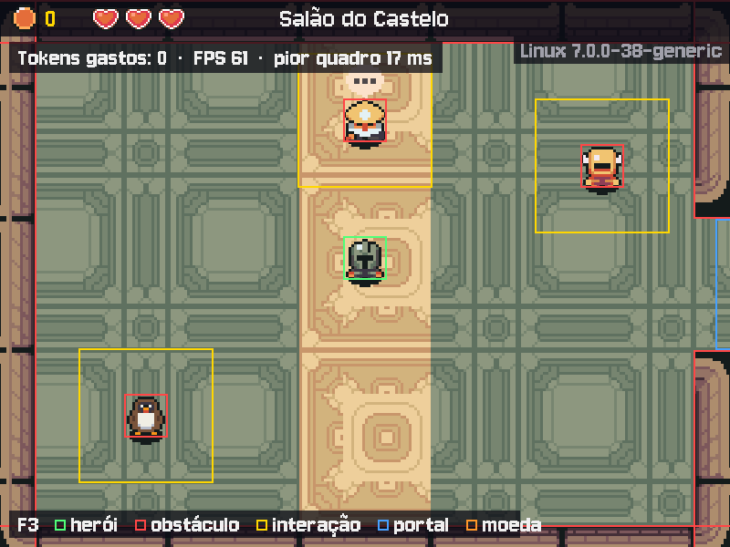

# MÓDULO 07A: Sem congelar — a IA pensa, e o herói anda

Engenheiro, desde o M01 o jogo inteiro para enquanto a IA pensa: o herói não se mexe, a música segue sozinha e, se a rede demora, a janela chega a "não responder". Hoje a espera sai do game loop e vai para uma thread de trabalho, e o jogo segue a 60 quadros por segundo. O conceito do dia é o que mantém responsivo todo programa que fala com a rede: **thread com fila**.

## 🎯 O que você vai ver na tela ao final

Você fala com o Mago e continua andando: um balão de reticências balança acima da cabeça dele enquanto ele pensa, e a caixa de diálogo abre quando a resposta chega. Com o F3, o canto de cima mostra o FPS e o pior quadro dos últimos 2 segundos: antes, a conversa derrubava os números; agora, eles nem se mexem.



## 🏢 Onde isso aparece no mercado

Todo aplicativo com interface (jogo, app de celular, navegador) tem uma thread principal que desenha a tela e não pode esperar. Chamadas de rede, banco de dados e arquivos grandes vão para threads de trabalho, e o resultado volta por uma fila ou por um laço de eventos. Servidores web usam a mesma ideia para atender muitos pedidos enquanto cada um espera o banco.

## 🚦 Ponto de partida

- Seu projeto deve estar como no fim do M06B, com o desafio concluído e o PR mergeado.
- **Arquivos do curso:** traga a pasta deste módulo do seu clone do curso: `git -C ~/kernel-quest-curso pull` e `cp -r ~/kernel-quest-curso/arquivos/M07A ~/curso-arquivos/`.
- **Arquivos prontos deste módulo:** pasta `M07A/` dentro de `curso-arquivos/`, com:
  - `src/fila_ia.py`, a IA em segundo plano, com dois `TODO` e uma função para escrever do zero;
  - `src/medidor.py` (o FPS e o pior quadro) e `src/paineis.py` (o balão de "pensando"), prontos;
  - `src/ia.py` (a IA falsa passa a demorar, como a rede) e `main.py` (a medição de cada quadro), prontos, com um `TODO` no `main.py`;
  - `tests/conftest.py` (o serviço falso com `pedir` e `coletar`) e `tests/test_fila.py`.
- Entrega por Pull Request `modulo-07a`. Crie a branch a partir da `main` atualizada, na pasta do projeto e com a venv ativa:

```bash
cd ~/rpg-engine
source .venv/bin/activate
git switch main
git pull
git switch -c modulo-07a
```

- Duas sessões:
  - **Sessão A**, Passos 1 a 4: medir o congelamento, a thread, a fila e o jogo ligado nela. É a sessão mais densa do curso até aqui: se passar de 90 minutos, faça um commit e pare depois do Passo 3.
  - **Sessão B**, Passos 5 a 7, o Quebre de propósito e o desafio: a revisão do código que uma IA sugere, um pedido por NPC, medir de novo e cancelar a espera com ESC.
- **Cota:** a IA falsa (`IA_FALSA=1 ./run.sh`) agora demora 1,5 segundo para responder, de propósito: dá para ver o congelamento e a cura sem gastar a sua cota. Umas 4 falas reais bastam no módulo inteiro.

> **Andaime:** o encanamento chega pronto (as filas, a thread, a medição e o balão); você completa dois `TODO`, escreve o `coletar()` do zero e os testes prontos dizem quando ele está certo.

## ❓ Pergunta do dia

Desde o M01 o jogo congela enquanto a IA pensa. Como o herói pode continuar andando enquanto alguém espera a resposta?

Ao longo dos passos aparecem caixas **🔍 Pare e pesquise**: pesquise as duas perguntas na hora, anote as respostas e, no fim, explique ao Engenheiro Sênior em até 5 minutos. **Sem mentor?** Grave um áudio de até 5 minutos explicando os termos e ouça de volta: onde você hesitar, o termo ainda não está claro.

## 🛠️ Passo a passo

### Passo 1 (Preveja): medir o congelamento

Traga os arquivos do módulo (o `/.` copia o conteúdo da pasta; o `main.py`, o `ia.py`, o `paineis.py` e o `conftest.py` novos substituem os seus, e o `medidor.py` é novo):

```bash
cp -r ~/curso-arquivos/M07A/. .
git diff main.py src/ia.py
```

O `git diff` mostra o que mudou. No `main.py`, o `relogio.tick(FPS)` agora guarda os milissegundos de cada quadro no `MEDIDOR` (do `src/medidor.py`), **antes** do teto do `dt`: um congelamento aparece inteiro na medida. No `ia.py`, a IA falsa ganha um `time.sleep`, que finge a espera da rede.

Falta o tempo dessa espera. No `src/config.py`, logo depois da linha do `INTERVALO_MINIMO`:

```python
ATRASO_IA_FALSA = 1.5  # segundos que a IA falsa finge pensar, como uma resposta de rede
```

E o F3 passa a mostrar a medida. No `src/depuracao.py` (o seu, com o desafio do M04A), acrescente `COR_DESTAQUE` ao `from src.config import` e, logo abaixo dessa linha:

```python
from src.medidor import MEDIDOR
```

No fim do `desenhar_depuracao`, troque as duas linhas do comentário `# Tokens: ...` e do `texto = fonte.render(f"Tokens gastos: {tokens}", ...)` por estas:

```python
    # Tokens e ritmo: no alto, logo abaixo da faixa, para continuarem visíveis na conversa.
    # Abaixo de 55 FPS (ou com um quadro acima de 50 ms), o texto fica dourado: o jogo engasgou.
    engasgou = MEDIDOR.fps() < 55 or MEDIDOR.pior_quadro() > 50
    texto = fonte.render(f"Tokens gastos: {tokens}  ·  FPS {MEDIDOR.fps()}  ·  "
                         f"pior quadro {MEDIDOR.pior_quadro()} ms", False,
                         COR_DESTAQUE if engasgou else COR_TEXTO)
```

**Preveja antes de rodar:** o jogo roda a 60 quadros por segundo. Durante a conversa, quanto você acha que cai o FPS? E qual é o quadro mais longo, em milissegundos?

Rode `IA_FALSA=1 ./run.sh`, aperte F3 e repare no alto da tela: "FPS 60 · pior quadro 17 ms", mais ou menos. Fale com o Mago e olhe a tela logo depois do ESPAÇO: o "Pensando..." para no meio, o contador do F3 congela e nenhuma tecla responde (só a música segue, porque o som toca por conta própria). Quando a fala aparece, o texto do F3 fica dourado. Nos testes do curso: **35 FPS e pior quadro de 1502 ms**, o tempo inteiro da "rede" num quadro só. Anote os seus números para o Passo 7.

### Passo 2 (Complete): a thread de trabalho

> 🤝 **Com o Sênior.** Leiam juntos o `src/fila_ia.py`, de cima para baixo, com o desenho do topo do arquivo na tela, antes de você completar o `TODO`. Thread é o conceito mais difícil do curso até aqui: vale meia hora de conversa.
> **Sem mentor?** Leia o desenho do topo do arquivo em voz alta, seguindo uma fala do `pedir()` até o `coletar()`, e desenhe no papel as duas threads e as duas filas. Depois, leia a documentação de `queue.Queue` (docs.python.org, módulo `queue`): o primeiro parágrafo explica por que ela é segura entre threads. Travou? Os "Problemas comuns" cobrem os erros mais frequentes.

O `FilaIA` embrulha o `ServicoIA` que você já conhece. Por fora, o Controller vai usar só dois métodos rápidos: `pedir()`, que deixa o pedido na fila de `pedidos` e devolve na hora, e `coletar()`, que entrega o que já está na fila de `respostas`. Por dentro, o `__init__` liga uma **thread** que roda o `trabalhar()` o tempo todo, ao lado do game loop. O `pedidos.get()` dorme até chegar um pedido; é aí que a thread de trabalho espera, e não o jogo.

Responda antes de completar:

1. Quem chama o `pedir()`, e em que thread? E quem chama o `trabalhar()`?
2. O `trabalhar()` tem um `while True` sem `break`. Por que isso não trava o jogo, e por que não gasta processador à toa?
3. O `daemon=True` diz o que sobre essa thread quando a janela do jogo fecha?

Complete o `TODO` do `trabalhar()`, no lugar das linhas de comentário: peça a resposta ao `self.servico_ia` (o mesmo `responder(...)` que o Controller chamava, com a instrução do NPC, a fala e `conversa=npc.nome`), registre no log quanto ela demorou (`logger.info("%s (%.1f s): %s", ...)` com o nome do NPC, os segundos desde o `inicio` e a resposta) e ponha a tupla `(npc, resposta)` na fila `self.respostas`, com `put`.

Rode só o teste da thread:

```bash
python -m pytest -q tests/test_fila.py -k thread
```

Passa: a thread recebeu o pedido, chamou o serviço e deixou a resposta na fila.

> 🔍 **Pare e pesquise: thread com fila (`threading`, `queue.Queue`)** — O que é uma thread, e o que duas threads de um mesmo programa compartilham? Por que passar o resultado por uma fila, em vez de a thread de trabalho escrever direto nas variáveis do jogo?

### Passo 3 (Crie): o coletar(), do zero

Agora a outra ponta. O `coletar()` é chamado pelo jogo a cada quadro, 60 vezes por segundo, e não pode esperar nunca: ele devolve, numa lista, tudo o que já chegou desde a última chamada (lista vazia se nada chegou), e libera o NPC de cada resposta para um pedido novo (o nome sai de `self.aguardando`).

Escreva o corpo do `coletar()`, no lugar das linhas de `TODO` e do `return []` provisório. São de 8 a 12 linhas. Duas pistas da `queue.Queue`: o `get()` espera até chegar alguma coisa, e o `get_nowait()` não espera, mas levanta a exceção `queue.Empty` quando a fila está vazia. Os testes prontos são a especificação:

```bash
python -m pytest -q tests/test_fila.py -k coletar
```

Os 2 testes passam quando o seu `coletar()` não espera e entrega cada resposta uma vez só.

### Passo 4a (Leia): o Controller pede e coleta

O Controller deixa de esperar. No `src/controllers.py`, no `__init__` do `Controle`, troque as duas linhas do `self.pedindo` e do `self.fala_jogador` por esta (o pedido sai na hora, então a fala não precisa mais esperar guardada):

```python
        self.pedindo = None  # o NPC cuja resposta a caixa espera ("Pensando...")
```

Troque o método `conversar` inteiro por estes dois. O `conversar` passa a pedir na hora; o `aplicar` é o que o trecho bloqueante fazia com a resposta (caixa, balão, ação), mais duas decisões novas: o cumprimento abre a caixa quando chega, e a resposta que chega tarde demais vai para o log:

```python
    def conversar(self, npc, fala_jogador):
        """Abre a caixa com "Pensando..." e pede a fala; a resposta chega por coletar()."""
        self.dialogo = self.tela.novo_dialogo(npc, "Pensando...")
        self.pedindo = npc
        self.servico_ia.pedir(npc, fala_jogador)

    def aplicar(self, npc, resposta):
        """Uma resposta que saiu da fila vira jogo: a caixa, o balão e a ação.

        Roda na thread principal (é o atualizar() que chama), entre dois quadros:
        o Model nunca muda no meio de um desenho. Resposta que chega tarde demais
        (o herói mudou de mapa, pausou ou já conversa com outro) vai para o log.
        """
        self.ultima_chamada = time.perf_counter()
        if npc is self.pedindo:  # a caixa esperava por ela ("Pensando...")
            self.pedindo = None
        elif self.jogo.estado == Estado.EXPLORANDO and npc in self.jogo.cena.npcs:
            self.jogo.mudar_estado(Estado.DIALOGO)  # o cumprimento: a caixa abre só agora
        else:
            self.servico_ia.esquecer(npc.nome)  # ninguém viu a fala: a conversa não continua dela
            logger.info("Resposta de %s descartada: o jogo seguiu adiante", npc.nome)
            return
        self.dialogo = self.tela.novo_dialogo(npc, resposta.fala)
        self.aplicar_emocao(resposta.emocao)
        self.executar(npc, resposta.acao)
```

No `tratar_evento`, o ESPAÇO perto de um NPC só pede, sem abrir a caixa. Troque as duas linhas do `self.conversar(perto, ...)` e do `jogo.mudar_estado(Estado.DIALOGO)` (as do ESPAÇO) por:

```python
                # A caixa só abre quando a resposta chegar: até lá, o herói segue andando.
                self.servico_ia.pedir(perto, f"O aprendiz {NOME} se aproxima e cumprimenta você.")
```

No `atualizar`, logo depois da linha `return  # nas telas de menu, o mundo fica parado`, o jogo coleta a cada quadro:

```python
        for npc, resposta in self.servico_ia.coletar():  # o que chegou desde o último quadro
            self.aplicar(npc, resposta)
```

E apague, no fim do `atualizar`, o trecho bloqueante inteiro: do `if self.pedindo and dialogo.pagina_completa():` até a linha `self.pedindo = None` que o fecha. Ele virou o `aplicar`.

Rode `python -m pytest -q`: todos passam, menos o `test_mesmo_npc_nao_pede_duas_vezes` (Passo 6). Os testes do M04A ao M06B não mudaram: o serviço falso do `conftest.py` tem `pedir()` e `coletar()` sem thread, com a resposta pronta na hora.

Leia o `aplicar` e responda: em que thread ele roda? E por que o `if npc is self.pedindo` vem antes do cumprimento?

### Passo 4b (Leia): o herói anda

Falta ligar a `FilaIA` no jogo de verdade. No `main.py`, troque a linha do `TODO (Passo 4b)` por estas:

```python
    # A IA fica atrás da fila: o Controller pede e coleta, e só a thread espera a rede.
    controle = Controle(jogo, tela, FilaIA(ServicoIA(MODELO_IA, TIMEOUT_IA_MS)))  # Controller
```

No `src/views.py`, troque a linha `from src.paineis import desenhar_balao, desenhar_portao, desenhar_receber` por:

```python
from src.paineis import desenhar_balao, desenhar_pensando, desenhar_portao, desenhar_receber
```

No `desenhar`, logo depois do `for` que desenha os sprites em ordem de profundidade (o das duas linhas que terminam em `tela.blit(imagem, (x - camera_x, y - camera_y))`), com o recuo do `for`:

```python
        desenhar_pensando(self, cena, controle.servico_ia.aguardando, tempo, camera_x, camera_y)
```

E o convite "ESPAÇO para falar" não pode cobrir o balão. Troque a linha `if jogo.estado == Estado.EXPLORANDO and perto:` por estas:

```python
        pensando = controle.servico_ia.aguardando  # quem espera a IA mostra o balão, não o convite
        if jogo.estado == Estado.EXPLORANDO and perto and perto.nome not in pensando:
```

Rode `IA_FALSA=1 ./run.sh`, F3 ligado, e fale com o Mago: o balão de reticências balança acima dele, você anda à vontade, e 1,5 segundo depois a caixa abre com a fala. O F3 nem pisca. No terminal, a linha `src.fila_ia: Arquimago Solaris (1.5 s): ...` vem da thread de trabalho.

Commit:

```bash
git add .
git commit -m "feat: IA em segundo plano com thread e fila, FPS no F3"
```

> ⏸️ **Fim da Sessão A.** Commit feito, o jogo não congela mais. Pare aqui e continue na próxima sessão, no Passo 5.

### Passo 5 (Leia): revise o código que uma IA sugere

O `aplicar` do Passo 4a veio pronto. Agora você vai ver o que uma IA sugere para o mesmo problema e julgar a sugestão, como um revisor de Pull Request.

Abra o chat do Gemini (gemini.google.com ou o Google AI Studio, com a sua conta) e mande a mensagem abaixo. Depois do texto da mensagem, cole o seu `src/fila_ia.py` inteiro:

```text
Estou fazendo um jogo em Python com pygame. O game loop roda na thread principal.
A classe FilaIA abaixo chama uma IA numa thread de trabalho. Escreva o corpo do
método aplicar(self, npc, resposta) do Controller, que mostra a fala do NPC na
caixa de diálogo e aplica a emoção e a ação da resposta. Mostre também onde ele
é chamado.
```

Leia a sugestão e responda, por escrito, as três perguntas:

1. **Quem mexe no Model** (o `self.jogo`, o `self.dialogo`, o estado)?
2. **Em qual thread** esse código roda? Siga quem chama quem: se o `aplicar` é chamado de dentro do `trabalhar()`, roda na thread de trabalho.
3. **E se duas respostas chegarem juntas**, ou se uma chegar no meio de um quadro, enquanto o game loop está desenhando a caixa?

Se a sugestão chamar o `aplicar` a partir do `coletar()`, na thread principal, ela está certa: compare com a sua. Se ela veio certa, analise então esta versão, a do primeiro rascunho deste curso, que muita IA também sugere (só leia, não cole):

```python
    def trabalhar(self):
        while True:
            npc, fala = self.pedidos.get()
            resposta = self.servico_ia.responder(npc.instrucao, fala, conversa=npc.nome)
            self.controle.aplicar(npc, resposta)  # a thread de trabalho muda o jogo
```

Ela funciona quase sempre, e esse é o problema: o `aplicar` troca a caixa de diálogo e o estado do jogo na thread de trabalho, a qualquer momento, inclusive no meio de um quadro em que o game loop está lendo essas mesmas variáveis. É uma *condição de corrida*: um erro que aparece uma vez em cem, nunca no seu teste, e sempre na demonstração. A fila resolve porque o Model só muda num lugar e numa hora: no `atualizar`, entre dois quadros.

Guarde as três respostas: elas vão para a descrição do PR, junto com a sugestão que o Gemini deu. Não há edição de código neste passo.

### Passo 6 (Complete): um pedido por NPC

Rode `IA_FALSA=1 ./run.sh`, fale com o Mago e, durante a espera, aperte ESPAÇO mais quatro vezes. O terminal mostra várias linhas `src.fila_ia: Arquimago Solaris (1.5 s)`, uma depois da outra: cada ESPAÇO virou um pedido, e com a IA de verdade cada um é uma chamada paga. As respostas extras chegam depois que a caixa abriu e são descartadas.

Complete o `TODO` do `pedir()`, no `src/fila_ia.py`, no lugar do comentário: se o nome do NPC já está em `self.aguardando`, o pedido é recusado (`return False`) antes de entrar na fila.

Rode `python -m pytest -q`: todos passam. Repita o ESPAÇO várias vezes no jogo: uma linha só no terminal.

### Passo 7 (Preveja): medir de novo

**Preveja:** com a thread, quanto vai marcar o pior quadro durante a conversa? Mais perto de 17 ms ou de 1500?

Rode `./run.sh` (IA real, umas 2 falas), F3 ligado, e converse com o Mago andando pela sala. Compare com os números que você anotou no Passo 1. Nos testes do curso, com a rede de verdade (respostas de 2,3 a 3 segundos): **62 FPS e pior quadro de 17 ms**, o tempo todo.

> 🔍 **Pare e pesquise: concorrência vs paralelismo (o GIL do Python)** — Qual é a diferença entre duas tarefas que se revezam (concorrência) e duas que rodam ao mesmo tempo em dois núcleos (paralelismo)? Por que, no Python, uma thread ajuda quando o trabalho é esperar a rede, mas não ajudaria se o trabalho fosse um cálculo pesado?

Commit e push:

```bash
git add .
git commit -m "feat: um pedido por NPC na FilaIA"
git push -u origin modulo-07a
```

## 💥 Quebre de propósito

No `src/fila_ia.py`, no `__init__`, troque `daemon=True` por `daemon=False`.

**Preveja:** o jogo abre e conversa normalmente? E quando você fecha a janela?

Rode `IA_FALSA=1 ./run.sh`, fale com o Mago e feche a janela. A janela some, mas o terminal não volta: o programa continua vivo. Uma thread que não é *daemon* segura o processo aberto até terminar, e a sua thread de trabalho nunca termina (ela dorme no `pedidos.get()` esperando o próximo pedido). Aperte Ctrl+C para matar o processo e desfaça a troca. É por isso que a thread nasce `daemon=True`, e que a chamada à IA tem um tempo máximo (`TIMEOUT_IA_MS`): nada fica preso esperando para sempre.

## 🧯 Problemas comuns

| Sintoma | Causa provável | Como resolver |
| --- | --- | --- |
| `ImportError: cannot import name 'ATRASO_IA_FALSA'` | A linha do `config.py` do Passo 1 não entrou | Passo 1 |
| O balão de "pensando" fica para sempre e a caixa nunca abre | O `coletar()` ainda devolve `[]`, ou o `atualizar` não chama o `coletar()` | Passo 3 e o `for` do Passo 4a |
| `Exception in thread ia` no terminal, e o NPC pensando para sempre | Um erro dentro do `trabalhar()` matou a thread de trabalho (leia o traceback: a linha dele mostra onde) | Corrija a linha; um erro de digitação no `responder(...)` é o mais comum |
| `AttributeError: 'ServicoIA' object has no attribute 'pedir'` ao apertar ESPAÇO | O `main.py` ainda passa o `ServicoIA` direto | A linha do Passo 4b no `main.py` |
| `AttributeError: 'Controle' object has no attribute 'fala_jogador'` | Ficou um uso do `fala_jogador` (o trecho bloqueante) | Apague o trecho do Passo 4a inteiro |
| O jogo congela de novo, e o F3 fica dourado | O `coletar()` usa `get()` em vez de `get_nowait()`: ele espera a resposta no game loop | `get_nowait()` com `except queue.Empty` (Passo 3) |
| A caixa não abre quando volto da pausa | A resposta chegou durante a pausa e foi descartada | É o esperado: fale de novo |
| O terminal não volta depois de fechar o jogo | A thread não é `daemon` | `daemon=True` (Quebre de propósito) |

## 🧩 Desafio de Engenharia

Hoje, com "Pensando..." na caixa, nenhuma tecla funciona: o jogador fica preso até a IA responder.

1. **ESC cancela a espera (Crie).** Com "Pensando..." na caixa, o ESC fecha a conversa na hora. A resposta, quando chegar, não pode abrir nada (nem como cumprimento: o `aplicar` abriria a caixa, porque o herói está explorando perto do NPC) e não pode continuar a conversa cancelada (o `esquecer` do serviço). O jeito é seu: um conjunto de NPCs cancelados, um número por pedido, um som, uma fala fixa.
2. **O teste (Crie).** Em `tests/test_cancelar.py`, com o serviço falso. O "Pensando..." aparece num turno da conversa, não no cumprimento: chegue a ele como no seu `tests/test_turnos.py` do M06A, ou direto, com `controle.conversar(npc, "uma frase")` seguido de `jogo.mudar_estado(Estado.DIALOGO)`. Aperte ESC antes do `atualizar` (a resposta do falso já está pronta, mas só é coletada no `atualizar`) e confira que, depois do quadro seguinte, o jogo continua explorando e a conversa foi esquecida (o `conversas` do falso).

**Critérios de aceite:**

- [ ] `python -m pytest -q` passa, com o seu `tests/test_cancelar.py` (ESC durante a espera fecha a conversa, e a resposta que chega depois não reabre a caixa).
- [ ] Com a IA falsa, ESC durante "Pensando..." fecha a caixa na hora, e nada abre quando a resposta chega.
- [ ] O jogo fica em 55 FPS ou mais durante toda a conversa, com o pior quadro abaixo de 50 ms (F3), com a IA falsa e com a real.
- [ ] Teste automático com o serviço falso: a fila entrega a resposta ao jogo (os testes de `tests/test_fila.py` passam).
- [ ] A descrição do PR traz a sugestão do Gemini do Passo 5 e as suas três respostas.
- [ ] **Nomes que os próximos módulos usam:**
  - em `src/fila_ia.py`, a `FilaIA` com `pedir(npc, fala)` (devolve na hora; `False` se o NPC já espera), `coletar()` (devolve a lista de `(npc, resposta)` que chegou desde a última chamada, sem esperar), `aguardando`, `esquecer()` e `tokens_gastos`;
  - no `Controle`, o `aplicar(npc, resposta)`, chamado só na thread principal;
  - `MEDIDOR` no `src/medidor.py` e `ATRASO_IA_FALSA` no `src/config.py`.
- [ ] Você explica ao Engenheiro Sênior, sem ler e em até 5 minutos, os dois termos das caixas 🔍 (thread com fila, concorrência vs paralelismo). **Sem mentor?** Grave a explicação em áudio e ouça de volta.

Lembre as regras de uso de IA do M00B: pode pedir explicação de conceito e de erro, não pode pedir a solução pronta, e deve dizer na descrição do PR cada trecho que veio de uma IA, sabendo explicá-lo. O Passo 5 é a exceção combinada: lá você pede o código de propósito, para julgá-lo, e não o cola.

**Entrega:** Pull Request `modulo-07a` para a `main` (`gh pr create --body-file`), com a descrição (o que muda, como testar, os números do F3 antes e depois, a revisão do Passo 5, o que veio de IA). Merge só com o CI verde e a aprovação. **Sem mentor?** Review de um colega do curso ou autorrevisão no dia seguinte, como no M03C.

## 💼 Resumo profissional

- **Conceito:** concorrência com thread de trabalho e filas thread-safe (`threading`, `queue.Queue`), interface não bloqueante (`pedir`/`coletar`), mudanças de estado só na thread principal, medição de desempenho (FPS e pior quadro), threads *daemon* e timeout, revisão crítica de código sugerido por IA (condição de corrida).
- **Linha para o currículo:** "Eliminei o congelamento da interface de um jogo em Python movendo as chamadas à API do Gemini para uma thread de trabalho com filas, mantendo 60 FPS medidos durante as respostas, com testes automatizados da fila."
