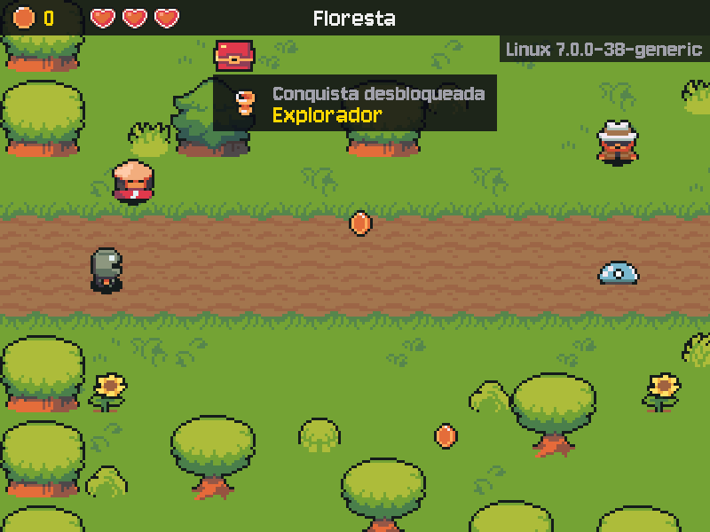

# MÓDULO 07B: Eventos — conquistas na tela e avisos no Discord

Engenheiro, o jogo já tem muita coisa acontecendo: o herói troca de cena, recebe a Chave, compra na loja, conversa. Hoje esses acontecimentos viram **eventos**: quem faz acontecer só anuncia o fato, e quem quer reagir se inscreve para ouvir. Com isso chegam as conquistas, um log de auditoria e, se você quiser, um aviso no celular pelo Discord, sem que o código da troca de cena saiba que nenhum deles existe. O conceito do dia é o que liga as partes de quase todo sistema grande: **publicar/assinar**.

## 🎯 O que você vai ver na tela ao final

Ao entrar na floresta pela primeira vez, um aviso aparece no alto da tela, com um troféu e um jingle: "Conquista desbloqueada: Explorador". Se você ligar o Discord, o celular recebe "Ada desbloqueou a conquista **Explorador** (floresta)." no mesmo instante, e o jogo não engasga.



## 🏢 Onde isso aparece no mercado

Uma loja virtual publica "pedido pago", e cada equipe assina o que lhe interessa: o estoque separa o produto, o financeiro emite a nota, o marketing manda o e-mail. Ninguém altera o código do pagamento para acrescentar uma reação nova. O mesmo padrão aparece em interfaces (cliques), em filas de mensagens (Kafka, RabbitMQ, Pub/Sub) e nos alertas que chegam ao celular da equipe de plantão por webhook.

## 🚦 Ponto de partida

- Seu projeto deve estar como no fim do M07A, com o desafio concluído e o PR mergeado.
- **Arquivos do curso:** traga a pasta deste módulo do seu clone do curso: `git -C ~/kernel-quest-curso pull` e `cp -r ~/kernel-quest-curso/arquivos/M07B ~/curso-arquivos/`.
- **Arquivos prontos deste módulo:** pasta `M07B/` dentro de `curso-arquivos/`, com:
  - `src/eventos.py`, os eventos prontos e o lugar do `EventBus`, que você escreve do zero;
  - `src/conquistas.py`, com um `TODO` (a regra do Explorador);
  - `src/discord.py`, o aviso no Discord, com dois `TODO`;
  - `src/auditoria.py` (o log de auditoria) e `src/paineis.py` (o aviso de conquista na tela), prontos;
  - `main.py`, com quatro `TODO` (onde as peças se ligam);
  - `tests/test_eventos.py`, `tests/test_conquistas.py` e `tests/test_discord.py`;
  - `requirements.txt` (o `httpx` fica explícito), `.env.example` (a linha do Discord) e os assets do troféu e do jingle.
- Entrega por Pull Request `modulo-07b`. Crie a branch a partir da `main` atualizada, na pasta do projeto e com a venv ativa:

```bash
cd ~/rpg-engine
source .venv/bin/activate
git switch main
git pull
git switch -c modulo-07b
```

- Duas sessões:
  - **Sessão A**, Passos 1 a 4: o `EventBus`, o jogo publicando a troca de cena e a conquista na tela.
  - **Sessão B**, Passos 5 a 7, o Quebre de propósito e o desafio: o Discord, o limite de requisições, a auditoria e uma conquista sua. Se passar de 90 minutos, faça o commit do Passo 7 e deixe o desafio para uma terceira sessão curta.
- **Assets:** o troféu e o jingle novos precisam de uma linha no seu `assets/CREDITOS.md` (Passo 4b).
- **Cota:** este módulo não muda nenhuma persona. Use a IA falsa (`IA_FALSA=1 ./run.sh`) o tempo todo.
- **Discord é opcional.** Sem ele, o jogo funciona igual (é um critério de aceite); com ele, você recebe os avisos no celular. A conta do Discord é sua; o curso não pede nenhuma.

> **Andaime:** o encanamento chega pronto (os eventos, a tela, a auditoria, o envio ao Discord e os testes); você escreve o `EventBus` do zero, completa três `TODO` e liga as peças no `main.py`.

## ❓ Pergunta do dia

Quem muda de cena precisa saber que existe uma conquista, um log e um Discord esperando por isso?

Ao longo dos passos aparecem caixas **🔍 Pare e pesquise**: pesquise as duas perguntas na hora, anote as respostas e, no fim, explique ao Engenheiro Sênior em até 5 minutos. **Sem mentor?** Grave um áudio de até 5 minutos explicando os termos e ouça de volta: onde você hesitar, o termo ainda não está claro.

## 🛠️ Passo a passo

### Passo 1 (Crie): o EventBus, do zero

Traga os arquivos do módulo (o `/.` copia o conteúdo da pasta; o `main.py`, o `paineis.py`, o `requirements.txt` e o `.env.example` substituem os seus, e o resto é novo):

```bash
cp -r ~/curso-arquivos/M07B/. .
git status
```

O `main.py` novo já importa o que este módulo usa do `config.py`. No fim do `src/config.py`, depois da linha do `DURACAO_ESCURECER`, acrescente o bloco:

```python

# Eventos (M07B)
DURACAO_AVISO = 3.0  # segundos que o aviso "Conquista desbloqueada" fica na tela
ARQUIVO_AUDITORIA = PASTA_PROJETO / "auditoria.log"  # um evento por linha (fora do Git)
# A URL do webhook é um segredo: quem tem a URL publica no seu canal. Vazia, sem Discord.
WEBHOOK_DISCORD = os.getenv("DISCORD_WEBHOOK_URL", "")
TIMEOUT_DISCORD = 10  # segundos: uma rede travada não prende a thread do Discord para sempre
TENTATIVAS_DISCORD = 3  # envios por aviso, contando os que voltam com 429
```

Abra o `src/eventos.py` e leia o desenho do topo. Os eventos são pequenas `dataclass`, uma por tipo de fato: `CenaAlterada(origem, destino)`, `NPCInteragido(npc, cena)`, `ItemRecebido(item, cena)` e `ConquistaDesbloqueada(id, nome, cena)`. O nome vem no passado porque o fato já aconteceu, e o `frozen=True` impede que alguém o altere depois de publicado.

Responda antes de escrever:

1. Num `EventBus`, quem chama `assinar`? E quem chama `publicar`?
2. Um assinante é uma função que recebe o quê?

No lugar das linhas de `TODO` do fim do arquivo, escreva a classe `EventBus`, com os três métodos que o `TODO` descreve. São de 8 a 12 linhas. Duas pistas: o dicionário `self.assinantes` guarda, para cada tipo de evento (a própria classe, como `CenaAlterada`), a lista de funções que o recebem; e `type(evento)` diz de que tipo é um evento. Rode os testes prontos, que são a especificação:

```bash
python -m pytest -q tests/test_eventos.py -k "not jogo"
```

Os 5 testes passam quando o seu `EventBus` entrega cada evento só a quem assinou o tipo dele, na ordem, e não reclama quando ninguém assinou. O sexto (`-k jogo`) é do Passo 2.

> 🔍 **Pare e pesquise: publicar/assinar (padrão Observer, EventBus)** — Qual é a diferença entre chamar uma função diretamente e publicar um evento que ela assina? O que se ganha (e o que fica mais difícil de seguir) quando quem publica não sabe quem assina?

### Passo 2 (Modifique): o Jogo publica a troca de cena

O Model passa a anunciar o que acontece. No `src/models.py`, logo depois do `)` que fecha o `from src.config import (...)`:

```python
from src.eventos import CenaAlterada, EventBus, ItemRecebido
```

No `Jogo`, troque as duas primeiras linhas do `__init__` (a do `def` e a do `self.cenas`) por estas:

```python
    def __init__(self, cenas, eventos=None):
        self.cenas = cenas
        # Onde o Model publica o que aconteceu; sem EventBus, um vazio (ninguém assina).
        self.eventos = eventos or EventBus()
```

No `atualizar_transicao`, logo depois da linha `self.indo_para = None` (a que vem depois do `posicionar_heroi(origem)`, com o mesmo recuo):

```python
                # O fato vai para o EventBus: o Jogo não sabe quem reage a ele.
                self.eventos.publicar(CenaAlterada(origem, self.cena.mapa))
```

O renascer também muda o herói de cena. Troque o corpo do `renascer` (as quatro linhas depois da docstring) por:

```python
        origem = self.cena.mapa
        self.cena = self.cenas["salao"]
        self.posicionar_heroi("inicio")
        self.heroi.vida = VIDA_MAXIMA
        logger.info("Vida zerada: de volta ao salão")
        self.eventos.publicar(CenaAlterada(origem, "salao"))
```

Agora o `main.py` cria o `EventBus` e o entrega ao Jogo, como já faz com a Tela e a IA (injeção de dependências). Troque a linha do `TODO (Passo 2)` por estas:

```python
    eventos = EventBus()  # o quadro de avisos: quem publica não conhece quem assina
    jogo = Jogo(carregar_cenas(), eventos)  # Model
```

Rode `python -m pytest -q tests/test_eventos.py`: os 6 passam. Rode `IA_FALSA=1 ./run.sh` e vá até a floresta: nada mudou na tela. O evento foi publicado, mas ninguém assinou ainda.

### Passo 3 (Complete): a regra do Explorador

Abra o `src/conquistas.py`. A classe `Conquistas` é um assinante: no `__init__`, ela pede ao `EventBus` os eventos `CenaAlterada` e `ItemRecebido`. O `desbloquear` marca a conquista uma vez só e publica `ConquistaDesbloqueada`, que outros assinantes vão ouvir (as conquistas assinam e também publicam). O "Portador da Chave" vem pronto, de exemplo.

Leia o `item_recebido` e complete o `TODO` do `cena_alterada`, no lugar dos comentários: se o destino do evento é a floresta, desbloqueie `"explorador"`, com o destino como cena. São duas linhas. Rode os testes das conquistas:

```bash
python -m pytest -q tests/test_conquistas.py
```

Os 4 passam.

### Passo 4a (Modifique): a View prepara o aviso

O aviso "Conquista desbloqueada" chega pronto no `src/paineis.py` (a função `desenhar_avisos`, que também faz o aviso sumir aos poucos). A `Tela` guarda os avisos e toca o jingle. No `src/views.py`, acrescente `DURACAO_AVISO` ao `from src.config import`, no fim da última linha de nomes:

```python
    TEMPO_QUADRO_MOEDA, VIDA_MAXIMA, VOLUME_VOZ, DURACAO_AVISO,
```

Troque a linha `from src.paineis import ...` por:

```python
from src.paineis import (
    desenhar_avisos, desenhar_balao, desenhar_pensando, desenhar_portao, desenhar_receber,
)
```

No `__init__` da `Tela`, troque a linha `"dano": carregar_som("dano.wav"),` e a `}` que fecha o dicionário de sons por estas:

```python
            "dano": carregar_som("dano.wav"),
            "conquista": carregar_som("conquista.wav"),
        }
        self.avisos = []  # [nome da conquista, segundos que faltam]: o desenhar_avisos() mostra
```

Rode `IA_FALSA=1 ./run.sh`: o jogo abre como antes. É só para conferir que nada quebrou.

### Passo 4b (Modifique): o assinante da tela

Falta o assinante que transforma a conquista em aviso. Na `Tela`, logo antes do `def novo_dialogo`:

```python
    def mostrar_conquista(self, evento):
        """Assinante de ConquistaDesbloqueada: o aviso no topo da tela e o jingle."""
        self.avisos.append([evento.nome, DURACAO_AVISO])
        self.tocar("conquista")

```

No fim do `desenhar`, logo depois das duas linhas da `escuridao` (com o recuo do `if jogo.escuro:`, e não dentro dele):

```python
        desenhar_avisos(self, self.avisos, dt)  # por cima até da transição: chegam no escuro
```

E a ligação, no `main.py`. Troque a linha do `TODO (Passo 4)` por estas:

```python
    Conquistas(eventos)
    eventos.assinar(ConquistaDesbloqueada, tela.mostrar_conquista)
```

O troféu e o jingle são do pacote, como o resto da arte. Acrescente esta linha ao fim do seu `assets/CREDITOS.md` (não substitua o arquivo: ele tem as suas linhas):

```markdown
| interface/trofeu.png, sons/conquista.wav | Pixel-boy e AAA (pacote Ninja Adventure) | https://pixel-boy.itch.io/ninja-adventure-asset-pack | CC0 | Renomeado (GoldCup, Success2) |
```

**Preveja:** o `CenaAlterada` é publicado com a tela toda preta, no meio da transição. Quando o aviso aparece: no preto, ou só quando a floresta clareia?

Rode `IA_FALSA=1 ./run.sh`, saia do salão pela porta leste e veja: "Conquista desbloqueada / Explorador", com o jingle, já no escuro. Volte ao salão e entre de novo na floresta: nada (uma vez só).

Repare no que você **não** mexeu: o `atualizar_transicao` do Passo 2 continua sem saber que existem conquistas, avisos ou jingles.

Commit:

```bash
git add .
git commit -m "feat: EventBus e a conquista Explorador na tela"
```

> ⏸️ **Fim da Sessão A.** Commit feito, a primeira conquista aparece. Pare aqui e continue na próxima sessão, no Passo 5.

### Passo 5 (Leia e Complete): o Discord, um assinante que fala HTTP

O `httpx` já veio com o `google-genai`; o `requirements.txt` novo só o deixa explícito. Confira:

```bash
pip install -r requirements.txt
```

Até hoje, quem falava com a rede era o SDK do Gemini, que esconde os detalhes. Agora o jogo faz uma requisição **HTTP** direto. Uma requisição tem:

- **método**: o verbo. `GET` pede algo; `POST` manda algo. Aqui, `POST`;
- **URL**: o endereço. Um **webhook de entrada** é uma URL que o Discord cria para um canal: quem faz um `POST` nela publica no canal;
- **corpo**: o que vai junto, aqui em JSON: `{"content": "texto da mensagem"}`;
- **código de status**: a resposta, em número. `2xx` deu certo (o webhook devolve `204`, "aceito, sem nada a dizer"); `4xx` o erro foi do pedido (`404`: URL errada; `429`: devagar, você mandou demais); `5xx` o erro foi do servidor.

Abra o `src/discord.py` e leia de cima para baixo. A `NotificacaoDiscord` assina `ConquistaDesbloqueada` e `ItemRecebido`, mas os assinantes (`conquista` e `item`) só põem o texto numa fila: a rede demora, como a IA do M07A, e o assinante roda na thread do jogo. Quem espera o Discord é uma thread só dela, a do `trabalhar()`. Responda:

1. Em que thread roda o `conquista()`? E o `enviar()`?
2. O que vai para o Discord, e o que nunca vai (compare com o que o jogador digita na conversa)?
3. Por que o arquivo põe o log do `httpx` em `WARNING`? Pista: o que o `httpx` escreveria no log a cada requisição, e o que tem dentro da URL do webhook?

Complete o `TODO` do `__init__`, no lugar dos comentários: sem URL (o texto vazio que o `config.py` devolve quando a linha não está no `.env`), registre no log, com `logger.info`, que o Discord está desligado, e saia do `__init__` com `return`, antes de assinar qualquer evento. Rode o teste:

```bash
python -m pytest -q tests/test_discord.py -k sem_url
```

Passa: sem URL, a `NotificacaoDiscord` nem assina, e o jogo segue.

> 🔍 **Pare e pesquise: webhook de entrada (HTTP, POST com corpo JSON)** — O que acontece, passo a passo, num `POST` para uma URL: o que vai e o que volta? Qual é a diferença entre um webhook de entrada (nós chamamos o serviço) e um webhook que nós recebemos (o serviço nos chama)?

### Passo 6 (Complete): o limite de requisições

Um serviço que recebe pedidos de milhões de clientes limita quantos cada um pode fazer. Passou do limite, a resposta é `429 Too Many Requests`, com um cabeçalho `Retry-After` que diz quantos segundos esperar. Quem insiste sem esperar continua levando 429 (e pode ser bloqueado).

Leia o `enviar()`: o `for` tenta até `TENTATIVAS_DISCORD` vezes, e um erro de rede (sem internet, nome que não existe, timeout) vira um aviso no log, nunca um erro que derruba o jogo. Complete o `TODO`, no lugar dos comentários: com `resposta.status_code == 429`, leia os segundos do cabeçalho (`resposta.headers.get("Retry-After", 1)`, convertido com `float`), registre no log com `logger.warning`, durma esse tempo com `time.sleep` e passe à próxima tentativa com `continue`. São 5 linhas. Rode os testes do Discord:

```bash
python -m pytest -q tests/test_discord.py
```

Os 6 passam, sem rede: os testes usam um Discord falso (`httpx.MockTransport`), que responde o que o teste mandar, como o serviço falso da IA.

**O Discord de verdade (opcional).** No Discord, num servidor seu: Configurações do servidor, Integrações, Webhooks, Novo webhook; escolha o canal e use "Copiar URL do webhook". No seu `.env` (nunca no código: quem tem a URL publica no seu canal), acrescente a linha, com a URL que você copiou no lugar dos `...`:

```text
DISCORD_WEBHOOK_URL=https://discord.com/api/webhooks/...
```

Sem Discord, pule o `.env`: o jogo segue sem ele.

A ligação, no `main.py`. Troque a linha do `TODO (Passo 6)` por esta:

```python
    NotificacaoDiscord(eventos, WEBHOOK_DISCORD)  # sem a URL no .env, fica desligado
```

Rode `IA_FALSA=1 ./run.sh` e vá até a floresta. Com a URL: o celular recebe a conquista, e o terminal mostra `src.discord: Discord: aviso entregue (204)`, sem a URL. Sem a URL: o terminal mostra `Discord desligado`, e o jogo segue igual. Nos dois casos, o aviso na tela é o mesmo.

> 🔍 **Pare e pesquise: limite de requisições (429 e `Retry-After`)** — Por que um serviço limita o número de requisições por cliente? O que é *backoff* e por que tentar de novo na hora, sem esperar, piora o problema?

### Passo 7 (Modifique): a auditoria e os outros eventos

O `src/auditoria.py` chega pronto: ele assina os quatro tipos de evento e grava cada um numa linha JSON do `auditoria.log`. No `main.py`, troque a linha do `TODO (Passo 7)` por esta:

```python
    Auditoria(eventos, ARQUIVO_AUDITORIA)  # a primeira: grava o fato antes das reações a ele
```

Faltam dois eventos. No `src/models.py`, o herói recebe item em dois lugares. No `comprar`, logo depois da linha `logger.info("Compra: ...")`:

```python
        self.eventos.publicar(ItemRecebido(item.nome, self.cena.mapa))
```

No `receber`, logo depois da linha `logger.info("Recebido: ...")`, com o recuo dela:

```python
            self.eventos.publicar(ItemRecebido(self.oferta.nome, self.cena.mapa))
```

E a conversa. No `src/controllers.py`, logo antes da linha `from src.resposta import EMOCOES`:

```python
from src.eventos import NPCInteragido
```

No `tratar_evento`, troque a linha `self.servico_ia.pedir(perto, f"O aprendiz ...")` (a do ESPAÇO) por estas:

```python
                fala = f"O aprendiz {NOME} se aproxima e cumprimenta você."
                if self.servico_ia.pedir(perto, fala):  # False: esse NPC ainda está pensando
                    jogo.eventos.publicar(NPCInteragido(perto.nome, jogo.cena.mapa))
```

Rode `IA_FALSA=1 ./run.sh`: fale com o Mago, aperte Tab (Missão), receba a Chave com ENTER e feche o jogo. O aviso "Portador da Chave" aparece, e, com o Discord ligado, chegam o item e a conquista. Leia o log:

```bash
cat auditoria.log
```

Uma linha por evento, nesta ordem: `NPCInteragido`, `ItemRecebido`, `ConquistaDesbloqueada`. A conquista vem depois do fato que a causou porque a `Auditoria` foi a primeira a assinar: o `publicar` entrega na ordem de assinatura, e a `ConquistaDesbloqueada` é publicada de dentro da entrega do `ItemRecebido`. Se as `Conquistas` assinassem antes, a conquista apareceria no log antes do item. Nenhuma linha tem o texto da conversa.

O `auditoria.log` é da sua máquina, não do repositório. No `.gitignore`, logo depois das linhas dos prints da verificação:

```text

# Log de auditoria do jogo (M07B): cada máquina tem o seu.
auditoria.log
```

`git status` não mostra mais o arquivo. Rode `python -m pytest -q`: todos passam.

Commit e push:

```bash
git add .
git commit -m "feat: auditoria, aviso no Discord e eventos de item e conversa"
git push -u origin modulo-07b
```

## 💥 Quebre de propósito

O jeito "rápido" de mandar o aviso seria chamar o Discord direto, no lugar em que a cena troca. No `src/controllers.py`, no `atualizar`, logo depois da linha `self.tela.tocar_musica(jogo.cena.mapa)  # cada mapa tem a música de mesmo nome`, com o mesmo recuo, acrescente esta linha provisória (ela manda o pedido a um site de exemplo, não ao seu Discord):

```python
            import httpx; httpx.post("https://example.com", json={"content": "trocou de cena"}, timeout=10)
```

**Preveja:** com o F3 ligado, o que acontece com o pior quadro a cada troca de cena? E sem internet, ou com a rede lenta?

Rode `IA_FALSA=1 ./run.sh`, aperte F3 e vá do salão à floresta. Nos testes do curso, o pior quadro saltou de **38 ms para 286 ms** (o seu número varia com a máquina e a rede; anote o seu para o PR): a tela fica parada esse tempo todo, e, com uma rede ruim, ficaria até os 10 segundos do timeout. Pior: o código da troca de cena passa a conhecer o Discord, e cada reação nova seria mais uma linha ali. Apague a linha. No assinante, a mesma chamada roda na thread do Discord, e quem publica nem sabe que ela existe.

## 🧯 Problemas comuns

| Sintoma | Causa provável | Como resolver |
| --- | --- | --- |
| `ImportError: cannot import name 'EventBus'` (ou `'ARQUIVO_AUDITORIA'`) | O `EventBus` do Passo 1 não foi escrito, ou o bloco do `config.py` não entrou | Passo 1 |
| `TypeError: Jogo.__init__() takes 2 positional arguments` | O `__init__` do Jogo ainda não recebe `eventos` | Passo 2 |
| Nenhum aviso ao entrar na floresta | Falta o `Conquistas(eventos)` ou o `assinar` da tela no `main.py`, ou o `TODO` do Explorador | Passos 3 e 4b |
| O aviso (ou o Discord) aparece duas vezes | Um assinante registrado duas vezes (um `Conquistas(eventos)` repetido no `main.py`) | Um `assinar` por assinante |
| `Discord desligado` mesmo com a linha no `.env` | Nome da variável diferente de `DISCORD_WEBHOOK_URL`, ou a linha começa com `#` | Confira o `.env` |
| `Discord recusou o aviso: 404` (ou `401`) | URL do webhook errada, incompleta ou de um webhook apagado | Copie a URL de novo |
| `Discord: 429, nova tentativa em ...` | Muitos avisos em pouco tempo | É o tratamento funcionando: o aviso sai depois da espera |
| `Discord fora de alcance: ConnectError` | Sem internet | O jogo segue; o aviso se perde (ver "Vá além" do desafio) |
| `auditoria.log` aparece no `git status` | Falta a linha no `.gitignore` | Fim do Passo 7 |
| O celular recebe avisos enquanto você só testa | Com a URL no `.env`, todo jogo aberto (inclusive o `ferramentas/verificar.py`) manda os avisos | Para testar sem Discord: `DISCORD_WEBHOOK_URL= ./run.sh` (a variável vazia vale mais que o `.env`) |

## 🧩 Desafio de Engenharia

1. **Uma conquista sua (Crie).** "Visitou as 3 cenas": quem pisou no salão, na floresta e na entrada da masmorra ganha a conquista (o nome e o identificador são seus). Ela entra só pelas conquistas: um método novo que assina `CenaAlterada` e uma linha em `CONQUISTAS`. Quem publica (`models.py`, `controllers.py`) não muda nenhuma linha. Atenção: o herói começa no salão sem nenhum evento.
2. **O teste (Crie).** Em `tests/test_conquistas.py`, sem rede e sem janela: publique as trocas de cena num `EventBus` e confira que a conquista sai na terceira cena, e uma vez só. Faça o desafio num commit só seu, depois do commit do Passo 7.
3. **O aviso no celular.** Com o Discord ligado, a conquista nova chega sozinha. Repare: você não mexeu no `discord.py`.

**Critérios de aceite:**

- [ ] A conquista "Visitou as 3 cenas" aparece na tela (e no Discord, se ligado) só com código novo nas conquistas: `git show --stat` do commit do desafio lista só `src/conquistas.py` e `tests/test_conquistas.py`, nunca `models.py` nem `controllers.py`.
- [ ] `python -m pytest -q` passa, com o seu teste da conquista nova em `tests/test_conquistas.py`, sem rede.
- [ ] O jogo funciona normalmente sem a `DISCORD_WEBHOOK_URL` no `.env` (o log diz `Discord desligado`).
- [ ] Os testes prontos do `EventBus`, das conquistas e do Discord passam.
- [ ] **Nomes que os próximos módulos usam:**
  - em `src/eventos.py`, o `EventBus` com `assinar(tipo, funcao)` e `publicar(evento)`, e os eventos `CenaAlterada`, `NPCInteragido`, `ItemRecebido` e `ConquistaDesbloqueada` (com `id`, `nome` e `cena`);
  - o `Jogo(cenas, eventos)` com o atributo `eventos`;
  - em `src/conquistas.py`, `CONQUISTAS` (identificador → nome) e a lista `Conquistas.obtidas` com os identificadores (`"explorador"`, `"portador_da_chave"` e o da sua): o M08A salva essa lista;
  - a variável `DISCORD_WEBHOOK_URL` no `.env` (o M11B a reaproveita no servidor).
- [ ] Você explica ao Engenheiro Sênior, sem ler e em até 5 minutos, os três termos das caixas 🔍 (publicar/assinar, webhook de entrada, limite de requisições). **Sem mentor?** Grave a explicação em áudio e ouça de volta.

**Vá além (opcional, fora dos critérios):** um aviso que falha por falta de rede se perde. Como você guardaria os avisos não entregues para mandar quando a rede voltar? E se um assinante der erro (uma exceção), o que acontece com os assinantes seguintes e com o jogo? Teste com um assinante que faz `1 / 0`.

Lembre as regras de uso de IA do M00B: pode pedir explicação de conceito e de erro, não pode pedir a solução pronta, e deve dizer na descrição do PR cada trecho que veio de uma IA, sabendo explicá-lo.

**Entrega:** Pull Request `modulo-07b` para a `main` (`gh pr create --body-file`), com a descrição (o que muda, como testar, os números do F3 no Quebre de propósito, o que veio de IA). Nunca cole a URL do webhook no PR. Merge só com o CI verde e a aprovação. **Sem mentor?** Review de um colega do curso ou autorrevisão no dia seguinte, como no M03C.

## 💼 Resumo profissional

- **Conceito:** arquitetura orientada a eventos com publicar/assinar (EventBus, padrão Observer), desacoplamento entre quem produz e quem reage, HTTP direto (método, URL, corpo JSON, códigos de status), webhook de entrada, limite de requisições (429 com `Retry-After`), segredo fora do código e do log, log de auditoria em JSON Lines, testes de HTTP sem rede (`httpx.MockTransport`).
- **Linha para o currículo:** "Implementei um EventBus num jogo em Python que desacopla as regras do jogo de conquistas, log de auditoria e notificações por webhook no Discord, com envio em thread, tratamento de 429 e testes sem rede."
